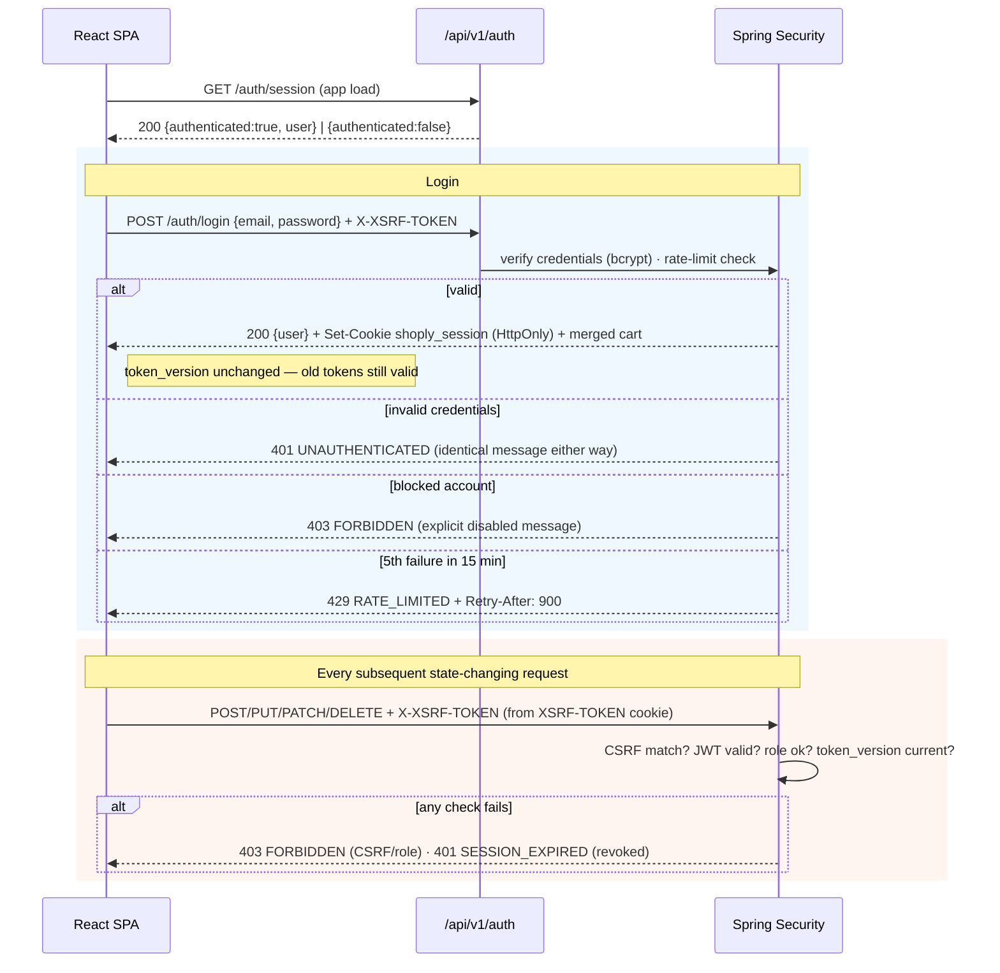
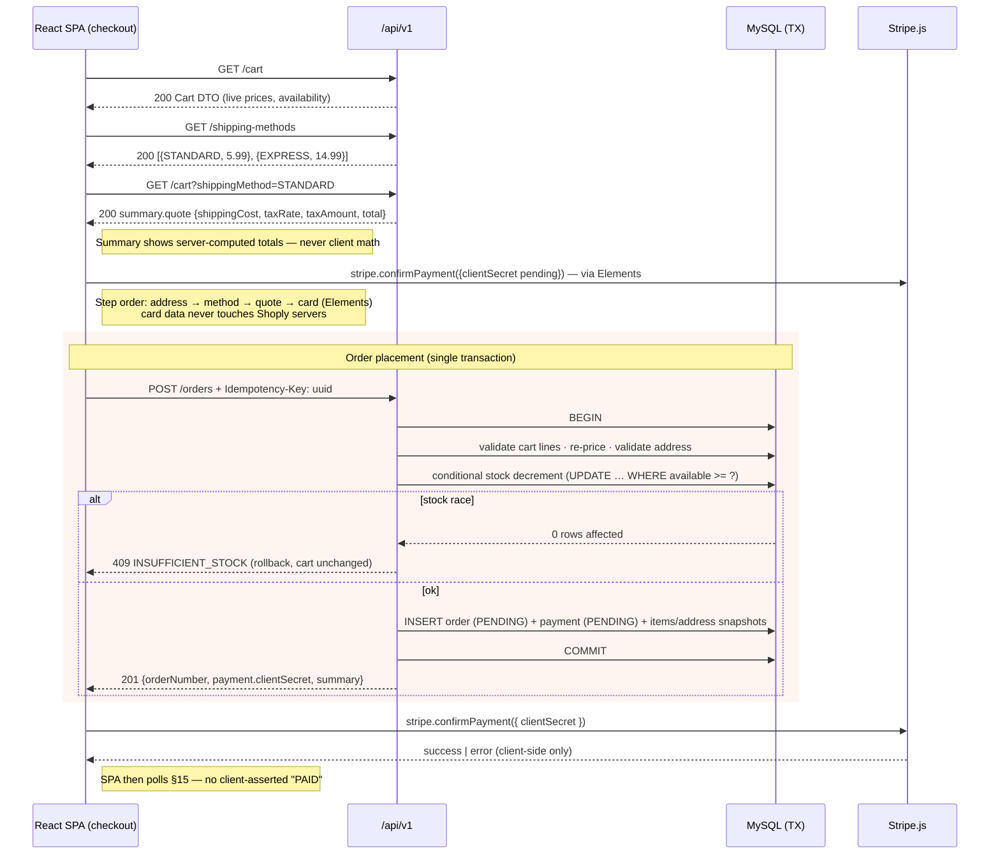
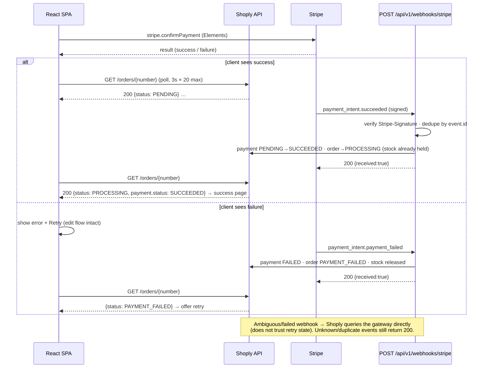

# Shoply — REST API Documentation

| Field | Value |
|---|---|
| **Project name** | Shoply |
| **Document type** | REST API Specification |
| **Version** | 1.0 |
| **Date** | 2026-11-04 |
| **Status** | 🟡 Draft — Awaiting stakeholder approval |
| **Author** | Senior Backend Architect / API Design Engineer |
| **Sources of truth** | `docs/PROJECT_PLANNING.md` · `docs/SRS.md` · `docs/USER_FLOWS.md` · `docs/UI_UX_DESIGN_SPEC.md` · `docs/SYSTEM_ARCHITECTURE.md` · `docs/DATABASE_DESIGN.md` (all approved) |
| **Stack** | React JS · Spring Boot · Java · MySQL · Hibernate/JPA · Spring Security |
| **Scope** | All V1 endpoints required by the approved SRS; deferred features documented as *absent by design* |
| **Code status** | ❌ No application code · ❌ No OpenAPI file generated yet |

---

## Document Control

| Version | Date | Change |
|---|---|---|
| 1.0 | 2026-11-04 | Initial API specification: conventions, 40+ endpoints across 18 groups, 3 flows, OpenAPI plan |

**Rules governing this document:**

1. Every endpoint traces to an approved `FR-*` requirement. **No endpoint exists that the SRS does not require**, and deferred features (wishlist, reviews, coupons, email) are documented as *deliberately absent* — no placeholder routes (UX-DEC-13).
2. Shapes are consistent with `SYSTEM_ARCHITECTURE.md` (§6–§8) and `DATABASE_DESIGN.md` (tables, constraints, snapshots).
3. No application code and no generated OpenAPI file — this is the contract those artifacts will implement.
4. Open choices are logged in [§17 APIDEC](#17-unresolved-api-decisions-apidec) with a position taken — nothing is silently decided.

---

## Table of Contents

1. [API Architecture](#1-api-architecture)
2. [API Versioning](#2-api-versioning)
3. [Naming Conventions](#3-naming-conventions)
4. [Authentication Requirements](#4-authentication-requirements)
5. [Authorization Requirements](#5-authorization-requirements)
6. [HTTP Status Codes](#6-http-status-codes)
7. [Request and Response Conventions](#7-request-and-response-conventions)
8. [Error Response Format](#8-error-response-format)
9. [Pagination](#9-pagination)
10. [Filtering](#10-filtering)
11. [Sorting](#11-sorting)
12. [Endpoint Reference](#12-endpoint-reference)
    - 12.1 [Authentication](#121-authentication)
    - 12.2 [Users](#122-users)
    - 12.3 [Addresses](#123-addresses)
    - 12.4 [Products](#124-products)
    - 12.5 [Categories](#125-categories)
    - 12.6 [Product Search](#126-product-search)
    - 12.7 [Cart](#127-cart)
    - 12.8 [Wishlist](#128-wishlist--absent-by-design)
    - 12.9 [Orders](#129-orders)
    - 12.10 [Payments](#1210-payments)
    - 12.11 [Coupons](#1211-coupons--absent-by-design)
    - 12.12 [Reviews](#1212-reviews--absent-by-design)
    - 12.13 [Notifications](#1213-notifications--derived-no-dedicated-endpoints)
    - 12.14 [Admin Dashboard](#1214-admin-dashboard)
    - 12.15 [Admin Product Management](#1215-admin-product-management)
    - 12.16 [Admin Inventory Management](#1216-admin-inventory-management)
    - 12.17 [Admin Order Management](#1217-admin-order-management)
    - 12.18 [Admin Customer Management](#1218-admin-customer-management)
13. [Authentication Flow](#13-authentication-flow)
14. [Checkout API Flow](#14-checkout-api-flow)
15. [Payment Verification Flow](#15-payment-verification-flow)
16. [OpenAPI / Swagger Integration Recommendations](#16-openapi--swagger-integration-recommendations)
17. [Unresolved API Decisions (APIDEC)](#17-unresolved-api-decisions-apidec)
18. [Summary & Approval](#18-summary--approval)

---

## 1. API Architecture

### 1.1 Style and shape

| Aspect | Decision | Source |
|---|---|---|
| Style | **REST** over HTTP/1.1, JSON request/response bodies | Plan §6 (GraphQL rejected) |
| Base path | `/api/v1` — all business endpoints | ARCH §7.1 |
| Transport | HTTPS only in deployed environments; HTTP redirects to HTTPS | SEC-01 |
| Consumers | One React SPA — storefront routes **and** `/admin/**` routes from the same bundle | ARCH §3 |
| Auth model | Stateless JWT in httpOnly cookie + CSRF double-submit; server is the authority for every rule | ARCH §8, SEC-03/04 |
| Server posture | **Server-authoritative**: prices, stock, totals, roles, and state transitions are recomputed server-side; client input is never trusted (FR-AUTH-07b) | SRS §5.3 |
| Coupling | Endpoints return **DTOs only** — never entities, never framework types (Spring `Page` is mapped to the flat list envelope, AR-DEC-10) | ARCH §4.3 |

### 1.2 Request pipeline (every request)

```text
TLS → Security filter chain (CSRF check · session/JWT parse · role rules)
    → Request-ID filter (X-Request-Id, MDC) → rate-limit filter (auth endpoints)
    → Controller (@Valid DTO binding) → Service (@Transactional, business rules, ownership scoping)
    → Repository (JPQL) → DTO mapping → JSON response (+ X-Request-Id header)
```

Failures at any stage funnel into the single error handler producing the uniform envelope (§8). Cross-cutting behavior (requestId, CSRF, rate limits, errors) is defined once in §7–§8 and never repeated per endpoint.

### 1.3 Surface map

| Surface | Path prefix | Audience | Auth |
|---|---|---|---|
| Storefront (public) | `/api/v1/**` (catalog, cart, checkout) | Guests + customers | Cookie session for account scope; guest cookie for cart |
| Account | `/api/v1/me/**`, `/api/v1/orders/**` | CUSTOMER (staff may view own) | Session required |
| Admin | `/api/v1/admin/**` | STAFF / ADMIN | Separate admin login (FR-AUTH-13); CUSTOMER token ⇒ `403` on the entire prefix |
| Webhook | `/api/v1/webhooks/stripe` | Stripe | `Stripe-Signature` header — no cookie, no CSRF (SEC-13) |
| Platform | `/api/v1/health` | Infra/CI | Public (FR-GEN-06) |

### 1.4 Endpoint inventory (V1)

| Group | Endpoints | Notes |
|---|---|---|
| Authentication | 5 | incl. separate admin login (FR-AUTH-13) |
| Users | 3 | profile + password change |
| Addresses | 5 | CRUD + default flag |
| Products | 2 (+ home composition) | public reads |
| Categories | 1 | navigation with counts |
| Product search | *(documented behavior of `GET /products`)* | APIDEC-13 |
| Cart | 5 | server-authoritative |
| Wishlist | **0** | deferred V1.5 (SRS §18) |
| Orders (incl. checkout) | 5 | incl. `GET /shipping-methods` |
| Payments | 1 | webhook; confirmation is client-side + polling |
| Coupons | **0** | excluded from V1 (SRS §3/§31 backlog) |
| Reviews | **0** | deferred V1.5 (SRS §17) |
| Notifications | **0 dedicated** | derived from orders/dashboard (§12.13) |
| Admin dashboard | 1 | single aggregation (AR-DEC-11) |
| Admin products *(incl. categories)* | 13 | products, variants, images, categories |
| Admin inventory | 2 | console + adjustments |
| Admin orders | 4 | list, detail, transition, refund |
| Admin customers | 3 | list, detail, block/role |
| Platform | 1 | `GET /health` |
| **Total** | **~44** | every one mapped to an `FR-*` in §12 |

### 1.5 Deliberate architectural exclusions

- **No GraphQL / no BFF** (plan §6), **no server-side sessions** (JWT + `tokenVersion`, ARCH §8.1).
- **No long-polling/SSE/websocket** — payment confirmation uses client polling of `GET /orders/{number}` (§15), which matches the webhook-authoritative model and free-tier hosting.
- **No generic `POST /actions`** — actions are named sub-resources (§3.4).

---

## 2. API Versioning

| Rule | Detail |
|---|---|
| Mechanism | **URL path versioning only**: `/api/v1/...` (ARCH §7.1) — the single mechanism in V1 |
| What lives inside v1 | Additive changes only: new optional query params, new optional response fields, new endpoints |
| What triggers `/v2` | Removing/renaming a field, changing a field's type or semantics, changing an error code for an existing condition, changing auth semantics |
| Response header | `X-API-Version: 1` on every response (informational; lets the SPA assert it talks to a known contract) |
| Deprecation policy | A field/endpoint slated for removal is marked `deprecated: true` in the response/OpenAPI for ≥ 1 release before a version bump; no removals are planned for V1 |
| Errors are versioned too | The error envelope shape (§8) is part of the v1 contract |
| Not used | Header versioning, query-param versioning, media-type versioning — one clear mechanism |

---

## 3. Naming Conventions

### 3.1 URLs

| Rule | Example |
|---|---|
| Lowercase, **plural** nouns, `kebab-case` where needed | `/api/v1/order-items` never appears publicly — use `/orders/{number}/…` |
| Nouns describe resources; **verbs live in the HTTP method** | `GET /products`, not `/getProducts` or `/products/list` |
| Nested resources for ownership | `/me/addresses/{id}`, `/admin/products/{id}/variants/{variantId}` |
| **Actions** = single-segment sub-resource + POST, verb allowed *in the action name* | `POST /orders/{number}/cancel`, `POST /admin/orders/{number}/status`, `POST /admin/orders/{number}/refund`, `POST /me/addresses/{id}/default` |
| Identifiers | **Public** resources use slugs (`/products/slim-oolong-shirt`, FR-GEN-07); **orders** use the human-readable `order_number` in paths; **admin** resources use numeric ids (internal surface) |
| No IDs in storefront URLs | Frontend routes mirror the same rule; the API never requires a raw product/category id from a guest |
| Trailing slashes | None; requests with a trailing slash are normalized (301) rather than 404 |
| Case sensitivity | Paths are lowercase; path params are opaque strings |

### 3.2 Query parameters

- `camelCase` and stable across endpoints: `page`, `size`, `sort`, `minPrice`, `maxPrice`, `dateFrom`, `dateTo`, `shippingMethod`.
- Filters mirror the **URL state** the SPA writes (FR-GEN-05): the query string *is* the canonical filter representation.

### 3.3 JSON bodies

- `camelCase` keys (Jackson default), no snake_case, no prefixed namespaces.
- Request bodies contain **only client-settable fields** (whitelist binding, SEC-06): never `role`, `userId`, `price`, `stock`, `total`, `status` (except where an endpoint explicitly *is* a status action, §12.17).
- Response DTOs are stable, flat, and free of framework types.

### 3.4 Method semantics

| Method | Success | Body | Use |
|---|---|---|---|
| `GET` | 200 | resource or list envelope | reads — always safe, cacheable per query |
| `POST` (collection) | 201 (or 200 on upsert/replay) | created resource | create **or** idempotent upsert where documented |
| `POST` (action) | 200 | affected resource | state transitions (`/cancel`, `/status`, `/refund`, `/default`) |
| `PATCH` | 200 | updated resource | partial field update |
| `PUT` | 200 | updated resource | full update of a sub-resource (password, default flag) |
| `DELETE` | 200 or 204 | updated parent **or** none | removal — documented per endpoint; cart mutations return the cart (§12.7) |

Idempotency: `GET`/`PUT`/`DELETE` are naturally idempotent; `POST /orders` is idempotent via the `Idempotency-Key` header (§12.9); action `POST`s are guarded by state-machine preconditions (a repeat yields `409`, never a double effect).

---

## 4. Authentication Requirements

### 4.1 Mechanisms (SEC-03, ARCH §8)

| Element | Specification |
|---|---|
| Session credential | JWT (HS256) in cookie **`shoply_session`**: `HttpOnly; SameSite=Lax; Secure` (prod); 7-day sliding expiry (DEC-18) |
| Where tokens live | **Never** in `localStorage`/JS-readable storage (SEC-03) |
| CSRF | Double-submit: non-HttpOnly cookie `XSRF-TOKEN` → request header **`X-XSRF-TOKEN`** on every `POST/PUT/PATCH/DELETE`; mismatch ⇒ `403 FORBIDDEN` (SEC-04) |
| Guest identity | Opaque cookie **`shoply_guest`** (~30 days) binds the cart only — *not* an authentication credential (FR-AUTH-09) |
| Revocation | `users.token_version` bump invalidates all outstanding tokens immediately — password change (FR-AUTH-05), role/status change (FR-AUTH-12), admin block (FR-AUTH-10), logout (FR-AUTH-14) |
| Credentials | Email + password; server-side generic failure message (SEC-07); bcrypt/argon2 hashes server-side only (SEC-02) |

### 4.2 Endpoints and behaviors

| Behavior | Requirement |
|---|---|
| Registration | `POST /auth/register` — creates CUSTOMER, sets cookie, **merges guest cart** (FR-CART-08) and **links guest orders matching the email** (FR-CUS-07) server-side |
| Storefront login | `POST /auth/login` — sets cookie; same merge/link behavior; generic `401` for unknown email *or* wrong password (SEC-07) |
| **Admin login** | `POST /auth/admin/login` — **separate route**, same credential store; CUSTOMER credentials ⇒ `403 FORBIDDEN` (FR-AUTH-13) |
| Session restore | `GET /auth/session` on app load — `200 {authenticated, user}` for everyone (guests get `authenticated:false`, not a 401) (FR-AUTH-04.3) |
| Logout | `POST /auth/logout` — server-side invalidation + cookie clear + **guest cookie rotated** (FR-AUTH-14) |
| Password change | `PUT /me/password` — requires current password; invalidates **other** sessions (token_version bump, FR-AUTH-05) |
| Rate limiting | Login, register, password-change: **5 failures / 15 min per email+IP ⇒ `429 RATE_LIMITED` + `Retry-After: 900`** (FR-AUTH-08, DEC-19c); success resets the counter |
| Blocked accounts | Cannot authenticate (`403 FORBIDDEN` with the explicit disabled message, DEC-19b); an existing session may **read** but every **mutating** request fails `403` (FR-AUTH-10) |
| Session expiry | Any request with an invalid/expired token ⇒ `401 UNAUTHENTICATED` / `401 SESSION_EXPIRED`; SPA redirects preserving destination (ERR-14) |

### 4.3 Request headers (canonical)

```http
Cookie: shoply_session=<jwt>; XSRF-TOKEN=<token>; shoply_guest=<opaque>
X-XSRF-TOKEN: <token>            # required on all state-changing methods
Content-Type: application/json   # application/json or multipart/form-data for image upload
Idempotency-Key: <uuid>          # required only on POST /orders
X-Request-Id: <uuid>             # optional client echo; server always returns one
```

---

## 5. Authorization Requirements

### 5.1 Roles

`GUEST` (anonymous — not persisted) · `CUSTOMER` · `STAFF` · `ADMIN` (SRS §5.1). Enforcement is **at the API layer on every request** — hiding UI is not authorization (FR-AUTH-07, FR-AUTH-31).

### 5.2 Permission matrix (SRS §5.2 → endpoints)

| Capability | GUEST | CUSTOMER | STAFF | ADMIN | Endpoints |
|---|---|---|---|---|---|
| Browse catalog, search, PDP | ✅ | ✅ | ✅ | ✅ | §12.4–12.6 |
| Maintain a cart | ✅ | ✅ | ✅ | ✅ | §12.7 |
| Checkout & pay | ✅ | ✅ | ✅ | ✅ | §12.9–12.10 |
| Own profile, addresses, orders | ❌ | ✅ | ✅ | ✅ | §12.2, 12.3, 12.9 |
| View **all** orders | ❌ | ❌ | ✅ | ✅ | §12.17 |
| Order transitions (fulfillment T3–T5), cancel unpaid | ❌ | ❌ | ✅ | ✅ | §12.17 |
| Refund / cancel a paid order (T6–T9) | ❌ | ❌ | ⚠️ DEC-11: **no** | ✅ | `POST /admin/orders/{number}/refund` |
| Inventory view + adjustments | ❌ | ❌ | ✅ | ✅ | §12.16 |
| Create/edit products & variants & images | ❌ | ❌ | ✅ | ✅ | §12.15 |
| Publish / unpublish / archive products | ❌ | ❌ | ❌ | ✅ | `PATCH /admin/products/{id}/status` |
| Manage categories | ❌ | ❌ | ❌ | ✅ | §12.15 (ADMIN only — USER_FLOWS AF-07) |
| Manage customers, roles, block | ❌ | ❌ | ❌ | ✅ | §12.18 |
| Dashboard KPIs | ❌ | ❌ | ✅ | ✅ | §12.14 |
| Store settings configuration | ❌ | ❌ | ❌ | ❌ | **not an API** — env/config (DEC-26) |

### 5.3 Enforcement rules

| Rule | Behavior | Source |
|---|---|---|
| Role check at the edge | Insufficient role ⇒ **`403 FORBIDDEN`** (code `FORBIDDEN`) before business logic | FR-AUTH-07 |
| **Ownership scoping ⇒ 404, not 403** | A valid session requesting **another user's** order/address/cart gets **`404 NOT_FOUND`** — resource existence is never disclosed | FR-AUTH-07a |
| No trusted identity fields | `userId`, `role`, `price`, `stock`, `total` from the client are ignored/recomputed | FR-AUTH-07b |
| Admin surface | `/api/v1/admin/**` requires STAFF or ADMIN; a CUSTOMER token receives `403` on the entire prefix (AC-09) | FR-AUTH-13 |
| Per-endpoint ADMIN-only | Publish/archive, categories, refunds, customers — even within the admin surface | §5.2 |
| Last-admin guard | Demote/block of the last active ADMIN ⇒ **`409 CONFLICT`** ("At least one administrator is required"), including self-demotion | FR-AUTH-11, EC-18 |
| Role changes effective next request | Role/status writes bump `token_version` ⇒ stale tokens die immediately | FR-AUTH-12 |
| Transition legality independent of UI | The API re-validates T1–T9 and actor role; illegal ⇒ `409 ILLEGAL_TRANSITION` (or `403` if role insufficient) | FR-ORD-02/06, EC-16 |

---

## 6. HTTP Status Codes

### 6.1 The Shoply status map (SRS §26.2 — authoritative)

| HTTP | Code(s) | Used when |
|---|---|---|
| `200` | — | Successful read or action |
| `201` | — | Resource created (`POST` collections) |
| `204` | — | Deleted, no body (image removal) |
| `400` | `VALIDATION_ERROR`, `CART_EMPTY`, `PRODUCT_UNAVAILABLE`, `IDEMPOTENCY_CONFLICT`* | Malformed/invalid input; business precondition on a client action |
| `401` | `UNAUTHENTICATED`, `SESSION_EXPIRED` | Missing/expired credentials |
| `402` | `PAYMENT_FAILED` | Provider rejected the payment (refund failure path, §12.17) |
| `403` | `FORBIDDEN`, `NOT_PURCHASED` | Authenticated but not permitted (incl. blocked account mutations) |
| `404` | `NOT_FOUND` | Missing resource **or foreign resource** (deliberate non-disclosure) |
| `409` | `CONFLICT`, `INSUFFICIENT_STOCK`, `ILLEGAL_TRANSITION`, `IDEMPOTENCY_CONFLICT` | State conflicts |
| `429` | `RATE_LIMITED` | Auth/expensive-endpoint throttling (+ `Retry-After`) |
| `500` | `INTERNAL_ERROR` | Unexpected failure (with `requestId`; stack trace server-side only) |
| `503` | `SERVICE_UNAVAILABLE` | Health check failure / dependency down |

\* **APIDEC-03:** the SRS lists `IDEMPOTENCY_CONFLICT` under both 400 and 409. Resolution: a **missing/malformed** key ⇒ `400 VALIDATION_ERROR`; a **well-formed key with a different payload** ⇒ `409 IDEMPOTENCY_CONFLICT` (per FR-PAY-04).

### 6.2 Supporting rules

- `405 Method Not Allowed` / `415 Unsupported Media Type` / `408` are produced by the framework with the **same error envelope** (never a framework default body).
- `500` responses never contain stack traces, SQL, or paths (ERR-01); they always carry `requestId` for support (NFR-09).
- Business-rule violations are raised deliberately as their mapped 4xx — **never** as `500` (ERR-02), and a `500` implies no partial writes (ERR-03).
- `422` is **not used** — it does not exist in SRS §26.2 (see APIDEC-06; ARCH §14.2's mention of 422 is superseded by this document).

---

## 7. Request and Response Conventions

### 7.1 Media, encoding, headers

| Aspect | Convention |
|---|---|
| Request body | `application/json; charset=utf-8` — except image upload (`multipart/form-data`) |
| Response body | `application/json; charset=utf-8` — always, including errors |
| Dates | ISO-8601 **UTC** with milliseconds: `"2026-11-04T09:30:00.000Z"` |
| Money | JSON number with exactly 2 decimals: `59.99` — matches `DECIMAL` columns; see **APIDEC-01** (if FR-GEN-08 minor units are reaffirmed, every money field switches to integer cents) |
| Booleans | `true`/`false`; never 0/1 in JSON |
| Nulls | Absent optional fields are **omitted**, not `null` (except where `null` is meaningful, e.g. `availableQuantity: null` = masked) |
| Correlation | Every response carries **`X-Request-Id`**; the same id appears in the error envelope and server logs (NFR-09) |
| Caching | Public catalog GETs may be revalidated by the CDN/SPA cache; all authenticated responses send `Cache-Control: no-store` |
| CORS | Explicit origin allowlist with `credentials: true` — never `*` with credentials (ARCH §18) |

### 7.2 Concurrency conventions

| Case | Mechanism | Failure |
|---|---|---|
| Editing a product (DEC-23) | Admin product detail returns `version`; `PATCH` may send `version` for optimistic check (body field — APIDEC-12) | stale ⇒ `409 CONFLICT` prompting reload |
| Order transitions (EC-15) | Server validates against current state + `@Version`; client sends only the desired `toStatus` | loser ⇒ `409 ILLEGAL_TRANSITION` (or `CONFLICT`) with current state in `fieldErrors`-free message |
| Stock (EC-01) | Conditional decrement server-side | `409 INSUFFICIENT_STOCK` naming the line + available quantity; cart unchanged |
| Double submit (EC-02) | `Idempotency-Key` | same order returned (`200`) — never two orders |

### 7.3 Request rules

- **All input validated server-side**; validation failures list **every** invalid field at once (ERR-05) in `fieldErrors[]`.
- Whitelist binding: unknown JSON fields are ignored/rejected — mass assignment is impossible (SEC-06).
- Max body sizes: JSON ≤ 64 KB; image upload ≤ 5 MB per file, jpg/png/webp only (FR-PROD-06).
- Query string is the source of filter/sort/page state (FR-GEN-05) — the SPA and API never disagree about what a view shows.

---

## 8. Error Response Format

### 8.1 The one envelope (FR-GEN-01)

Every non-2xx response — from every endpoint, including webhooks' validation failures and framework errors — has exactly this shape:

```json
{
  "code": "INSUFFICIENT_STOCK",
  "message": "Only 2 left in this size.",
  "fieldErrors": [
    { "field": "quantity", "message": "Exceeds available stock (2)" }
  ],
  "requestId": "8f3c1d92-5a77-4c0e-9a3f-1b6d2e0f7c44"
}
```

| Field | Type | Presence | Rules |
|---|---|---|---|
| `code` | string | **always** | Stable, machine-readable — the SPA branches on this, never on `message` |
| `message` | string | **always** | Human-safe, states what happened + what to do next (§26.5); no raw codes, no "An error occurred", no blaming the user |
| `fieldErrors[]` | array of `{field, message}` | on validation failures | **All** invalid fields at once (ERR-05); rendered inline next to inputs (ERR-07) |
| `requestId` | string (uuid) | **always** | Matches `X-Request-Id` header and the server log line |

**Never present:** stack traces, SQL, internal paths, framework error pages, timestamps of failure, or any PII (ERR-01, SEC-10).

### 8.2 Code catalog (V1 complete)

| Code | HTTP | Meaning / produced by |
|---|---|---|
| `VALIDATION_ERROR` | 400 | Bean Validation / request-rule failure; see `fieldErrors` |
| `CART_EMPTY` | 400 | Place-order with no available lines (FR-CHK-05) |
| `PRODUCT_UNAVAILABLE` | 400 | Archived product / inactive variant on a client action (EC-04) |
| `IDEMPOTENCY_CONFLICT` | 409 | Same key, different payload (FR-PAY-04); malformed key ⇒ `VALIDATION_ERROR` (APIDEC-03) |
| `UNAUTHENTICATED` | 401 | No/invalid session on a protected endpoint |
| `SESSION_EXPIRED` | 401 | Valid shape, expired/revoked token (DEC-18, SEC-17) |
| `PAYMENT_FAILED` | 402 | Provider rejected the payment/refund (FR-PAY-07, EC-17) |
| `FORBIDDEN` | 403 | Insufficient role, blocked-account mutation, CSRF failure |
| `NOT_PURCHASED` | 403 | Reserved for verified-purchase checks — **not reachable in V1** (reviews deferred) |
| `NOT_FOUND` | 404 | Missing **or foreign** resource (FR-AUTH-07a) |
| `CONFLICT` | 409 | Generic state conflict: last-admin guard (EC-18), address cap (20), duplicate email on register is `VALIDATION_ERROR`, category archive with linked products, stale product `version` |
| `INSUFFICIENT_STOCK` | 409 | Stock race at cart mutation or placement (EC-01); message includes actual available quantity |
| `ILLEGAL_TRANSITION` | 409 | Order state-machine violation (T1–T9, EC-16); message states current and requested states |
| `RATE_LIMITED` | 429 | Auth/expensive endpoint throttle (FR-AUTH-08); `Retry-After` header present |
| `INTERNAL_ERROR` | 500 | Unexpected defect; `requestId` is the support handle |
| `SERVICE_UNAVAILABLE` | 503 | DB/dependency down; health endpoint reports `DOWN` |

### 8.3 Client handling contract (ERR-06…14, for the SPA)

| Condition | Handling |
|---|---|
| `fieldErrors` present | Inline field errors, focus first invalid, input never cleared (ERR-07/08) |
| `401` | Redirect to login preserving destination (ERR-14) |
| `403` | "Not allowed" view — no redirect loop |
| `404` on a user-owned resource | Treat as "not yours / gone" — message, not crash |
| `409` family | Refresh affected query, explain conflict, offer the corrective action |
| `429` | Countdown from `Retry-After` |
| `5xx` / network | Widget-level error + Retry (ERR-10/11); global ErrorBoundary only for render crashes (ERR-09) |
| Retry safety | Only idempotent GETs auto-retry (once); `POST /orders` is **never** auto-retried by the client (the human retries; the key makes it safe) |

---

## 9. Pagination

### 9.1 Contract (FR-GEN-02)

Every list endpoint accepts `page` and `size` and returns the flat envelope:

```json
{
  "items": [ /* … */ ],
  "page": 0,
  "size": 24,
  "total": 137,
  "totalPages": 6
}
```

| Parameter | Rules |
|---|---|
| `page` | **0-based**; default `0`; beyond the last page ⇒ `200` with empty `items` (EC-26 — never an error) |
| `size` | default **24**, maximum **48** (FR-GEN-02); values > 48 are **clamped** to 48 (clamping recommended over 400, SRS §16.4); `size < 1` ⇒ clamped to 1 |
| `total` | total matching rows (not pages) |
| `totalPages` | `ceil(total / size)`; `0` when empty |

> **APIDEC-02:** SRS §16.4's search table says "default 12" while FR-GEN-02 (P0, cross-cutting) says default 24. Position: **24 everywhere** — FR-GEN-02 governs.

### 9.2 Stability (no duplicates, no skips)

- Every sort appends a **unique tiebreaker** (`id`) so equal-valued rows keep a total order across pages (FR-SRCH-03, plan §6).
- Pagination applies to *filtered* sets — filtering and paging happen in one query server-side (PERF-15: no unbounded queries, ever).
- The SPA mirrors `page/size/sort/filters` into the URL (FR-GEN-05); back/forward restores the exact page (FR-SRCH-07).

### 9.3 Endpoints that paginate

`GET /products` · `GET /orders` · `GET /admin/products` · `GET /admin/orders` · `GET /admin/inventory` · `GET /admin/customers` — all others return complete bounded collections (addresses ≤ 20, categories ≤ ~6, shipping methods = 2, cart lines ≤ 30).

---

## 10. Filtering

### 10.1 Public catalog facets (FR-SRCH-02)

| Param | Semantics | Notes |
|---|---|---|
| `category` | one or more category **slugs**, comma-separated | OR within the facet |
| `size` | controlled vocabulary value(s), comma-separated | OR within facet |
| `color` | controlled vocabulary value(s), comma-separated | OR within facet |
| `minPrice` / `maxPrice` | inclusive bounds | `minPrice ≤ maxPrice`, both ≥ 0 else `400 VALIDATION_ERROR`; **decimal representation — APIDEC-01** |
| `q` | keyword (2–100 chars trimmed; < 2 ⇒ browse mode, not an error) | see §12.6 |

**Combination rules:** AND **across** facets, OR **within** a facet; unknown facet values are **silently ignored** (not an error); filters only ever match `PUBLISHED` products (BR-33); `size`/`color` filters never surface archived products.

### 10.2 Admin filters

| Endpoint | Filters |
|---|---|
| `GET /admin/products` | `q` (name/SKU), `category`, `status`, `lowStock=true` |
| `GET /admin/orders` | `status` (multi, comma-separated), `dateFrom`/`dateTo` (inclusive, whole days UTC), `q` (partial order number **or** customer email/name) |
| `GET /admin/inventory` | `q` (name/SKU), `product`, `category`, `status=in\|low\|out` |
| `GET /admin/customers` | `q` (name/email), `role`, `accountStatus` |
| `GET /admin/dashboard` | `range=7\|30\|90` (default 30 — FR-ANL-02; the range lives in the URL) |

Unknown values on admin filters follow the same "ignore, don't error" rule except `status`, where a bad value falls back to no status filter (documented per endpoint).

---

## 11. Sorting

### 11.1 Public catalog (FR-SRCH-03)

| `sort` token | Order |
|---|---|
| `newest` | `created_at DESC` — **default** |
| `price_asc` | effective price ASC |
| `price_desc` | effective price DESC |
| `name_asc` | name A–Z (case-insensitive collation) |

- **Unknown token ⇒ silently `newest`, no error** (SRS §16.4).
- When `q` is present and `sort` is absent, results are ordered by **relevance** (name match before description match) — FR-SRCH-01; any explicit `sort` overrides relevance.
- **Every** sort appends `id ASC/DESC` as tiebreaker ⇒ stable pagination (§9.2).

### 11.2 Admin lists

Per-endpoint whitelisted tokens (no unified grammar — **APIDEC-09**):

| Endpoint | Tokens | Default |
|---|---|---|
| `GET /admin/products` | `newest`, `oldest`, `name_asc`, `price_asc` | `newest` |
| `GET /admin/orders` | `placed_desc`, `placed_asc`, `total_desc`, `total_asc` | `placed_desc` |
| `GET /admin/inventory` | `stock_asc`, `stock_desc`, `name_asc`, `updated_desc` | `stock_asc` (console scans for low stock first) |
| `GET /admin/customers` | `registered_desc`, `registered_asc`, `name_asc`, `orders_desc` | `registered_desc` |

All append the unique `id` tiebreaker; unknown tokens fall back to the default without error.

---

---

## 12. Endpoint Reference

> **Template:** each endpoint lists Description (+ `FR-*` refs) · Auth · Role · Path params · Query params · Request body · Response body · Success codes · Error codes · Validation rules. Example JSON follows each group.

### 12.1 Authentication

#### `POST /api/v1/auth/register`

| | |
|---|---|
| **Description** | Create a CUSTOMER account, establish the session, merge the guest cart (FR-CART-08), and link any guest orders placed with the same email (FR-CUS-07). FR-AUTH-01 |
| **Auth** | Public (guest cookie read for merge) · rate-limited |
| **Role** | — |
| **Path / query params** | — |
| **Request body** | `{ "fullName": string, "email": string, "password": string, "confirm": string }` |
| **Response body** | `201` → `{ user: {id, fullName, email, role}, cartMerge?: {merged, adjusted[], skipped[]} }` + `Set-Cookie: shoply_session`, refreshed `XSRF-TOKEN` |
| **Success** | `201` |
| **Errors** | `400 VALIDATION_ERROR` (duplicate email ⇒ field error "An account with this email already exists" — DEC-19a; password policy), `429 RATE_LIMITED` |
| **Validation** | fullName 2–100 · email valid ≤254, unique · password 8–72 with letter+number · confirm matches |

#### `POST /api/v1/auth/login`

| | |
|---|---|
| **Description** | Storefront authentication; sets session cookie; performs cart merge + guest-order linking on success. FR-AUTH-02 |
| **Auth** | Public · rate-limited (5/15 min per email+IP) |
| **Role** | — (CUSTOMER accounts) |
| **Path / query params** | — |
| **Request body** | `{ "email": string, "password": string }` |
| **Response body** | `200` → `{ user: {id, fullName, email, role, accountStatus}, cartMerge? }` + session cookie |
| **Success** | `200` |
| **Errors** | `400 VALIDATION_ERROR`, `401 UNAUTHENTICATED` (identical message for unknown email vs wrong password — SEC-07), `403 FORBIDDEN` (blocked account — explicit disabled message, DEC-19b), `429 RATE_LIMITED` + `Retry-After` |

#### `POST /api/v1/auth/admin/login`

| | |
|---|---|
| **Description** | **Separate admin login route** (FR-AUTH-13), same credential store; accepts STAFF/ADMIN only. FR-AUTH-13, AF-01 |
| **Auth** | Public · rate-limited |
| **Role** | — (issues STAFF/ADMIN session) |
| **Path / query params** | — |
| **Request body** | `{ "email": string, "password": string }` |
| **Response body** | `200` → `{ user: {id, fullName, email, role, accountStatus} }` + session cookie |
| **Success** | `200` |
| **Errors** | `400 VALIDATION_ERROR`, `401 UNAUTHENTICATED`, `403 FORBIDDEN` (**CUSTOMER credentials on this route**), `429 RATE_LIMITED` |

#### `POST /api/v1/auth/logout`

| | |
|---|---|
| **Description** | Invalidates the session server-side (token_version bump), clears cookies, **rotates the guest cookie**. FR-AUTH-03/14 |
| **Auth** | Cookie (works even if expired — always clears) |
| **Role** | any |
| **Path / query params** | — |
| **Request body** | none (CSRF header required) |
| **Response body** | `204` + expired `Set-Cookie` for `shoply_session` and a fresh `shoply_guest` |
| **Success** | `204` |
| **Errors** | `403 FORBIDDEN` (CSRF missing/invalid) |

#### `GET /api/v1/auth/session`

| | |
|---|---|
| **Description** | Restore auth state on app load before rendering protected views (FR-AUTH-04.3). Guests receive `authenticated:false` with `200` — this is a probe, not a protected read |
| **Auth** | Cookie optional |
| **Role** | any |
| **Path / query params** | — |
| **Request body** | — |
| **Response body** | `200` → `{ "authenticated": true, "user": {id, fullName, email, role, accountStatus} }` or `{ "authenticated": false }` |
| **Success** | `200` |
| **Errors** | `401 SESSION_EXPIRED` only if a token is present but expired/revoked (the SPA treats this as guest) |

**Example — login request/response:**

```http
POST /api/v1/auth/login
Content-Type: application/json
X-XSRF-TOKEN: 9f8e7d6c…

{"email":"maya@example.com","password":"••••••••"}
```

```json
// 200 OK — Set-Cookie: shoply_session=…; HttpOnly; SameSite=Lax; Path=/
{
  "user": { "id": 42, "fullName": "Maya Chen", "email": "maya@example.com",
            "role": "CUSTOMER", "accountStatus": "ACTIVE" },
  "cartMerge": { "merged": 2, "adjusted": ["Only 2 left of SIZE-M-RED — quantity capped"],
                  "skipped": [] }
}
```

```json
// 401 — identical for unknown email and wrong password (SEC-07)
{ "code": "UNAUTHENTICATED", "message": "That email and password combination doesn't match our records.",
  "requestId": "0a1b2c3d-…" }
```

---

### 12.2 Users

#### `GET /api/v1/me`

| | |
|---|---|
| **Description** | Current profile: name, email, role, status. FR-CUS-04 |
| **Auth** | Session required | **Role** | any authenticated |
| **Path / query** | — |
| **Response** | `200` → `{ id, fullName, email, role, accountStatus, createdAt }` |
| **Errors** | `401 UNAUTHENTICATED` / `401 SESSION_EXPIRED` |

#### `PATCH /api/v1/me`

| | |
|---|---|
| **Description** | Edit display name. **Email is not editable in V1** (DEC-20). FR-CUS-04 |
| **Auth** | Session required | **Role** | any authenticated |
| **Request body** | `{ "fullName": string }` (whitelist — `email`/`role` in the body are ignored, SEC-06) |
| **Response** | `200` → updated profile DTO |
| **Errors** | `400 VALIDATION_ERROR` (name 2–100), `401`, `403` (blocked account mutation) |

#### `PUT /api/v1/me/password`

| | |
|---|---|
| **Description** | Change password; requires current password; **invalidates all other sessions** (token_version bump). FR-AUTH-05 |
| **Auth** | Session required | **Role** | any authenticated |
| **Request body** | `{ "currentPassword": string, "newPassword": string, "confirm": string }` |
| **Response** | `204` (current session retained; other tokens dead) |
| **Errors** | `400 VALIDATION_ERROR` (wrong current password ⇒ field error on `currentPassword`; new = current ⇒ error; policy 8–72 letter+number), `401`, `403` (blocked), `429 RATE_LIMITED` |

---

### 12.3 Addresses

All endpoints scoped to the authenticated user; a foreign id ⇒ **`404`** (FR-AUTH-07a). Max **20 addresses/account** (FR-CUS-05 `[Proposed]`).

#### `GET /api/v1/me/addresses`

| | |
|---|---|
| **Description** | List saved addresses with default marker. FR-CUS-05.1 |
| **Auth/Role** | Session · any authenticated |
| **Response** | `200` → `{ items: [{id, fullName, line1, line2?, city, state, postalCode, country, phone?, isDefault}] }` (bounded, not paginated) |
| **Errors** | `401` |

#### `POST /api/v1/me/addresses`

| | |
|---|---|
| **Description** | Add an address; first address becomes default automatically. FR-CUS-05.2 |
| **Auth/Role** | Session · any authenticated |
| **Request body** | `{ fullName, line1, line2?, city, state, postalCode, country?, phone? }` |
| **Response** | `201` → address DTO |
| **Errors** | `400 VALIDATION_ERROR` (§12.2 SRS field rules), `403` (blocked), `409 CONFLICT` (20-address cap) |
| **Validation** | fullName 2–100 · line1 3–120 · line2 ≤120 · city 2–60 · state 2–60 · postalCode `#####`/`#####-####` · country ISO-2 (default `US`, DEC-28) · phone 7–20 of digits/`+`/`-`/space, optional |

#### `PATCH /api/v1/me/addresses/{addressId}`

| | |
|---|---|
| **Description** | Edit a saved address. Existing orders are untouched (snapshot — BR-16). FR-CUS-05.3 |
| **Auth/Role** | Session · any authenticated |
| **Path params** | `addressId` (long, must belong to caller else `404`) |
| **Request body** | Any subset of the create fields |
| **Response** | `200` → address DTO |
| **Errors** | `400 VALIDATION_ERROR`, `401`, `404 NOT_FOUND` (missing/foreign) |

#### `DELETE /api/v1/me/addresses/{addressId}`

| | |
|---|---|
| **Description** | Delete an address. Deleting the default promotes the oldest remaining address (FR-CUS-05 `[Proposed]`). Past orders keep their snapshot (BR-16, EC-20) |
| **Auth/Role** | Session · any authenticated |
| **Path params** | `addressId` (foreign ⇒ `404`) |
| **Response** | `204` |
| **Errors** | `401`, `404`, `403` (blocked mutation) |

#### `PUT /api/v1/me/addresses/{addressId}/default`

| | |
|---|---|
| **Description** | Make this address the single default (BR-15); idempotent. FR-CUS-05.4 |
| **Auth/Role** | Session · any authenticated |
| **Path params** | `addressId` (foreign ⇒ `404`) |
| **Request body** | none |
| **Response** | `200` → address DTO with `isDefault:true` |
| **Errors** | `401`, `404` |

**Example:**

```json
// POST /api/v1/me/addresses → 201 Created
{ "id": 7, "fullName": "Maya Chen", "line1": "480 Mission St", "line2": "Apt 12",
  "city": "San Francisco", "state": "CA", "postalCode": "94105",
  "country": "US", "phone": "+1-415-555-0132", "isDefault": true }
```

---

### 12.4 Products

#### `GET /api/v1/products`

| | |
|---|---|
| **Description** | Paginated browse of **published** products with facets/sort — also serves keyword search when `q` is present (§12.6). FR-CUS-02, FR-SRCH-01…06 |
| **Auth/Role** | Public |
| **Query params** | `page`, `size`, `sort` (§11.1) · `category`, `size`, `color`, `minPrice`, `maxPrice` (§10.1) · `q` (§12.6) |
| **Response** | `200` list envelope, `items[]` of `ProductListItem` (shape below) |
| **Errors** | `400 VALIDATION_ERROR` (invalid price range only — unknown facets are ignored) |

```json
// 200 OK — GET /api/v1/products?category=tees&sort=price_asc&page=0&size=24
{ "items": [
    { "slug": "slim-oolong-shirt", "name": "Slim Oolong Shirt",
      "categorySlug": "tops", "price": 59.99, "compareAtPrice": 79.99,
      "imageUrl": "/uploads/products/12/primary-480.webp",
      "availability": "IN_STOCK", "createdAt": "2026-10-18T10:00:00.000Z" }
  ],
  "page": 0, "size": 24, "total": 137, "totalPages": 6 }
```

> Public list cards never expose stock depth — only a `SOLD_OUT` badge is derivable (FR-INV-07, DEC-16).

#### `GET /api/v1/products/{slug}`

| | |
|---|---|
| **Description** | Product detail: content, gallery, category, and **active variants with masked availability**. FR-CUS-03 |
| **Auth/Role** | Public |
| **Path params** | `slug` — non-existent **or archived** ⇒ `404` (FR-PROD-03); never accepts raw ids (FR-GEN-07) |
| **Response** | `200` → `ProductDetail` (below) |
| **Errors** | `404 NOT_FOUND` |

```json
// 200 OK — GET /api/v1/products/slim-oolong-shirt
{ "slug": "slim-oolong-shirt", "name": "Slim Oolong Shirt",
  "description": "A featherweight overshirt in washed cotton…",
  "price": 59.99, "compareAtPrice": 79.99,
  "category": { "slug": "tops", "name": "Tops" },
  "images": [ { "url": "/uploads/products/12/primary-480.webp", "alt": "Slim Oolong Shirt front view", "position": 1 } ],
  "variants": [
    { "id": 101, "size": "M", "color": "Oolong", "price": 59.99,
      "availability": "LOW_STOCK", "availableQuantity": 3 },
    { "id": 102, "size": "L", "color": "Oolong", "price": 59.99,
      "availability": "SOLD_OUT", "availableQuantity": 0 }
  ] }
```

- `availability`: `IN_STOCK` (>5) · `LOW_STOCK` (1–5, exact count exposed **only** here, DEC-16) · `SOLD_OUT` (0) (FR-INV-07).
- Variant ids are **required** by `POST /cart/items` — the PDP is the only add-to-cart surface (UX-DEC-03).

**Home page (FR-CUS-01):** no dedicated endpoint — the SPA composes hero (static content), category entry points (`GET /categories`), new arrivals (`GET /products?sort=newest`), and the featured module from list endpoints per DEC-24's rule (**APIDEC-07**).

---

### 12.5 Categories

#### `GET /api/v1/categories`

| | |
|---|---|
| **Description** | Active categories in display order with counts of **published, active-variant** products; zero-product categories are omitted (UX-DEC-08 = hidden). FR-CAT-01/02 |
| **Auth/Role** | Public |
| **Query params** | none (bounded collection — not paginated) |
| **Response** | `200` → `{ items: [{ slug, name, displayOrder, productCount, imageUrl? }] }` |
| **Errors** | — |

---

### 12.6 Product Search

Keyword search is **behavior on `GET /api/v1/products`** (ARCH §7.2 — unified list endpoint; **APIDEC-13**), distinguished by the `q` parameter:

| Aspect | Rule (FR-SRCH-01…06) |
|---|---|
| `q` | Matches product **name and description**, case-insensitive; 1–100 chars after trim; **< 2 chars ⇒ browse mode** (no error, prompt shown client-side) |
| Escaping | `%`, `_`, and quotes are escaped/stripped — `q=%' OR '1'='1` returns a normal empty result (EC-24, SEC-09) |
| Ordering | Name matches before description matches (relevance) **unless** an explicit `sort` is given |
| Empty results | `200` with empty `items`, `total: 0` — the SPA renders the recoverable empty state (FR-SRCH-06) |
| Scope | Published products only (BR-33) — archived/draft never appear |
| Facets | Combine with §10.1 rules; result count = `total` in the envelope (FR-SRCH-06) |
| URL state | `q` + facets + sort + page all live in the query string (FR-SRCH-05) |
| Facet counts | **Not in V1** (FR-SRCH-07, P2) |

```json
// 200 OK — GET /api/v1/products?q=oolong&page=0&size=24
{ "items": [ { "slug": "slim-oolong-shirt", "name": "Slim Oolong Shirt", "…": "…" } ],
  "page": 0, "size": 24, "total": 4, "totalPages": 1 }
```

---

### 12.7 Cart

Server-authoritative; priced at **read time** (BR-05 — carts never lock prices, FR-CART-11). Identity = session user **or** guest cookie; a foreign cart ⇒ `404` (FR-CART validation table). Bounded: ≤ 30 lines, qty 1–10 per line (DEC-15b).

**Cart DTO (returned by every mutation):**

```json
{ "lines": [
    { "lineId": 55, "variantId": 101, "productSlug": "slim-oolong-shirt",
      "productName": "Slim Oolong Shirt", "size": "M", "color": "Oolong",
      "unitPrice": 59.99, "quantity": 2, "lineTotal": 119.98,
      "availability": "AVAILABLE", "maxQuantity": 3 } ],
  "summary": { "unitCount": 2, "lineCount": 1, "subtotal": 119.98,
               "quote": null },
  "priceUpdatedAt": "2026-11-04T09:00:00.000Z" }
```

`availability`: `AVAILABLE` · `OUT_OF_STOCK` (0) · `UNAVAILABLE` (archived product/inactive variant — line retained, excluded from totals, blocks checkout, EC-04) · `LOW_STOCK`.

#### `GET /api/v1/cart`

| | |
|---|---|
| **Description** | Current cart with resolved live prices/stock; empty cart ⇒ `200` with empty shape (never 404). Optional `shippingMethod` returns a server-computed **quote** for checkout summary (FR-CHK-03/04). FR-CART-02/11 |
| **Auth/Role** | Public (session or guest cookie) |
| **Query params** | `shippingMethod?` = `STANDARD` \| `EXPRESS` → `summary.quote` = `{shippingMethod, shippingCost, taxRate, taxAmount, total}` |
| **Response** | `200` → Cart DTO |
| **Errors** | `400 VALIDATION_ERROR` (unknown method), `404` (foreign cart) |

#### `POST /api/v1/cart/items`

| | |
|---|---|
| **Description** | Add a variant; **existing line sums quantities** (capped by stock) — one line per variant, ever (EC-08). FR-CART-01 |
| **Auth/Role** | Public (guest or customer) |
| **Request body** | `{ "variantId": long, "quantity": int }` |
| **Response** | `200` → Cart DTO (upsert semantics — `201` not used, APIDEC-10) |
| **Errors** | `400 VALIDATION_ERROR` (qty 1–10, ≤30 lines ⇒ `CONFLICT`), `409 INSUFFICIENT_STOCK` (message = max allowed), `409 PRODUCT_UNAVAILABLE` (unpublished/inactive) |
| **Validation** | Variant active + product published + stock ≥ requested, re-checked server-side (FR-CART-06) |

#### `PATCH /api/v1/cart/items/{lineId}`

| | |
|---|---|
| **Description** | Set quantity and/or swap variant (merging if target already a line). A failed update leaves the cart **unchanged** (FR-CART-03/04) |
| **Auth/Role** | Public · line must belong to caller's cart else `404` |
| **Path params** | `lineId` |
| **Request body** | `{ "quantity?: int", "variantId?: long" }` (at least one) |
| **Response** | `200` → Cart DTO |
| **Errors** | `400 VALIDATION_ERROR`, `409 INSUFFICIENT_STOCK` (cart unchanged), `409 PRODUCT_UNAVAILABLE`, `404` |

#### `DELETE /api/v1/cart/items/{lineId}`

| | |
|---|---|
| **Description** | Remove a line; idempotent — removing twice succeeds twice (FR-CART-05) |
| **Auth/Role** | Public · ownership scoped (else `404`) |
| **Response** | `200` → Cart DTO (returns state, satisfying FR-CART-05's "200 on second call" — APIDEC-10) |
| **Errors** | `401` n/a · `404` (foreign line) |

#### `DELETE /api/v1/cart`

| | |
|---|---|
| **Description** | Clear the entire cart (same effect as removing all lines) |
| **Auth/Role** | Public · scoped |
| **Response** | `200` → empty Cart DTO |
| **Errors** | `404` |

**Example:**

```json
// POST /api/v1/cart/items → 200 OK
{ "variantId": 101, "quantity": 1 }
```
```json
// 409 — EC-01/EC-06
{ "code": "INSUFFICIENT_STOCK", "message": "Only 2 left in size M — you asked for 3.",
  "fieldErrors": [ { "field": "quantity", "message": "Maximum available: 2" } ],
  "requestId": "…" }
```

---

### 12.8 Wishlist — *absent by design*

**No V1 endpoints.** Wishlist is deferred to V1.5 (SRS §18: "No code for these requirements may be written during V1"), and UX-DEC-13 forbids placeholder/dead affordances. When V1.5 arrives, the expected shape is `GET/POST/DELETE /wishlist/items` — **not specified now** to keep this document V1-only.

---

### 12.9 Orders

Checkout is a **client-composed flow** (§14): the cart stays a cart until placement. Order reads are ownership-scoped — a foreign order number ⇒ **`404`** (FR-AUTH-07a), except the guest confirmation scope below.

#### `GET /api/v1/shipping-methods`

| | |
|---|---|
| **Description** | The two valid shipping methods with cost and ETA — server-authoritative source for the checkout selector (FR-CHK-03, DEC-30: fixed config, no rate engine) |
| **Auth/Role** | Public |
| **Response** | `200` → `{ items: [{ "method": "STANDARD", "label": "Standard (5–7 days)", "cost": 5.99 }, { "method": "EXPRESS", "label": "Express (2–3 days)", "cost": 14.99 }] }` |
| **Errors** | — (config always present; `503` only if config fails to load) |

#### `POST /api/v1/orders`

| | |
|---|---|
| **Description** | **Place the order**: validates cart + address + stock, snapshots items/address, decrements stock conditionally in one transaction, creates `PENDING` order + `PENDING` payment intent, returns client secret for Stripe.js. FR-CHK-04…08, FR-ORD-01 |
| **Auth** | Public (guest cookie **or** session); `Idempotency-Key` **required** |
| **Role** | — (guests and customers) |
| **Path / query params** | — |
| **Headers** | `Idempotency-Key: <uuid>` — required (FR-PAY-04) |
| **Request body** | `{ "email": string, "shippingAddress": {fullName, line1, line2?, city, state, postalCode, country, phone?}, "shippingMethod": "STANDARD"\|"EXPRESS", "billingAddress"?: same shape (defaults to shipping), "guestCheckout": boolean }` — **no prices, no totals** (server recomputes, FR-CHK-04) |
| **Response body** | `201` → `{ "orderNumber": "SHP-20261104-0042", "status": "PENDING", "payment": { "provider": "stripe", "clientSecret": "pi_…_secret_…", "amount": 130.96, "currency": "USD" }, "summary": { subtotal, shippingCost, taxAmount, total }, "expiresAt": "…" }` |
| **Success** | `201 Created` (first attempt with a key) · `200 OK` (same key + same payload = replay, returns the original order — never two orders) |
| **Errors** | `400 VALIDATION_ERROR` · `400 CART_EMPTY` (no available lines, FR-CHK-05) · `400 PRODUCT_UNAVAILABLE` (EC-04) · `400 IDEMPOTENCY_CONFLICT` (malformed key — APIDEC-03) · `409 IDEMPOTENCY_CONFLICT` (key + different payload) · `409 INSUFFICIENT_STOCK` (EC-01; nothing written) · `409 CONFLICT` (address validation failed — line+4 zip rule, FR-CHK-02) · `429 RATE_LIMITED` · `500` (no partial writes — ERR-03) |
| **Validation** | Email valid (guest) · full address per §12.3 rules (server re-validates, FR-CHK-02) · method ∈ {STANDARD, EXPRESS} · every line re-priced and stock-rechecked at placement (BR-05, FR-ORD-03) · tax/shipping computed server-side (FR-CHK-04) |

**Stock rule:** decrement is a **conditional `UPDATE … WHERE available_quantity >= ?`** inside the placement transaction — `0` rows affected ⇒ `409 INSUFFICIENT_STOCK`, rollback, **stock never negative** (BR-12, FR-INV-01).

**Guest read scope (APIDEC-04):** the response also sets a `shoply_order_<token>` scoped cookie (or returns `guestToken` once). With it, `GET /orders/{number}` below resolves **only orders placed in this session/email** — refining FR-AUTH-09 and honoring UX-DEC-06 (no guest lookup form).

#### `GET /api/v1/orders`

| | |
|---|---|
| **Description** | Current customer's order history, newest first, paginated. FR-CUS-06 |
| **Auth/Role** | Session · CUSTOMER (staff/admin see their own personal orders here too; all-orders view is §12.17) |
| **Query params** | `page`, `size` (§9) · `status?` (single order status) |
| **Response** | `200` list envelope; `items[]`: `{ orderNumber, placedAt, status, total, itemSummary: "2 items", thumbnailUrl? }` |
| **Errors** | `401` |

#### `GET /api/v1/orders/{orderNumber}`

| | |
|---|---|
| **Description** | Full order detail: line items (snapshot), address snapshot, payment record, and status timeline. FR-CUS-06.4, FR-ORD-09 |
| **Auth/Role** | Session (own order) **or** guest token (scoped — APIDEC-04) · CUSTOMER/STAFF/ADMIN |
| **Path params** | `orderNumber` (e.g. `SHP-20261104-0042`) — missing or **another user's** ⇒ `404` (FR-AUTH-07a) |
| **Response** | `200` → order detail DTO (below) |
| **Errors** | `401`, `404 NOT_FOUND` |

```json
// 200 OK — GET /api/v1/orders/SHP-20261104-0042
{ "orderNumber": "SHP-20261104-0042", "status": "PROCESSING",
  "placedAt": "2026-11-04T09:42:00.000Z", "updatedAt": "2026-11-04T10:05:00.000Z",
  "customer": { "email": "maya@example.com", "fullName": "Maya Chen" },
  "items": [ { "productName": "Slim Oolong Shirt", "size": "M", "color": "Oolong",
               "unitPrice": 59.99, "quantity": 2, "lineTotal": 119.98,
               "productSlug": "slim-oolong-shirt" } ],
  "shippingAddress": { "fullName": "Maya Chen", "line1": "480 Mission St", "…": "…" },
  "shippingMethod": "STANDARD",
  "summary": { "subtotal": 119.98, "shippingCost": 5.99, "taxAmount": 5.10, "total": 130.07 },
  "payment": { "provider": "stripe", "status": "SUCCEEDED",
               "amount": 130.07, "transactionId": "pi_3P…", "paidAt": "2026-11-04T09:43:12.000Z" },
  "timeline": [ { "status": "PENDING",    "at": "2026-11-04T09:42:00.000Z", "note": "Order placed" },
                { "status": "PAID",       "at": "2026-11-04T09:43:12.000Z", "note": "Payment confirmed" },
                { "status": "PROCESSING", "at": "2026-11-04T10:05:00.000Z", "note": "Payment confirmed" } ],
  "cancellable": true }
```

- `payment.status`: `PENDING` · `SUCCEEDED` · `FAILED` · `REFUNDED` (FR-PAY-05).
- `cancellable` = client hint; the API **re-validates** cancellation rules regardless (§5.3).

#### `POST /api/v1/orders/{orderNumber}/cancel`

| | |
|---|---|
| **Description** | Customer cancels their **unpaid** order; restores stock and marks payment intent canceled in the same transaction. FR-ORD-07, CF-16 |
| **Auth/Role** | Session · CUSTOMER (own order; foreign ⇒ `404`) |
| **Path params** | `orderNumber` |
| **Request body** | none (CSRF header required) |
| **Response** | `200` → order detail DTO with `status: "CANCELLED"` |
| **Errors** | `401` · `404` · `409 ILLEGAL_TRANSITION` (already CANCELLED/shipped — EC-16; message states current status) · `409 CONFLICT` (paid orders are not cancellable here — refund path is admin-only, DEC-11) |
| **Validation** | Only `PENDING` (and `FAILED`-payment) orders are cancellable; confirmation happens client-side (UX-DEC-09), enforcement server-side |

**Statuses** (order_state machine, FR-ORD-02): `PENDING → PAID → PROCESSING → SHIPPED → DELIVERED`, plus `CANCELLED` (from PENDING), `REFUNDED` (from PAID+, admin T6–T9). Illegal transitions ⇒ `409 ILLEGAL_TRANSITION` regardless of UI (FR-ORD-06).

---

### 12.10 Payments

V1 integrates **Stripe only** (DEC-14). Card entry happens in the browser via **Stripe.js/Elements** — raw card data **never** touches Shoply servers (SEC-15, SAQ-A). Consequently the only server-to-server payment endpoint is the webhook; confirmation is client-side polling (§15).

#### `POST /api/v1/webhooks/stripe`

| | |
|---|---|
| **Description** | Authoritative payment state change: `payment_intent.succeeded` → order `PAID`/`PROCESSING`; `payment_intent.payment_failed` → order `PAYMENT_FAILED` + stock release; `charge.refunded` → `REFUNDED`. FR-PAY-05/06, ARCH §11 |
| **Auth** | **`Stripe-Signature` header** — HMAC verified with the webhook signing secret; **no cookie, no CSRF** (SEC-13) |
| **Role** | — (machine caller) |
| **Path / query params** | — |
| **Request body** | Stripe event JSON (`type`, `data.object`) |
| **Response body** | `200` with `{ "received": true }` **whenever the signature verifies** — even if the event is a duplicate or unknown type (APIDEC-14; a 2xx stops Stripe's retries) |
| **Success** | `200` |
| **Errors** | `400 VALIDATION_ERROR` (bad/missing signature — never acked as success) · `500` (processing error ⇒ Stripe retries with backoff) |
| **Validation / rules** | **Idempotent by `event.id`** — duplicate deliveries never double-apply · state may only move `PENDING → SUCCEEDED/FAILED` (never backward) · handler does **not** trust webhook stock state — it re-checks the gateway on ambiguous events |

**Deliberately absent payment endpoints (documented so nobody "adds" them later):**

| Not exposed | Why |
|---|---|
| `POST /payments/intent`, `POST /payments/confirm` | Client confirms via Stripe.js with the `clientSecret` returned by `POST /orders` (FR-PAY-02); server-side confirm would require card data (SEC-15) |
| `GET /payments/{id}` | Payment state is read **through the order** — `GET /orders/{number}` exposes `payment` (FR-PAY-05); no separate resource |
| Refund creation by customers | Never — admin-only, §12.17 |

---

### 12.11 Coupons — *absent by design*

**No V1 endpoints.** Coupons/discounts are explicitly outside V1 (SRS §3 scope, §31 excluded list; AF-10 is a V1.5 backlog item). No `coupon` field appears on cart or order payloads — adding one would be an invented endpoint and a contract lie. V1.5 will add `POST /cart/coupon` + admin CRUD — **not specified here**.

---

### 12.12 Reviews — *absent by design*

**No V1 endpoints.** Reviews & ratings are deferred to V1.5 (SRS §17: "No code for these requirements may be written during V1"; CF-18 marked ⛔ V1.5). The `NOT_PURCHASED` error code (§8.2) is reserved for the future verified-purchase check but is **unreachable in V1**. No rating field appears on product DTOs.

---

### 12.13 Notifications — *derived, no dedicated endpoints*

V1 has **no notification API**: notifications are derived from data already served elsewhere. FR-NTF-05 (transactional email) is V2; FR-NTF-01…04 are UI states, not resources:

| SRS requirement | Where the data comes from (API) |
|---|---|
| FR-NTF-01 Order confirmation | `POST /orders` response + `GET /orders/{number}` (§12.9) — confirmation view & timeline |
| FR-NTF-02 Order status updates | `GET /orders/{number}` `timeline[]` — SPA polls while on the order pages (§15) |
| FR-NTF-03 Admin low-stock indicator | `GET /admin/dashboard` `lowStock` widget + `GET /admin/inventory?status=low` (§12.14/12.16) |
| FR-NTF-04 (V2 email on status change) | — out of scope |

No `GET /notifications`, no read/unread state, no subscription resource exists in V1 — adding any would invent a table the approved schema doesn't have.

---

### 12.14 Admin Dashboard

#### `GET /api/v1/admin/dashboard`

| | |
|---|---|
| **Description** | **Single aggregation endpoint** serving the whole dashboard screen: KPI cards, recent orders, top products, low-stock widget (AR-DEC-11: one round-trip, not four). FR-ADM-02, FR-ANL-01…05 |
| **Auth/Role** | Session · **STAFF, ADMIN** |
| **Query params** | `range` = `7` \| `30` \| `90` (days; default `30` — FR-ANL-02; the range lives in the SPA URL) |
| **Response** | `200` → dashboard DTO (below) |
| **Errors** | `400 VALIDATION_ERROR` (unknown range value) · `401` · `403 FORBIDDEN` (CUSTOMER token on `/admin/**`) |
| **Validation** | Range strictly one of the three values; metrics computed over `[now − range, now]` |

```json
// 200 OK — GET /api/v1/admin/dashboard?range=30
{ "range": "30",
  "kpis": { "revenue": 18422.50, "orderCount": 142, "averageOrderValue": 129.74,
            "lowStockCount": 7 },
  "recentOrders": [ { "orderNumber": "SHP-20261104-0042", "customerEmail": "maya@example.com",
                      "total": 130.07, "status": "PROCESSING", "placedAt": "2026-11-04T09:42:00.000Z" } ],
  "topProducts": [ { "productSlug": "slim-oolong-shirt", "productName": "Slim Oolong Shirt",
                     "units": 38, "revenue": 2279.62 } ],
  "lowStock": [ { "variantId": 101, "productName": "Slim Oolong Shirt", "size": "M", "color": "Oolong",
                  "sku": "SOS-M-OOL", "availableQuantity": 2, "reorderThreshold": 5 } ] }
```

| Widget | Composition rule |
|---|---|
| `kpis` | Revenue = sum of paid/refund-adjusted orders in range (metric definitions pending **DEC-22** — values follow the approved definitions when frozen) |
| `recentOrders` | Last **10** by `placed_at` (FR-ANL-03), each linking to §12.17 detail |
| `topProducts` | Top **5** by units and by revenue in range (FR-ANL-04) |
| `lowStock` | Variants at/below `reorder_threshold` (FR-ANL-05, FR-INV-04), linking to §12.16 |

---

### 12.15 Admin Product Management

Surface: `/api/v1/admin/**` — requires STAFF/ADMIN session; CUSTOMER token ⇒ `403` on the whole prefix (AC-09). Category endpoints are **ADMIN-only** (AF-07). **No hard delete anywhere** — archive only (BR-06, AF-05).

#### `GET /api/v1/admin/products`

| | |
|---|---|
| **Description** | Back-office product list across **all** statuses (draft/published/archived), paginated. FR-PROD-04 |
| **Auth/Role** | Session · STAFF, ADMIN |
| **Query params** | `page`, `size`, `sort` (§11.2) · `q` (name/SKU) · `category` (slug) · `status` = `DRAFT`\|`PUBLISHED`\|`ARCHIVED` · `lowStock=true` |
| **Response** | `200` list envelope; `items[]`: `{ id, slug, name, categorySlug, price, status, variantCount, lowStockCount, updatedAt }` |
| **Errors** | `400 VALIDATION_ERROR` (bad `status` token) · `401` · `403` |

#### `POST /api/v1/admin/products`

| | |
|---|---|
| **Description** | Create a product (starts as `DRAFT`), optionally with its initial variants in the same request. FR-PROD-01, AF-03 |
| **Auth/Role** | Session · STAFF, ADMIN |
| **Request body** | `{ name, description, categorySlug, price, compareAtPrice?, status?: "DRAFT"\|"PUBLISHED", variants?: [{ size, color, sku, price?, stockQuantity? }] }` |
| **Response** | `201` → product detail DTO (admin view, includes id + version) |
| **Errors** | `400 VALIDATION_ERROR` (all fields listed — ERR-05) · `409 CONFLICT` (duplicate slug or SKU) · `401` · `403` |
| **Validation** | name 2–120 · description 10–5000 · price 0.01–9999.99, ≤ 2 dp · `categorySlug` must exist & be active · variants: size/color ∈ controlled vocabularies (DEC-27), SKU unique ≤ 40, qty ≥ 0; ≥ 1 active variant required before publishing (BR-31) |

#### `GET /api/v1/admin/products/{productId}`

| | |
|---|---|
| **Description** | Full product for editing: content, images, variants, stock, `version` for optimistic locking. FR-PROD-04, DEC-23 |
| **Auth/Role** | Session · STAFF, ADMIN |
| **Path params** | `productId` (numeric — internal surface) — missing ⇒ `404` |
| **Response** | `200` → admin product DTO `{ id, slug, name, description, categorySlug, price, compareAtPrice, status, version, images[], variants[{id, size, color, sku, price, stockQuantity, reorderThreshold, active}], updatedAt }` |
| **Errors** | `401`, `403`, `404` |

#### `PATCH /api/v1/admin/products/{productId}`

| | |
|---|---|
| **Description** | Partial content/pricing edit (name, description, category, price, compare-at). FR-PROD-05, AF-04 |
| **Auth/Role** | Session · STAFF, ADMIN |
| **Path params** | `productId` |
| **Request body** | Any subset of `{ name?, description?, categorySlug?, price?, compareAtPrice?, version? }` — whitelist only; `status` **not** allowed here (see status endpoint below) |
| **Response** | `200` → admin product DTO (with bumped `version`) |
| **Errors** | `400 VALIDATION_ERROR` · `404` · `409 CONFLICT` (stale `version` ⇒ "reload and retry", DEC-23 — **APIDEC-12**; also duplicate-slug collision) |
| **Validation** | Same as create; `compareAtPrice > price` when present |

#### `PATCH /api/v1/admin/products/{productId}/status`

| | |
|---|---|
| **Description** | Publish / unpublish / archive — the **only** way a product's lifecycle state changes (BR-06: never deleted). FR-PROD-03/05 |
| **Auth/Role** | Session · **ADMIN only** (SRS §5.2: publish & archive are ADMIN capabilities; STAFF receives `403`) |
| **Path params** | `productId` |
| **Request body** | `{ "status": "DRAFT"\|"PUBLISHED"\|"ARCHIVED", "version"?: long }` |
| **Response** | `200` → admin product DTO |
| **Errors** | `400 VALIDATION_ERROR` (publish with 0 active variants ⇒ BR-31) · `403` (STAFF) · `404` · `409 CONFLICT` (stale version) |
| **Lifecycle** | `DRAFT ⇄ PUBLISHED` · `→ ARCHIVED` (admin-only, terminal); archived ⇒ public `404` (FR-PROD-03) |

#### `POST /api/v1/admin/products/{productId}/variants`

| | |
|---|---|
| **Description** | Add a variant to an existing product. FR-PROD-01 |
| **Auth/Role** | Session · STAFF, ADMIN |
| **Path params** | `productId` |
| **Request body** | `{ size, color, sku, price?, stockQuantity?, reorderThreshold?, active? }` |
| **Response** | `201` → variant DTO |
| **Errors** | `400 VALIDATION_ERROR` · `404` · `409 CONFLICT` (duplicate size+color on this product / SKU taken elsewhere) |

#### `PUT /api/v1/admin/products/{productId}/variants/{variantId}`

| | |
|---|---|
| **Description** | Edit a variant's attributes and price (**not** stock — adjustments are §12.16). FR-PROD-05 |
| **Auth/Role** | Session · STAFF, ADMIN |
| **Path params** | `productId`, `variantId` (variant must belong to product, else `404`) |
| **Request body** | `{ size?, color?, sku?, price?, active? }` |
| **Response** | `200` → variant DTO |
| **Errors** | `400 VALIDATION_ERROR` · `403` · `404` · `409 CONFLICT` (SKU taken) |

#### `DELETE /api/v1/admin/products/{productId}/variants/{variantId}`

| | |
|---|---|
| **Description** | Remove a variant **only if it never appeared on an order** (order-item snapshots keep history intact); otherwise the client must deactivate (`active: false`) instead |
| **Auth/Role** | Session · STAFF, ADMIN |
| **Response** | `204` |
| **Errors** | `404` · `409 CONFLICT` ("Variant has order history — deactivate it instead") · `403` |

#### `POST /api/v1/admin/products/{productId}/images`

| | |
|---|---|
| **Description** | Upload a gallery image (`multipart/form-data`), set `position`; the first image becomes primary. FR-PROD-06, FR-IMG-01 |
| **Auth/Role** | Session · STAFF, ADMIN |
| **Request body** | `file` (jpg/png/webp ≤ 5 MB) · `position?` int · `alt?` string ≤ 200 (FR-IMG-03) |
| **Response** | `201` → image DTO `{ id, url, alt, position, isPrimary }` |
| **Errors** | `400 VALIDATION_ERROR` (type/size/alt) · `404` · `413` (oversize) · `500` (storage failure — no orphan row, ERR-03) |

#### `PATCH /api/v1/admin/products/{productId}/images/{imageId}`

| | |
|---|---|
| **Description** | Update `alt` and/or `position` (gallery reorder). FR-IMG-04 |
| **Auth/Role** | Session · STAFF, ADMIN |
| **Request body** | `{ alt?, position? }` |
| **Response** | `200` → image DTO |
| **Errors** | `400` · `404` (image not in this product) |

#### `DELETE /api/v1/admin/products/{productId}/images/{imageId}`

| | |
|---|---|
| **Description** | Remove image + storage file atomically; deleting the primary promotes the next by position. FR-IMG-05 |
| **Auth/Role** | Session · STAFF, ADMIN |
| **Response** | `204` |
| **Errors** | `404` · `409 CONFLICT` (last remaining image — products keep ≥ 1) |

#### `GET /api/v1/admin/categories`

| | |
|---|---|
| **Description** | All categories **including inactive** (admin view), with product counts. FR-CAT-03, AF-07 |
| **Auth/Role** | Session · **ADMIN only** |
| **Query params** | `page`, `size` optional — default returns the full bounded list |
| **Response** | `200` list envelope; `items[]`: `{ id, slug, name, displayOrder, imageUrl?, active, productCount }` |
| **Errors** | `401` · `403` (STAFF) |

#### `POST /api/v1/admin/categories`

| | |
|---|---|
| **Description** | Create a category (active by default). FR-CAT-03, AF-07 |
| **Auth/Role** | Session · **ADMIN only** |
| **Request body** | `{ name, slug?, displayOrder?, imageUrl? }` (slug auto-derived from name when omitted, uniqueness enforced) |
| **Response** | `201` → category DTO |
| **Errors** | `400 VALIDATION_ERROR` (name 2–60) · `403` (STAFF) · `409 CONFLICT` (slug/name duplicate) |

#### `PATCH /api/v1/admin/categories/{categoryId}`

| | |
|---|---|
| **Description** | Rename, reorder, re-image, activate/deactivate a category. FR-CAT-03, AF-07 |
| **Auth/Role** | Session · **ADMIN only** |
| **Path params** | `categoryId` |
| **Request body** | `{ name?, slug?, displayOrder?, imageUrl?, active? }` |
| **Response** | `200` → category DTO |
| **Errors** | `400` · `403` (STAFF) · `404` · `409 CONFLICT` (duplicate slug) |

#### `DELETE /api/v1/admin/categories/{categoryId}`

| | |
|---|---|
| **Description** | **Archive** the category (`active=false`) — it disappears from public navigation (UX-DEC-08) while products keep their FK. Hard removal is impossible while products reference it. FR-CAT-03, BR-06 |
| **Auth/Role** | Session · **ADMIN only** |
| **Response** | `204` |
| **Errors** | `403` (STAFF) · `404` · `409 CONFLICT` (referenced-by-products for true deletion) |

**Example — create product:**

```json
// POST /api/v1/admin/products → 201 Created
// Request
{ "name": "Slim Oolong Shirt", "description": "A featherweight overshirt in washed cotton…",
  "categorySlug": "tops", "price": 59.99, "compareAtPrice": 79.99, "status": "DRAFT",
  "variants": [ { "size": "M", "color": "Oolong", "sku": "SOS-M-OOL", "stockQuantity": 12 },
                { "size": "L", "color": "Oolong", "sku": "SOS-L-OOL", "stockQuantity": 8 } ] }
// Response
{ "id": 12, "slug": "slim-oolong-shirt", "status": "DRAFT", "version": 1, "…": "…" }
```

---

### 12.16 Admin Inventory Management

#### `GET /api/v1/admin/inventory`

| | |
|---|---|
| **Description** | Inventory console: one row per **variant** with stock, threshold, and status chip; the low-stock filter is the primary view. FR-INV-04, FR-ANL-05, AF-06 |
| **Auth/Role** | Session · STAFF, ADMIN |
| **Query params** | `page`, `size`, `sort` (§11.2) · `q` (product name/SKU) · `product` (productId) · `category` (slug) · `status` = `in` \| `low` \| `out` |
| **Response** | `200` list envelope; `items[]`: `{ variantId, productId, productSlug, productName, size, color, sku, stockQuantity, reorderThreshold, status: "in"\|"low"\|"out", lastAdjustedAt? }` |
| **Errors** | `400 VALIDATION_ERROR` (bad `status`) · `401` · `403` |

#### `POST /api/v1/admin/inventory/adjustments`

| | |
|---|---|
| **Description** | Record a stock adjustment for one variant (restock, shrinkage, correction): writes `stock_adjustments` history **and** updates `variants.stock_quantity` in one transaction. FR-INV-05, AF-06 |
| **Auth/Role** | Session · STAFF, ADMIN |
| **Request body** | `{ "variantId": long, "mode": "SET" \| "DELTA", "quantity": int, "reason": string }` |
| **Response** | `201` → adjustment DTO `{ id, variantId, mode, quantity, resultingQuantity, reason, adjustedBy: {id, fullName}, createdAt }` |
| **Errors** | `400 VALIDATION_ERROR` · `404` (variant) · `409 CONFLICT` (would drive stock negative — BR-12) |
| **Validation / semantics** | `SET` → `quantity` = absolute new level (0–999999); `DELTA` → signed change (`+` restock, `−` shrinkage) applied race-safely; result must be ≥ 0; `reason` 3–200 chars, **mandatory for negative adjustments** (audit trail, FR-INV-05) |

```json
// POST /api/v1/admin/inventory/adjustments → 201 Created
// Request
{ "variantId": 101, "mode": "DELTA", "quantity": -3, "reason": "Damaged in transit — write-off" }
// Response
{ "id": 88, "variantId": 101, "mode": "DELTA", "quantity": -3, "resultingQuantity": 9,
  "reason": "Damaged in transit — write-off", "adjustedBy": { "id": 3, "fullName": "Sam Ortiz" },
  "createdAt": "2026-11-04T11:20:00.000Z" }
```

> The low-stock indicator is **derived** (`stock_quantity ≤ reorder_threshold`, FR-INV-04 → §12.13) — there is no threshold-notification endpoint.

---

### 12.17 Admin Order Management

#### `GET /api/v1/admin/orders`

| | |
|---|---|
| **Description** | All-orders console list: filterable by status/date/customer/number, paginated. FR-ADM-03, SRS §13 |
| **Auth/Role** | Session · STAFF, ADMIN |
| **Query params** | `page`, `size`, `sort` (§11.2) · `status` (multi, comma-separated, valid order statuses) · `dateFrom`, `dateTo` (inclusive whole days UTC) · `q` (partial order number **or** customer email/name) |
| **Response** | `200` list envelope; `items[]`: `{ orderNumber, customerEmail, customerName, status, paymentStatus, total, itemCount, placedAt }` |
| **Errors** | `400 VALIDATION_ERROR` (bad status token or `dateFrom > dateTo`) · `401` · `403` (CUSTOMER) |

#### `GET /api/v1/admin/orders/{orderNumber}`

| | |
|---|---|
| **Description** | Operational order detail: items, **address snapshot**, payment record, status history — plus only the transition actions that are legal **and** permitted for the caller's role (FR-ADM-03, FR-ORD-09) |
| **Auth/Role** | Session · STAFF, ADMIN |
| **Path params** | `orderNumber` — missing ⇒ `404` |
| **Response** | `200` → order detail DTO (same shape as §12.9) **plus** `allowedTransitions: ["PROCESSING", …]` computed server-side for this role |
| **Errors** | `401`, `403`, `404` |

#### `POST /api/v1/admin/orders/{orderNumber}/status`

| | |
|---|---|
| **Description** | Advance an order through the state machine (T1–T9). The API re-validates legality **and** actor role — illegal/unpermitted transitions are impossible regardless of UI. FR-ORD-02/06, FR-ADM-03, EC-16 |
| **Auth/Role** | Session · STAFF, ADMIN (rights vary per transition — matrix below) |
| **Path params** | `orderNumber` |
| **Request body** | `{ "toStatus": "PROCESSING"\|"SHIPPED"\|"DELIVERED"\|"CANCELLED", "note"?: string ≤ 300, "version"?: long }` — client sends **only the target**; the server derives the transition from current state. (`PAID` is webhook-only; `REFUNDED` is the `/refund` endpoint's job) |
| **Response** | `200` → order detail DTO with updated `timeline` |
| **Errors** | `400 VALIDATION_ERROR` (unknown target) · `403 FORBIDDEN` (role insufficient for this transition) · `404` · `409 ILLEGAL_TRANSITION` (wrong source state — message states current status) · `409 CONFLICT` (stale `version`) |
| **Validation** | Target must be in the approved T1–T9 set (FR-ORD-02); `CANCELLED` restores stock in-transaction; `PROCESSING`+ requires payment `SUCCEEDED` (webhook authoritative, ARCH §11) |

**Transition × role matrix (SRS §13, DEC-11):**

| # | Transition | Meaning | STAFF | ADMIN |
|---|---|---|---|---|
| T1 | `PENDING → CANCELLED` | Abandon unpaid/expired order | ✅ | ✅ |
| T2 | `PENDING → PAID` | **Webhook-only** — never settable manually | ❌ | ❌ |
| T3 | `PAID → PROCESSING` | Begin fulfillment | ✅ | ✅ |
| T4 | `PROCESSING → SHIPPED` | Hand to carrier | ✅ | ✅ |
| T5 | `SHIPPED → DELIVERED` | Confirm delivery | ✅ | ✅ |
| T6 | `PAID → REFUNDED` | Refund (via `/refund`) | ❌ | ✅ |
| T7 | `PROCESSING → REFUNDED` | Refund (via `/refund`) | ❌ | ✅ |
| T8 | `SHIPPED → REFUNDED` | Refund after ship (admin decision) | ❌ | ✅ |
| T9 | paid → `CANCELLED` | Cancel paid order = refund + cancel | ❌ | ✅ |

#### `POST /api/v1/admin/orders/{orderNumber}/refund`

| | |
|---|---|
| **Description** | Issue a **full refund** through the payment provider, then mark the order `REFUNDED` (stock release per policy). Separate from `/status` because it calls Stripe. FR-PAY-07, DEC-11 |
| **Auth/Role** | Session · **ADMIN only** |
| **Path params** | `orderNumber` |
| **Request body** | `{ "reason"?: string ≤ 300 }` |
| **Response** | `200` → order DTO `{ status: "REFUNDED", payment: { status: "REFUNDED", refundedAt, refundId } }` |
| **Errors** | `401` · `403` (STAFF) · `404` · `409 ILLEGAL_TRANSITION` (not refundable / already refunded — never double-refunds) · **`402 PAYMENT_FAILED`** (provider refused; order state unchanged, EC-17) · `503` (provider unreachable — no state change) |

---

### 12.18 Admin Customer Management

#### `GET /api/v1/admin/customers`

| | |
|---|---|
| **Description** | Paginated customer list: name, email, registration date, order count, status. FR-ADM-04, AF-09 |
| **Auth/Role** | Session · **ADMIN only** |
| **Query params** | `page`, `size`, `sort` (§11.2) · `q` (name/email) · `role` = `CUSTOMER`\|`STAFF`\|`ADMIN` · `accountStatus` = `ACTIVE`\|`BLOCKED` |
| **Response** | `200` list envelope; `items[]`: `{ id, fullName, email, role, accountStatus, registeredAt, orderCount }` |
| **Errors** | `400 VALIDATION_ERROR` (bad enum) · `401` · `403` (STAFF — ADMIN only) |

#### `GET /api/v1/admin/customers/{customerId}`

| | |
|---|---|
| **Description** | Customer detail: profile, **read-only** address book, order history (links into §12.17), account stats. FR-ADM-04 |
| **Auth/Role** | Session · **ADMIN only** |
| **Path params** | `customerId` — missing ⇒ `404` |
| **Response** | `200` → `{ id, fullName, email, role, accountStatus, registeredAt, lastLoginAt?, addresses[] (read-only), orders: {items, page, size, total, totalPages}, stats: { orderCount, totalSpent } }` |
| **Errors** | `401`, `403`, `404` |

#### `PATCH /api/v1/admin/customers/{customerId}`

| | |
|---|---|
| **Description** | Block/unblock an account or change a role (promote CUSTOMER → STAFF/ADMIN). FR-ADM-04, FR-AUTH-10/11/12 |
| **Auth/Role** | Session · **ADMIN only** |
| **Path params** | `customerId` |
| **Request body** | `{ "role"?: "CUSTOMER"\|"STAFF"\|"ADMIN", "accountStatus"?: "ACTIVE"\|"BLOCKED" }` (at least one; whitelist — name/email not editable here, SEC-06) |
| **Response** | `200` → customer DTO |
| **Errors** | `400 VALIDATION_ERROR` · `403` (STAFF; also blocking yourself) · `404` · **`409 CONFLICT`** — last-admin guard: demoting/blocking the only active ADMIN (including self) fails with "At least one administrator is required" (FR-AUTH-11, EC-18) |
| **Side effects** | Effective change bumps `target.token_version` ⇒ outstanding sessions die **immediately** (FR-AUTH-12); blocked accounts fail login with the explicit disabled message (DEC-19b) |

```json
// PATCH /api/v1/admin/customers/42 → 200 OK
// Request
{ "accountStatus": "BLOCKED" }
// Response
{ "id": 42, "fullName": "Maya Chen", "email": "maya@example.com",
  "role": "CUSTOMER", "accountStatus": "BLOCKED",
  "registeredAt": "2026-09-12T14:03:00.000Z", "orderCount": 6 }
```

---

## 13. Authentication Flow

### 13.1 Storefront login / registration / session restore



### 13.2 Key mechanics

| Step | Rule |
|---|---|
| Admin login | Same flow via `POST /auth/admin/login` — CUSTOMER credentials ⇒ `403` (FR-AUTH-13) |
| Cart merge | On **successful** login/register the server merges the guest cart, caps by stock, and links guest orders by email (FR-CART-08, FR-CUS-07) — client never sends merge data |
| Revocation | Password change / role change / block / logout bumps `token_version` ⇒ all older tokens fail with `401 SESSION_EXPIRED` on their **next** request (FR-AUTH-05/10/12/14) |
| CSRF rotation | Login/register responses refresh `XSRF-TOKEN`; the SPA reads the non-HttpOnly cookie and echoes it in `X-XSRF-TOKEN` |
| Session restore | `GET /auth/session` runs before rendering protected routes; guests get `200 authenticated:false` — no 401 storm on public pages (FR-AUTH-04.3) |

---

## 14. Checkout API Flow

### 14.1 Sequence (guest or customer)



### 14.2 Rules the flow enforces

| Rule | Enforcement point |
|---|---|
| Server computes totals (FR-CHK-04) | Placement re-prices every line; the request body carries **no** money fields |
| Stock never negative (BR-12, FR-INV-01) | Conditional `UPDATE` inside the TX; failure ⇒ `409`, rollback, nothing written (ERR-03) |
| Exactly-once orders (FR-PAY-04, EC-02) | `Idempotency-Key`: same key + same payload ⇒ `200` with the **original** order; different payload ⇒ `409 IDEMPOTENCY_CONFLICT`; missing/malformed key ⇒ `400` (APIDEC-03) |
| Address revalidation (FR-CHK-02) | Server repeats the §12.3 validation + line+4 zip rule at placement ⇒ `400/409` with `fieldErrors` |
| Cart emptiness (FR-CHK-05) | No available lines ⇒ `400 CART_EMPTY` |
| Stock reservation window | Stock is decremented at placement, **not** at payment; unpaid `PENDING` orders are re-checked by the expiry job which cancels and restores stock (gateway re-verified before release — ARCH §11) |

---

## 15. Payment Verification Flow

**Webhook-authoritative**: the order is `PAID` when **Stripe says so**, never when the browser says so (ARCH §11, SEC-13/15).



| Aspect | Rule |
|---|---|
| Client never confirms | No `POST /payments/confirm` exists — the `clientSecret` from `POST /orders` drives Stripe.js (§12.10) |
| Polling target | `GET /orders/{number}` exposes `status` + `payment.status`; also used by the confirmation page and order timeline (FR-NTF-02) |
| Poll budget | 3 s interval, 20 attempts (60 s), then a manual "Check status" button — polling is bounded, never infinite |
| Webhook signature | Missing/invalid `Stripe-Signature` ⇒ `400` (never acked); verified ⇒ always `200` so Stripe stops retrying (APIDEC-14) |
| Idempotency | Events dedupe by `event.id`; state moves `PENDING → SUCCEEDED/FAILED` only — never backward |
| Failure path | `payment_failed` releases the held stock and allows re-order; `402 PAYMENT_FAILED` is reserved for the **admin refund** rejection path (EC-17) |
| Refunds | Admin `POST /admin/orders/{number}/refund` → provider call → `charge.refunded` webhook confirms `REFUNDED` (§12.17) |

---

## 16. OpenAPI / Swagger Integration Recommendations

Springdoc generates the spec **from code** — this document remains the authored contract the generated one must match.

### 16.1 Setup (recommendations — not implemented now)

| Item | Recommendation |
|---|---|
| Library | `springdoc-openapi-starter-webmvc-ui` (Spring Boot 3.x) |
| Doc title | `Shoply API v1` — version from `/api/v1`, `X-API-Version: 1` (§2) |
| UI exposure | **Dev/test only** — Swagger UI + `/v3/api-docs` disabled or IP-restricted in production (aligns with AR-DEC-07's dev-only posture and SEC-10's information minimization) |
| Grouping | Four tags mirroring this document: `auth`, `catalog` (products/categories/search), `cart-checkout` (cart/orders/payments), `admin` — matches §12's 18 groups collapsed to surfaces (§1.3) |

### 16.2 Annotations to write per endpoint

- `@Operation(summary, description)` carrying the `FR-*` ids from §12; `@ApiResponse` per documented status code — **only** the codes §12 lists (no invented codes).
- `@Parameter` for every path/query param with the validation rules from §12 (min/max, enums, defaults: `page=0`, `size=24`).
- `@Schema` on **DTOs only** — controllers declare DTO types, never entities (AR-DEC-10).
- `@SecurityScheme` describing the real auth: `apiKey` in **cookie** `shoply_session` + header `X-XSRF-TOKEN` (cookie auth — not HTTP bearer, since the credential is an httpOnly cookie). The webhook uses a separate `apiKey` in header `Stripe-Signature`.

### 16.3 Models to declare explicitly

| Schema | Why |
|---|---|
| `ErrorEnvelope` (`code`, `message`, `fieldErrors[]`, `requestId`) | Reused as the response for **every** non-2xx — matches §8.1 exactly |
| `ListEnvelope<T>` (`items`, `page`, `size`, `total`, `totalPages`) | The one pagination shape (§9.1) |
| Money fields | `type: number, format: double, example: 59.99` — pending **APIDEC-01** |
| Enums | `OrderStatus`, `AccountStatus`, `Availability`, `SortToken` — closed sets from §12 |

### 16.4 CI / contract governance

1. **Generate** `openapi.yaml` in CI from the running app; commit it (or publish as an artifact).
2. **Diff gate**: compare against the previous release with a breaking-change detector (e.g. `oasdiff`); fail on removed/renamed fields, changed types, or narrowed status codes — those require `/v2` (§2).
3. **Consistency lint**: every example in this document must resolve against the generated schemas — drift between §12 and code is a build failure.
4. **Test-doubles**: generate a mock server from `openapi.yaml` so the React team can build against the contract before the backend is complete.
5. Never expose real session cookies/webhook secrets in examples — the examples here are already sanitized.

---

## 17. Unresolved API Decisions (APIDEC)

Positions are taken below (so nothing is blocked), but each needs stakeholder confirmation.

| ID | Decision | Position taken | Impact if reversed | Status |
|---|---|---|---|---|
| **APIDEC-01** | **Money representation in JSON** (2-decimal numbers vs integer minor units per FR-GEN-08) | 2-decimal JSON numbers (`59.99`) to match the approved `DECIMAL(10,2)` columns | Every DTO + example changes; frontend formatting simplifies | 🟡 **Open — coupled to DBQ-01 (DATABASE_DESIGN §25)** |
| **APIDEC-02** | Default page size 12 (SRS §16.4) vs 24 (FR-GEN-02) | **24 everywhere** — P0 cross-cutting requirement governs | One-line config change | 🟡 Open (low risk) |
| **APIDEC-03** | `IDEMPOTENCY_CONFLICT` listed under both 400 and 409 (§26.2) | Missing/malformed key ⇒ `400 VALIDATION_ERROR`; same key + different payload ⇒ `409 IDEMPOTENCY_CONFLICT` | Error-handling branch in SPA | 🟡 Open (low risk) |
| **APIDEC-04** | Guest order read scope (FR-AUTH-09 vs UX-DEC-06's no-lookup rule) | Scoped `guest_token` set at placement; `GET /orders/{number}` accepts it **only** with a matching token — no lookup form, no email+order-number endpoint | Confirmation page becomes unusable for guests if removed | 🟡 Open |
| **APIDEC-05** | Where the checkout quote comes from (FR-CHK-03/04) | `GET /cart?shippingMethod=` returns `summary.quote` (no separate quote endpoint) | Adds one endpoint if a dedicated quote route is preferred | 🟡 Open (low risk) |
| **APIDEC-06** | ARCH §14.2 mentions `422`; SRS §26.2 has no `422` | **No 422** — §26.2 is authoritative; validation errors are `400` | None unless status map is amended | 🟡 Open (doc consistency) |
| **APIDEC-07** | Home page: composed client-side vs dedicated aggregation endpoint | Composed from `GET /categories` + `GET /products?...` (DEC-24's data rule) | A `/home` aggregate endpoint would be added if latency demands it | 🟡 Open (measure after build) |
| **APIDEC-08** | Size-guide content source (FR-CUS-09) | Static content in the SPA/build — **no schema column, no endpoint** | Requires a content endpoint + table if editors demand CMS control | 🟡 Open (fits DEC-26's config posture) |
| **APIDEC-09** | Sort grammar: unified tokens vs per-endpoint whitelists | Per-endpoint whitelisted tokens (§11.2), unknown ⇒ default, never an error | Centralized registry possible later | 🟡 Open (low risk) |
| **APIDEC-10** | Cart mutation responses: `201` vs `200` | Always `200` + full Cart DTO (upsert/idempotent semantics; satisfies FR-CART-05's "200 on second call") | `201` on first add only — cosmetic | 🟡 Open (low risk) |
| **APIDEC-11** | Address cap (20) error code | `409 CONFLICT` with actionable message (EC-20 pairs with the cap) | Could be `400` — one branch | 🟡 Open (low risk) |
| **APIDEC-12** | Product optimistic locking transport | `version` as an optional **body field** on `PATCH` (not an `If-Match` header) → stale ⇒ `409 CONFLICT` | `If-Match`/ETG header approach is more "pure REST" but awkward in the SPA | 🟡 Open (low risk) |
| **APIDEC-13** | Search as its own endpoint vs behavior on the list endpoint | Behavior on `GET /products?q=` — one endpoint serves browse + search + facets (ARCH §7.2) | A `/products/search` alias could be added without breaking anything | 🟡 Open (low risk) |
| **APIDEC-14** | Webhook acknowledgment semantics | `200` for **any** verified-signature event (even unknown/dup) — stops retries; `400` only for bad signature | Alternative: 4xx for unprocessable events (invites retry storms) | 🟡 Open (low risk) |

**Related non-API decisions carried forward:** `DBQ-01` (DECIMAL vs minor units — blocks APIDEC-01 final), `DEC-22` (metric definitions for §12.14), `DEC-24` (home merchandising source), `DEC-26` (store settings = config, not API).

---

## 18. Summary & Approval

### 18.1 What this specification delivers

| Aspect | Summary |
|---|---|
| **Style** | REST / JSON, base path `/api/v1`, URL-path versioning, `X-API-Version: 1`; one uniform error envelope (`code/message/fieldErrors/requestId`) and one list envelope (`items/page/size/total/totalPages`) across every endpoint |
| **Scope** | **~44 endpoints** across the 18 required groups (§1.4) — every one traced to an `FR-*`/`DEC-*`/`UX-DEC-*` in the approved SRS; **zero invented endpoints** |
| **Absent by design** | Wishlist (0 — V1.5), Reviews (0 — V1.5), Coupons (0 — excluded), Notifications (0 dedicated — derived per §12.13), Store settings (config, DEC-26) — no placeholders (UX-DEC-13) |
| **Auth** | httpOnly JWT cookie (7 d) + CSRF double-submit + guest cookie; separate admin login (FR-AUTH-13); `token_version` revocation; 5/15-min rate limit ⇒ `429 + Retry-After` |
| **Authorization** | Role matrix (§5.2) enforced at the API layer; ownership ⇒ **404** not 403 (FR-AUTH-07a); last-admin guard ⇒ 409; transition×role matrix T1–T9 (§12.17) |
| **Consistency with DB** | DTOs map 1:1 to the 14 approved tables incl. order/address snapshots, `stock_adjustments` (SET/DELTA), `products.version` optimistic locking, soft archives only (BR-06) |
| **Flows** | Auth (§13), checkout (§14 — conditional stock decrement in one TX + `Idempotency-Key`), payment verification (§15 — Stripe.js client confirm + webhook-authoritative state + bounded polling) |
| **OpenAPI plan** | springdoc, dev-only UI, cookie+CSRF security scheme, error/list envelope schemas, CI breaking-change + example-consistency gates (§16) — **no OpenAPI file generated yet** |
| **Open items** | **14 APIDECs** (§17), each with a position taken; top review item: **APIDEC-01 money format**, coupled to **DBQ-01** |

### 18.2 Conformance rules for implementation (preview)

1. No application code exists yet — this document is the contract to build against; the generated OpenAPI must not contradict it (§16.4).
2. Every response (success or error) carries `X-Request-Id`; every non-2xx uses the §8 envelope — no framework default bodies.
3. No endpoint may be added without an `FR-*` trace; deferred features stay undocumented until their phase ships.

### 18.3 Approval gate

> **⏸️ Awaiting your approval.**
>
> Please review, with special attention to:
> 1. **APIDEC-01 / DBQ-01** — money as 2-decimal JSON numbers vs integer cents (affects every DTO; tied to the database-design confirmation).
> 2. **APIDEC-04** — guest order access via scoped token (confirmation page without a lookup form).
> 3. **§12.17 transition matrix** — STAFF excluded from refunds/cancel-paid (DEC-11) as specified.
> 4. **Absence decisions** (§12.8, 12.11–12.13) — wishlist/reviews/coupons/notifications endpoints intentionally missing.
> 5. **Endpoint inventory** — confirm ~44 endpoints matches expectations before implementation planning begins.
>
> On approval, the next phase can proceed (implementation planning / sprint breakdown). This document will be updated to `✅ Approved` — source documents remain untouched.
