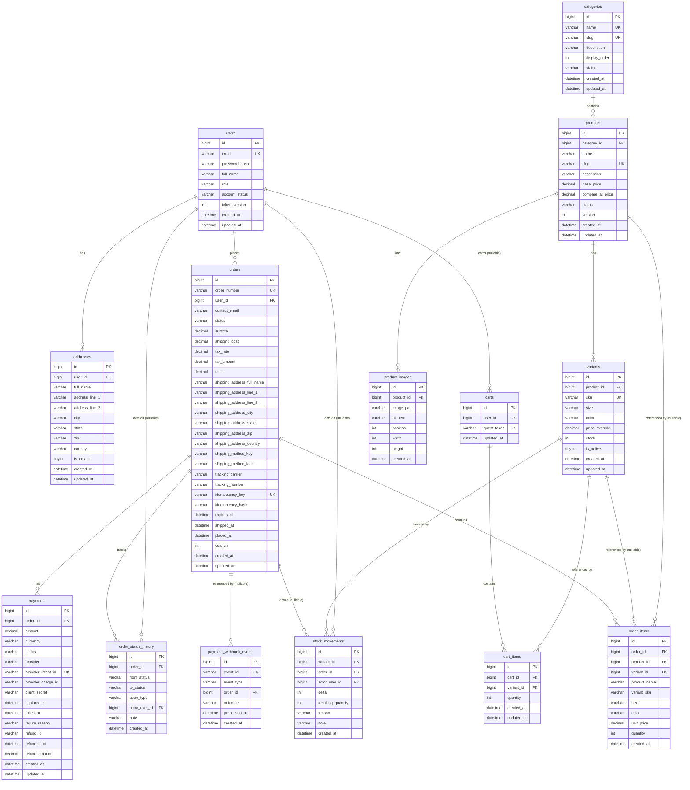

# Shoply — Backend Database Design

| Field | Value |
|---|---|
| **Project name** | Shoply |
| **Document type** | Backend Database Design — JPA Entity & Schema Specification |
| **Version** | 1.0 |
| **Date** | 2026-11-05 |
| **Status** | 🟡 Draft — Awaiting approval |
| **Author** | Senior Database Architect / Backend Developer |
| **Sources of truth** | `docs/DATABASE_DESIGN.md` v1.0 · `docs/SYSTEM_ARCHITECTURE.md` v1.0 · `docs/API_DOCUMENTATION.md` v1.0 · `docs/SRS.md` v1.0 |
| **Stack** | MySQL 8 (InnoDB, utf8mb4) · Spring Boot 3.x · Hibernate/JPA · Java 17 |
| **Schema scope** | 14 tables · 1 schema (`shoply`) · no stored procedures · no triggers |
| **Code status** | ❌ No entity classes yet — this document specifies the design; implementation follows in the next phase |

---

## Table of Contents

1. [Entity Overview](#1-entity-overview)
2. [Entity Attribute Definitions](#2-entity-attribute-definitions)
3. [Relationships](#3-relationships)
4. [Ecommerce Business Rules](#4-ecommerce-business-rules)
5. [Entity Relationship Diagram](#5-entity-relationship-diagram)
6. [Indexes & Constraints](#6-indexes--constraints)
7. [Design Decisions](#7-design-decisions)
8. [Implementation Roadmap](#8-implementation-roadmap)
9. [Summary & Approval](#9-summary--approval)

---

## 1. Entity Overview

Shoply's backend uses **14 JPA entities** mapped to 14 MySQL tables. Each entity belongs to a specific backend module (per `SYSTEM_ARCHITECTURE.md` §5). No tables exist for deferred features (wishlist, reviews, coupons, notifications) — these are deliberately absent (SRS §18, §3.2 of Database Design).

| # | Entity | Module | Table | Purpose | Mutability |
|---|---|---|---|---|---|
| 1 | `User` | identity | `users` | Accounts, roles, credentials, revocation token | Mutable (status-archived, never deleted) |
| 2 | `Address` | identity | `addresses` | Saved address book, one default per user | Mutable; hard-deletable |
| 3 | `Category` | catalog | `categories` | Single-level storefront categories | Mutable; archive-only |
| 4 | `Product` | catalog | `products` | Shared product content, base price, lifecycle | Mutable; archive (BR-06) |
| 5 | `Variant` | catalog + inventory | `variants` | Sellable SKU (size × color), price override, stock | Mutable; stock via inventory rules |
| 6 | `ProductImage` | catalog | `product_images` | Gallery rows, position, alt, dimensions | Mutable (reorder/alt); row-deletable |
| 7 | `Cart` | cart | `carts` | One active cart per user or guest token | Mutable; purgeable (DEC-14) |
| 8 | `CartItem` | cart | `cart_items` | Variant + quantity lines | Mutable; merge/purge deletable |
| 9 | `Order` | checkout | `orders` | Header: status, totals snapshot, address snapshot, idempotency | Status transitions only; never deleted |
| 10 | `OrderItem` | checkout | `order_items` | Immutable line snapshots | Insert-only |
| 11 | `OrderStatusHistory` | checkout | `order_status_history` | Append-only transition audit | Insert-only (BR-26) |
| 12 | `Payment` | checkout | `payments` | Payment intent: amounts, status, provider refs, refund | Status/refund updates; never deleted |
| 13 | `PaymentWebhookEvent` | checkout | `payment_webhook_events` | Webhook de-duplication + diagnosis | Insert-only (EC-12) |
| 14 | `StockMovement` | inventory | `stock_movements` | Append-only stock ledger | Insert-only (FR-INV-09) |

### Entity Responsibility Summary

- **User**: Every account (customers + staff). Holds normalized email (unique), password hash (never plaintext, SEC-02), full name, single role column, account status (ACTIVE/BLOCKED), and `token_version` for instant JWT revocation.
- **Address**: Saved address book. Many per user. One default per user (BR-15). Hard-deletable because orders snapshot addresses (BR-16).
- **Category**: Single-level only (DEC-15a). No parent_id, no nesting. Archive-only lifecycle.
- **Product**: Shared content (name, slug, description, base price, compare-at price). Lifecycle: DRAFT/PUBLISHED/ARCHIVED. Carries `version` for optimistic locking (DEC-23). Holds no stock (BR-01).
- **Variant**: The sellable unit (BR-01). Globally unique SKU (BR-07). Size/color from controlled vocabularies. Optional price override (BR-03). `is_active` for deactivation. `stock` column owned by inventory module.
- **ProductImage**: Gallery rows (1–8 per product). Position 1 = primary image. Optional width/height for aspect-ratio placeholders.
- **Cart**: Server-authoritative. One active cart per user (nullable user_id for guests) or per guest token. No prices stored (BR-05).
- **CartItem**: One row per variant per cart. Quantity bounded 1–10 (DEC-15b). Cascade-deleted with cart.
- **Order**: Order header with human-readable order number (DEC-17). Money snapshots (subtotal, shipping, tax, total). Address snapshot (columns, not FK). Idempotency key + payload hash. `expires_at` for 30-min expiry. `version` for concurrent-transition safety.
- **OrderItem**: Immutable line snapshots. Copied product_name, variant_sku, size/color, unit_price at purchase, quantity. FKs to product/variant are RESTRICT (history can deep-link but doesn't depend on them).
- **OrderStatusHistory**: Append-only transition audit. from_status (NULL for initial), to_status, actor_type, actor_user_id, optional note. Drives customer timeline.
- **Payment**: One row per payment intent. Server-side amount (always order total, BR-12). Status, provider refs, capture/refund timestamps. Full refund only (BR-27). No cardholder data.
- **PaymentWebhookEvent**: Webhook de-duplication. Unique provider event_id. Outcome: PROCESSED/IGNORED/FAILED. Insert-only.
- **StockMovement**: Append-only ledger. Signed delta, resulting_quantity (post-change snapshot), reason (5 SRS values), nullable order_id and actor_user_id, optional note. Invariant: `variants.stock` = seed + Σ deltas.

---

## 2. Entity Attribute Definitions

### 2.1 Identity Domain

#### `users` table

| Field | MySQL Type | Java Type | PK | FK | Unique | Nullable |
|---|---|---|---|---|---|---|
| `id` | `BIGINT AUTO_INCREMENT` | `Long` | ✅ | — | ✅ | ❌ |
| `email` | `VARCHAR(254)` | `String` | — | — | ✅ | ❌ |
| `password_hash` | `VARCHAR(255)` | `String` | — | — | — | ❌ |
| `full_name` | `VARCHAR(100)` | `String` | — | — | — | ❌ |
| `role` | `VARCHAR(20)` | `enum Role` | — | — | — | ❌ |
| `account_status` | `VARCHAR(20)` | `enum AccountStatus` | — | — | — | ❌ |
| `token_version` | `INT` | `int` | — | — | — | ❌ (default 0) |
| `created_at` | `DATETIME(3)` | `LocalDateTime` | — | — | — | ❌ |
| `updated_at` | `DATETIME(3)` | `LocalDateTime` | — | — | — | ❌ |

**Enums:**
- `Role`: `CUSTOMER`, `STAFF`, `ADMIN`
- `AccountStatus`: `ACTIVE`, `BLOCKED`

**Constraints:**
- `CHECK (role IN ('CUSTOMER', 'STAFF', 'ADMIN'))`
- `CHECK (account_status IN ('ACTIVE', 'BLOCKED'))`
- `uq_users_email` on `email`

#### `addresses` table

| Field | MySQL Type | Java Type | PK | FK | Unique | Nullable |
|---|---|---|---|---|---|---|
| `id` | `BIGINT AUTO_INCREMENT` | `Long` | ✅ | — | ✅ | ❌ |
| `user_id` | `BIGINT` | `Long` | — | ✅ → users.id | — | ❌ |
| `label` | `VARCHAR(60)` | `String` | — | — | — | ✅ |
| `full_name` | `VARCHAR(100)` | `String` | — | — | — | ❌ |
| `address_line_1` | `VARCHAR(120)` | `String` | — | — | — | ❌ |
| `address_line_2` | `VARCHAR(120)` | `String` | — | — | — | ✅ |
| `city` | `VARCHAR(60)` | `String` | — | — | — | ❌ |
| `state` | `VARCHAR(60)` | `String` | — | — | — | ❌ |
| `zip` | `VARCHAR(20)` | `String` | — | — | — | ❌ |
| `country` | `VARCHAR(60)` | `String` | — | — | — | ❌ |
| `is_default` | `TINYINT(1)` | `boolean` | — | — | — | ❌ (default false) |
| `created_at` | `DATETIME(3)` | `LocalDateTime` | — | — | — | ❌ |
| `updated_at` | `DATETIME(3)` | `LocalDateTime` | — | — | — | ❌ |

**FK:** `addresses.user_id → users.id ON DELETE CASCADE`

**Unique constraint:** `uq_addresses_user_default` — partial unique on `(user_id, is_default)` where `is_default = TRUE` (ensures one default per user).

### 2.2 Catalog Domain

#### `categories` table

| Field | MySQL Type | Java Type | PK | FK | Unique | Nullable |
|---|---|---|---|---|---|---|
| `id` | `BIGINT AUTO_INCREMENT` | `Long` | ✅ | — | ✅ | ❌ |
| `name` | `VARCHAR(120)` | `String` | — | — | ✅ | ❌ |
| `slug` | `VARCHAR(120)` | `String` | — | — | ✅ | ❌ |
| `description` | `VARCHAR(5000)` | `String` | — | — | — | ✅ |
| `display_order` | `INT` | `int` | — | — | — | ❌ (default 0) |
| `status` | `VARCHAR(20)` | `enum CategoryStatus` | — | — | — | ❌ |
| `created_at` | `DATETIME(3)` | `LocalDateTime` | — | — | — | ❌ |
| `updated_at` | `DATETIME(3)` | `LocalDateTime` | — | — | — | ❌ |

**Enum:** `CategoryStatus`: `ACTIVE`, `ARCHIVED`

**Constraints:**
- `CHECK (status IN ('ACTIVE', 'ARCHIVED'))`
- `uq_categories_name` on `name`
- `uq_categories_slug` on `slug`

#### `products` table

| Field | MySQL Type | Java Type | PK | FK | Unique | Nullable |
|---|---|---|---|---|---|---|
| `id` | `BIGINT AUTO_INCREMENT` | `Long` | ✅ | — | ✅ | ❌ |
| `category_id` | `BIGINT` | `Long` | — | ✅ → categories.id | — | ❌ |
| `name` | `VARCHAR(120)` | `String` | — | — | — | ❌ |
| `slug` | `VARCHAR(120)` | `String` | — | — | ✅ | ❌ |
| `description` | `VARCHAR(5000)` | `String` | — | — | — | ✅ |
| `base_price` | `DECIMAL(10,2)` | `BigDecimal` | — | — | — | ❌ |
| `compare_at_price` | `DECIMAL(10,2)` | `BigDecimal` | — | — | — | ✅ |
| `status` | `VARCHAR(20)` | `enum ProductStatus` | — | — | — | ❌ |
| `version` | `INT` | `int` | — | — | — | ❌ (default 0, optimistic lock) |
| `created_at` | `DATETIME(3)` | `LocalDateTime` | — | — | — | ❌ |
| `updated_at` | `DATETIME(3)` | `LocalDateTime` | — | — | — | ❌ |

**Enum:** `ProductStatus`: `DRAFT`, `PUBLISHED`, `ARCHIVED`

**Constraints:**
- `CHECK (status IN ('DRAFT', 'PUBLISHED', 'ARCHIVED'))`
- `CHECK (compare_at_price IS NULL OR compare_at_price > base_price)` (BR-04)
- `uq_products_slug` on `slug`
- `FK products.category_id → categories.id ON DELETE RESTRICT`

**Note**: Money stored as `DECIMAL` per DBQ-01 (conflicts with FR-GEN-08 minor units — needs approval).

#### `variants` table

| Field | MySQL Type | Java Type | PK | FK | Unique | Nullable |
|---|---|---|---|---|---|---|
| `id` | `BIGINT AUTO_INCREMENT` | `Long` | ✅ | — | ✅ | ❌ |
| `product_id` | `BIGINT` | `Long` | — | ✅ → products.id | — | ❌ |
| `sku` | `VARCHAR(40)` | `String` | — | — | ✅ | ❌ |
| `size` | `VARCHAR(40)` | `String` | — | — | — | ❌ |
| `color` | `VARCHAR(40)` | `String` | — | — | — | ❌ |
| `price_override` | `DECIMAL(10,2)` | `BigDecimal` | — | — | — | ✅ |
| `stock` | `INT` | `int` | — | — | — | ❌ (default 0) |
| `is_active` | `TINYINT(1)` | `boolean` | — | — | — | ❌ (default true) |
| `created_at` | `DATETIME(3)` | `LocalDateTime` | — | — | — | ❌ |
| `updated_at` | `DATETIME(3)` | `LocalDateTime` | — | — | — | ❌ |

**Constraints:**
- `CHECK (stock >= 0)` (BR-08)
- `uq_variants_sku` on `sku`
- `uq_variants_product_size_color` on `(product_id, size, color)`
- `FK variants.product_id → products.id ON DELETE RESTRICT`

#### `product_images` table

| Field | MySQL Type | Java Type | PK | FK | Unique | Nullable |
|---|---|---|---|---|---|---|
| `id` | `BIGINT AUTO_INCREMENT` | `Long` | ✅ | — | ✅ | ❌ |
| `product_id` | `BIGINT` | `Long` | — | ✅ → products.id | — | ❌ |
| `image_path` | `VARCHAR(500)` | `String` | — | — | — | ❌ |
| `alt_text` | `VARCHAR(255)` | `String` | — | — | — | ✅ |
| `position` | `INT` | `int` | — | — | — | ❌ (default 1) |
| `width` | `INT` | `Integer` | — | — | — | ✅ |
| `height` | `INT` | `Integer` | — | — | — | ✅ |
| `created_at` | `DATETIME(3)` | `LocalDateTime` | — | — | — | ❌ |

**Constraints:**
- `CHECK (position BETWEEN 1 AND 8)`
- `FK product_images.product_id → products.id ON DELETE CASCADE`

### 2.3 Cart Domain

#### `carts` table

| Field | MySQL Type | Java Type | PK | FK | Unique | Nullable |
|---|---|---|---|---|---|---|
| `id` | `BIGINT AUTO_INCREMENT` | `Long` | ✅ | — | ✅ | ❌ |
| `user_id` | `BIGINT` | `Long` | — | ✅ → users.id | ✅ (nullable) | ✅ |
| `guest_token` | `VARCHAR(64)` | `String` | — | — | ✅ (nullable) | ✅ |
| `updated_at` | `DATETIME(3)` | `LocalDateTime` | — | — | — | ❌ |

**Constraints:**
- `uq_carts_user` on `user_id` (nullable — guests don't collide)
- `uq_carts_guest` on `guest_token` (nullable)
- `FK carts.user_id → users.id ON DELETE CASCADE`
- `CHECK (user_id IS NOT NULL OR guest_token IS NOT NULL)` (BR-17)

#### `cart_items` table

| Field | MySQL Type | Java Type | PK | FK | Unique | Nullable |
|---|---|---|---|---|---|---|
| `id` | `BIGINT AUTO_INCREMENT` | `Long` | ✅ | — | ✅ | ❌ |
| `cart_id` | `BIGINT` | `Long` | — | ✅ → carts.id | — | ❌ |
| `variant_id` | `BIGINT` | `Long` | — | ✅ → variants.id | — | ❌ |
| `quantity` | `INT` | `int` | — | — | — | ❌ (default 1) |
| `created_at` | `DATETIME(3)` | `LocalDateTime` | — | — | — | ❌ |
| `updated_at` | `DATETIME(3)` | `LocalDateTime` | — | — | — | ❌ |

**Constraints:**
- `CHECK (quantity BETWEEN 1 AND 10)` (DEC-15b)
- `uq_cart_items_cart_variant` on `(cart_id, variant_id)` (prevents EC-08 duplicates)
- `FK cart_items.cart_id → carts.id ON DELETE CASCADE`
- `FK cart_items.variant_id → variants.id ON DELETE RESTRICT`

### 2.4 Checkout Domain

#### `orders` table

| Field | MySQL Type | Java Type | PK | FK | Unique | Nullable |
|---|---|---|---|---|---|---|
| `id` | `BIGINT AUTO_INCREMENT` | `Long` | ✅ | — | ✅ | ❌ |
| `order_number` | `VARCHAR(32)` | `String` | — | — | ✅ | ❌ |
| `user_id` | `BIGINT` | `Long` | — | ✅ → users.id | — | ✅ |
| `contact_email` | `VARCHAR(254)` | `String` | — | — | — | ❌ |
| `status` | `VARCHAR(20)` | `enum OrderStatus` | — | — | — | ❌ |
| `subtotal` | `DECIMAL(10,2)` | `BigDecimal` | — | — | — | ❌ |
| `shipping_cost` | `DECIMAL(10,2)` | `BigDecimal` | — | — | — | ❌ |
| `tax_rate` | `DECIMAL(5,4)` | `BigDecimal` | — | — | — | ❌ |
| `tax_amount` | `DECIMAL(10,2)` | `BigDecimal` | — | — | — | ❌ |
| `total` | `DECIMAL(10,2)` | `BigDecimal` | — | — | — | ❌ |
| `shipping_address_full_name` | `VARCHAR(100)` | `String` | — | — | — | ❌ |
| `shipping_address_line_1` | `VARCHAR(120)` | `String` | — | — | — | ❌ |
| `shipping_address_line_2` | `VARCHAR(120)` | `String` | — | — | — | ✅ |
| `shipping_address_city` | `VARCHAR(60)` | `String` | — | — | — | ❌ |
| `shipping_address_state` | `VARCHAR(60)` | `String` | — | — | — | ❌ |
| `shipping_address_zip` | `VARCHAR(20)` | `String` | — | — | — | ❌ |
| `shipping_address_country` | `VARCHAR(60)` | `String` | — | — | — | ❌ |
| `shipping_method_key` | `VARCHAR(40)` | `String` | — | — | — | ❌ |
| `shipping_method_label` | `VARCHAR(120)` | `String` | — | — | — | ❌ |
| `tracking_carrier` | `VARCHAR(60)` | `String` | — | — | — | ✅ |
| `tracking_number` | `VARCHAR(120)` | `String` | — | — | — | ✅ |
| `idempotency_key` | `VARCHAR(64)` | `String` | — | — | ✅ | ✅ |
| `idempotency_hash` | `VARCHAR(64)` | `String` | — | — | — | ✅ |
| `expires_at` | `DATETIME(3)` | `LocalDateTime` | — | — | — | ✅ |
| `shipped_at` | `DATETIME(3)` | `LocalDateTime` | — | — | — | ✅ |
| `placed_at` | `DATETIME(3)` | `LocalDateTime` | — | — | — | ❌ |
| `version` | `INT` | `int` | — | — | — | ❌ (default 0) |
| `created_at` | `DATETIME(3)` | `LocalDateTime` | — | — | — | ❌ |
| `updated_at` | `DATETIME(3)` | `LocalDateTime` | — | — | — | ❌ |

**Enum:** `OrderStatus`: `PENDING`, `PAID`, `SHIPPED`, `DELIVERED`, `CANCELLED`, `EXPIRED`, `REFUNDED`

**Constraints:**
- `CHECK (status IN ('PENDING', 'PAID', 'SHIPPED', 'DELIVERED', 'CANCELLED', 'EXPIRED', 'REFUNDED'))`
- `uq_orders_order_number` on `order_number`
- `uq_orders_idempotency_key` on `idempotency_key` (nullable)
- `FK orders.user_id → users.id ON DELETE SET NULL`

#### `order_items` table

| Field | MySQL Type | Java Type | PK | FK | Unique | Nullable |
|---|---|---|---|---|---|---|
| `id` | `BIGINT AUTO_INCREMENT` | `Long` | ✅ | — | ✅ | ❌ |
| `order_id` | `BIGINT` | `Long` | — | ✅ → orders.id | — | ❌ |
| `product_id` | `BIGINT` | `Long` | — | ✅ → products.id | — | ✅ |
| `variant_id` | `BIGINT` | `Long` | — | ✅ → variants.id | — | ✅ |
| `product_name` | `VARCHAR(120)` | `String` | — | — | — | ❌ |
| `variant_sku` | `VARCHAR(40)` | `String` | — | — | — | ❌ |
| `size` | `VARCHAR(40)` | `String` | — | — | — | ✅ |
| `color` | `VARCHAR(40)` | `String` | — | — | — | ✅ |
| `unit_price` | `DECIMAL(10,2)` | `BigDecimal` | — | — | — | ❌ |
| `quantity` | `INT` | `int` | — | — | — | ❌ |
| `created_at` | `DATETIME(3)` | `LocalDateTime` | — | — | — | ❌ |

**Constraints:**
- `FK order_items.order_id → orders.id ON DELETE RESTRICT`
- `FK order_items.product_id → products.id ON DELETE RESTRICT` (nullable)
- `FK order_items.variant_id → variants.id ON DELETE RESTRICT` (nullable)

#### `order_status_history` table

| Field | MySQL Type | Java Type | PK | FK | Unique | Nullable |
|---|---|---|---|---|---|---|
| `id` | `BIGINT AUTO_INCREMENT` | `Long` | ✅ | — | ✅ | ❌ |
| `order_id` | `BIGINT` | `Long` | — | ✅ → orders.id | — | ❌ |
| `from_status` | `VARCHAR(20)` | `enum OrderStatus` | — | — | — | ✅ |
| `to_status` | `VARCHAR(20)` | `enum OrderStatus` | — | — | — | ❌ |
| `actor_type` | `VARCHAR(20)` | `enum ActorType` | — | — | — | ❌ |
| `actor_user_id` | `BIGINT` | `Long` | — | ✅ → users.id | — | ✅ |
| `note` | `VARCHAR(500)` | `String` | — | — | — | ✅ |
| `created_at` | `DATETIME(3)` | `LocalDateTime` | — | — | — | ❌ |

**Enums:**
- `ActorType`: `SYSTEM`, `CUSTOMER`, `STAFF`, `ADMIN`

**Constraints:**
- `FK order_status_history.order_id → orders.id ON DELETE CASCADE`
- `FK order_status_history.actor_user_id → users.id ON DELETE SET NULL`

#### `payments` table

| Field | MySQL Type | Java Type | PK | FK | Unique | Nullable |
|---|---|---|---|---|---|---|
| `id` | `BIGINT AUTO_INCREMENT` | `Long` | ✅ | — | ✅ | ❌ |
| `order_id` | `BIGINT` | `Long` | — | ✅ → orders.id | — | ❌ |
| `amount` | `DECIMAL(10,2)` | `BigDecimal` | — | — | — | ❌ |
| `currency` | `VARCHAR(3)` | `String` | — | — | — | ❌ (default 'USD') |
| `status` | `VARCHAR(20)` | `enum PaymentStatus` | — | — | — | ❌ |
| `provider` | `VARCHAR(20)` | `String` | — | — | — | ❌ |
| `provider_intent_id` | `VARCHAR(120)` | `String` | — | — | ✅ | ❌ |
| `provider_charge_id` | `VARCHAR(120)` | `String` | — | — | — | ✅ |
| `client_secret` | `VARCHAR(255)` | `String` | — | — | — | ✅ |
| `captured_at` | `DATETIME(3)` | `LocalDateTime` | — | — | — | ✅ |
| `failed_at` | `DATETIME(3)` | `LocalDateTime` | — | — | — | ✅ |
| `failure_reason` | `VARCHAR(500)` | `String` | — | — | — | ✅ |
| `refund_id` | `VARCHAR(120)` | `String` | — | — | — | ✅ |
| `refunded_at` | `DATETIME(3)` | `LocalDateTime` | — | — | — | ✅ |
| `refund_amount` | `DECIMAL(10,2)` | `BigDecimal` | — | — | — | ✅ |
| `created_at` | `DATETIME(3)` | `LocalDateTime` | — | — | — | ❌ |
| `updated_at` | `DATETIME(3)` | `LocalDateTime` | — | — | — | ❌ |

**Enum:** `PaymentStatus`: `PENDING`, `AUTHORIZED`, `CAPTURED`, `FAILED`, `REFUNDED`

**Constraints:**
- `CHECK (status IN ('PENDING', 'AUTHORIZED', 'CAPTURED', 'FAILED', 'REFUNDED'))`
- `CHECK (refund_amount IS NULL OR refund_amount = amount)` (full refunds only, BR-27)
- `uq_payments_provider_intent_id` on `provider_intent_id`
- `FK payments.order_id → orders.id ON DELETE RESTRICT`

#### `payment_webhook_events` table

| Field | MySQL Type | Java Type | PK | FK | Unique | Nullable |
|---|---|---|---|---|---|---|
| `id` | `BIGINT AUTO_INCREMENT` | `Long` | ✅ | — | ✅ | ❌ |
| `event_id` | `VARCHAR(120)` | `String` | — | — | ✅ | ❌ |
| `event_type` | `VARCHAR(60)` | `String` | — | — | — | ❌ |
| `order_id` | `BIGINT` | `Long` | — | ✅ → orders.id | — | ✅ |
| `outcome` | `VARCHAR(20)` | `enum WebhookOutcome` | — | — | — | ❌ |
| `processed_at` | `DATETIME(3)` | `LocalDateTime` | — | — | — | ❌ |
| `created_at` | `DATETIME(3)` | `LocalDateTime` | — | — | — | ❌ |

**Enum:** `WebhookOutcome`: `PROCESSED`, `IGNORED`, `FAILED`

**Constraints:**
- `CHECK (outcome IN ('PROCESSED', 'IGNORED', 'FAILED'))`
- `uq_payment_webhook_events_event_id` on `event_id`
- `FK payment_webhook_events.order_id → orders.id ON DELETE SET NULL`

### 2.5 Inventory Domain

#### `stock_movements` table

| Field | MySQL Type | Java Type | PK | FK | Unique | Nullable |
|---|---|---|---|---|---|---|
| `id` | `BIGINT AUTO_INCREMENT` | `Long` | ✅ | — | ✅ | ❌ |
| `variant_id` | `BIGINT` | `Long` | — | ✅ → variants.id | — | ❌ |
| `order_id` | `BIGINT` | `Long` | — | ✅ → orders.id | — | ✅ |
| `actor_user_id` | `BIGINT` | `Long` | — | ✅ → users.id | — | ✅ |
| `delta` | `INT` | `int` | — | — | — | ❌ |
| `resulting_quantity` | `INT` | `int` | — | — | — | ❌ |
| `reason` | `VARCHAR(30)` | `enum MovementReason` | — | — | — | ❌ |
| `note` | `VARCHAR(200)` | `String` | — | — | — | ✅ |
| `created_at` | `DATETIME(3)` | `LocalDateTime` | — | — | — | ❌ |

**Enum:** `MovementReason`: `ORDER_PLACED`, `ORDER_CANCELLED`, `ORDER_EXPIRED`, `MANUAL_ADJUSTMENT`, `INITIAL_SEED`

**Constraints:**
- `CHECK (reason IN ('ORDER_PLACED', 'ORDER_CANCELLED', 'ORDER_EXPIRED', 'MANUAL_ADJUSTMENT', 'INITIAL_SEED'))`
- `FK stock_movements.variant_id → variants.id ON DELETE RESTRICT`
- `FK stock_movements.order_id → orders.id ON DELETE SET NULL`
- `FK stock_movements.actor_user_id → users.id ON DELETE SET NULL`

---

## 3. Relationships

### 3.1 Cardinality Summary

| Relationship | Cardinality | FK Location | Cascade Behavior |
|---|---|---|---|
| User → Address | One-to-Many | `addresses.user_id` | CASCADE DELETE (addresses deleted with user) |
| User → Order | One-to-Many | `orders.user_id` | SET NULL (orders preserved for history) |
| User → Cart | One-to-One | `carts.user_id` | CASCADE DELETE |
| User → StockMovement | One-to-Many | `stock_movements.actor_user_id` | SET NULL |
| Category → Product | One-to-Many | `products.category_id` | RESTRICT (can't delete category with products) |
| Product → Variant | One-to-Many | `variants.product_id` | RESTRICT (can't delete product with variants) |
| Product → ProductImage | One-to-Many | `product_images.product_id` | CASCADE DELETE (images deleted with product) |
| Cart → CartItem | One-to-Many | `cart_items.cart_id` | CASCADE DELETE |
| Variant → CartItem | One-to-Many | `cart_items.variant_id` | RESTRICT (can't delete variant in active cart) |
| Order → OrderItem | One-to-Many | `order_items.order_id` | RESTRICT (immutable history) |
| Order → OrderStatusHistory | One-to-Many | `order_status_history.order_id` | CASCADE DELETE (history deleted with order — but orders are never deleted) |
| Order → Payment | One-to-Many | `payments.order_id` | RESTRICT (payment records preserved) |
| Order → StockMovement | One-to-Many | `stock_movements.order_id` | SET NULL (movement preserved, order ref cleared) |
| Product → OrderItem | One-to-Many | `order_items.product_id` | RESTRICT (nullable, product can be archived) |
| Variant → OrderItem | One-to-Many | `order_items.variant_id` | RESTRICT (nullable, variant can be deactivated) |
| Order → PaymentWebhookEvent | One-to-Many | `payment_webhook_events.order_id` | SET NULL (event preserved) |

### 3.2 JPA Relationship Annotations

| Relationship | JPA Annotation | Notes |
|---|---|---|
| User → Address | `@OneToMany(mappedBy="user", cascade=ALL, orphanRemoval=true)` | Bidirectional; owning side is Address |
| User → Order | `@OneToMany(mappedBy="user")` | Unidirectional preferred (Order has @ManyToOne to User) |
| User → Cart | `@OneToOne(mappedBy="user")` | Unidirectional preferred (Cart has @ManyToOne to User) |
| Category → Product | `@OneToMany(mappedBy="category")` | Unidirectional preferred |
| Product → Variant | `@OneToMany(mappedBy="product", cascade=ALL, orphanRemoval=true)` | Bidirectional; owning side is Variant |
| Product → ProductImage | `@OneToMany(mappedBy="product", cascade=ALL, orphanRemoval=true)` | Bidirectional; ordered by position |
| Cart → CartItem | `@OneToMany(mappedBy="cart", cascade=ALL, orphanRemoval=true)` | Bidirectional; owning side is CartItem |
| Order → OrderItem | `@OneToMany(mappedBy="order", cascade=PERSIST)` | Unidirectional preferred; insert-only |
| Order → OrderStatusHistory | `@OneToMany(mappedBy="order", cascade=ALL)` | Unidirectional preferred; append-only |
| Order → Payment | `@OneToMany(mappedBy="order", cascade=ALL)` | Unidirectional preferred |

### 3.3 Bidirectional vs Unidirectional

**Principle**: Prefer unidirectional relationships (`@ManyToOne` on the owning side) unless there's a clear need for navigation from the parent. This reduces coupling and prevents accidental N+1 queries.

- **Bidirectional** (where parent needs to manage children): User↔Address, Product↔Variant, Product↔ProductImage, Cart↔CartItem
- **Unidirectional** (child references parent only): Order→User, Order→OrderItem, Order→Payment, Order→OrderStatusHistory, Variant→Product, CartItem→Variant

---

## 4. Ecommerce Business Rules

### 4.1 Product & Inventory

| Rule | Enforcement |
|---|---|
| Products hold no stock (BR-01) | `products` table has no stock column; stock lives in `variants` |
| Variants are the sellable unit (BR-01) | All cart/order lines reference `variant_id` |
| Stock is non-negative (BR-08) | `CHECK (stock >= 0)` on variants; conditional UPDATE in service layer |
| Stock mutations are atomic | `UPDATE variants SET stock = stock - ? WHERE id = ? AND stock >= ?` |
| Stock ledger is append-only (FR-INV-09) | `stock_movements` is insert-only; invariant asserted by tests |
| Product archive, not delete (BR-06) | `status = 'ARCHIVED'`; FKs are RESTRICT to prevent orphan references |
| Category archive requires reassignment | Application-enforced (count query before archive) |

### 4.2 Cart

| Rule | Enforcement |
|---|---|
| Server-authoritative cart (ARCH §3) | Cart lives in DB; client mirrors for display only |
| One active cart per identity (BR-17) | Unique constraints on `user_id` and `guest_token` |
| Quantity bounded 1–10 (DEC-15b) | `CHECK (quantity BETWEEN 1 AND 10)` |
| No prices in cart (BR-05) | `cart_items` stores only `variant_id` + `quantity`; prices resolve at read time |
| Guest cart merge on login (FR-CART-08) | Orchestrated by cart service calling identity; direction: cart → identity |
| Guest purge after 60 days (DEC-14) | `@Scheduled` job deletes old guest carts |

### 4.3 Orders

| Rule | Enforcement |
|---|---|
| Immutable line snapshots (BR-11) | `order_items` is insert-only; `product_name`, `variant_sku`, `unit_price` copied at purchase time |
| Server-computed totals (BR-12) | `orders.subtotal`, `shipping_cost`, `tax_amount`, `total` computed by service, never client input |
| Address snapshot (BR-16) | Address stored as columns in `orders`, not FK to `addresses` |
| Shipping method snapshot | `shipping_method_key` + `shipping_method_label` stored on order (config, not data) |
| Order number format (DEC-17) | `SHOP-YYYYMMDD-XXXX`, unique constraint |
| Idempotency (NFR-05) | `idempotency_key` unique on orders; duplicate returns existing order |
| Status transitions (T1–T9) | State machine in service layer; `order_status_history` records every transition |
| Order expiry (DEC-02) | 30-minute timeout; `@Scheduled` job cancels stale PENDING orders |
| Cancel only when PENDING (CF-16) | Application-enforced; danger-ghost button only shown for PENDING |
| No hard delete (BR-06) | Orders are never deleted; status transitions only |

### 4.4 Payments

| Rule | Enforcement |
|---|---|
| No cardholder data (§21.2) | `payments` stores only provider references, never card numbers/CVV |
| One row per payment intent (FR-PAY-08) | Multiple payments per order (retries) |
| Webhook is authority (§11) | `PAID` status only applied via verified webhook, not client callback |
| Full refunds only (BR-27) | `CHECK (refund_amount IS NULL OR refund_amount = amount)` |
| Payment always wins over expiry (EC-14) | Expiry job re-checks payment status with gateway before cancelling |

### 4.5 Inventory

| Rule | Enforcement |
|---|---|
| Single writer for stock (§5.2 rule 3) | Only `inventory` module mutates `variants.stock` |
| Conditional decrement | `UPDATE variants SET stock = stock - ? WHERE id = ? AND stock >= ?` |
| Stock ledger invariant | `variants.stock` = `INITIAL_SEED` + Σ `stock_movements.delta` (asserted by tests) |
| Manual adjustments require note | Application-enforced (FR-INV-05) |
| Low-stock threshold in config (DEC-13) | Not a DB column; configured via env |

---

## 5. Entity Relationship Diagram

---

## 6. Indexes & Constraints

### 6.1 Primary Keys
Every table has a surrogate `id BIGINT AUTO_INCREMENT` primary key. No composite PKs, no natural keys as PKs (simplifies JPA and Hibernate).

### 6.2 Unique Constraints

| Table | Constraint | Columns | Purpose |
|---|---|---|---|
| `users` | `uq_users_email` | `email` | Login lookup, case-insensitive (utf8mb4_0900_ai_ci) |
| `addresses` | `uq_addresses_user_default` | `(user_id, is_default)` WHERE `is_default = TRUE` | One default per user (BR-15) |
| `categories` | `uq_categories_name` | `name` | Unique category name |
| `categories` | `uq_categories_slug` | `slug` | Unique URL slug |
| `products` | `uq_products_slug` | `slug` | Unique URL slug |
| `variants` | `uq_variants_sku` | `sku` | Globally unique SKU (BR-07) |
| `variants` | `uq_variants_product_size_color` | `(product_id, size, color)` | One variant per size/color combo |
| `carts` | `uq_carts_user` | `user_id` (nullable) | One active cart per user |
| `carts` | `uq_carts_guest` | `guest_token` (nullable) | One active cart per guest |
| `cart_items` | `uq_cart_items_cart_variant` | `(cart_id, variant_id)` | Prevents duplicate lines (EC-08) |
| `orders` | `uq_orders_order_number` | `order_number` | Unique human-readable order number |
| `orders` | `uq_orders_idempotency_key` | `idempotency_key` (nullable) | Idempotent order placement (NFR-05) |
| `payments` | `uq_payments_provider_intent_id` | `provider_intent_id` | Unique payment intent |
| `payment_webhook_events` | `uq_payment_webhook_events_event_id` | `event_id` | Webhook de-duplication (EC-12) |

### 6.3 Foreign Keys

| FK | From → To | ON DELETE | Rationale |
|---|---|---|---|
| `addresses.user_id` | users.id | CASCADE | Addresses deleted with user |
| `products.category_id` | categories.id | RESTRICT | Can't delete category with products |
| `variants.product_id` | products.id | RESTRICT | Can't delete product with variants |
| `product_images.product_id` | products.id | CASCADE | Images deleted with product |
| `carts.user_id` | users.id | CASCADE | Cart deleted with user |
| `cart_items.cart_id` | carts.id | CASCADE | Lines deleted with cart |
| `cart_items.variant_id` | variants.id | RESTRICT | Can't delete variant in active cart |
| `orders.user_id` | users.id | SET NULL | Orders preserved for history |
| `order_items.order_id` | orders.id | RESTRICT | Immutable history |
| `order_items.product_id` | products.id | RESTRICT (nullable) | Deep-link, not dependency |
| `order_items.variant_id` | variants.id | RESTRICT (nullable) | Deep-link, not dependency |
| `order_status_history.order_id` | orders.id | CASCADE | History deleted with order (orders never deleted) |
| `order_status_history.actor_user_id` | users.id | SET NULL | Actor preserved if account goes |
| `payments.order_id` | orders.id | RESTRICT | Payment records preserved |
| `payment_webhook_events.order_id` | orders.id | SET NULL | Event preserved |
| `stock_movements.variant_id` | variants.id | RESTRICT | Can't delete variant with movements |
| `stock_movements.order_id` | orders.id | SET NULL | Movement preserved |
| `stock_movements.actor_user_id` | users.id | SET NULL | Actor preserved |

### 6.4 CHECK Constraints

| Table | Constraint | Rule |
|---|---|---|
| `users` | `role IN ('CUSTOMER', 'STAFF', 'ADMIN')` | Valid roles only |
| `users` | `account_status IN ('ACTIVE', 'BLOCKED')` | Valid statuses only |
| `categories` | `status IN ('ACTIVE', 'ARCHIVED')` | Valid statuses only |
| `products` | `status IN ('DRAFT', 'PUBLISHED', 'ARCHIVED')` | Valid statuses only |
| `products` | `compare_at_price IS NULL OR compare_at_price > base_price` | BR-04 |
| `variants` | `stock >= 0` | BR-08 |
| `cart_items` | `quantity BETWEEN 1 AND 10` | DEC-15b |
| `orders` | `status IN ('PENDING', 'PAID', 'SHIPPED', 'DELIVERED', 'CANCELLED', 'EXPIRED', 'REFUNDED')` | Valid states only |
| `payments` | `status IN ('PENDING', 'AUTHORIZED', 'CAPTURED', 'FAILED', 'REFUNDED')` | Valid states only |
| `payments` | `refund_amount IS NULL OR refund_amount = amount` | BR-27 (full refunds only) |
| `payment_webhook_events` | `outcome IN ('PROCESSED', 'IGNORED', 'FAILED')` | Valid outcomes only |
| `stock_movements` | `reason IN ('ORDER_PLACED', 'ORDER_CANCELLED', 'ORDER_EXPIRED', 'MANUAL_ADJUSTMENT', 'INITIAL_SEED')` | FR-INV-09 |
| `carts` | `user_id IS NOT NULL OR guest_token IS NOT NULL` | BR-17 |
| `product_images` | `position BETWEEN 1 AND 8` | FR-PROD-06 |

### 6.5 Performance Indexes

| Table | Index | Columns | Purpose |
|---|---|---|---|
| `products` | `idx_products_category_status` | `(category_id, status)` | Category listing with published filter |
| `products` | `idx_products_slug` | `slug` | Slug lookup (unique, also indexed) |
| `products` | `idx_products_status` | `status` | Published product queries |
| `variants` | `idx_variants_product` | `product_id` | Variants by product |
| `variants` | `idx_variants_sku` | `sku` | SKU lookup (unique) |
| `variants` | `idx_variants_active` | `(product_id, is_active)` | Active variants by product |
| `product_images` | `idx_product_images_product_position` | `(product_id, position)` | Gallery ordering |
| `carts` | `idx_carts_user` | `user_id` | User cart lookup |
| `carts` | `idx_carts_guest` | `guest_token` | Guest cart lookup |
| `carts` | `idx_carts_updated` | `updated_at` | Guest purge job (DEC-14) |
| `cart_items` | `idx_cart_items_cart` | `cart_id` | Cart lines by cart |
| `orders` | `idx_orders_user_placed` | `(user_id, placed_at DESC)` | Customer order history |
| `orders` | `idx_orders_status_placed` | `(status, placed_at)` | Admin order filtering |
| `orders` | `idx_orders_expires` | `expires_at` | Expiry job query |
| `orders` | `idx_orders_idempotency` | `idempotency_key` | Idempotency lookup |
| `order_items` | `idx_order_items_order` | `order_id` | Order lines by order |
| `order_status_history` | `idx_osh_order_created` | `(order_id, created_at)` | Timeline ordering |
| `payments` | `idx_payments_order` | `order_id` | Payments by order |
| `payments` | `idx_payments_provider_intent` | `provider_intent_id` | Provider lookup |
| `stock_movements` | `idx_sm_variant_created` | `(variant_id, created_at)` | Movement history |
| `stock_movements` | `idx_sm_order` | `order_id` | Movements by order |
| `addresses` | `idx_addresses_user` | `user_id` | Addresses by user |

---

## 7. Design Decisions

### 7.1 Money as DECIMAL (DBQ-01)

**Decision**: All monetary columns use `DECIMAL(10,2)` or `DECIMAL(12,2)`, never `FLOAT`/`DOUBLE`.

**Rationale**: Exact arithmetic is preserved. `DECIMAL` stores fixed-point numbers, avoiding floating-point precision errors. This conflicts with FR-GEN-08 (minor units as integers) — the conflict is logged as DBQ-01 and needs stakeholder approval.

**Impact**: API payloads transmit money as decimal strings (e.g., `"189.00"`), not integer cents. Frontend formats for display. If reverted to `BIGINT` cents, all money columns change type but the structure remains the same.

### 7.2 No Junction Tables for Many-to-Many

**Decision**: No many-to-many relationships exist in V1. Cart items and order items use surrogate `id` + unique constraints on `(cart_id, variant_id)` and `(order_id, variant_id)` respectively.

**Rationale**: Simpler JPA mapping, easier to add attributes to junction entities later (e.g., quantity on cart_items). Composite natural keys would complicate JPA entity identity.

### 7.3 Append-Only Tables

**Decision**: `order_items`, `order_status_history`, `stock_movements`, `payment_webhook_events` are insert-only. No UPDATE or DELETE operations are permitted.

**Rationale**: Immutability provides audit trail, supports SEC-18 (attributable changes), and prevents accidental data loss. History is the source of truth for order timelines and inventory reconciliation.

### 7.4 Address Snapshot Strategy (BR-16)

**Decision**: Orders store shipping address as columns (not FK to `addresses`).

**Rationale**: If a user updates or deletes their saved address, the order's shipping address must remain unchanged. Snapshotting ensures historical accuracy. This is a deliberate denormalization justified by BR-16.

### 7.5 Price Snapshot Strategy (BR-11, BR-21)

**Decision**: Order items copy `product_name`, `variant_sku`, `size`, `color`, and `unit_price` at purchase time. FKs to `products` and `variants` are nullable RESTRICT.

**Rationale**: Product prices and names can change after purchase. The order must preserve what was bought and at what price. FKs allow deep-linking to live catalog rows without depending on them for display.

### 7.6 No Stored Procedures or Triggers

**Decision**: All business logic lives in the service layer (Java). No stored procedures, no triggers, no database-level automation.

**Rationale**: Testability (NFR-15), portability, and the modular monolith architecture (ARCH §4.3: "perform raw SQL strings" is in the "Never does" column for services). Database is a data store, not a computation engine.

### 7.7 Optimistic Locking on Products

**Decision**: `products` table has a `version` column (INT, default 0) for optimistic locking of admin edits (DEC-23).

**Rationale**: Prevents lost updates when multiple admin users edit the same product concurrently. Hibernate's `@Version` annotation handles this automatically.

### 7.8 Guest Cart Design (BR-17)

**Decision**: Carts have nullable `user_id` and nullable `guest_token`. A `CHECK` constraint ensures at least one is set. Unique constraints on each (nullable) prevent duplicate carts.

**Rationale**: Guests shop without accounts. On login, the guest cart is merged into the user's cart. The nullable unique constraints allow multiple guests (each with their own token) without colliding.

### 7.9 Product Images Position (No `is_primary` Flag)

**Decision**: Position 1 is the primary image. No separate `is_primary` boolean column.

**Rationale**: The lowest position *is* the primary image. This avoids a second source of truth and simplifies reordering (just update positions). Position is 1–8 (FR-PROD-06).

### 7.10 Stock Movement Invariant

**Decision**: `variants.stock` = `INITIAL_SEED` + Σ `stock_movements.delta`. The `resulting_quantity` column stores the post-change snapshot for instant audit.

**Rationale**: The invariant is asserted by tests (§19.4 of DB design). The `resulting_quantity` avoids recomputing the running sum for audit queries. Every stock change creates a ledger row (FR-INV-09).

---

## 8. Implementation Roadmap

### Phase 1: Entity Foundation (Week 1)
1. Create JPA entity classes for all 14 tables in `domain/` subpackages
2. Add `@Entity`, `@Table`, `@Id`, `@GeneratedValue`, `@Column` annotations
3. Add `@Enumerated(EnumType.STRING)` for state columns
4. Add `@Version` on `Product.version`
5. Add `@CreatedDate` / `@LastModifiedDate` (Spring Data JPA auditing)
6. Create `@EntityListeners(AuditingEntityListener.class)` base

### Phase 2: Relationships (Week 1)
7. Add `@ManyToOne`, `@OneToMany`, `@OneToOne` annotations
8. Configure cascade and orphan removal
9. Add `@JoinColumn` with FK constraints
10. Verify with Hibernate `ddl-auto=validate` (should match migration)

### Phase 3: Repositories (Week 1–2)
11. Create Spring Data JPA repositories for each entity
12. Add derived query methods (e.g., `findBySlug`, `findByUserId`)
13. Add named queries for complex joins (e.g., cart with items + variants)
14. Add `@EntityGraph` to prevent N+1 queries

### Phase 4: Mappers & DTOs (Week 2)
15. Create request/response DTOs in `web/dto/`
16. Create manual mapper functions in `web/mapper/`
17. Ensure entities never leave the service layer

### Phase 5: Services (Week 2–3)
18. Implement service classes with `@Transactional`
19. Add business rules, validation, ownership scoping
20. Implement state machine for order transitions
21. Implement stock reserve/release/adjust logic

### Phase 6: Controllers (Week 3)
22. Create REST controllers in `web/`
23. Add `@Valid` binding on request DTOs
24. Add `@PreAuthorize` for role-based access
25. Map service results to response DTOs

### Phase 7: Security (Week 3–4)
26. Configure Spring Security filter chain
27. Implement JWT in httpOnly cookie
28. Implement CSRF double-submit
29. Implement rate limiting on auth endpoints
30. Add role-based URL matchers

### Phase 8: Seed & Migration (Week 4)
31. Create `V1__init_schema.sql` with all 14 tables
32. Create `V2__seed_data.sql` or idempotent seed runner
33. Verify Flyway migration runs cleanly
34. Verify Hibernate `ddl-auto=validate` passes

### Phase 9: Testing (Week 4–5)
35. Repository tests with Testcontainers (real MySQL)
36. Service tests (business rules, state machine, stock invariants)
37. Controller tests (MockMvc, security rules)
38. Integration tests (full checkout flow)

---

## 9. Summary & Approval

### What This Design Covers

This backend database design specifies:

1. **14 JPA entities** mapped to 14 MySQL tables, organized by module ownership
2. **~120 columns** across all tables with precise MySQL types and Java types
3. **16 foreign keys** with explicit ON DELETE behavior (CASCADE, RESTRICT, SET NULL)
4. **14 unique constraints** (including partial unique for default address)
5. **16 CHECK constraints** encoding business rules at the database level
6. **22 performance indexes** for common query patterns
7. **Complete Mermaid ER diagram** showing all relationships
8. **8 key design decisions** (money as DECIMAL, no junction tables, append-only tables, address/price snapshots, no stored procedures, optimistic locking, guest cart design, stock movement invariant)

### Key Design Principles

- **Correctness over cleverness** — constraints are the last line of defense
- **History is immutable** — orders, line items, addresses, status history, and stock movements are written once
- **No duplicate data without a reason** — only snapshots (justified by approved rules)
- **Foreign keys everywhere** — with explicit ON DELETE behavior
- **Constraints encode business rules** — CHECK/UNIQUE implement BR-* and FR-* directly in DB
- **No tables without a requirement** — deferred features get no placeholder tables

### Important Design Decisions Requiring Review

| Decision | Choice | Conflict/Note |
|---|---|---|
| Money type | `DECIMAL(10,2)` | Conflicts with FR-GEN-08 (minor units/BIGINT). Logged as DBQ-01. Needs approval. |
| No wishlist table | Deferred to V1.5 | SRS §18 — no placeholder tables |
| No reviews table | Deferred to V1.5 | SRS §17 — no placeholder tables |
| No coupons table | Excluded from V1 | Design-spec exclusion; no FR-* |
| No notifications table | Derived, not stored | FR-NTF-01…04 — derived from orders |
| Shipping methods as config | Not a DB table | DEC-05, DEC-26 — env/config files |
| Tax rate as config | Not a DB table | DEC-04 — single configurable rate |
| No `is_primary` on images | Position 1 = primary | Avoids second source of truth |

### Approval Required

This document is a design specification. On approval, implementation begins with Phase 1 (Entity foundation). No Java entity classes have been created yet.

---

**Status: Awaiting approval before implementation.**

**Do not proceed to entity implementation until this design is approved.**