# Shoply — Database Design

| Field | Value |
|---|---|
| **Project name** | Shoply |
| **Document type** | Relational Database Design Specification |
| **Version** | 1.0 |
| **Date** | 2026-11-04 |
| **Status** | 🟡 Draft — Awaiting stakeholder approval |
| **Author** | Senior Database Architect |
| **Sources of truth** | `docs/PROJECT_PLANNING.md` · `docs/SRS.md` · `docs/USER_FLOWS.md` · `docs/UI_UX_DESIGN_SPEC.md` · `docs/SYSTEM_ARCHITECTURE.md` (all approved) |
| **Stack** | MySQL 8 (InnoDB, utf8mb4) · Spring Boot · Hibernate/JPA · Java |
| **Schema scope** | 14 tables · 1 schema (`shoply`) · no stored procedures · no triggers |
| **Next phase** | Flyway migration implementation — **after approval of this document** |
| **Code status** | ❌ No application code · ❌ No SQL migration files |

---

## Document Control

| Version | Date | Change |
|---|---|---|
| 1.0 | 2026-11-04 | Initial relational design: 14 tables, constraints, indexes, ERD, integrity & transaction rules |

**Rules governing this document:**

1. Every table traces to an approved `FR-*`, `BR-*`, `DEC-*`, or plan §5 entity — **no speculative tables** (§3.2 lists what was deliberately *not* created and why).
2. No application code and **no SQL files** — column definitions are specification, not migration scripts (migration strategy in §24).
3. Structure follows `SYSTEM_ARCHITECTURE.md` §5 (module ownership) and §10 (transaction discipline); where this document refines an architecture statement, the refinement is noted in place.
4. Unresolved questions are collected in [§25](#25-unresolved-questions-dbq) — nothing is silently decided.

---

## Table of Contents

1. [Database Overview](#1-database-overview)
2. [Naming Conventions](#2-naming-conventions)
3. [Complete Table List](#3-complete-table-list)
4. [Table Descriptions](#4-table-descriptions)
5. [Columns and Data Types](#5-columns-and-data-types)
6. [Primary Keys](#6-primary-keys)
7. [Foreign Keys](#7-foreign-keys)
8. [Unique Constraints](#8-unique-constraints)
9. [Indexes](#9-indexes)
10. [Relationships](#10-relationships)
11. [One-to-One Relationships](#11-one-to-one-relationships)
12. [One-to-Many Relationships](#12-one-to-many-relationships)
13. [Many-to-Many Relationships](#13-many-to-many-relationships)
14. [Entity Relationship Diagram (Mermaid)](#14-entity-relationship-diagram-mermaid)
15. [Database Normalization](#15-database-normalization)
16. [Data Integrity Rules](#16-data-integrity-rules)
17. [Soft Delete Strategy](#17-soft-delete-strategy)
18. [Audit Timestamps](#18-audit-timestamps)
19. [Inventory Management Design](#19-inventory-management-design)
20. [Order History and Price Snapshot Strategy](#20-order-history-and-price-snapshot-strategy)
21. [Payment Transaction Data Design](#21-payment-transaction-data-design)
22. [Database Security Considerations](#22-database-security-considerations)
23. [Transaction Management Considerations](#23-transaction-management-considerations)
24. [Database Migration Strategy](#24-database-migration-strategy)
25. [Unresolved Questions (DBQ)](#25-unresolved-questions-dbq)
26. [Summary & Approval](#26-summary--approval)

---

## 1. Database Overview

### 1.1 What this database is

Shoply's schema is the **single source of truth** for a single-vendor apparel storefront: catalog (categories, products, variants, images), identity (users, addresses), server-side carts, orders with immutable snapshots, payments with webhook deduplication, and an append-only inventory ledger. It backs **one Spring Boot application** (modular monolith) accessed through Hibernate/JPA.

| Property | Value |
|---|---|
| Engine | **InnoDB** (transactions, row locks, FK enforcement) |
| Charset / collation | `utf8mb4` / `utf8mb4_0900_ai_ci` — the `ci` collation gives **case-insensitive uniqueness** for email, SKU, and name rules (FR-AUTH-01a, BR-07, FR-CAT-01) with no extra columns |
| Schemas | One: `shoply` |
| Time storage | `DATETIME(3)`, always **UTC** (application discipline; MySQL session `time_zone='+00:00'`) |
| Money | **`DECIMAL`** — see the conflict callout in §1.2 |
| IDs | `BIGINT AUTO_INCREMENT` surrogate keys (JPA `Long`, `GenerationType.IDENTITY`) |
| Schema management | **Flyway only**; `ddl-auto=validate` (FR-GEN-10) — §24 |
| Scale target | 60 products · ~300 variants · ~10k orders · ~25k order lines · ≤ ~60k ledger rows (demo scale, NFR-18) — no sharding, no read replicas, no cache tables |

### 1.2 ⚠️ Money type — conflict with approved documents (top of review list)

This task explicitly instructs: **"Use DECIMAL for monetary values."** The approved documents specify the opposite convention:

| Source | Rule |
|---|---|
| `SRS.md` **FR-GEN-08** | "Money stored and transmitted in **minor units**" (integer cents) |
| `PROJECT_PLANNING.md` §5 | "Store as integer minor units (cents), never `FLOAT`" |
| `SYSTEM_ARCHITECTURE.md` §10.1 | "`BIGINT` columns — never floats" |
| **This document (per your instruction)** | **`DECIMAL(10,2)` / `DECIMAL(12,2)`** |

**Design position:** this document follows your explicit instruction — all monetary columns are `DECIMAL`, never `FLOAT`/`DOUBLE` (the *spirit* of FR-GEN-08 — exact arithmetic — is preserved: `DECIMAL` is exact, floats are not). But the conflict is real and affects more than columns: API JSON payloads, the `FR-SRCH-02` price-filter parameter ("in minor units"), and the frontend money formatter all encode the same choice.

→ **Logged as [DBQ-01](#25-unresolved-questions-dbq)** — approval of this document should confirm: *DECIMAL supersedes FR-GEN-08*, or *revert to `BIGINT` cents*. Everything else in this design is independent of that choice.

### 1.3 Design principles

1. **Correctness over cleverness** — every money/stock mutation is transactional (NFR-01); constraints are the last line of defense, application logic the first (BR-08).
2. **History is immutable** — orders, their line items, addresses, status history, and stock movements are written once and never updated (BR-11, BR-26, FR-INV-09).
3. **No duplicate data without a reason** — the only denormalizations are snapshots (§15.4), each justified by an approved rule.
4. **Foreign keys everywhere appropriate** — with explicit `ON DELETE` behavior chosen per relationship (§7); orphan rows are not an acceptable failure mode.
5. **Constraints encode approved business rules** — `CHECK`/`UNIQUE` implement BR-04, BR-07, BR-08, BR-13, BR-15, FR-PAY-05 directly in the database (§16).
6. **No tables without a requirement** — deferred features (reviews, wishlist, email) get **no** placeholder tables (§3.2).

### 1.4 Module ↔ table ownership (from `SYSTEM_ARCHITECTURE.md` §5)

| Module | Tables owned (writes) |
|---|---|
| identity | `users`, `addresses` |
| catalog | `categories`, `products`, `variants`, `product_images` |
| cart | `carts`, `cart_items` |
| checkout | `orders`, `order_items`, `order_status_history`, `payments`, `payment_webhook_events` |
| inventory | `variants.stock` (via `StockPort`), `stock_movements` |
| reporting | *read-only* across tables (documented exception, ARCH §5.2 rule 4) |
| platform | *(schema only — Flyway owns DDL)* |

> `variants` is owned by **catalog** for structure (SKU, options, price) while **inventory** owns the `stock` column and every `stock_movements` write — matching ARCH §5.3's single-writer rules.

---

## 2. Naming Conventions

### 2.1 General

| Element | Convention | Examples |
|---|---|---|
| Tables | `snake_case`, **plural** nouns | `order_items`, `stock_movements` |
| Junction/child tables | `<parent>_<child>` | `cart_items`, `order_items` |
| Append-only tables | plural, history/movements/events suffix | `order_status_history`, `stock_movements`, `payment_webhook_events` |
| Columns | `snake_case` | `contact_email`, `is_active` |
| Primary key | `id` on every table | `id BIGINT` |
| Foreign keys | `<entity>_id` | `user_id`, `variant_id`, `category_id` |
| Booleans | `is_` prefix, `TINYINT(1)` | `is_active`, `is_default` |
| Money columns | `price`, `*_amount`, `*_cost`, `total` + `DECIMAL` | `unit_price`, `tax_amount`, `shipping_cost` |
| Quantities | `quantity`, `stock` + `INT` | never money type |
| Timestamps | `created_at`, `updated_at`, business milestones (`captured_at`, `shipped_at`) | `DATETIME(3)` UTC |
| Enumerated states | `status` (or qualified: `account_status`), `VARCHAR` + `CHECK` | §2.3 |
| Indexes | `idx_<table>_<col(s)>`, `uq_<table>_<col(s)>` | `idx_orders_status_placed` |
| Forbidden | prefixes (`tbl_`), abbreviations except `id/sku/slug/url`, camelCase in DDL | — |

Hibernate's Spring naming strategy (`camelCase → snake_case`) maps entity fields to these names automatically — no `@Column(name=…)` needed except where a business name differs (e.g., entity `placedAt` does **not** exist; see §18.1).

### 2.2 String lengths follow the SRS validation tables

Every `VARCHAR` length equals the maximum allowed input length — the database accepts exactly what the API accepts (validation tables in SRS §10.2, §11.2, §12.2):

| Field | SRS rule | Column |
|---|---|---|
| Email | ≤ 254 | `VARCHAR(254)` |
| Product name | 2–120 | `VARCHAR(120)` |
| Slug | ≤ 120 | `VARCHAR(120)` |
| SKU | 3–40 | `VARCHAR(40)` |
| Full name | 2–100 | `VARCHAR(100)` |
| Address line | ≤ 120 | `VARCHAR(120)` |
| City / state | ≤ 60 | `VARCHAR(60)` |
| Order number | `SHOP-YYYYMMDD-XXXX` = 19 chars | `VARCHAR(32)` (headroom) |
| Description | ≤ 5,000 | `VARCHAR(5000)` |
| Adjustment note | ≤ 200 | `VARCHAR(200)` |

### 2.3 State columns: `VARCHAR` + `CHECK`, not MySQL `ENUM`

All status/state columns are `VARCHAR(n) NOT NULL CHECK (col IN (…))`:

- **Hibernate compatibility:** with `ddl-auto=validate`, `@Enumerated(EnumType.STRING)` expects `varchar`; a native MySQL `ENUM` can fail schema validation spuriously.
- **DB enforcement retained:** the `CHECK` still rejects invalid states at the database layer (MySQL 8.0.16+ enforces `CHECK`).
- **Future state additions** (V1.5 features) are an `ALTER` on a `VARCHAR`, not an `ENUM` rewrite.

The exact state vocabularies are fixed by the SRS and never extended in V1: order (7), payment (5), product (3), account (2), category (2), movement reason (5), webhook outcome (3), actor (4), role (3).

---

## 3. Complete Table List

### 3.1 The 14 tables

| # | Table | Module | Purpose | Est. rows | Mutability |
|---|---|---|---|---|---|
| 1 | `users` | identity | Accounts, roles, credentials, revocation token-version | 50–500 | Mutable (status-archived, never deleted) |
| 2 | `addresses` | identity | Saved address book, one default per user | 1k | Mutable; hard-deletable (orders snapshot) |
| 3 | `categories` | catalog | Single-level storefront categories (DEC-15a) | 4–6 | Mutable; archive-only lifecycle |
| 4 | `products` | catalog | Shared product content, base price, lifecycle status | 60 | Mutable; archive (BR-06) |
| 5 | `variants` | catalog + inventory | Sellable SKU (size × color), price override, **stock** | ~300 | Mutable; `stock` via inventory rules only |
| 6 | `product_images` | catalog | Gallery rows, position (1 = primary), alt, dimensions | ~300 | Mutable (reorder/alt); row-deletable |
| 7 | `carts` | cart | One active cart per user **or** per guest token | 2k | Mutable; purgeable (DEC-14) |
| 8 | `cart_items` | cart | Variant + quantity lines; unique per cart×variant | 5k | Mutable; merge/purge deletable |
| 9 | `orders` | checkout | Header: status, totals snapshot, address snapshot, idempotency | 10k | Status transitions only; never deleted |
| 10 | `order_items` | checkout | Immutable line snapshots: name, SKU, options, unit price, qty | 25k | **Insert-only** |
| 11 | `order_status_history` | checkout | Append-only transition audit; drives customer timeline | 50k | **Insert-only** (BR-26) |
| 12 | `payments` | checkout | One row per payment intent: amounts, status, provider refs, refund | 11k | Status/refund updates; never deleted |
| 13 | `payment_webhook_events` | checkout | Webhook de-duplication + processing diagnosis | 30k | **Insert-only** (EC-12) |
| 14 | `stock_movements` | inventory | Append-only ledger: delta, result, reason, references | 60k | **Insert-only** (FR-INV-09) |

**Cardinality summary:** 14 tables, 4 append-only, 10 mutable, 0 junction tables with composite natural keys (all junctions use surrogate `id` + unique constraints, §6.2).

### 3.2 Tables deliberately **not** created (and why)

| Not created | Reason |
|---|---|
| `roles`, `user_roles` | Three fixed roles (`CUSTOMER/STAFF/ADMIN`) — a single `users.role` column; a role table adds joins with zero flexibility gain at single-vendor scale (SRS §5) |
| `sessions` | Stateless JWT in httpOnly cookie + `users.token_version` revocation (ARCH §8.1, SEC-03/17) — no server session store |
| `shipping_methods` | Approved costs/windows are configuration, not data: DEC-05 fixed two methods; DEC-26 explicitly places store configuration in **env/config files**, not a settings panel. Orders snapshot the label + cost (§20.3). → [DBQ-02] |
| `settings` / `app_config` | Tax rate (DEC-04), low-stock threshold (DEC-13), expiry minutes (DEC-02), cart lifetime (DEC-14) — all env/config per DEC-26 |
| `notifications` | V1 notifications are **derived**, not stored: confirmation view from `orders`, timeline from `order_status_history`, low-stock count from `variants.stock`, toasts client-side (FR-NTF-01…04). No email exists in V1 (FR-NTF-05 deferred) |
| `reviews`, `ratings`, `product_rating_stats` | SRS §17 — **deferred to V1.5**, "no code may be written during V1"; no placeholder tables |
| `wishlist_items` | SRS §18 — deferred to V1.5, same rule |
| `coupons`, `discounts`, `order_promotions` | No coupon/discount feature in V1 (design-spec exclusion; no `FR-*`) |
| `password_reset_tokens` | FR-AUTH-06 deferred; V1 uses the static support page (DEC-18) |
| `refunds` | V1 supports **full refunds only** (FR-ORD-07/FR-PAY-07) — refund fields live on `payments` (BR-27). A `refunds` table becomes necessary only if partial refunds arrive (§21.4) |
| `audit_log` (generic) | Domain-specific append-only trails already exist (`order_status_history`, `stock_movements`, `payment_webhook_events`); a generic audit table duplicates them (SEC-18 satisfied) |
| `tax_rates` | Single configurable rate (DEC-04), config not data; rate snapshotted per order (§20.3) |
| `search_index` / `tags` / `product_attributes` | Search = indexed `LIKE` over `products` (AR-DEC-04, §9.4); options are fixed columns (`size`, `color`, DEC-15d) — no EAV |
| `slug_redirects` | P2/descoped (FR-PROD-02 note) — seam documented, no table |
| `guest_sessions` | Guest identity is an opaque cookie value stored on `carts.guest_token` / `orders.guest_token`; there is nothing else to store (FR-AUTH-09) |

---

## 4. Table Descriptions

### 4.1 Identity domain

**`users`** — every account: customers and staff. Holds the normalized login email (unique), the bcrypt/argon2 hash (never anything else, SEC-02), full name, single-role column, account status (`ACTIVE`/`BLOCKED` — blocked accounts cannot authenticate or transact but keep all history, BR-20), and `token_version` for instant JWT revocation (SEC-17). Accounts are **blocked, never deleted** (plan §5; last-admin guard BR-19 is application-enforced on the role/status columns).

**`addresses`** — the saved address book (FR-CUS-05), many rows per user. Exactly one row per user may be "default" (BR-15), enforced by a null-aware unique index (§8.3). Addresses are **hard-deletable** because orders never reference them — orders carry a full snapshot (BR-16, §20.2). No FK exists from `orders` to `addresses`, by design.

### 4.2 Catalog domain

**`categories`** — single-level only (DEC-15a): no `parent_id`, no nesting. `display_order` drives header/footer navigation (FR-CAT-02), `status` (`ACTIVE`/`ARCHIVED`) is the only lifecycle — categories are never deleted, and archiving requires products to be reassigned first (FR-CAT-01, enforced application-side because "products linked" is a count query).

**`products`** — shared content: name, slug (unique, FR-CAT-03), description, **base price**, optional compare-at price (must be strictly greater — BR-04, enforced by `CHECK`), category FK, and lifecycle `DRAFT/PUBLISHED/ARCHIVED` (§10.1 of SRS; no hard delete — BR-06). Carries `version` for optimistic locking of admin edits (DEC-23). Products hold no stock and no variant data (BR-01).

**`variants`** — the **sellable unit** (BR-01): globally unique `sku` (BR-07), `size`/`color` columns from the controlled vocabularies (DEC-15d, app-enforced — [DBQ-03]), optional `price_override` (price resolution = override else product price, BR-03), `is_active` (deactivation stops sales but never erases history, FR-PROD-05.3), and **`stock`** — the current on-hand quantity, non-negative by `CHECK` (BR-08), writable only through inventory rules (§19).

**`product_images`** — gallery rows per product (1–8, FR-PROD-06): relative `image_path` (local volume in V1, ARCH §12), descriptive `alt_text` (accessibility), `position` 1–8 where **position 1 is the primary/listing image** (no separate `is_primary` flag — the lowest position *is* the primary, avoiding a second source of truth), and optional `width`/`height` for aspect-ratio placeholders that prevent layout shift ([DBQ-09], EC-28).

### 4.3 Cart domain

**`carts`** — server-authoritative carts (FR-CART model): **one active cart per identity** — a unique `user_id` for account carts (nullable, so guests don't collide) and a unique `guest_token` for guest carts (FR-AUTH-09, BR-17). `updated_at` supports the 60-day guest purge job (DEC-14). Carts hold no prices (BR-05 — prices resolve at read time).

**`cart_items`** — one row per variant per cart (unique pair prevents EC-08 duplicates), `quantity` bounded 1–10 by `CHECK` (DEC-15b), cascade-deleted with the cart (merge on login, purge job).

### 4.4 Checkout domain

**`orders`** — the order header. Human-readable unique `order_number` (DEC-17, `SHOP-YYYYMMDD-XXXX`), ownership (`user_id` nullable for guests + always-populated `contact_email` for guest→account linking, FR-CUS-07), status (7 states, T1–T9 vocabulary), **money snapshots** (subtotal, shipping cost, tax rate + amount, total — server-computed, BR-12/BR-21), **shipping address snapshot** (columns, not a FK — §20.2), shipping method key + label snapshot, optional tracking fields (DEC-07), idempotency key + payload hash (FR-PAY-04), `expires_at` for the 30-minute expiry job (DEC-02), `shipped_at` milestone (plan §5), and `version` for concurrent-transition safety (EC-15).

**`order_items`** — **insert-only** immutable lines (BR-11): copied `product_name`, `variant_sku`, `size`/`color`, `unit_price` **at purchase**, `quantity` — plus `product_id`/`variant_id` FKs (RESTRICT) so history can deep-link to live catalog rows without depending on them for display.

**`order_status_history`** — **insert-only** transition audit (FR-ORD-09, BR-26): `from_status` (NULL for the initial row written at placement), `to_status`, `actor_type` (`SYSTEM/CUSTOMER/STAFF/ADMIN`), nullable `actor_user_id` (SET NULL if the account ever goes), optional `note`. Drives the customer timeline and satisfies SEC-18/BR-35 ("every money/status change attributable").

**`payments`** — one row **per payment intent** (FR-PAY-08's "≥1 record per order attempt"): server-side `amount` (always the order total, BR-12), `currency`, status (`PENDING/AUTHORIZED/CAPTURED/FAILED/REFUNDED`), provider (`stripe`/`mock` behind the same port), provider references (`provider_intent_id` unique, `provider_charge_id`), `client_secret` (needed to resume payment after refresh — [DBQ-10]), capture/refund timestamps, and full-refund fields (`refund_id`, `refunded_at`, `refund_amount` with a `CHECK` that it equals `amount` — partial refunds are out of V1). **No cardholder data of any kind** (§21.2).

**`payment_webhook_events`** — exactly-once webhook processing (FR-PAY-05, EC-12): unique provider `event_id`, `event_type`, nullable `order_id` (unknown orders are recorded and acknowledged, not dropped), `outcome` (`PROCESSED/IGNORED/FAILED` — the "never silently dropped" diagnosis trail), timestamps. Insert-only.

### 4.5 Inventory domain

**`stock_movements`** — append-only ledger of every stock change (FR-INV-09): signed `delta`, `resulting_quantity` (post-change snapshot for instant audit), `reason` from the five SRS values (`ORDER_PLACED / ORDER_CANCELLED / ORDER_EXPIRED / MANUAL_ADJUSTMENT / INITIAL_SEED`), nullable `order_id` (order-driven movements reference the order), nullable `actor_user_id` (who made a manual adjustment), optional `note` (≤200 chars; required for negative adjustments — app-enforced, FR-INV-05). The invariant *current `variants.stock` = seed + Σ deltas* is asserted by tests (§19.4).

---

---

## 5. Columns and Data Types

> Conventions: every table has `id BIGINT AUTO_INCREMENT PRIMARY KEY` (§6) unless noted. Timestamps are `DATETIME(3)` UTC. Money is `DECIMAL` per §1.2. `CHECK` constraints listed here are part of the column definition.

### 5.1 `users`

| Column | Type | Null | Default | Constraints / notes |
|---|---|---|---|---|
| `id` | `BIGINT` | NO | `AUTO_INCREMENT` | PK |
| `email` | `VARCHAR(254)` | NO | — | `UNIQUE` (§8); stored trimmed + lowercased (FR-AUTH-01a); `ci` collation double-guards case |
| `password_hash` | `VARCHAR(255)` | NO | — | bcrypt/argon2 only (SEC-02); never selected into API DTOs |
| `full_name` | `VARCHAR(100)` | NO | — | 2–100 chars (FR-AUTH-01) |
| `role` | `VARCHAR(10)` | NO | `'CUSTOMER'` | `CHECK (role IN ('CUSTOMER','STAFF','ADMIN'))` (SRS §5) |
| `account_status` | `VARCHAR(10)` | NO | `'ACTIVE'` | `CHECK (account_status IN ('ACTIVE','BLOCKED'))` (BR-20) |
| `token_version` | `INT` | NO | `0` | bumped to revoke all sessions (SEC-17) |
| `created_at` | `DATETIME(3)` | NO | `CURRENT_TIMESTAMP(3)` | audit (§18) |
| `updated_at` | `DATETIME(3)` | NO | `CURRENT_TIMESTAMP(3)` | audit (§18) |

### 5.2 `addresses`

| Column | Type | Null | Default | Constraints / notes |
|---|---|---|---|---|
| `id` | `BIGINT` | NO | `AUTO_INCREMENT` | PK |
| `user_id` | `BIGINT` | NO | — | FK → `users.id` `ON DELETE CASCADE` (§7) |
| `full_name` | `VARCHAR(100)` | NO | — | §12.2 |
| `line1` | `VARCHAR(120)` | NO | — | required |
| `line2` | `VARCHAR(120)` | YES | `NULL` | optional |
| `city` | `VARCHAR(60)` | NO | — | required |
| `state` | `VARCHAR(60)` | NO | — | US dropdown values (DEC-28); length per §12.2 |
| `postal_code` | `VARCHAR(16)` | NO | — | US `#####`/`#####-####` validated app-side |
| `country` | `CHAR(2)` | NO | `'US'` | ISO-3166 alpha-2; **no `CHECK`** — dropping the US-only rule later must not require DDL ([§16.4](#164-where-rules-live)) |
| `phone` | `VARCHAR(20)` | YES | `NULL` | optional (§12.2) |
| `is_default` | `TINYINT(1)` | YES | `NULL` | `1` = default, `NULL` = not default; `UNIQUE (user_id, is_default)` — the null-aware trick for BR-15 (§8.3) |
| `created_at` | `DATETIME(3)` | NO | `CURRENT_TIMESTAMP(3)` | audit |
| `updated_at` | `DATETIME(3)` | NO | `CURRENT_TIMESTAMP(3)` | audit |

### 5.3 `categories`

| Column | Type | Null | Default | Constraints / notes |
|---|---|---|---|---|
| `id` | `BIGINT` | NO | `AUTO_INCREMENT` | PK |
| `name` | `VARCHAR(60)` | NO | — | `UNIQUE`; 2–60, case-insensitive uniqueness via collation (FR-CAT-01) |
| `slug` | `VARCHAR(120)` | NO | — | `UNIQUE`; `^[a-z0-9]+(-[a-z0-9]+)*$` app-validated (FR-CAT-03) |
| `display_order` | `INT` | NO | `0` | navigation order (FR-CAT-02) |
| `status` | `VARCHAR(10)` | NO | `'ACTIVE'` | `CHECK (status IN ('ACTIVE','ARCHIVED'))` — archive-only lifecycle (FR-CAT-01) |
| `created_at` | `DATETIME(3)` | NO | `CURRENT_TIMESTAMP(3)` | audit |
| `updated_at` | `DATETIME(3)` | NO | `CURRENT_TIMESTAMP(3)` | audit |

### 5.4 `products`

| Column | Type | Null | Default | Constraints / notes |
|---|---|---|---|---|
| `id` | `BIGINT` | NO | `AUTO_INCREMENT` | PK |
| `category_id` | `BIGINT` | NO | — | FK → `categories.id` `ON DELETE RESTRICT` (§7) |
| `name` | `VARCHAR(120)` | NO | — | 2–120 (§10.2) |
| `slug` | `VARCHAR(120)` | NO | — | `UNIQUE`; auto-generated, collision-suffixed (FR-CAT-03, EC-29) |
| `description` | `VARCHAR(5000)` | NO | `''` | plain text / sanitized markup ≤5,000 (§10.2) |
| `price` | `DECIMAL(10,2)` | NO | — | `CHECK (price >= 0)`; business bounds $1.00–$10,000.00 enforced app-side (§16.4) |
| `compare_at_price` | `DECIMAL(10,2)` | YES | `NULL` | `CHECK (compare_at_price IS NULL OR compare_at_price > price)` — **BR-04 in the database** |
| `status` | `VARCHAR(10)` | NO | `'DRAFT'` | `CHECK (status IN ('DRAFT','PUBLISHED','ARCHIVED'))` (SRS §10.1) |
| `version` | `BIGINT` | NO | `0` | JPA `@Version` — optimistic lock for admin edits (DEC-23) |
| `created_at` | `DATETIME(3)` | NO | `CURRENT_TIMESTAMP(3)` | audit; also the `newest` sort key (FR-SRCH-03) |
| `updated_at` | `DATETIME(3)` | NO | `CURRENT_TIMESTAMP(3)` | audit |

### 5.5 `variants`

| Column | Type | Null | Default | Constraints / notes |
|---|---|---|---|---|
| `id` | `BIGINT` | NO | `AUTO_INCREMENT` | PK |
| `product_id` | `BIGINT` | NO | — | FK → `products.id` `ON DELETE RESTRICT` (§7) |
| `sku` | `VARCHAR(40)` | NO | — | `UNIQUE`, globally, case-insensitive (BR-07) |
| `size` | `VARCHAR(16)` | YES | `NULL` | controlled vocabulary `XS–XXL` (DEC-15d), app-enforced; nullable for accessories ([DBQ-03]) |
| `color` | `VARCHAR(32)` | YES | `NULL` | controlled vocabulary (~8 colors, DEC-15d), app-enforced |
| `price_override` | `DECIMAL(10,2)` | YES | `NULL` | `CHECK (price_override IS NULL OR price_override > 0)` (FR-PROD-05); effective price = override else product price (BR-03) |
| `stock` | `INT` | NO | `0` | **`CHECK (stock >= 0)` — BR-08, the oversell backstop** (§19) |
| `is_active` | `TINYINT(1)` | NO | `1` | deactivation stops new sales, preserves history (FR-PROD-05.3) |
| `created_at` | `DATETIME(3)` | NO | `CURRENT_TIMESTAMP(3)` | audit |
| `updated_at` | `DATETIME(3)` | NO | `CURRENT_TIMESTAMP(3)` | audit |

> No `version` column: `stock` changes are atomic conditional `UPDATE`s (§23.3) and attribute edits follow the product-level lock (DEC-23 covers the product form).

### 5.6 `product_images`

| Column | Type | Null | Default | Constraints / notes |
|---|---|---|---|---|
| `id` | `BIGINT` | NO | `AUTO_INCREMENT` | PK |
| `product_id` | `BIGINT` | NO | — | FK → `products.id` `ON DELETE CASCADE` (child gallery dies with the row; products are never actually deleted — BR-06) |
| `image_path` | `VARCHAR(255)` | NO | — | relative path/URL under `/uploads/…` (ARCH §12); never an absolute external URL in V1 |
| `alt_text` | `VARCHAR(125)` | NO | — | descriptive alt required (FR-PROD-06, A11Y-07) |
| `position` | `TINYINT` | NO | — | `CHECK (position BETWEEN 1 AND 8)` (FR-PROD-06); `UNIQUE (product_id, position)`; **position 1 = primary/listing image** |
| `width` | `INT` | YES | `NULL` | source pixel width for aspect-ratio placeholder (EC-28, [DBQ-09]) |
| `height` | `INT` | YES | `NULL` | source pixel height (EC-28) |
| `created_at` | `DATETIME(3)` | NO | `CURRENT_TIMESTAMP(3)` | audit |
| `updated_at` | `DATETIME(3)` | NO | `CURRENT_TIMESTAMP(3)` | reorder/alt edits |

### 5.7 `carts`

| Column | Type | Null | Default | Constraints / notes |
|---|---|---|---|---|
| `id` | `BIGINT` | NO | `AUTO_INCREMENT` | PK |
| `user_id` | `BIGINT` | YES | `NULL` | FK → `users.id` `ON DELETE CASCADE`; `UNIQUE` — at most one account cart per user (BR-17) |
| `guest_token` | `VARCHAR(64)` | YES | `NULL` | `UNIQUE`; opaque guest cookie value (FR-AUTH-09); `NULL` for account carts |
| `created_at` | `DATETIME(3)` | NO | `CURRENT_TIMESTAMP(3)` | audit |
| `updated_at` | `DATETIME(3)` | NO | `CURRENT_TIMESTAMP(3)` | activity marker; 60-day guest purge uses it (DEC-14) |

> A row must carry exactly one identity: `CHECK ((user_id IS NULL) <> (guest_token IS NULL))` — XOR, so carts are never anonymous-both or anonymous-neither.

### 5.8 `cart_items`

| Column | Type | Null | Default | Constraints / notes |
|---|---|---|---|---|
| `id` | `BIGINT` | NO | `AUTO_INCREMENT` | PK |
| `cart_id` | `BIGINT` | NO | — | FK → `carts.id` `ON DELETE CASCADE` |
| `variant_id` | `BIGINT` | NO | — | FK → `variants.id` `ON DELETE RESTRICT` (variants are never deleted) |
| `quantity` | `INT` | NO | — | `CHECK (quantity BETWEEN 1 AND 10)` — DEC-15b max 10 per line |
| `created_at` | `DATETIME(3)` | NO | `CURRENT_TIMESTAMP(3)` | audit |
| `updated_at` | `DATETIME(3)` | NO | `CURRENT_TIMESTAMP(3)` | quantity changes |
| — | — | — | — | `UNIQUE (cart_id, variant_id)` — EC-08: no duplicate lines |

### 5.9 `orders`

| Column | Type | Null | Default | Constraints / notes |
|---|---|---|---|---|
| `id` | `BIGINT` | NO | `AUTO_INCREMENT` | PK |
| `order_number` | `VARCHAR(32)` | NO | — | `UNIQUE`; `SHOP-YYYYMMDD-XXXX` (DEC-17); collision → regenerate app-side |
| `user_id` | `BIGINT` | YES | `NULL` | FK → `users.id` `ON DELETE SET NULL` — orders survive account removal; `NULL` = guest order |
| `guest_token` | `VARCHAR(64)` | YES | `NULL` | guest cookie at placement — scopes **read-only** confirmation-page access (UX-DEC-06 "confirmation link", [DBQ-06]); never grants any other resource |
| `contact_email` | `VARCHAR(254)` | NO | — | snapshot of buyer email; guest→account linking on registration (FR-CUS-07); admin search (FR-ORD-05); indexed |
| `status` | `VARCHAR(12)` | NO | `'PENDING'` | `CHECK (status IN ('PENDING','PAID','PROCESSING','SHIPPED','DELIVERED','CANCELLED','REFUNDED'))` — SRS §13.1, the only states (BR-10) |
| `currency` | `CHAR(3)` | NO | `'USD'` | BR-24 single currency; kept explicit for provider compatibility |
| `subtotal` | `DECIMAL(12,2)` | NO | — | `CHECK (subtotal >= 0)`; Σ of line totals, server-computed (BR-21) |
| `shipping_cost` | `DECIMAL(10,2)` | NO | `0` | `CHECK (shipping_cost >= 0)`; snapshot of method quote |
| `tax_rate` | `DECIMAL(6,3)` | NO | `0.000` | snapshot of applied rate, e.g. `7.500` (DEC-04) |
| `tax_amount` | `DECIMAL(10,2)` | NO | `0` | `CHECK (tax_amount >= 0)`; labeled "Estimated tax" (FR-CHK-04) |
| `total` | `DECIMAL(12,2)` | NO | — | `CHECK (total >= 0)`; server-computed; **never accepted from the client** (BR-12) |
| `shipping_method` | `VARCHAR(32)` | NO | — | config key (`STANDARD`/`EXPRESS`, DEC-05) |
| `shipping_method_label` | `VARCHAR(60)` | NO | — | display snapshot ("Standard — 5–7 business days") so later config edits don't rewrite history |
| `ship_full_name` | `VARCHAR(100)` | NO | — | ┐ |
| `ship_line1` | `VARCHAR(120)` | NO | — | │ |
| `ship_line2` | `VARCHAR(120)` | YES | `NULL` | │ address **snapshot** (BR-11): columns on the order, |
| `ship_city` | `VARCHAR(60)` | NO | — | │ no FK to `addresses` — deleting or editing a saved |
| `ship_state` | `VARCHAR(60)` | NO | — | │ address can never touch history (BR-16, EC-20) |
| `ship_postal_code` | `VARCHAR(16)` | NO | — | │ |
| `ship_country` | `CHAR(2)` | NO | `'US'` | ┘ |
| `ship_phone` | `VARCHAR(20)` | YES | `NULL` | contact phone on the shipment |
| `tracking_number` | `VARCHAR(64)` | YES | `NULL` | optional at T4 (DEC-07) |
| `carrier` | `VARCHAR(64)` | YES | `NULL` | free-text carrier label (DEC-07) |
| `idempotency_key` | `VARCHAR(64)` | YES | `NULL` | `UNIQUE`; one key per checkout attempt, 24 h relevance (FR-PAY-04, BR-13) |
| `idempotency_payload_hash` | `CHAR(64)` | YES | `NULL` | SHA-256 of the canonical request — same key + different payload ⇒ `409 IDEMPOTENCY_CONFLICT` |
| `expires_at` | `DATETIME(3)` | YES | `NULL` | `placed_at + 30 min` for `PENDING` orders (DEC-02); expiry job scans it |
| `shipped_at` | `DATETIME(3)` | YES | `NULL` | milestone (plan §5); other milestones come from `order_status_history` (§18.2) |
| `version` | `BIGINT` | NO | `0` | JPA `@Version` — one winner for concurrent transitions (EC-15) |
| `created_at` | `DATETIME(3)` | NO | `CURRENT_TIMESTAMP(3)` | **this is `placedAt`** (plan §5) — see §18.1; also default list sort (FR-ORD-03) |
| `updated_at` | `DATETIME(3)` | NO | `CURRENT_TIMESTAMP(3)` | set on every status change |

### 5.10 `order_items`

| Column | Type | Null | Default | Constraints / notes |
|---|---|---|---|---|
| `id` | `BIGINT` | NO | `AUTO_INCREMENT` | PK |
| `order_id` | `BIGINT` | NO | — | FK → `orders.id` `ON DELETE CASCADE` |
| `product_id` | `BIGINT` | NO | — | FK → `products.id` `ON DELETE RESTRICT` — link for deep navigation; display never depends on it (§20.1) |
| `variant_id` | `BIGINT` | NO | — | FK → `variants.id` `ON DELETE RESTRICT` — restock source on T2/T6/T7 (§19.3) |
| `product_name` | `VARCHAR(120)` | NO | — | **snapshot at purchase** (BR-11) |
| `variant_sku` | `VARCHAR(40)` | NO | — | **snapshot** (BR-11) |
| `size` | `VARCHAR(16)` | YES | `NULL` | option snapshot as purchased |
| `color` | `VARCHAR(32)` | YES | `NULL` | option snapshot as purchased |
| `unit_price` | `DECIMAL(10,2)` | NO | — | `CHECK (unit_price >= 0)`; **price at purchase — never rewritten** (plan §5, FR-ORD-01) |
| `quantity` | `INT` | NO | — | `CHECK (quantity >= 1)` |
| `created_at` | `DATETIME(3)` | NO | `CURRENT_TIMESTAMP(3)` | insert-only — **no `updated_at`, no UPDATE path** (§18.3) |

> Line total is deliberately **not stored**: under exact `DECIMAL` arithmetic, `unit_price × quantity` is exact, so a stored total would be duplicate data with a drift risk (§15.4).

### 5.11 `order_status_history`

| Column | Type | Null | Default | Constraints / notes |
|---|---|---|---|---|
| `id` | `BIGINT` | NO | `AUTO_INCREMENT` | PK |
| `order_id` | `BIGINT` | NO | — | FK → `orders.id` `ON DELETE CASCADE` |
| `from_status` | `VARCHAR(12)` | YES | `NULL` | `NULL` only for the initial row (`NULL → PENDING` at placement); otherwise `CHECK (… IN (7 states))` |
| `to_status` | `VARCHAR(12)` | NO | — | `CHECK (… IN ('PENDING','PAID','PROCESSING','SHIPPED','DELIVERED','CANCELLED','REFUNDED'))` |
| `actor_type` | `VARCHAR(10)` | NO | — | `CHECK (actor_type IN ('SYSTEM','CUSTOMER','STAFF','ADMIN'))` |
| `actor_user_id` | `BIGINT` | YES | `NULL` | FK → `users.id` `ON DELETE SET NULL`; `NULL` = system/expiry job |
| `note` | `VARCHAR(500)` | YES | `NULL` | optional transition note (FR-ORD-06.3) |
| `created_at` | `DATETIME(3)` | NO | `CURRENT_TIMESTAMP(3)` | transition instant; insert-only (BR-26) |

### 5.12 `payments`

| Column | Type | Null | Default | Constraints / notes |
|---|---|---|---|---|
| `id` | `BIGINT` | NO | `AUTO_INCREMENT` | PK |
| `order_id` | `BIGINT` | NO | — | FK → `orders.id` `ON DELETE CASCADE` |
| `amount` | `DECIMAL(12,2)` | NO | — | `CHECK (amount > 0)`; written **only** from the order total (BR-12) |
| `currency` | `CHAR(3)` | NO | `'USD'` | must equal the order currency |
| `status` | `VARCHAR(12)` | NO | `'PENDING'` | `CHECK (status IN ('PENDING','AUTHORIZED','CAPTURED','FAILED','REFUNDED'))` — FR-PAY-08 vocabulary |
| `provider` | `VARCHAR(16)` | NO | `'stripe'` | `CHECK (provider IN ('stripe','mock'))` — gateway port, ARCH §11.1 |
| `provider_intent_id` | `VARCHAR(128)` | YES | `NULL` | `UNIQUE`; Stripe PaymentIntent id (`pi_…`) — provider reference (FR-PAY-08) |
| `provider_charge_id` | `VARCHAR(128)` | YES | `NULL` | captured charge id (`ch_…`) from webhook; second provider reference |
| `client_secret` | `VARCHAR(255)` | YES | `NULL` | lets the checkout resume after refresh (FR-CHK-07, EC-11); **never logged, never returned except to the owning checkout** ([DBQ-10]) |
| `captured_at` | `DATETIME(3)` | YES | `NULL` | set on `CAPTURED` — the revenue date for FR-ANL-01/DEC-22 |
| `refund_id` | `VARCHAR(128)` | YES | `NULL` | Stripe refund id (`re_…`) when refunded |
| `refunded_at` | `DATETIME(3)` | YES | `NULL` | refund instant |
| `refund_amount` | `DECIMAL(12,2)` | YES | `NULL` | `CHECK (refund_amount IS NULL OR refund_amount = amount)` — **full refunds only** (FR-PAY-07); no partial-refund column exists |
| `created_at` | `DATETIME(3)` | NO | `CURRENT_TIMESTAMP(3)` | audit |
| `updated_at` | `DATETIME(3)` | NO | `CURRENT_TIMESTAMP(3)` | status/refund updates |

### 5.13 `payment_webhook_events`

| Column | Type | Null | Default | Constraints / notes |
|---|---|---|---|---|
| `id` | `BIGINT` | NO | `AUTO_INCREMENT` | PK |
| `event_id` | `VARCHAR(128)` | NO | — | `UNIQUE` — **the exactly-once gate** (FR-PAY-05.2, EC-12) |
| `event_type` | `VARCHAR(64)` | NO | — | e.g. `payment_intent.succeeded`, `charge.refunded` |
| `order_id` | `BIGINT` | YES | `NULL` | FK → `orders.id` `ON DELETE SET NULL`; `NULL` = unknown/unmatched order (logged, acknowledged — FR-PAY-05 error scenario) |
| `outcome` | `VARCHAR(10)` | NO | — | `CHECK (outcome IN ('PROCESSED','IGNORED','FAILED'))` — the "never silently dropped" trail (FR-PAY-05.5) |
| `received_at` | `DATETIME(3)` | NO | `CURRENT_TIMESTAMP(3)` | arrival instant |
| `processed_at` | `DATETIME(3)` | YES | `NULL` | when handling completed (or gave up) |

> Insert-only; no `updated_at` (an event's outcome is written once inside its handling transaction).

### 5.14 `stock_movements`

| Column | Type | Null | Default | Constraints / notes |
|---|---|---|---|---|
| `id` | `BIGINT` | NO | `AUTO_INCREMENT` | PK |
| `variant_id` | `BIGINT` | NO | — | FK → `variants.id` `ON DELETE RESTRICT` (ledger outlives any product lifecycle) |
| `delta` | `INT` | NO | — | signed, non-zero (`CHECK (delta <> 0)`) |
| `resulting_quantity` | `INT` | NO | — | `CHECK (resulting_quantity >= 0)` — BR-08 recorded per row |
| `reason` | `VARCHAR(20)` | NO | — | `CHECK (reason IN ('ORDER_PLACED','ORDER_CANCELLED','ORDER_EXPIRED','MANUAL_ADJUSTMENT','INITIAL_SEED'))` — FR-INV-09 exact list |
| `order_id` | `BIGINT` | YES | `NULL` | FK → `orders.id` `ON DELETE SET NULL`; order-driven rows resolve to the order number (FR-INV-09) |
| `actor_user_id` | `BIGINT` | YES | `NULL` | FK → `users.id` `ON DELETE SET NULL`; `NULL` = system/seed (FR-INV-05 "who") |
| `note` | `VARCHAR(200)` | YES | `NULL` | adjustment reason ≤200 chars; required for negative deltas app-side (FR-INV-05) |
| `created_at` | `DATETIME(3)` | NO | `CURRENT_TIMESTAMP(3)` | movement instant; insert-only (FR-INV-09) |

---

---

## 6. Primary Keys

### 6.1 Convention

Every table uses a **surrogate** `id BIGINT AUTO_INCREMENT PRIMARY KEY`:

| Rationale | Detail |
|---|---|
| JPA-native | Maps to `Long` + `GenerationType.IDENTITY` — the default, best-supported MySQL strategy; no UUID binary-alignment pitfalls, no pooled-lo sequences |
| Compact | 8 bytes vs 16/36 for UUID/VARCHAR — indexes referencing FKs stay small at demo scale and beyond |
| Opaque | IDs never appear in public URLs — storefront routes use **slugs** (FR-GEN-07); order URLs use `order_number` |
| InnoDB clustering | Secondary indexes automatically carry the PK — FK indexes are implicitly `…, id` |

**Rejected:** natural primary keys (`sku` on variants would drag the 40-char key through every FK; `order_number` on orders is a business key, not a storage key) and UUID PKs (larger indexes, worse cache locality, no requirement for globally-generated ids in a single-node app).

### 6.2 Primary keys — complete list

| Table | PK | Note |
|---|---|---|
| `users` | `id` | |
| `addresses` | `id` | |
| `categories` | `id` | |
| `products` | `id` | |
| `variants` | `id` | |
| `product_images` | `id` | |
| `carts` | `id` | |
| `cart_items` | `id` | surrogate PK **plus** `UNIQUE (cart_id, variant_id)` — the business key is enforced as a unique constraint, not as the PK (§8), so JPA never needs a composite `@IdClass` |
| `orders` | `id` | human-readable `order_number` is a separate unique key (§8) |
| `order_items` | `id` | same pattern as `cart_items` |
| `order_status_history` | `id` | |
| `payments` | `id` | |
| `payment_webhook_events` | `id` | `event_id` unique is the real gate (§8) |
| `stock_movements` | `id` | |

**No composite primary keys anywhere** — business uniqueness lives in `UNIQUE` constraints where Hibernate can express it with `@Table(uniqueConstraints=…)` and where a duplicate yields a clean `409` instead of an identity-mapping conflict.

---

## 7. Foreign Keys

### 7.1 `ON DELETE` policy

| Action | Used when | Tables |
|---|---|---|
| `RESTRICT` | Child holds **history or business meaning**; parent must never disappear | `products`, `categories`, `variants` as parents |
| `CASCADE` | Child is a pure **dependent of an owned aggregate**; parent deletion (rare/purge-only) must take children along | address/cart/order aggregates |
| `SET NULL` | The **fact survives** the referenced actor/record | order ↔ user, ledger ↔ order, history ↔ actor |

### 7.2 Complete foreign key list

| # | Child.column | → Parent | On delete | On update | Justification |
|---|---|---|---|---|---|
| 1 | `addresses.user_id` | `users.id` | `CASCADE` | `RESTRICT` | Address book is part of the account aggregate; accounts are blocked, not deleted (§17), so this fires only in hypothetical cleanup |
| 2 | `products.category_id` | `categories.id` | **`RESTRICT`** | `RESTRICT` | BR-06 spirit: no orphaned products; FR-CAT-01 requires **reassigning products before archiving** — the DB backs the rule |
| 3 | `variants.product_id` | `products.id` | **`RESTRICT`** | `RESTRICT` | Products are archived, never deleted (BR-06); variants carry stock history |
| 4 | `product_images.product_id` | `products.id` | `CASCADE` | `RESTRICT` | Gallery is dependent data; cascade is a safety net — product rows are never actually removed |
| 5 | `carts.user_id` | `users.id` | `CASCADE` | `RESTRICT` | Carts are ephemeral (never history); purge paths may delete an account's carts |
| 6 | `cart_items.cart_id` | `carts.id` | **`CASCADE`** | `RESTRICT` | Merge-on-login and the 60-day purge (DEC-14) delete carts wholesale |
| 7 | `cart_items.variant_id` | `variants.id` | **`RESTRICT`** | `RESTRICT` | A cart line must always resolve; variants are deactivated, not deleted (FR-PROD-05.3) |
| 8 | `orders.user_id` | `users.id` | **`SET NULL`** | `RESTRICT` | **Orders must outlive accounts** (reporting, BR-06); `contact_email` snapshot keeps the record complete; guest orders are `NULL` by design |
| 9 | `order_items.order_id` | `orders.id` | `CASCADE` | `RESTRICT` | Owned aggregate child (orders themselves are never deleted in V1) |
| 10 | `order_items.product_id` | `products.id` | **`RESTRICT`** | `RESTRICT` | BR-06: order history must always resolve |
| 11 | `order_items.variant_id` | `variants.id` | **`RESTRICT`** | `RESTRICT` | Restock on T2/T6/T7 reads the snapshot's variant (§19.3) |
| 12 | `order_status_history.order_id` | `orders.id` | `CASCADE` | `RESTRICT` | Owned append-only child |
| 13 | `order_status_history.actor_user_id` | `users.id` | `SET NULL` | `RESTRICT` | Audit row survives actor removal; `actor_type` retains the role |
| 14 | `payments.order_id` | `orders.id` | `CASCADE` | `RESTRICT` | Payment rows belong to the order (BR-27) |
| 15 | `payment_webhook_events.order_id` | `orders.id` | `SET NULL` | `RESTRICT` | Dedup record must survive; unmatched events already allow `NULL` |
| 16 | `stock_movements.variant_id` | `variants.id` | **`RESTRICT`** | `RESTRICT` | Ledger outlives every lifecycle state (FR-INV-09) |
| 17 | `stock_movements.order_id` | `orders.id` | `SET NULL` | `RESTRICT` | The movement fact survives; FR-INV-09's "reference the order number" resolves while the order exists |
| 18 | `stock_movements.actor_user_id` | `users.id` | `SET NULL` | `RESTRICT` | "who adjusted" preserved as long as the account exists |

**Notes:**

- **No FK from `orders` to `addresses`** — the address snapshot lives in order columns (BR-11/BR-16, §20.2). This is the single most important *absent* constraint.
- **No FK from `orders` to `shipping_methods`** — shipping methods are configuration (§3.2, [DBQ-02]); the label is snapshotted.
- All FK columns are indexed — InnoDB auto-creates an index on each referencing column when no suitable one exists; §9 lists only the *additional* explicit indexes.
- Creation order in the migration must respect the graph: `users → addresses/categories → products → variants → product_images → carts → cart_items → orders → (order_items, order_status_history, payments, payment_webhook_events) → stock_movements`.

---

## 8. Unique Constraints

### 8.1 Complete unique constraint list

| # | Table | Column(s) | Enforces | SRS / rule |
|---|---|---|---|---|
| 1 | `users` | `email` | One account per email; login identifier is unique | FR-AUTH-01a |
| 2 | `categories` | `name` | Case-insensitive name uniqueness (collation) | FR-CAT-01 |
| 3 | `categories` | `slug` | Unique navigation URLs | FR-CAT-03 |
| 4 | `products` | `slug` | Unique product URLs; collision → suffix `‑2` handled app-side before insert | FR-CAT-03, EC-29 |
| 5 | `variants` | `sku` | **Globally unique, case-insensitive** — enforced by the database, not just code | BR-07, FR-PROD-05 |
| 6 | `product_images` | `(product_id, position)` | No two images share a gallery slot; positions 1–8 | FR-PROD-06 |
| 7 | `carts` | `user_id` | **At most one account cart per user** (nullable → guests unaffected) | BR-17 |
| 8 | `carts` | `guest_token` | At most one cart per guest session | FR-AUTH-09, FR-CART-07 |
| 9 | `cart_items` | `(cart_id, variant_id)` | **No duplicate lines** — adding twice sums quantity | EC-08, FR-CART-01.2 |
| 10 | `orders` | `order_number` | Order numbers unique and never reused | BR-25, DEC-17, FR-ORD-08 |
| 11 | `orders` | `idempotency_key` | **One order per checkout attempt** — double-click/network retry returns the existing order | BR-13, FR-PAY-04, EC-02 |
| 12 | `payments` | `provider_intent_id` | One row per provider intent; duplicate webhook-driven creates are impossible | FR-PAY-01/05 |
| 13 | `payment_webhook_events` | `event_id` | **Exactly-once webhook processing** — the duplicate insert *is* the dedup test | FR-PAY-05.2, EC-12 |
| 14 | `addresses` | `(user_id, is_default)` | **Exactly one default address per user** — null-aware, see §8.3 | BR-15 |

### 8.2 Uniqueness mechanics

- **Case-insensitive rules for free:** `utf8mb4_0900_ai_ci` makes `UNIQUE(email)`, `UNIQUE(sku)`, `UNIQUE(name)` case-insensitive by default — matching FR-AUTH-01a/BR-07/FR-CAT-01 without a generated column or `LOWER()` index.
- **Email is also stored normalized** (trimmed, lowercased — FR-AUTH-01a): defense in depth, so the uniqueness proof does not depend solely on collation.
- **Order-number generation** produces `SHOP-YYYYMMDD-XXXX` with random suffix; a duplicate-key error triggers regeneration (retry loop), never an override.

### 8.3 The one-default-address trick (BR-15)

MySQL has no partial indexes (`UNIQUE … WHERE is_default`), and a plain `UNIQUE(user_id, is_default)` with a boolean would reject a user's second/third *non-default* address (`(u1,0)` twice). The design therefore uses **tri-state**:

```
is_default = 1      → the default row
is_default = NULL   → a normal row (MySQL unique indexes allow repeated NULLs)
```

`UNIQUE(user_id, is_default)` then permits unlimited `(u1, NULL)` rows and **exactly one** `(u1, 1)` row — the constraint is fully DB-enforced.

**Operationally:** switching default inside one transaction sets the old row to `NULL` first, then the new row to `1` (row locks serialize concurrent switches). JPA maps the column as a nullable `Boolean` (`null` = "not default") — documented so the mapping is never "cleaned up" into a non-null boolean ([DBQ-04]).

---

## 9. Indexes

### 9.1 Principles

1. Every FK is indexed (InnoDB requires it for referential checks; composites that lead with the FK column serve double duty).
2. Indexes exist for **proven query shapes** from the SRS — every index below names the requirement it serves; no speculative indexes.
3. `UNIQUE` constraints are themselves indexes and are not repeated here.
4. At demo scale (60 products / 10k orders) over-indexing costs more than it buys — low-cardinality columns (`size`, `color`, `status` alone) are deliberately **not** individually indexed (§9.4).

### 9.2 Explicit secondary indexes

| # | Table | Index | Serves |
|---|---|---|---|
| 1 | `products` | `idx_products_status_category (status, category_id)` | Category listing: published products per category (FR-CAT-02, FR-SRCH-02) |
| 2 | `products` | `idx_products_status_created (status, created_at DESC)` | Default `newest` sort with stable tiebreaker (FR-SRCH-03, FR-CUS-02) |
| 3 | `orders` | `idx_orders_user_placed (user_id, created_at DESC)` | Account order history, newest first (FR-ORD-03, FR-CUS-06) |
| 4 | `orders` | `idx_orders_status_placed (status, created_at)` | **Expiry job** (`PENDING` + `created_at < now−30min`, DEC-02); admin status filters (FR-ORD-05) |
| 5 | `orders` | `idx_orders_contact_email (contact_email)` | Guest→account linking at registration (FR-CUS-07); admin search by email (FR-ORD-05) |
| 6 | `orders` | `idx_orders_created (created_at DESC)` | Recent-orders widget, all statuses (FR-ANL-03) |
| 7 | `order_items` | `idx_order_items_product (product_id)` | Top-products aggregation (FR-ANL-04) |
| 8 | `order_items` | `idx_order_items_variant (variant_id)` | Ledger/line reconciliation tests (FR-INV-09 AC) |
| 9 | `payments` | `idx_payments_status_captured (status, captured_at)` | **Revenue = Σ `CAPTURED` in range** (FR-ANL-01, DEC-22) |
| 10 | `stock_movements` | `idx_stock_movements_variant_created (variant_id, created_at)` | Per-SKU ledger view; Σ-delta verification (FR-INV-09) |
| 11 | `carts` | `idx_carts_updated (updated_at)` | 60-day guest-cart purge scan (DEC-14, FR-CART-10) |
| 12 | `variants` | `idx_variants_stock (stock)` | Low-stock filter/count (FR-INV-04, FR-ANL-05) |

> FK-only columns (`addresses.user_id`, `cart_items.cart_id` — covered by its composite unique, `order_status_history.order_id`, `payments.order_id`, `payment_webhook_events.order_id`, `variants.product_id`, `product_images.product_id` via its composite unique) rely on the automatically created FK indexes and are **not** duplicated.

### 9.3 Search (FR-SRCH-01) — deliberately no `FULLTEXT` in V1

Keyword search is `WHERE status='PUBLISHED' AND (name LIKE '%q%' OR description LIKE '%q%')` with escaped input (SEC-09, EC-24). Leading-wildcard `LIKE` cannot use a B-tree — **accepted**, because:

- 60 published products ≈ a single-page scan; p95 budget (PERF-03) is trivially met (AR-DEC-04 recommendation: LIKE/range for V1).
- Relevance ordering ("name matches before description") is computed in the query service anyway.

**Upgrade seam:** add `FULLTEXT INDEX (name, description)` (or an external engine) behind the same query service if the catalog grows — no schema redesign, flagged in [DBQ-07].

### 9.4 Indexes intentionally omitted

| Omitted | Why |
|---|---|
| `variants(size)`, `variants(color)` | 2 values + 8 values — near-zero selectivity; the join starts from filtered published products (≤60 rows) |
| `products(name)` for `name_asc` sort | Sorting ≤60 published rows is free; index would only help at scale (FR-SRCH-03) |
| `payments(refunded_at)` | Refund sums touch tens of rows; demo-scale scan (§9.1 rule 2) |
| `payment_webhook_events(received_at)` | No query needs it; `event_id` unique serves lookups |
| `orders(status)` alone | Covered by `idx_orders_status_placed` |

---

## 10. Relationships

### 10.1 Overview

```text
users 1 ──── * addresses            categories 1 ──── * products
users 1 ──── * orders (nullable)    products 1 ──── * variants
users 1 ──── 1 carts (partial)      products 1 ──── * product_images
users 1 ──── * order_status_history (actor)
users 1 ──── * stock_movements (actor)

carts 1 ──── * cart_items * ──── 1 variants
orders 1 ──── * order_items * ──── 1 products   (and * ──── 1 variants)
orders 1 ──── * order_status_history
orders 1 ──── * payments
orders 1 ──── * payment_webhook_events (nullable)
orders 1 ──── * stock_movements (nullable)
variants 1 ──── * stock_movements
```

### 10.2 Reading the model

- **Write paths are single-owner** (ARCH §5): only inventory writes `stock_movements`/`variants.stock`; only checkout writes the order aggregate; only identity writes `users`/`addresses`.
- **Read paths may cross** (reporting reads everything read-only).
- **Two relationship styles coexist deliberately:** FK *references* (`product_id` on order lines — live links for navigation) and *embedded snapshots* (name/price/address columns — historical truth). §20 explains the split.

---

## 11. One-to-One Relationships

There are no classic shared-PK 1:1 tables in this design — and that is a decision, not an omission:

| Relationship | Cardinality in practice | How it is expressed |
|---|---|---|
| `users` ↔ active cart | **partial 1:1** — at most one cart per user, but a user may have none | `carts.user_id UNIQUE` (§8 #7). modeled as `0..1` — no separate `cart_id` on `users`, so guest carts and account carts share one table |
| `orders` ↔ shipping address | **embedded 1:1** — one snapshot address per order | Address **columns on `orders`** (§5.9) rather than a child table: an order has exactly one ship-to in V1 (single-address checkout, §12.2), so a child table would add a join for no flexibility |
| `orders` ↔ current payment | **1:N in schema, 1:1 in practice** | `payments.order_id` is *not* unique (§21.3): V1 creates one intent per order, but FR-PAY-08's "≥1 record" and future re-attempts must not require a migration |
| `orders` ↔ status history "current row" | derived 1:1 | Latest row of `order_status_history` mirrors `orders.status` — the history table is never the write target; `orders.status` is authoritative for current state, history for the trail |

**Rejected alternative:** a `current_payment_id` FK on `orders` — redundant with "latest payment row", and it would create a cyclic FK (`orders ↔ payments`).

---

## 12. One-to-Many Relationships

| Parent | Child | FK | Cardinality | Notes |
|---|---|---|---|---|
| `users` | `addresses` | `addresses.user_id` | `1 : 0..*` | exactly one flagged default (§8.3) |
| `users` | `orders` | `orders.user_id` | `1 : 0..*` | `0` for guests; `SET NULL` on delete |
| `users` | `carts` | `carts.user_id` | `1 : 0..1` | unique — see §11 |
| `users` | `order_status_history` | `actor_user_id` | `1 : 0..*` | who performed transitions (BR-35) |
| `users` | `stock_movements` | `actor_user_id` | `1 : 0..*` | who adjusted stock (FR-INV-05) |
| `categories` | `products` | `products.category_id` | `1 : 0..*` | single category per product (§13.3) |
| `products` | `variants` | `variants.product_id` | `1 : 1..*` | ≥1 variant to publish (FR-PROD-04) |
| `products` | `product_images` | `product_images.product_id` | `1 : 0..8` | `CHECK (position BETWEEN 1 AND 8)` |
| `products` | `order_items` | `order_items.product_id` | `1 : 0..*` | reference only; display uses snapshot (§20.1) |
| `carts` | `cart_items` | `cart_items.cart_id` | `1 : 0..30` | ≤30 distinct lines (FR-CART validation table) |
| `variants` | `cart_items` | `cart_items.variant_id` | `1 : 0..*` | one line per cart (unique pair) |
| `variants` | `order_items` | `order_items.variant_id` | `1 : 0..*` | restock source (§19.3) |
| `variants` | `stock_movements` | `stock_movements.variant_id` | `1 : 0..*` | append-only ledger |
| `orders` | `order_items` | `order_items.order_id` | `1 : 1..*` | non-empty by `CART_EMPTY` precondition (FR-CHK-05) |
| `orders` | `order_status_history` | `order_status_history.order_id` | `1 : 1..*` | initial row at placement (§5.11) |
| `orders` | `payments` | `payments.order_id` | `1 : 1..*` | ≥1 per FR-PAY-08 (§21.3) |
| `orders` | `payment_webhook_events` | `payment_webhook_events.order_id` | `1 : 0..*` | nullable — unmatched events allowed |
| `orders` | `stock_movements` | `stock_movements.order_id` | `1 : 0..*` | nullable — seed/manual rows have no order |

---

## 13. Many-to-Many Relationships

### 13.1 M:N relationships in the model

| Relationship | Junction | Extra data carried on the junction |
|---|---|---|
| **`orders` ↔ `products`** | `order_items` | Full purchase snapshot: `product_name`, `unit_price`, `quantity`, `variant_sku`, options — an order line is *both* a M:N resolver **and** a historical fact (§20.1) |
| **`carts` ↔ `variants`** | `cart_items` | `quantity`; price is **not** stored (BR-05 — resolved at read time) |

Both junctions use surrogate `id` PKs plus a composite `UNIQUE` (§6.2, §8 #9) — Hibernate-friendly, EC-08-safe.

### 13.2 Why there is no `order ↔ shipping_method` M:N

V1 ships exactly one method per order (single ship-to, DEC-05) — a junction table plus a `shipping_methods` master would be pure overhead for two config-defined options (§3.2).

### 13.3 Why `products ↔ categories` is **not** M:N here

General ecommerce modeling would use a M:N `product_categories` junction. This design uses a single `products.category_id` because the approved requirements say so:

- SRS §10.2: "**Category** — Required" (singular) as a product field;
- DEC-15a: categories are **single-level**, matching the reference catalog;
- FR-CAT-01: archiving requires "reassigning those products" (singular destination).

If multi-category assignment is ever approved, that is the day a `product_categories` junction appears — the `category_id` column becomes a "primary category". **Not built speculatively.**

---

## 14. Entity Relationship Diagram (Mermaid)

```mermaid
erDiagram
    USERS ||--o{ ADDRESSES : "owns"
    USERS ||--o| CARTS : "has active cart"
    USERS ||--o{ ORDERS : "places"
    USERS ||--o{ ORDER_STATUS_HISTORY : "acts on"
    USERS ||--o{ STOCK_MOVEMENTS : "adjusts"
    CATEGORIES ||--o{ PRODUCTS : "contains"
    PRODUCTS ||--o{ VARIANTS : "sellable as"
    PRODUCTS ||--o{ PRODUCT_IMAGES : "displays"
    PRODUCTS ||--o{ ORDER_ITEMS : "referenced by"
    VARIANTS ||--o{ CART_ITEMS : "appears in"
    VARIANTS ||--o{ ORDER_ITEMS : "snapshot source"
    VARIANTS ||--o{ STOCK_MOVEMENTS : "ledger"
    CARTS ||--o{ CART_ITEMS : "contains"
    ORDERS ||--o{ ORDER_ITEMS : "contains"
    ORDERS ||--o{ ORDER_STATUS_HISTORY : "audited by"
    ORDERS ||--o{ PAYMENTS : "paid via"
    ORDERS |o--o{ PAYMENT_WEBHOOK_EVENTS : "matched to"
    ORDERS |o--o{ STOCK_MOVEMENTS : "drives"

    USERS {
        bigint id PK
        varchar email UK
        varchar password_hash
        varchar full_name
        varchar role "CUSTOMER|STAFF|ADMIN"
        varchar account_status "ACTIVE|BLOCKED"
        int token_version "JWT revocation"
        datetime created_at
        datetime updated_at
    }

    ADDRESSES {
        bigint id PK
        bigint user_id FK
        varchar full_name
        varchar line1
        varchar line2 "nullable"
        varchar city
        varchar state
        varchar postal_code
        char country "US"
        varchar phone "nullable"
        tinyint is_default "1 or NULL - UK(user_id,is_default)"
        datetime created_at
        datetime updated_at
    }

    CATEGORIES {
        bigint id PK
        varchar name UK "case-insensitive"
        varchar slug UK
        int display_order
        varchar status "ACTIVE|ARCHIVED"
        datetime created_at
        datetime updated_at
    }

    PRODUCTS {
        bigint id PK
        bigint category_id FK
        varchar name
        varchar slug UK
        varchar description "max 5000"
        decimal price "DECIMAL(10,2) base"
        decimal compare_at_price "nullable, > price"
        varchar status "DRAFT|PUBLISHED|ARCHIVED"
        bigint version "optimistic lock"
        datetime created_at
        datetime updated_at
    }

    VARIANTS {
        bigint id PK
        bigint product_id FK
        varchar sku UK "globally unique"
        varchar size "controlled vocab, nullable"
        varchar color "controlled vocab, nullable"
        decimal price_override "DECIMAL(10,2), nullable"
        int stock "CHECK >= 0"
        tinyint is_active
        datetime created_at
        datetime updated_at
    }

    PRODUCT_IMAGES {
        bigint id PK
        bigint product_id FK
        varchar image_path
        varchar alt_text
        tinyint position "1-8, 1=primary"
        int width "nullable"
        int height "nullable"
        datetime created_at
        datetime updated_at
    }

    CARTS {
        bigint id PK
        bigint user_id FK "nullable, UK"
        varchar guest_token "nullable, UK"
        datetime created_at
        datetime updated_at
    }

    CART_ITEMS {
        bigint id PK
        bigint cart_id FK
        bigint variant_id FK
        int quantity "CHECK 1..10"
        datetime created_at
        datetime updated_at
    }

    ORDERS {
        bigint id PK
        varchar order_number UK "SHOP-YYYYMMDD-XXXX"
        bigint user_id FK "nullable = guest"
        varchar guest_token "confirmation-link scope"
        varchar contact_email "snapshot, indexed"
        varchar status "7 states - T1..T9"
        char currency "USD"
        decimal subtotal "DECIMAL(12,2)"
        decimal shipping_cost "DECIMAL(10,2)"
        decimal tax_rate "DECIMAL(6,3) snapshot"
        decimal tax_amount "DECIMAL(10,2)"
        decimal total "DECIMAL(12,2), server-computed"
        varchar shipping_method "config key"
        varchar shipping_method_label "snapshot"
        varchar ship_full_name "address snapshot"
        varchar ship_line1 "address snapshot"
        varchar ship_city "address snapshot"
        varchar ship_state "address snapshot"
        varchar ship_postal_code "address snapshot"
        char ship_country "address snapshot"
        varchar tracking_number "nullable, DEC-07"
        varchar carrier "nullable, DEC-07"
        varchar idempotency_key "UK, FR-PAY-04"
        char idempotency_payload_hash "SHA-256"
        datetime expires_at "pending+30min, DEC-02"
        datetime shipped_at "milestone"
        bigint version "optimistic lock, EC-15"
        datetime created_at "placedAt"
        datetime updated_at
    }

    ORDER_ITEMS {
        bigint id PK
        bigint order_id FK
        bigint product_id FK "RESTRICT"
        bigint variant_id FK "RESTRICT, restock source"
        varchar product_name "snapshot"
        varchar variant_sku "snapshot"
        varchar size "snapshot, nullable"
        varchar color "snapshot, nullable"
        decimal unit_price "DECIMAL(10,2) at purchase"
        int quantity
        datetime created_at "insert-only"
    }

    ORDER_STATUS_HISTORY {
        bigint id PK
        bigint order_id FK
        varchar from_status "nullable for initial row"
        varchar to_status "7 states"
        varchar actor_type "SYSTEM|CUSTOMER|STAFF|ADMIN"
        bigint actor_user_id FK "nullable"
        varchar note "nullable"
        datetime created_at "append-only"
    }

    PAYMENTS {
        bigint id PK
        bigint order_id FK
        decimal amount "DECIMAL(12,2) = order total"
        char currency "USD"
        varchar status "PENDING|AUTHORIZED|CAPTURED|FAILED|REFUNDED"
        varchar provider "stripe|mock"
        varchar provider_intent_id UK "pi_..."
        varchar provider_charge_id "ch_..., nullable"
        varchar client_secret "resume after refresh"
        datetime captured_at "revenue date"
        varchar refund_id "re_..., nullable"
        datetime refunded_at "nullable"
        decimal refund_amount "full only, = amount"
        datetime created_at
        datetime updated_at
    }

    PAYMENT_WEBHOOK_EVENTS {
        bigint id PK
        varchar event_id UK "exactly-once gate"
        varchar event_type
        bigint order_id FK "nullable if unmatched"
        varchar outcome "PROCESSED|IGNORED|FAILED"
        datetime received_at
        datetime processed_at "nullable"
    }

    STOCK_MOVEMENTS {
        bigint id PK
        bigint variant_id FK
        int delta "signed, non-zero"
        int resulting_quantity "CHECK >= 0"
        varchar reason "5 approved reasons"
        bigint order_id FK "nullable"
        bigint actor_user_id FK "nullable"
        varchar note "max 200"
        datetime created_at "append-only"
    }
```



*Diagram scope: all 14 tables with PKs, FKs, unique keys (UK), and the business-critical CHECK rules inline. Full column types in §5.*

---

---

## 15. Database Normalization

### 15.1 Target: Third Normal Form (3NF), with documented exceptions

The schema is designed to 3NF; the exceptions are all in §15.4 and each one is demanded by an approved requirement.

### 15.2 First Normal Form (1NF) — atomic values, no repeating groups

- Every column holds a single atomic value; there are **no comma-separated lists** (options are `size` + `color` columns, not `"M,Red"`).
- No multi-valued attributes: an order's line items are rows in `order_items`, not JSON on `orders`.
- One row per entity instance: one row per user's cart (unique), one row per cart line per variant (unique pair).

### 15.3 Second Normal Form (2NF) — no partial dependencies

- All tables use single-column surrogate PKs, so partial dependency on a composite key is structurally impossible.
- The junction tables' non-key data depends on the **whole** association: `cart_items.quantity` depends on (cart, variant) — not on cart alone; `order_items.unit_price` depends on that specific order line, not on the product (a different order line for the same product may carry a different historical price).

### 15.4 Third Normal Form (3NF) — no transitive dependencies (and the deliberate exceptions)

**Typical 3NF evidence:**

| Non-key column | Depends on | Not on | Why it's not denormalized |
|---|---|---|---|
| `products.category_id` | the product | — | Stores the FK only; category *name* is never copied onto the product |
| `variants.price_override` | the variant | product name | Product content lives solely on `products` |
| `orders.contact_email` | the order (snapshot) | — | ⚠️ exception, see below |
| `addresses.city` | the address | the user | Two addresses of one user each carry their own city |

**Deliberate, rule-driven denormalizations:**

| # | What | Rule that demands it | Why it is not "duplicate data" |
|---|---|---|---|
| 1 | `order_items`: product name, SKU, options, unit price | **BR-11 / FR-ORD-01** — immutable purchase snapshot | Historical truth must not depend on rows that change (price edit) or vanish (archive); normalizing to `products` would make history *wrong* |
| 2 | Address snapshot columns on `orders` | **BR-11 / BR-16 / EC-20** — deleting a saved address must not touch the order | The alternative (FK to `addresses`) couples history to a mutable row — explicitly forbidden |
| 3 | `shipping_method_label` + `shipping_cost` on `orders` | FR-ORD-01 ("shipping method label and cost") | Config may change tomorrow; the charged quote must not |
| 4 | `contact_email` on `orders` | FR-ORD-01 (guest identity + email), FR-CUS-07, FR-ORD-05 search | Required for guest orders where no `users` row exists at placement |
| 5 | `tax_rate` on `orders` | DEC-04 auditability of the applied rate | Rate is configuration; the applied value is a fact about that order |
| 6 | `variants.stock` alongside `stock_movements` | BR-08 (instant non-negative check) + FR-INV-09 (ledger) | Classic **current-state + audit-log** pair: the column is the materialized state, the ledger proves it; sum-of-deltas invariant is test-verified (§19.4) |
| 7 | `orders.shipped_at` (and payment `captured_at`/`refunded_at`) | Plan §5 (`shippedAt` on orders) + FR-ANL-01 revenue-by-date | Query-speed milestones; the **authoritative** trail remains the append-only history tables (§18.2) — the columns are caches of a single fact, updated in the same transaction |
| 8 | `order_items.line_total` **not stored** | — (the *anti*-denormalization) | Exact `DECIMAL` multiplication makes it derivable with zero drift risk — storing it would be pure duplication |

### 15.5 What was intentionally *not* normalized into existence

- No `option_types`/`option_values` EAV schema — DEC-15d fixes two controlled vocabularies, so two columns beat a five-table EAV maze (and facets still filter, FR-SRCH-02).
- No `price_history` table — price changes affect only future orders by design (FR-PROD-02 AC); history is *orders*, not prices.
- No `status_enum` lookup table — fixed vocabularies are `CHECK` constraints (§2.3).

---

## 16. Data Integrity Rules

### 16.1 Constraints that enforce approved rules in the database

| Rule | Mechanism | Location |
|---|---|---|
| **BR-04** compare-at > price | `CHECK (compare_at_price IS NULL OR compare_at_price > price)` | `products` |
| **BR-06/07** no product orphaning; SKU unique | `FK … RESTRICT` + `UNIQUE(sku)` | `variants` |
| **BR-08** stock never negative | `CHECK (stock >= 0)` + conditional UPDATE (§19.2) | `variants` |
| **BR-08** ledger results never negative | `CHECK (resulting_quantity >= 0)` | `stock_movements` |
| **BR-10** only 7 order states exist | `CHECK (status IN (…7…))` | `orders`, `order_status_history` |
| **BR-13** one order per idempotency key | `UNIQUE (idempotency_key)` | `orders` |
| **BR-15** one default address per user | null-aware `UNIQUE (user_id, is_default)` (§8.3) | `addresses` |
| **BR-25** order numbers unique | `UNIQUE (order_number)` | `orders` |
| **BR-07** case-insensitive SKU/email/name uniqueness | `ci` collation on the `UNIQUE` indexes | `users`, `variants`, `categories` |
| **EC-08** no duplicate cart lines | `UNIQUE (cart_id, variant_id)` | `cart_items` |
| **EC-12** exactly-once webhooks | `UNIQUE (event_id)` | `payment_webhook_events` |
| **DEC-15b** max 10 per line | `CHECK (quantity BETWEEN 1 AND 10)` | `cart_items` |
| **FR-PROD-06** ≤8 images, slots unique | `CHECK (position BETWEEN 1 AND 8)` + `UNIQUE (product_id, position)` | `product_images` |
| **FR-PAY-07** full refunds only | `CHECK (refund_amount IS NULL OR refund_amount = amount)` | `payments` |
| **FR-INV-09** movement reasons fixed | `CHECK (reason IN (…5…))`, `CHECK (delta <> 0)` | `stock_movements` |
| **FR-ORD-09/BR-26** history append-only | insert-only table, no `updated_at`, no UPDATE path (§18.3) | `order_status_history`, `stock_movements`, `payment_webhook_events`, `order_items` |
| Referential integrity everywhere | 18 FKs with chosen `ON DELETE` behavior | §7.2 |

### 16.2 Application-enforced invariants (not constraints)

These require cross-row logic and stay in services — the DB supports them but cannot own them:

| Invariant | Where enforced |
|---|---|
| T1–T9 transition legality + actor role (BR-10, FR-ORD-02) | Single transition validator in `checkout` service; `@Version` resolves races (EC-15) |
| Stock restored **exactly once**, only on T2/T6/T7 (BR-09, BR-29, FR-INV-03) | Restoration executed inside the same transaction as the guarded status change — the state machine prevents double-fire |
| Totals consistency (`subtotal = Σ lines`, `total = subtotal + shipping + tax`) | Computed in the placement transaction from DB values; client amounts ignored (BR-12/BR-21) |
| Price bounds ($1.00–$10,000.00), name/slug lengths | Bean Validation + service rules (FR-GEN-03) — DB `CHECK` keeps only the hard invariant (≥ 0) |
| Exactly one default address during a switch | Two UPDATEs in one transaction (§8.3) |
| Last-admin guard (BR-19) | Service checks before role/status writes |
| Publish preconditions: ≥1 active variant, ≥1 image (FR-PROD-04) | Service rule; `variants`/`product_images` rows support the check |
| Cart merge caps by live stock (BR-18) | Merge transaction re-validates against `variants.stock` |
| Slug collision → suffix (EC-29) | Generate-then-insert; `UNIQUE(slug)` is the backstop that converts a race into a retry |

### 16.3 What the database does **not** do

- **No triggers** — triggers hide business logic from the service layer, complicate Hibernate-managed transactions, and make Testcontainers debugging harder; every rule above has an explicit home (app code) or a constraint (DB).
- **No stored procedures/functions** — all logic is testable Java.
- **No generated/derived columns for money** — exact `DECIMAL` arithmetic in queries keeps expectations obvious.

### 16.4 Where rules live

```text
Layer 1 — UI/client validation     → faster feedback (FR-GEN-03), never trusted alone
Layer 2 — Bean Validation on DTOs  → shape, length, enum membership (SEC-06 whitelist)
Layer 3 — Service business rules   → transitions, totals, ownership, preconditions
Layer 4 — DB constraints (this doc)→ last line of defense: CHECK / UNIQUE / FK / NOT NULL
```

A rule's failure at layer 4 is a **defect signal** (logged with `requestId`), not a normal path — except `CHECK (stock >= 0)` under concurrency, which is a *designed* guard (§19.2).

---

## 17. Soft Delete Strategy

### 17.1 Principle: archive what history references; delete what is ephemeral

| Entity | Strategy | Mechanism | Rule |
|---|---|---|---|
| **Products** | **Soft archive** | `status = 'ARCHIVED'` (terminal for storefront) | BR-06: orders reference products; archive preserves history, 404s the storefront (FR-PROD-03) |
| **Categories** | **Soft archive** | `status = 'ARCHIVED'`; products must be reassigned first | FR-CAT-01 — no delete option exists at all |
| **Users** | **Block, never delete** | `account_status = 'BLOCKED'` | BR-20/plan §5: blocked accounts keep orders and history; admin "delete" maps to blocking; BR-19 guards the last admin |
| **Variants** | **Deactivate** | `is_active = 0` | FR-PROD-05.3: stops sales, stays on historical orders and keeps its stock row for restock |
| **Addresses** | **Hard delete allowed** | row removed | BR-16: orders never FK to addresses (snapshot), so deletion cannot damage history |
| **Carts / cart_items** | **Hard delete** | cascade + purge job | Ephemeral by nature; 60-day guest purge (DEC-14), cleared on merge (FR-CART-08) |
| **Order aggregates** | **Never deleted** | `RESTRICT` FKs back this | Orders, lines, history, payments are permanent V1 records |
| **Append-only ledgers** | **Never deleted, never updated** | no UPDATE/DELETE path | BR-26, FR-INV-09, FR-PAY-05 |

### 17.2 Why no `deleted_at` columns

Every "soft deleted" entity in this model **already has a lifecycle state column** that the SRS defines (`DRAFT/PUBLISHED/ARCHIVED`, `ACTIVE/BLOCKED`). Adding `deleted_at` would create a second, parallel delete axis ("archived *and* deleted?") with no requirement behind it. States answer queries (`status = 'PUBLISHED'`) directly and index cleanly.

**Consequence for queries:** storefront reads filter `status = 'PUBLISHED'`; admin lists show all states with badges; "deleted" UI actions map to the archive/block state (§17.1).

### 17.3 Future deletion obligations (out of V1 scope, noted for completeness)

If a data-retention request ever arrives (e.g., account erasure), `orders SET NULL` + `contact_email` snapshot already lets a user row vanish without breaking history — the one relationship designed for it (§7.2 #8).

---

## 18. Audit Timestamps

### 18.1 Conventions

- All timestamps: `DATETIME(3)` **UTC**, millisecond precision (webhook/transition ordering at demo traffic is comfortably resolved; no microsecond need).
- `created_at` — row insert instant, `DEFAULT CURRENT_TIMESTAMP(3)` (DB-side default as a safety net).
- `updated_at` — set by Hibernate (`@UpdateTimestamp`-style auditing) on every entity update; **application-managed, not `ON UPDATE CURRENT_TIMESTAMP`** (explicit values keep replicas and restores honest).
- Business milestones use named columns, not a generic `event_at`.
- **Naming reconciliation (plan §5):** plan calls the order's creation instant `placedAt`. This design stores it as the standard `created_at` on `orders` — **the value is the placement instant**; `placedAt` exists as a presentation/API alias only. This avoids a duplicate column that could disagree with the audit timestamp. Likewise `shipped_at` exists as a column (plan-named), while `paid/delivered/cancelled` instants come from `order_status_history` (§18.2).

### 18.2 Timestamp inventory

| Table | `created_at` | `updated_at` | Business milestones |
|---|---|---|---|
| `users` | ✅ | ✅ | — |
| `addresses` | ✅ | ✅ | — |
| `categories` | ✅ | ✅ | — |
| `products` | ✅ | ✅ | — (status changes update `updated_at`) |
| `variants` | ✅ | ✅ | — |
| `product_images` | ✅ | ✅ | — |
| `carts` | ✅ | ✅ | `updated_at` drives purge (DEC-14) |
| `cart_items` | ✅ | ✅ | — |
| `orders` | ✅ (= placed) | ✅ | `shipped_at`, `expires_at` (DEC-02) |
| `payments` | ✅ | ✅ | `captured_at`, `refunded_at` (DEC-22 revenue) |
| `order_status_history` | ✅ (transition instant) | ❌ insert-only | — |
| `order_items` | ✅ | ❌ insert-only | — |
| `payment_webhook_events` | ✅ (`received_at`) | ❌ insert-only | `processed_at` |
| `stock_movements` | ✅ | ❌ insert-only | — |

### 18.3 Append-only discipline (four tables)

`order_items`, `order_status_history`, `stock_movements`, `payment_webhook_events`:

- **No `updated_at` column exists** — a schema-level signal that updates are not part of the model.
- Services expose only insert methods; no JPA `save()` on loaded instances of these entities.
- Integrity proof in tests: row counts and content are asserted immutable after subsequent transitions (FR-ORD-09 AC, FR-INV-09 AC).

---

## 19. Inventory Management Design

### 19.1 The model (DEC-01 option A, as approved)

Stock lives on **`variants.stock`** (per SKU, never per product — FR-INV-01), decremented **at order placement** inside the placement transaction, with an append-only `stock_movements` ledger recording every change. No `reserved` quantity exists (option C rejected by DEC-01) — abandoned orders release stock via the 30-minute expiry job (DEC-02).

### 19.2 Decrement (FR-INV-02, EC-01, FR-INV-08)

- Executed as a **conditional UPDATE**: *decrement only if `stock >= quantity`* — the affected-rows count is the test; **zero rows ⇒ `INSUFFICIENT_STOCK` ⇒ whole placement transaction rolls back** (no order, no partial decrement — FR-CHK-05 error table).
- The DB `CHECK (stock >= 0)` (BR-08) is the backstop: even a logic bug cannot write negative stock.
- **Multi-line orders acquire variant rows in a deterministic order** (`variant_id ASC`) to eliminate deadlocks between concurrent checkouts (§23.4).
- Concurrency proof is a CI test: N parallel buyers, 1 unit ⇒ exactly 1 success, final stock 0 (AC-04).

### 19.3 Restoration (FR-INV-03, BR-09, BR-29)

- Quantities come from the **order line snapshots** (`order_items.quantity` keyed by `variant_id`) — never from current cart or catalog state.
- Restored **exactly once**, in the **same transaction** as the status change, only for **T2 / T6 / T7** — never for T8/T9 (no restock for shipped/delivered refunds, DEC-09).
- Exactly-once is structural: the transition validator only allows those transitions once (a second cancel attempt fails with `409 ILLEGAL_TRANSITION` before any restock code runs).
- A deactivated variant still receives its stock (FR-INV-03 error scenario) — its row always exists (`RESTRICT` FK, §7.2 #16).

### 19.4 Ledger & invariants (FR-INV-09)

Every write to `variants.stock` inserts a `stock_movements` row **in the same transaction** with `delta`, `resulting_quantity`, `reason`, and references. Reasons map exactly to events:

| Reason | Emitted by |
|---|---|
| `INITIAL_SEED` | seed script (FR-GEN-09) |
| `ORDER_PLACED` | placement decrement (DEC-01) |
| `ORDER_CANCELLED` | T2/T6/T7 restock |
| `ORDER_EXPIRED` | 30-minute expiry job (DEC-02) — its own reason so abandoned-checkout churn is visible |
| `MANUAL_ADJUSTMENT` | admin console (FR-INV-05; note required for negatives; result ≥ 0, ≤ 1,000,000) |

**Verification invariant (asserted in tests):** for every variant — `INITIAL_SEED + Σ(delta) = variants.stock`, and each `resulting_quantity` matches the running sum (FR-INV-09 acceptance).

### 19.5 Low stock (DEC-13, FR-INV-06)

Threshold is **configuration** (default 5), not a column: flagging is computed as `stock <= threshold` in queries served by `idx_variants_stock` (§9.2 #12). Per-product overrides are explicitly out of scope — no column is reserved for them.

---

## 20. Order History and Price Snapshot Strategy

### 20.1 What an order permanently captures (FR-ORD-01)

| Captured | Where | Survives |
|---|---|---|
| Line items: product name, SKU, options, **unit price at purchase**, quantity | `order_items` columns | product rename, price change, variant deactivation, archive (BR-11) |
| Full ship-to address | `orders.ship_*` columns | address edit/delete (BR-16, EC-20) |
| Shipping method key + label + cost | `orders.shipping_method(_label)`, `shipping_cost` | shipping config changes (DEC-05 revision) |
| Tax rate + amount | `orders.tax_rate`, `tax_amount` | tax config changes (DEC-04) |
| Buyer contact | `orders.contact_email` | profile changes; enables guest→account linking (FR-CUS-07) |
| Totals | `orders.subtotal/total` | everything — the charged amounts, byte-stable for the confirmation page (FR-ORD-03 AC) |
| Live links | `order_items.product_id`, `variant_id` FKs | navigation to current catalog state (archived ⇒ storefront 404, history still renders from snapshot — EC-21) |

### 20.2 Snapshot mechanics

- Snapshots are written **once, inside the placement transaction** — there is no code path that updates them (§18.3).
- Display logic prefers snapshot columns; FK joins are used only for *optional* enrichment (current slug, primary image) and must degrade gracefully when the target is archived.
- **Price authority flow:** cart never locks prices (BR-05) → placement copies the then-current resolved price (`price_override ?? product.price`, BR-03) into `unit_price` → all later money math uses `unit_price` only.

### 20.3 What is *not* snapshotted (and why)

| Not stored on the order | Where it lives instead |
|---|---|
| Category of the purchased product | Not order-relevant; derivable via `product_id` if ever needed |
| Product image | Live via `product_id` (degrades to placeholder — EC-28) |
| Full user record | `user_id` reference + `contact_email` snapshot — the minimal identity the order needs |
| Shipping method *definition* (windows, rules) | Config; only label + cost are facts about the order |
| Line totals | Exactly derivable (`unit_price × quantity`, §15.4 #8) |
| Coupon/discount lines | No coupon feature exists in V1 (§3.2) |

---

## 21. Payment Transaction Data Design

### 21.1 Principles

1. **No cardholder data touches Shoply** — hosted Payment Element (FR-PAY-02, SEC-11/PCI SAQ-A posture).
2. **The server owns amounts** — `payments.amount` is written from the order total only (BR-12).
3. **Payment truth lives in `payments`, not in order status** — BR-27: an order may be `CANCELLED` yet refunded; revenue reports read `payments` (DEC-22).
4. **Exactly-once webhook application** — unique `event_id` + state guards (FR-PAY-05, EC-12/EC-13).
5. **Provider-agnostic** — `provider` column + the `PaymentGateway` port (ARCH §11.1); the mock adapter writes the same rows.

### 21.2 Forbidden data — explicit non-columns

The following are **never stored anywhere in the schema**: card number/PAN, CVV/CVC, expiry date, cardholder name, magnetic-stripe/track data, BIN. There is no column for them in any table, no "temporary" landing table, and no JSON blob that could smuggle them in. What *is* stored is limited to provider references (`pi_…`, `ch_…`, `re_…`), amounts, statuses, and timestamps — the FR-PAY-08 field list.

`client_secret` is stored solely so checkout can resume after refresh (FR-CHK-07, EC-11); it is returned only to the owning checkout request and **never logged** ([DBQ-10]).

### 21.3 Payment record granularity (FR-PAY-08)

- `payments.order_id` is **not unique** → schema is `orders 1 : N payments`, modeled so FR-PAY-08's "≥1 record per order attempt" holds literally.
- **V1 in practice writes exactly one row per order:** the intent is created at placement (FR-PAY-01) tagged with the order's idempotency key; a decline marks that row `FAILED`, and a retry **reuses the same intent** (same `provider_intent_id`, status moves `FAILED → PENDING → CAPTURED`) — never a second charge (EC-10).
- If a future flow ever creates a second intent for an order, no migration is needed — it is simply another row; `UNIQUE(provider_intent_id)` keeps provider identity clean.
- **Refund representation:** full-refund fields on the payment row (`refund_id`, `refunded_at`, `refund_amount` with `CHECK = amount`) — no separate `refunds` table, because partial refunds are out of V1 (FR-PAY-07). Refund failure changes **nothing** (EC-17): status stays `CAPTURED`, retry re-attempts the provider call.
- **One payment attempt lifecycle:** `PENDING` (created) → `CAPTURED` (webhook/confirm, sets `captured_at`) or `FAILED` (decline, order stays `PENDING` per DEC-03) → optionally `REFUNDED` (T6–T9). `AUTHORIZED` is kept in the `CHECK` vocabulary because the provider exposes it, though DEC-06 captures immediately.

### 21.4 Webhook processing record (FR-PAY-05)

Flow encoded in schema terms: *insert `payment_webhook_events` row first* — a duplicate `event_id` raises a unique-constraint violation, which the handler interprets as "already handled ⇒ acknowledge, ignore" (EC-12). A bad signature is rejected before any insert (EC-13, SEC-13). The `outcome` column distinguishes `PROCESSED` / `IGNORED` (duplicate or already-final state) / `FAILED` (unmatched order, processing error) so nothing is ever silently dropped (FR-PAY-05.5), and the row commits **in the same transaction** as the order/payment state change it applies (FR-PAY-05.4).

### 21.5 Revenue reporting reads (DEC-22, FR-ANL-01)

Gross revenue = `SUM(amount)` over `payments.status = 'CAPTURED' AND captured_at` in range; refunds = `SUM(refund_amount)` over `status = 'REFUNDED' AND refunded_at` in range; net = difference. Served by `idx_payments_status_captured`. Order status is *not* consulted for revenue — BR-27.

---

---

## 22. Database Security Considerations

| # | Consideration | Implementation |
|---|---|---|
| 1 | **Least-privilege accounts** | Two DB users (ARCH §15 SEC-19): `shoply_app` — `SELECT/INSERT/UPDATE/DELETE` only, no DDL, no `DROP`; `shoply_migrator` — DDL rights, used only by Flyway at deploy time, never by the running app |
| 2 | **No cardholder data** | §21.2 — the schema structurally cannot leak PAN/CVV because no such column exists |
| 3 | **Credentials hygiene** | `DB_URL/DB_USERNAME/DB_PASSWORD` from environment only; never in git; `.env.example` has placeholders (SEC-12) |
| 4 | **Password protection** | Only `password_hash` exists (bcrypt/argon2 ≥ cost 10, SEC-02); DTO projections never select it; no column could ever hold a reversible password |
| 5 | **PII inventory** | `users.email/full_name`, `addresses.*`, `orders.contact_email/ship_*` are PII: read only through ownership-scoped queries (§9 of ARCH), excluded from error envelopes and logs (NFR-09), and never joined into unrelated responses |
| 6 | **Injection defense** | Parameterized JPQL everywhere (SEC-09); user input in `LIKE` is escaped/stripped (EC-24); no dynamic SQL built from strings; no stored procedures to smuggle logic through |
| 7 | **Transport** | App↔MySQL over TLS in deployed environments where the host supports it (SEC-01 covers client traffic; DB TLS is a host-config note) |
| 8 | **Row-level access** | MySQL has no RLS — **ownership scoping lives in application queries** (every customer query carries `user_id`/ownership predicates; ARCH §9). The DB user is shared, so this discipline is test-covered (AC-09) |
| 9 | **Audit trail** | `order_status_history` + `stock_movements` + `payment_webhook_events` satisfy SEC-18/BR-35: money/status changes attributable to actor + time |
| 10 | **Session revocation** | `users.token_version` — a security control column, bumped on password change/role change/block (SEC-17) |
| 11 | **Backups** | Scheduled `mysqldump` (nightly) to host storage; **restore tested once** before launch; restore is the documented rollback path for data-level incidents (§24.4) |
| 12 | **Secrets at rest** | No secrets in tables (JWT signing key, Stripe keys are env vars — SEC-12); webhook signing secret likewise |
| 13 | **Encryption at rest** | Not configured for V1 (free-tier hosts vary); noted as a deployment option, not a schema concern |
| 14 | **Input bounds as columns** | `VARCHAR` lengths + `CHECK`s cap hostile payloads at the schema layer (§2.2, §16.1) |

---

## 23. Transaction Management Considerations

### 23.1 Boundaries (from ARCH §10.2, restated in schema terms)

- `@Transactional` at **service entry points only**; controllers/repos are never transactional.
- **All money and stock mutations are transactional** (NFR-01): placement, transitions, restock, adjustments, refunds, webhook application.
- **No external HTTP inside a DB transaction** — the Stripe intent call happens *before* the placement transaction; the transaction then records what already exists (ARCH §11.3). Webhook signature verification also happens before the transaction opens.

### 23.2 The placement transaction (FR-CHK-05, DEC-01)

```text
BEGIN
  1. insert orders row            (PENDING, snapshots, idempotency_key ← unique backstop)
  2. insert order_items rows      (immutable snapshots)
  3. insert order_status_history  (NULL → PENDING, actor SYSTEM)
  4. conditional stock UPDATEs    (variant_id ASC order, each guarded stock >= qty)
  5. insert stock_movements       (ORDER_PLACED per line, resulting_quantity recorded)
  6. insert payments row          (PENDING, amount = order total, provider intent ref)
COMMIT   → any failure at any step rolls back everything (cart and stock byte-identical, FR-CHK-05 AC)
```

Idempotent replay: `INSERT` at step 1 hits `UNIQUE(idempotency_key)` → transaction aborts → service returns the **existing** order (200 instead of 201) — the constraint is the idempotency mechanism (BR-13, EC-02).

### 23.3 Locking strategy

| Mechanism | Where | Purpose |
|---|---|---|
| **Atomic conditional UPDATE** | `variants.stock` decrement/restock | The primary concurrency control — no read-then-write race; affected-rows = success test (FR-INV-02) |
| **Optimistic `@Version`** | `orders.version` | One winner for concurrent transitions — webhook vs expiry job vs two admins (EC-15, FR-ORD-06); loser gets `409` after reload |
| **Optimistic `@Version`** | `products.version` | Concurrent admin edits reject with `409` (DEC-23 option A) |
| **Unique-key insert** | `idempotency_key`, `event_id` | Turns races into clean constraint violations that map to idempotent responses (EC-02, EC-12) |
| **Deterministic lock order** | multi-line stock updates sorted by `variant_id ASC` | Prevents AB-BA deadlocks between two multi-line checkouts (§23.4) |

**No `SELECT … FOR UPDATE` is required in V1** — every contended write is expressed as a conditional/unique update. Pessimistic locking remains an option if a future flow can't be expressed that way.

### 23.4 Deadlock avoidance

- Always acquire variant locks in `variant_id ASC` order (placement and restock paths).
- Keep transactions short: no provider calls, no file I/O, no user interaction inside a TX (ARCH §10.2 #3).
- Transaction isolation stays at **MySQL's default `REPEATABLE READ`** — ARCH §10.2 noted `READ_COMMITTED` would suffice; keeping the default means zero configuration deviation, and with conditional updates + `@Version` the phantom-read behaviors are harmless at this scale. (Minor refinement of ARCH §10.2, recorded here.)

### 23.5 Idempotency & exactly-once summary

| Scenario | Mechanism |
|---|---|
| Double-click / network retry of Place Order (EC-02) | `UNIQUE(idempotency_key)` + payload hash → same order returned |
| Duplicate/out-of-order webhook (EC-12) | `UNIQUE(event_id)` + state guards + `@Version` |
| Expiry job vs payment confirmation race (EC-14) | Gateway status queried **before** the cancel transaction; transition validator permits only one of T1/T2 |
| Double cancellation restock (FR-INV-03 AC) | Transition guard — second attempt fails before restock code |
| Concurrent admin transitions (EC-15) | `orders.version` optimistic lock → one `409` |
| Refund retry (EC-17) | Refund state columns updated only on provider success; failure = no rows change |

### 23.6 Failure atomicity guarantees (NFR-02)

After **any** failure the schema is consistent by construction: order, payment, and stock agree because they commit together (placement) or not at all; a decline leaves `PENDING` order + `FAILED` payment attempt + held stock — the designed state (DEC-03), reconciled later by the expiry job.

---

## 24. Database Migration Strategy

### 24.1 Tooling & discipline

| Rule | Detail |
|---|---|
| **Flyway only** | Versioned migrations; `ddl-auto=validate` — Hibernate never writes schema (FR-GEN-10, NFR-03, plan §6) |
| **Forward-only** | Applied migrations are immutable (checksums); a mistake is fixed by a *new* migration, never by editing history |
| **Naming** | `V1__init_schema.sql`, `V2__….sql` — sequential, human-readable; executed in order on an empty or existing DB |
| **Executed by** | `shoply_migrator` credentials at deploy start (§22 #1); the app then boots as `shoply_app` and validates the schema |
| **No SQL in this phase** | This document defines *what* the migrations will contain; the `.sql` files are the implementation step **after approval** (per the task boundary) |

### 24.2 Planned migration sequence (specification, not files)

| Version | Content |
|---|---|
| `V1__init_schema` | All 14 tables in dependency order (§7.2), every `CHECK`/`UNIQUE`/`FK`/index from §5–§9, `utf8mb4`/InnoDB defaults |
| `V2+` | Reserved for approved changes only (e.g., if a §25 question resolves into schema change, or V1.5 reviews/wishlist arrive as their own reviewed migrations) |

Seed data (FR-GEN-09) is **not** a migration: it runs via the idempotent seed runner (ARCH §4.5) so re-runs never duplicate (EC-30) and production never receives demo rows by accident.

### 24.3 Rollback strategy (NFR-03)

- **Schema:** forward-only; rollback of a release = redeploy the previous app image, whose migrations are a subset — achieved via **expand-contract** discipline: new columns are added nullable/with defaults first (expand), backfilled, and only constrained/dropped in a later release (contract). Old code therefore always runs against the new schema during a rollback window.
- **Data incidents:** restore from backup (§22 #11) — the documented data-level rollback.
- **Destructive operations** (dropping a column with data) are never part of an initial release.

### 24.4 Verification gates

| Gate | When | Checks |
|---|---|---|
| CI (Testcontainers, real MySQL) | every push | migrations run **from empty DB** (NFR-04) + `ddl-auto=validate` passes + tests green |
| Health endpoint | deploy | `/api/v1/health` verifies DB connectivity before traffic (FR-GEN-06) |
| Concurrency tests | CI | AC-04 oversell test, double-click idempotency, duplicate webhook — against real MySQL, not H2 (plan §6) |
| Ledger invariant test | CI | `Σ deltas + seed = stock` per variant (FR-INV-09 AC) |
| Pre-launch | once | backup **restore drill** (§22 #11) |

---

## 25. Unresolved Questions (DBQ)

Each question states the design position **already taken in this document** — approval confirms it or flips it.

| ID | Question | Position taken here | Impact if changed |
|---|---|---|---|
| **DBQ-01** ⚠️ | **Money type conflict:** your instruction says `DECIMAL`; FR-GEN-08 / plan §5 / ARCH §10.1 say integer minor units (`BIGINT` cents). | **`DECIMAL(10,2)` (unit prices) / `DECIMAL(12,2)` (totals)** per explicit instruction; exactness preserved either way (§1.2) | Columns, API JSON numbers, `FR-SRCH-02` price-filter params, frontend formatter. Everything else in this doc is unaffected. **Top review item.** |
| **DBQ-02** | Shipping methods: config or table? | **Config** (DEC-05 fixed two methods; DEC-26 puts store configuration in env/config), label+cost snapshotted on orders (§3.2) | A `shipping_methods` table would be table #15 if admin-editable methods are wanted in V1 |
| **DBQ-03** | Must every variant have **both** `size` and `color`? | **Both nullable** so accessories (bags, no size) and single-attribute products can exist; controlled vocabularies app-enforced (DEC-15d) | `NOT NULL` on both if the catalog is apparel-only; facet queries unchanged |
| **DBQ-04** | One-default-address: DB-enforced or app-enforced? | **DB-enforced** via null-aware `UNIQUE(user_id, is_default)` (§8.3) | App-only check is simpler to map in JPA but loses the last-line defense on BR-15 |
| **DBQ-05** | Payment record granularity & refunds table? | **`payments` 1:N** (one intent per order in V1), refund fields on the payment row, no `refunds` table (§21.3) | A `refunds` table only becomes necessary with partial refunds (explicitly out of V1) |
| **DBQ-06** | Guest confirmation-page revisit: store `guest_token` on orders? | **Yes** — scopes read-only confirmation access (UX-DEC-06's "confirmation link", FR-CUS-07 declined path) | Without it, a guest loses the confirmation page on refresh; no guest lookup page exists (UX-DEC-06), so scope stays one order |
| **DBQ-07** | Search: `LIKE` only, or add `FULLTEXT` now? | **`LIKE` only** (AR-DEC-04; 60 products, §9.3) | `FULLTEXT INDEX (name, description)` is a one-migration addition behind the same query service |
| **DBQ-08** | Snapshot immutability: application discipline or DB triggers? | **Application discipline** (insert-only entities, no UPDATE paths, §16.3) — no triggers | Triggers would hard-guarantee immutability but hide logic from services/tests; rejected with §16.3 |
| **DBQ-09** | Store `width`/`height` on `product_images`? | **Yes** — aspect-ratio placeholders prevent layout shift (EC-28/PERF-11) | Dropping them pushes aspect ratios into frontend constants (more fragile, alt/layout risk) |
| **DBQ-10** | Store Stripe `client_secret` on `payments`? | **Yes** — checkout must resume after refresh (FR-CHK-07, EC-11); never logged, never returned outside the owning checkout (§21.2) | Alternative: re-fetch from Stripe on resume (extra provider call, more failure modes) |

**Carried-forward decisions already resolved** (no action): DEC-01 placement-time decrement · DEC-02 30-min expiry (`expires_at`) · DEC-03 decline keeps `PENDING` · DEC-04 tax as labeled line + rate snapshot · DEC-05 two shipping methods · DEC-07 tracking fields · DEC-09 no restock on T8/T9 · DEC-13 threshold in config · DEC-14 60-day cart purge · DEC-15a single-level categories · DEC-15b max 10/line · DEC-17 order-number format · DEC-20 email immutable (no update path) · DEC-22 revenue from payments · DEC-23 optimistic lock · DEC-26 config-over-panel · DEC-28 US-only addresses · DEC-30 USD/EN/US · DEC-31 Stripe test + mock · FR-GEN-09 idempotent seed · UX-DEC-06 no guest lookup page.

---

## 26. Summary & Approval

### 26.1 What this design commits to

- **14 tables, zero speculative ones** — every table traces to an approved requirement; §3.2 documents 15+ tables deliberately *not* created (reviews, wishlist, notifications, shipping methods, refunds, roles, sessions…), with reasons.
- **Hibernate/JPA-first:** surrogate `BIGINT` PKs, `VARCHAR`+`CHECK` state columns (validate-mode safe), Spring naming-strategy-aligned snake_case, `@Version` on `orders` and `products`, no composite IDs, DTO-friendly shapes.
- **Money exact:** `DECIMAL(10,2)`/`DECIMAL(12,2)` per your instruction — with the FR-GEN-08 minor-units conflict surfaced as **DBQ-01**, not silently absorbed.
- **History immutability:** purchase price, SKU, options, address, and shipping/tax quotes snapshotted on orders (BR-11/16); four append-only tables (lines, status history, stock ledger, webhook events).
- **Correctness in the schema:** 18 FKs with chosen `ON DELETE` semantics, 14 unique constraints (idempotency, webhook dedup, SKU, default address…), and ~20 `CHECK`s encoding BR-04/07/08/13/15, DEC-15b, FR-PAY-07, FR-INV-09 directly in MySQL.
- **Inventory:** conditional decrement + `CHECK(stock >= 0)` + exactly-once restock via the state machine + a provable ledger invariant (Σ deltas = stock).
- **Payments:** no cardholder data anywhere; intent-per-order rows; refund truth in `payments` (BR-27); webhook dedup as a unique-key insert.
- **Operations:** Flyway-only forward migrations with expand-contract rollback, two least-privilege DB users, Testcontainers-from-empty gates, backup/restore drill.

### 26.2 Deliverable checklist

| Required item | Status |
|---|---|
| Sections 1–24 present | ✅ |
| Entity Relationship Diagram (Mermaid) | ✅ §14 — all 14 tables with PK/FK/UK/CHECK inline |
| Appropriate MySQL types; `DECIMAL` for money | ✅ §2 (never FLOAT/DOUBLE) |
| Foreign keys wherever appropriate | ✅ §7 — 18 FKs, each with justified `ON DELETE` |
| Primary keys / unique constraints / indexes | ✅ §6 / §8 / §9 (every index names the requirement it serves) |
| 1:1 · 1:N · M:N explained | ✅ §11–§13 (incl. why products↔categories is 1:N here) |
| Normalization | ✅ §15 — 3NF + 8 justified denormalizations + anti-denormalization (line_total) |
| Data integrity rules | ✅ §16 — constraint table mapped to BR/FR/EC IDs; app-vs-DB layering |
| Soft delete where appropriate | ✅ §17 — archive/block states, no `deleted_at`, hard-delete only where safe |
| Audit timestamps | ✅ §18 — UTC `DATETIME(3)`, insert-only inventory, `placedAt` naming reconciliation |
| Inventory design | ✅ §19 — DEC-01 option A, exactly-once restock, ledger invariant |
| Order price-snapshot strategy | ✅ §20 |
| Payment transaction data | ✅ §21 — incl. explicit forbidden-column list |
| DB security / transactions / migrations | ✅ §22 / §23 / §24 |
| Unresolved questions identified | ✅ §25 — DBQ-01…10, each with a position taken |
| No application code · no SQL files | ✅ specification only |
| Avoids unnecessary/duplicate data | ✅ §3.2 (no extra tables) + §15.4 (every denormalization justified; derived values not stored) |
| Order records preserve historical prices | ✅ §20 — `order_items.unit_price` insert-only, snapshot columns |

### 26.3 Approval request

🟡 **Awaiting your approval.** On approval, the next step is implementing the **Flyway migrations** (`V1__init_schema`) exactly as specified here, followed by the seed strategy.

Please review — especially:
1. **DBQ-01 (money type)** — the `DECIMAL` vs minor-units conflict with FR-GEN-08; this is the one instruction that overrides an approved document,
2. **§14 ER diagram** — overall shape and the 14-table scope,
3. **§7 `ON DELETE` choices** — particularly `orders.user_id → SET NULL` and the `RESTRICT` walls around catalog history,
4. **§25 remaining DBQs** — positions taken; flip any you disagree with.

*All five source documents were read only — none modified. No application code and no SQL migration files were created.*
