# Shoply — Project Planning Document

| Field | Value |
|---|---|
| **Project name** | Shoply |
| **Document type** | Business & Product Planning (Phase 1) |
| **Version** | 1.0 |
| **Date** | 2026-11-03 |
| **Status** | 🟡 Draft — Awaiting stakeholder approval |
| **Author** | Product Management & Business Analysis |
| **Next phase** | UI/UX design specification + Technical architecture (after approval) |

---

## Table of Contents

1. [Executive Summary](#1-executive-summary)
2. [Business Analysis](#2-business-analysis)
   - 2.1 [What type of ecommerce website should we build?](#21-what-type-of-ecommerce-website-should-we-build)
   - 2.2 [What problem will it solve?](#22-what-problem-will-it-solve)
   - 2.3 [Who are the target customers?](#23-who-are-the-target-customers)
   - 2.4 [What products will it sell?](#24-what-products-will-it-sell)
   - 2.5 [What will make it different from competitors?](#25-what-will-make-it-different-from-competitors)
   - 2.6 [Which features are necessary for the first version?](#26-which-features-are-necessary-for-the-first-version)
   - 2.7 [Which features should be added later?](#27-which-features-should-be-added-later)
   - 2.8 [Which customer workflows are required?](#28-which-customer-workflows-are-required)
   - 2.9 [Which admin workflows are required?](#29-which-admin-workflows-are-required)
   - 2.10 [What are the major technical and business risks?](#210-what-are-the-major-technical-and-business-risks)
3. [Product Scope — V1 Definition](#3-product-scope--v1-definition)
4. [Personas](#4-personas)
5. [Domain Model Highlights](#5-domain-model-highlights)
6. [Key Technical Decisions (No Code Yet)](#6-key-technical-decisions-no-code-yet)
7. [Non-Functional Requirements](#7-non-functional-requirements)
8. [Design Direction — Defining "Premium"](#8-design-direction--defining-premium)
9. [Risk Register](#9-risk-register)
10. [Success Criteria & Metrics](#10-success-criteria--metrics)
11. [Assumptions & Open Questions](#11-assumptions--open-questions)
12. [Delivery Roadmap](#12-delivery-roadmap)
13. [Approval Gate](#13-approval-gate)

---

## 1. Executive Summary

**Shoply** is a production-oriented, single-brand B2C ecommerce application built as a professional developer portfolio project. It sells a curated range of premium apparel and accessories through a fast, trustworthy, mobile-first storefront backed by a full administrative back office.

**Why this project:** Most frontend-only portfolio ecommerce demos use `localStorage` carts, fake "Place Order" buttons, and no backend. Shoply is deliberately engineered to be the opposite — server-authoritative cart and inventory, a real payment provider in test mode, an explicit order state machine, role-based access control, and a design system produced in Figma before a single component is written.

**The honest framing:** Shoply has two audiences with two different value propositions.

| Audience | Value delivered |
|---|---|
| **Real (portfolio)** | Demonstrates end-to-end competence: system design, backend engineering, frontend architecture, UI design, testing, and deployment. |
| **Fictional (product)** | Represents a credible, well-run premium direct-to-consumer brand storefront — the kind of system a small retail business actually needs. |

Both must be served. The fictional layer must be realistic enough that the system's design decisions are defensible in an interview; the real layer must be impressive enough to convert a portfolio visitor into an interview.

**Scope philosophy:** *Breadth of a real store, depth of a real system, none of the speculative features.* Every feature in V1 exists because removing it would break a core purchase or management workflow.

**Stack (confirmed by stakeholder):** React JS · JavaScript · Tailwind CSS · Spring Boot (Java) · MySQL · Hibernate/JPA · Figma — with OpenCode as the AI development assistant.

---

## 2. Business Analysis

### 2.1 What type of ecommerce website should we build?

**Recommendation: A single-brand, direct-to-consumer (D2C) B2C transactional store with a curated catalog and first-party inventory.**

#### Models evaluated

| Model | Verdict | Reasoning |
|---|---|---|
| **Single-brand D2C store** ✅ | **Selected** | Realistic, fully scoped for one developer, lets depth beat breadth, and produces a UI that can actually look premium. |
| Multi-vendor marketplace (Amazon-style) | ❌ Rejected | Vendor onboarding, split shipments, commissions, payouts, and vendor dashboards roughly triple the scope while adding no portfolio value. |
| Subscription-only store (Dollar-Shave model) | ❌ Rejected | Recurring billing, dunning, and plan management are a project by themselves. |
| Digital goods / downloads | ❌ Rejected | Cheap to build, weak UI showcase, and doesn't exercise inventory or shipping logic — the interesting engineering. |
| Services booking marketplace | ❌ Rejected | Wrong domain; doesn't leverage the ecommerce skills being demonstrated. |
| Dropshipping store | ❌ Rejected | No inventory control, which removes the most valuable backend engineering (stock, reservations, oversell prevention). |

#### Confirmed model characteristics

- **B2C** — sells to individual consumers, not businesses.
- **Single vendor** — Shoply is the only seller. One catalogue, one checkout, one shipment.
- **Physical goods** — products are warehoused and shipped; this forces real shipping, inventory, and fulfillment logic.
- **First-party inventory** — Shoply owns stock and decrements it on sale. This is the decision that creates the interesting engineering problems (concurrency, overselling, stock restoration).
- **Curated catalog** — a deliberately edited range of roughly 40–60 products, not an infinite long tail. Curation is both a brand decision and a scoping decision: it keeps merchandising, seeding, and QA tractable.
- **One market, one currency, one language (V1)** — English, USD. Multi-currency and i18n are explicitly deferred.

#### What we are deliberately *not* building in V1

Wholesale/B2B pricing tiers, auctions, gift registries, pre-orders, back-in-stock waitlists, bundles/kits, and store pickup. Each is a legitimate ecommerce feature; none is required to complete a purchase or run the store.

---

### 2.2 What problem will it solve?

This must be answered honestly at two levels.

#### Level 1 — The portfolio problem (the real problem)

**Problem:** Employers and interviewers evaluating full-stack developers cannot distinguish between candidates who *understand* production systems and candidates who have only followed tutorials.

**Evidence of the problem:**
- Ecommerce demos are among the most common portfolio projects, so they blend together.
- Most stop at the frontend. Cart state lives in the browser; "checkout" mutates nothing; there is no concept of a paid order.
- Interviewers routinely probe: *"What happens if two people buy the last item?"*, *"How do you prevent double-charging?"*, *"How is stock restored when an order is cancelled?"* — and most candidates cannot answer.

**Solution:** Shoply is engineered to survive those questions. The differentiators are described in [§2.5](#25-what-will-make-it-different-from-competitors).

#### Level 2 — The fictional product problem (the domain problem)

Shoply represents a small-to-mid premium apparel brand that currently sells through a marketplace or a template-driven storefront builder. That creates four concrete problems:

| # | Problem | Consequence |
|---|---|---|
| 1 | **Low design differentiation** | Template storefronts look identical to competitors; a premium brand cannot signal premium through a generic theme. |
| 2 | **Platform cost and lock-in** | Transaction fees, app subscriptions, and theme/plugin costs compound; the brand cannot modify checkout logic it does not own. |
| 3 | **Weak operational visibility** | Order status is managed manually or through spreadsheets; stock levels drift out of sync; cancellations and refunds are error-prone. |
| 4 | **Slow, untrustworthy checkout** | Long checkouts and unclear order status are the leading causes of cart abandonment (industry benchmark: ~70%). |

**Shoply's fictional value proposition:** a fast, mobile-first, visually distinctive storefront with a frictionless checkout, backed by an internal admin panel where orders, inventory, and products are managed accurately from one place.

> **PM note:** Level 2 is a *design constraint*, not a marketing claim. We do not need to acquire a single real customer. We need the product to be internally consistent and realistic enough that every technical decision can be explained as a response to a genuine business need. That is what makes the project credible in an interview.

---

### 2.3 Who are the target customers?

Two distinct audiences, each with different success criteria.

#### Audience A — Real: The portfolio reviewer

| Attribute | Detail |
|---|---|
| **Who** | Recruiters, hiring managers, engineering managers, technical interviewers, peer developers |
| **Goal** | Assess competence quickly — typically 60–120 seconds of initial scanning |
| **Success signal** | Reads the README, opens the live demo, clicks through a purchase, then inspects the code |
| **What they value** | Clean architecture, real integrations, testing, design quality, documentation, evidence of judgment |
| **What loses them** | Broken flows, loading spinners everywhere, placeholder lorem ipsum, ugly default styling, missing README |

**Key insight:** Audience A judges *how the product was built*. Audience B judges *how the product feels*. Both must succeed.

#### Audience B — Fictional: The end consumer

Three personas, described in full in [§4](#4-personas).

| Persona | Summary |
|---|---|
| **The Design-Conscious Professional** (primary) | 25–40, urban, mobile-first, values quality and restraint over trend-chasing, willing to pay more for fewer, better things. |
| **The Gift Buyer** (secondary) | Arrives with intent and a deadline; needs fast navigation, clear pricing, and a short checkout. |
| **The Returning Loyalist** (tertiary) | Already purchased; wants order history, saved addresses, and one-tap reorder. |

**Common expectations across all three:** pages load fast, images are high quality, pricing has no surprises, checkout takes under two minutes on a phone, and it is obvious what is happening with an order after purchase.

---

### 2.4 What products will it sell?

**Recommendation: Curated premium apparel and accessories — wardrobe staples rather than fast fashion.**

#### Category structure (V1)

```
Shoply
├── Outerwear        (jackets, coats, overshirts)
├── Tops             (tees, shirts, knitwear)
├── Bottoms          (trousers, denim, shorts)
├── Accessories      (bags, belts, caps, socks)
└── Footwear         (optional — only if it stays visually cohesive)
```

#### Catalog sizing

| Metric | V1 target | Rationale |
|---|---|---|
| Categories | 4–5 | Enough for meaningful navigation and filtering; small enough to design one template. |
| Products | **40–60** | Large enough that pagination and filtering are real, not theoretical. |
| Variants per product | 2–4 | One colorway × 3–5 sizes is the industry norm. |
| Total SKUs (variants) | ~250–400 | Each SKU carries its own stock level — this is what makes inventory logic real. |
| Images per product | 3–5 | Gallery with thumbnails; enough to exercise image handling without bloating seed data. |

#### Why apparel specifically

| Criterion | Apparel | Coffee/Home goods | Electronics |
|---|---|---|---|
| Variant complexity (size × color) | ✅ Native | ⚠️ Limited | ✅ High |
| Premium visual showcase | ✅ Strong | ✅ Strong | ⚠️ Commodity |
| Inventory realism | ✅ Per-SKU stock | ✅ Per-SKU stock | ✅ Per-SKU stock |
| Legal/regulatory complexity | ✅ None | ⚠️ Food labeling, expiry | ⚠️ Warranty, certifications |
| Sizing/returns complexity | ⚠️ Higher | ✅ None | ⚠️ Medium |
| Data modeling depth for portfolio | ✅ Excellent | ⚠️ Moderate | ⚠️ Skews hardware |

**Apparel wins on variant modeling and visual showcase**, which are the two things this project most needs to demonstrate. The cost is size-related returns complexity — mitigated by deferring returns to a later phase and including a size guide instead.

> **Alternatives considered and defensible:** specialty coffee & brewing equipment (excellent for a subscription feature later, lower variant complexity) and home/lifestyle goods (excellent aesthetics, weaker variant story). If the stakeholder prefers one of these, the architecture in this document is unchanged — only the seed catalog and category tree differ.

#### Product data requirements

Each product needs, at minimum: name, slug, description, category, brand/collection tag, base price, optional compare-at price (for showing a discount), material/care details, size guide reference, image set, and publication status (draft/published/archived).

Each variant needs: size, color, SKU code, price override (optional), stock quantity, and an active flag.

---

### 2.5 What will make it different from competitors?

Two comparison frames, because the question means different things for each audience.

#### Frame A — Differentiation vs. fictional competitors (Everlane, COS, Arket, Uniqlo)

The fictional brand competes on **curation and experience**, not price or range:

1. **Restraint as a brand signal** — a tightly edited catalog communicates confidence. "We chose this for you" rather than "we have everything."
2. **Transparency** — material composition, care instructions, and clear sizing presented without digging.
3. **Speed** — a checkout that completes on a phone in under two minutes.
4. **Trust** — clear order status, no hidden fees at the last step, obvious support path.

These are the qualities the UI must *visibly* exhibit. They are design requirements, not slogans.

#### Frame B — Differentiation vs. other portfolio projects (the frame that actually matters)

This is where Shoply must be genuinely distinct. **Seven technical and craft differentiators:**

| # | Differentiator | Why it stands out |
|---|---|---|
| 1 | **Server-authoritative cart & inventory** | No `localStorage` cart. The cart lives in MySQL, validated on the server, merged on login. Answers "what happens when two people buy the last one?" |
| 2 | **Real payment integration** | Stripe in **test mode** via Payment Element — card data never touches our server. Not a fake `alert("Payment successful")`. |
| 3 | **Explicit order state machine** | Defined states and legal transitions with enforced server-side validation. Not a free-text status field. |
| 4 | **Concurrency-safe stock management** | Transactional decrement with row-level checks; stock restored on cancellation; tested against oversell scenarios. |
| 5 | **Design system first** | A Figma file with color, type, spacing, and component libraries — translated into Tailwind tokens. The UI is *designed*, not styled. |
| 6 | **RBAC back office** | A real admin panel with role enforcement at the API layer, not hidden buttons. |
| 7 | **Production hygiene** | Migrations, environment-based config, seed data, tests, Docker Compose, CI, screenshots, and a README that explains decisions. |

> **Positioning statement:** *Most portfolio ecommerce projects are a frontend with a mock backend. Shoply is a designed, tested, production-shaped system that happens to be a portfolio project.*

---

### 2.6 Which features are necessary for the first version?

**V1 principle:** include a feature only if omitting it would break the ability to *browse → buy → fulfill*, or *manage the store*.

#### V1 — Storefront (customer-facing)

| Feature | Details | Priority |
|---|---|---|
| **Home page** | Hero, featured collection, new arrivals, category entry points | P0 |
| **Catalog listing** | Category navigation, filters (category, size, color, price range), sort (price, newest), pagination | P0 |
| **Product detail page** | Image gallery, variant selector (size/color), price, stock indicator, material/care, size guide, add-to-cart | P0 |
| **Search** | Server-side, name/description match, with result counts and empty state | P0 |
| **Cart** | Server-side, persistent for guests (session) and users (DB), quantity update, variant change, remove, stock validation, subtotal | P0 |
| **Checkout** | Address entry + selection, shipping method, order summary with any fees shown *before* payment | P0 |
| **Payment** | Stripe test mode (Payment Element), idempotent order creation, success/failure handling | P0 |
| **Order confirmation** | Order number, summary, expected shipping window, in-app confirmation (email deferred) | P0 |
| **Authentication** | Register, login, logout, session/token persistence, password hashing | P0 |
| **Customer account** | Profile, address book (CRUD), order history, order detail | P0 |
| **Guest checkout** | Full purchase without an account, with an optional post-purchase account creation prompt | P0 |
| **Cart merge on login** | Guest cart contents merged into the user's cart at authentication | P1 |
| **Wishlist** | Save for later | **Out** (V1.5) |
| **Reviews & ratings** | UGC | **Out** (V1.5) |
| **Coupons/promotions** | Discount engine | **Out** (V1.5) |
| **Real transactional email** | SMTP/provider integration | **Out** (V2) — log + in-app only |

#### V1 — Admin (back office)

| Feature | Details | Priority |
|---|---|---|
| **Admin authentication** | Separate login path, role check enforced server-side | P0 |
| **Role-based access control** | `ADMIN`, `STAFF`, `CUSTOMER` roles; every mutating admin endpoint requires the correct role | P0 |
| **Product management** | Create, read, update, archive; variant management; image assignment; draft/publish | P0 |
| **Category management** | CRUD, ordering, product counts | P0 |
| **Inventory management** | Stock view per SKU, manual adjust, low-stock flagging | P0 |
| **Order management** | Filterable list (status, date, customer), order detail, **status transitions along legal paths only** | P0 |
| **Customer management** | View customers, view order history, block/unblock | P1 |
| **Dashboard** | KPIs: revenue, orders, average order value, low-stock count, recent orders, top products | P1 |

#### V1 — Cross-cutting / platform

- Consistent loading, empty, and error states for every view.
- Form validation (client + server) with clear messages.
- API error envelope with machine-readable codes.
- Responsive, mobile-first layout (375px → 1920px).
- Semantic HTML, accessible focus states, keyboard-navigable dialogs and menus.
- Database migrations managed by a migration tool (never auto-DDL in production).
- Seed script producing a realistic catalog with real images.
- Health check endpoint.

#### Explicitly out of scope for V1 (and why)

| Excluded | Reason |
|---|---|
| Reviews, wishlists, coupons | Do not block a purchase; large surface area (moderation, abuse, stacking rules). |
| Transactional email | Adds provider setup + deliverability debugging. In-app confirmation covers the workflow. |
| Real shipping rate calculation / carrier API | Requires negotiated carrier accounts. Fixed shipping tiers are sufficient and honest. |
| Tax calculation service (e.g., Avalara) | A flat/derived tax line is adequate for a demo; full tax engines are a domain of their own. |
| Returns/refunds automation | Order status can reach `REFUNDED`; the *workflow* of returns is deferred. |
| Product reviews moderation, Q&A | UGC moderation is a project. |
| Multi-language, multi-currency | Doubles QA matrix for zero portfolio gain. |
| Native mobile app / PWA | Responsive web covers it. |
| Elasticsearch / advanced search | MySQL full-text or `LIKE` is adequate at 60 products. |
| Microservices | A modular monolith is the correct architecture at this scale. Splitting services here would be resume-driven development. |

---

### 2.7 Which features should be added later?

Prioritized by **value ÷ effort**. Nothing here is committed; this is the backlog that follows V1.

#### V1.5 — High value, low effort (first follow-up)

| Feature | Value | Effort | Notes |
|---|---|---|---|
| Wishlist / save for later | High | Low | Reuses cart-like table structure. |
| Reviews & ratings (verified purchase only) | High | Medium | Strong trust signal; needs basic moderation. |
| Coupons & promotions | High | Medium | Percentage + fixed amount; single-coupon rule in V1.5. |
| Transactional email (order confirmed, shipped) | High | Medium | Spring Mail + provider; template-driven. |
| Recently viewed products | Medium | Low | Simple, high perceived polish. |
| Admin image upload to object storage | High | Low | Replaces local file storage. |
| Low-stock email alerts to admin | Medium | Low | Small scheduling job. |

#### V2 — Significant capability

| Feature | Value | Effort | Notes |
|---|---|---|---|
| Returns & refund workflow | High | High | RMA states, partial refunds, stock restock rules. |
| Advanced analytics (charts, cohorts, funnels) | High | High | Admin charts; export to CSV. |
| Server-side rendering / SEO upgrade | High | High | Evaluate Next.js or a Spring-rendered landing layer; SPA SEO is a real limitation. |
| Elasticsearch-grade search + autocomplete | Medium | High | Overkill until catalog is large. |
| Loyalty / points program | Medium | High | Earn/redeem rules create accounting complexity. |
| Subscription / replenishment (recurring orders) | Medium | High | Strong for consumables; requires Stripe Billing + dunning. |
| Multi-language / multi-currency | Medium | High | Only with a real market need. |
| Real carrier rates & label printing | Medium | High | Requires carrier account integration. |
| Audit log for admin actions | Medium | Low | Good compliance story; simple append-only table. |
| PWA (installable, offline cart) | Low | Medium | Nice-to-have. |
| Product bundles / kits | Medium | Medium | Composite inventory rules. |
| Back-in-stock notifications | Medium | Medium | Requires a job queue + subscriber list. |

#### V3 / Explore only

Personalization & recommendations, A/B testing framework, native mobile app, marketplace/multi-vendor expansion, AI-assisted product search, gift cards.

> **Rule:** nothing from V1.5+ enters scope until V1 is complete, deployed, and demonstrable. Scope creep is the single most likely cause of this project failing (see [§9](#9-risk-register)).

---

### 2.8 Which customer workflows are required?

Five end-to-end workflows define the customer experience. Anything not serving one of these is out of V1.

#### Workflow 1 — Discover & browse

```
Home → Category / Collection → Filtered listing → Product detail → Add to cart
         (filters, sort, pagination)     (variant selection, size guide)
```
**Requirements:** filters persist in the URL (shareable/back-button safe), empty results are handled with a clear recovery action, and the product page never allows add-to-cart without a selected variant where one is required.

#### Workflow 2 — Guest purchase (highest-priority flow)

```
Browse → Cart → Checkout (address, shipping) → Payment → Order created → Confirmation
                                                              ↓
                                                   Prompt: "create an account to track it"
```
**Requirements:** guest cart survives page reloads via session; the order summary must show all costs (item subtotal, shipping, tax, total) *before* payment; a failed payment must not create a paid order.

#### Workflow 3 — Registered purchase & account

```
Login → (guest cart merged) → Cart → Checkout → Payment → Order → Order history
   ↓
Account: profile · address book (add/edit/delete/default) · order detail · logout
```

#### Workflow 4 — Cart management

Add variant → update quantity → change variant → remove → validation against live stock → subtotal recalculation → proceed to checkout.
**Requirements:** if stock drops below the requested quantity, the cart must surface it *before* checkout rather than failing at payment.

#### Workflow 5 — Post-purchase

Order confirmation → order appears in history → status progresses (`PENDING → PAID → PROCESSING → SHIPPED → DELIVERED`) → order detail shows a status timeline → customer can request cancellation while still cancellable.

#### Supporting flows

- **Authentication:** register (email uniqueness, password rules) → login → logout → forgot password *(V1.5; V1 can be "contact support" to avoid email dependency)*.
- **Search:** query → results → refine → product detail. Includes a genuine empty state.
- **Checkout failure & recovery:** declined card → clear message → retry without losing cart or address.

#### Customer-facing order state machine

```mermaid
stateDiagram-v2
    [*] --> PENDING : Order placed (awaiting payment)
    PENDING --> PAID : Payment confirmed
    PENDING --> CANCELLED : Customer cancels / payment fails / timeout
    PAID --> PROCESSING : Admin confirms & prepares
    PROCESSING --> SHIPPED : Handed to carrier
    SHIPPED --> DELIVERED : Carrier confirms
    PAID --> CANCELLED : Admin cancels (refund issued)
    PROCESSING --> CANCELLED : Admin cancels (refund issued)
    DELIVERED --> REFUNDED : Refund approved
    SHIPPED --> REFUNDED : Refund approved
    REFUNDED --> [*]
    DELIVERED --> [*]
    CANCELLED --> [*]
```



**Transition rules are enforced on the server.** An admin cannot move an order from `PENDING` directly to `SHIPPED`. Illegal transitions return `409 Conflict` with a clear message. This is a deliberate, demonstrable design decision.

---

### 2.9 Which admin workflows are required?

The admin panel exists to answer one question: **can a store operator run the business correctly without touching the database?**

#### Workflow A — Catalog setup

```
Create category → Create product → Add variants (size × color, SKU, stock)
    → Attach images → Set pricing → Preview → Publish
```
**Requirements:** SKU uniqueness enforced; unpublished products never appear on the storefront; deleting a product with orders uses **archive**, never hard delete (referential integrity + order history preservation).

#### Workflow B — Daily order operations

```
Dashboard → Orders (filter: status, date, customer) → Open order
    → Verify payment → PENDING → PAID → PROCESSING → SHIPPED
    → (option) CANCELLED with refund
```
**Requirements:** only legal transitions are offered in the UI *and* enforced by the API; every transition is validated against payment state; cancelled orders restore stock.

#### Workflow C — Inventory management

```
Inventory list (filter by low stock) → Select SKU → Adjust quantity
    → Optional reason note → Saved
```
**Requirements:** adjustments are transactional and auditable; low-stock threshold is configurable per product or globally; overselling is prevented at the database level.

#### Workflow D — Merchandising & content

```
Dashboard → Featured products / home page modules → Select products → Reorder → Publish
```

#### Workflow E — Customer service

```
Orders → search by customer/email/order number → Open order
    → View addresses & history → Take action (cancel, refund, mark shipped)
```

#### Workflow F — Access management

```
Admin → Users → Change role (ADMIN / STAFF / CUSTOMER) → Activate/Block
```
**Requirements:** role changes are enforced immediately; a blocked customer cannot log in or check out; the last remaining ADMIN cannot demote or block themselves (guard rail).

#### Admin role matrix

| Capability | CUSTOMER | STAFF | ADMIN |
|---|---|---|---|
| Browse, cart, checkout | ✅ | ✅ | ✅ |
| Own orders & profile | ✅ | ✅ | ✅ |
| View orders (all) | ❌ | ✅ | ✅ |
| Update order status | ❌ | ✅ | ✅ |
| Manage inventory | ❌ | ✅ | ✅ |
| Create/edit products | ❌ | ✅ | ✅ |
| Publish/unpublish products | ❌ | ❌ | ✅ |
| Manage categories | ❌ | ❌ | ✅ |
| Manage customers & roles | ❌ | ❌ | ✅ |
| View dashboard KPIs | ❌ | ✅ | ✅ |
| System/settings configuration | ❌ | ❌ | ✅ |

> Enforcement is at the **API layer**, not by hiding UI elements. Hiding a button is not authorization.

---

### 2.10 What are the major technical and business risks?

A full risk register with scoring sits in [§9](#9-risk-register). The five risks that should shape every decision:

1. **Scope creep (business, critical).** Ecommerce has an infinite feature tail. *Mitigation:* a written V1 scope, a hard "not now" list, and a rule that no new feature enters until V1 is deployed.
2. **Stock overselling under concurrency (technical, critical).** Two buyers, one unit. *Mitigation:* transactional decrement with a row-level guard, database-level constraints, and an explicit integration test that proves it.
3. **Payment security & PCI scope (technical, high).** *Mitigation:* never handle raw card data; use the provider's hosted Payment Element; idempotency keys to prevent double charges.
4. **The project never ships (business, critical).** *Mitigation:* thin vertical slices, a deployable skeleton in the first week, and demo-driven acceptance — a finished, deployed, slightly smaller project beats an unfinished large one.
5. **Looking like every other portfolio project (business, high).** *Mitigation:* Figma-first design, real payment integration, and the seven differentiators in [§2.5](#25-what-will-make-it-different-from-competitors).

---

## 3. Product Scope — V1 Definition

### In scope

**Storefront:** home, catalog with filters/sort/pagination, product detail with variants and gallery, server-side search, server-side cart (guest + authenticated, merged on login), checkout with address and shipping method, Stripe test-mode payment, order confirmation, auth, customer account (profile, addresses, order history).

**Admin:** RBAC (ADMIN/STAFF/CUSTOMER), product & variant CRUD with draft/publish, category management, inventory adjustment with low-stock flagging, order management with enforced state transitions, customer management, KPI dashboard.

**Platform:** MySQL schema with migrations, seed data, layered Spring Boot API, error envelope, pagination convention, health check, Docker Compose, test suite on critical paths, README with architecture and decision notes, Figma design file, screenshots.

### Out of scope

Reviews, wishlists, coupons, transactional email, returns workflow, real shipping/tax engines, recommendations, i18n/multi-currency, PWA, microservices, Elasticsearch, subscriptions, loyalty, marketplace features.

### Definition of Done (V1)

A feature is done when: it works on mobile and desktop; loading, empty, and error states exist; input is validated on both client and server; it has automated coverage if it touches money or inventory; it follows the API and design conventions; and it is documented.

---

## 4. Personas

### Persona 1 — Maya, The Design-Conscious Professional *(primary)*

- **Age/location:** 31, urban professional
- **Device:** 80% mobile, 20% desktop
- **Income:** middle-to-high disposable income; buys less, buys better
- **Behavior:** browses on commute, purchases on desktop at home; expects saved addresses and fast checkout
- **Goals:** find a well-made staple quickly; be confident about fit and material
- **Frustrations:** cluttered pages, surprise fees, unclear sizing, sites that feel cheap
- **Success in Shoply:** reaches a product and completes checkout in under two minutes without zooming or squinting

### Persona 2 — Daniel, The Gift Buyer *(secondary)*

- **Age/location:** 38, shopping for a partner or family member
- **Device:** mobile-first, often during a lunch break
- **Behavior:** arrives with intent, needs reassurance — clear pricing, delivery window, easy returns policy
- **Goals:** buy the right thing, fast, with confidence it will arrive on time
- **Frustrations:** unclear delivery dates, forced account creation, complicated checkout
- **Success in Shoply:** guest checkout with delivery dates visible *before* payment

### Persona 3 — Sofia, The Returning Loyalist *(tertiary)*

- **Age/location:** 29, previous customer
- **Device:** mixed
- **Behavior:** returns for a specific item; expects her addresses and orders to be remembered
- **Goals:** reorder quickly, track a shipment, buy the next size/color she needs
- **Frustrations:** having to re-enter everything, not knowing where her order is
- **Success in Shoply:** one-tap reorder from order history with the address pre-filled

> These personas govern design and copy decisions. They are not a marketing plan.

---

## 5. Domain Model Highlights

*Entity relationships are finalized in the technical architecture phase; this captures the decisions that must be made now because they shape the schema.*

| Decision | Recommendation | Rationale |
|---|---|---|
| **Variant as the sellable unit** | A `Variant` (size × color) carries SKU + stock + price override; `Product` holds shared content | The product page shows one product; the warehouse tracks many SKUs. This is the core modeling insight. |
| **Price location** | Price on `Product`, optional override on `Variant` | Most apparel is one price across sizes; overrides keep the model flexible without forcing duplication. |
| **Cart storage** | DB-backed `Cart` / `CartItem`, keyed by user **or** guest session token | Server authority enables stock validation, cross-device continuity, and merge-on-login. |
| **Guest cart merge** | On login, merge guest items into the user's cart; on conflict, keep the higher quantity capped by stock | Prevents lost carts — a common real-world requirement. |
| **Orders are immutable snapshots** | Order line items store product name, SKU, and price **at purchase time** | Renaming or repricing a product must never rewrite history. |
| **Order vs. payment separation** | Separate `Order` and `Payment` entities | A retried/failed payment must not corrupt the order; enables refund tracking. |
| **Soft delete / archive** | Products and customers are archived, not deleted | Orders reference products; hard deletes break reporting and history. |
| **Stock movement ledger (optional V1)** | Append-only `StockMovement` table | Makes inventory adjustments auditable; cheap to add and impressive to show. Strongly recommended. |
| **Slugs, not IDs, in URLs** | `/products/slim-oolong-shirt` | Better SEO, cleaner URLs, exposes no sequential IDs. |
| **Money handling** | Store as integer minor units (cents), never `FLOAT` | Floating point money is a correctness bug waiting to happen. |
| **Timestamps** | `createdAt`, `updatedAt` on all core entities; `placedAt`, `shippedAt` on orders | Required for reporting and the order timeline. |

### Core entities (overview)

`User` → `Role` · `Address` · `Cart` → `CartItem` · `Order` → `OrderItem` · `Payment` · `Category` · `Product` → `Variant` → `StockMovement` · `ProductImage`

---

## 6. Key Technical Decisions (No Code Yet)

*Recommendations only — to be confirmed in the architecture phase.*

| Area | Recommendation | Why |
|---|---|---|
| **Backend structure** | Modular monolith, layered: `controller → service → repository` | Correct scale; interview-friendly; avoids premature microservices. |
| **API style** | REST, JSON, versioned (`/api/v1/...`) | Conventional and predictable. |
| **Authentication** | Stateless tokens delivered via **httpOnly, SameSite cookies**; CSRF protection enabled | Avoids storing tokens in `localStorage` (XSS-exposed). A defensible security choice. |
| **Authorization** | Spring Security method-level role checks + URL rules | Enforcement at the API layer, not the UI. |
| **Validation** | Bean Validation on request DTOs + service-level business rules | Input validation is not business validation; both are needed. |
| **Errors** | Uniform error envelope: `code`, `message`, `fieldErrors[]` | Lets the frontend render precise, consistent messages. |
| **Pagination** | Spring Data `Pageable` with `size`/`sort`/`page` conventions; stable sort keys | Prevents duplicate/skipped rows across pages. |
| **Migrations** | Flyway or Liquibase from day one; never `ddl-auto=update` | Schema changes must be reviewable and repeatable. |
| **Concurrency / stock** | Transactional conditional decrement (`UPDATE … WHERE stock >= ?`) + row locking; restore on cancel | Directly prevents overselling. |
| **Idempotency** | Idempotency key on order creation + payment intent | Prevents double orders and double charges on retry. |
| **Payments** | **Stripe test mode** with hosted Payment Element behind a `PaymentGateway` interface | Card data never reaches our server (minimizes PCI scope); the interface lets us swap in a mock gateway if Stripe is unavailable. |
| **File storage** | Local directory in V1, object storage (S3-compatible) later | Keeps V1 simple while leaving a clean seam. |
| **Search** | MySQL full-text or indexed `LIKE` | 60 products do not need Elasticsearch. |
| **Caching** | None initially; add where a profile proves need | Avoid premature caching complexity. |
| **Frontend structure** | Vite + React, feature-based folders, React Router, TanStack Query for server state | Server state and UI state are different problems; separating them is a senior-level distinction. |
| **Forms** | React Hook Form + schema validation, mirroring server rules | Fast UX with server as the source of truth. |
| **Styling** | Tailwind with a **token layer** derived from Figma (colors, type scale, radii, spacing) | Prevents hard-coded one-off values; makes "premium" systematic. |
| **Testing backend** | JUnit 5 + Spring Boot Test + Testcontainers (real MySQL) | Integration tests against a real database catch what H2 hides. |
| **Testing frontend** | Vitest + React Testing Library on critical components | Focus on user-visible behavior. |
| **CI** | Lint + tests on every push | Cheap, visible professionalism. |
| **Runtime** | Docker Compose for MySQL + backend; frontend served separately | One-command local setup is a portfolio requirement. |
| **Deployment** | Backend on a free-tier host (Render/Railway/Fly), frontend on Vercel/Netlify | A live demo materially increases callback rates. |

**Deliberately rejected:** GraphQL (REST is sufficient), MongoDB (relational data with strong integrity needs), Redux for server state (TanStack Query), CSS-in-JS (Tailwind is specified), Kubernetes (absurd at this scale).

---

## 7. Non-Functional Requirements

| Category | Requirement | Target |
|---|---|---|
| **Performance** | First contentful paint on 4G | < 2.0 s |
| | Largest contentful paint (home) | < 3.5 s |
| | API p95 latency (non-search reads) | < 300 ms |
| | Product images | Responsive/lazy-loaded, sized formats |
| **Responsiveness** | Breakpoints | 375 / 768 / 1024 / 1440 / 1920 px; mobile-first |
| **Accessibility** | Standard | WCAG 2.1 AA: keyboard navigation, visible focus, labels on inputs, sufficient contrast, `aria` on dialogs/menus |
| **Security** | Passwords | Hashed with a strong adaptive algorithm (bcrypt/argon2) |
| | Transport | HTTPS only in production |
| | Headers | CSRF protection, frame options, content-type sniffing disabled |
| | Payments | Raw card data never handled server-side |
| | Input | All user input validated server-side; parameterized queries only (JPA) |
| | Roles | Enforced at the API layer |
| **Reliability** | Transactions | All money and stock mutations are transactional |
| | Failure | A failed payment never leaves an order in an inconsistent state |
| | Migrations | Forward-only, versioned, applied automatically on deploy |
| **Observability** | Logging | Structured logs with request correlation; no secrets logged |
| | Health | `/actuator/health` (or equivalent) for uptime checks |
| **Compatibility** | Browsers | Latest 2 versions of Chrome, Firefox, Safari, Edge |
| **Data** | Seeding | Repeatable, idempotent seed script producing a realistic catalog |
| | Backups | Documented mysqldump procedure (demo environment) |

---

## 8. Design Direction — Defining "Premium"

"Premium" must be operationalized, or it means nothing. Six concrete rules:

1. **Restrained palette.** One neutral base (near-black text on off-white), one accent used sparingly, one semantic set for success/warning/error. No gradients, no glow, no more than three brand hues.
2. **Typographic hierarchy does the heavy lifting.** A single display face for headings and a highly legible body face; a defined type scale (e.g., 12/14/16/20/24/32/48/64) used consistently. Generous line-height on body copy.
3. **Whitespace is the luxury signal.** Larger section rhythm than feels comfortable at first; never pack content edge-to-edge.
4. **Imagery carries the brand.** Consistent aspect ratios, uniform treatment, high-resolution product photography (or Figma-composed product shots). Poor imagery destroys a premium feel faster than bad CSS.
5. **Micro-interactions, not decoration.** Subtle hover states, smooth add-to-cart confirmation, skeleton loaders instead of spinners, focus rings, transition durations around 150–200 ms.
6. **Discipline in components.** Buttons, inputs, cards, badges, and modals defined once in Figma and reused — no page invents its own button.

**Deliverable from Figma (Phase 2):** a design file containing moodboard, color and type tokens, spacing scale, component library (button/input/select/badge/card/product tile/nav/footer/modal/toast), and high-fidelity screens for the eight key views — home, listing, product detail, cart, checkout, order confirmation, account, and admin dashboard.

---

## 9. Risk Register

Scale: **Impact** and **Likelihood** rated 1–5; **Score = Impact × Likelihood**.

| ID | Risk | Type | Impact | Likely | Score | Mitigation | Owner |
|---|---|---|---|---|---|---|---|
| R1 | **Scope creep** delays or kills the project | Business | 5 | 5 | **25** | Written V1 scope; hard out-of-scope list; change requests deferred to backlog; no new feature before V1 ships | PM |
| R2 | **Stock overselling** when concurrent buyers hit the last unit | Technical | 5 | 3 | **15** | Transactional conditional decrement + row locking; automated concurrency test; stock restoration on cancel | Tech |
| R3 | **Project never ships** — stays "almost done" | Business | 5 | 4 | **20** | Thin vertical slices; deployable skeleton early; weekly demoable increment; "done beats big" | PM |
| R4 | **Payment security / PCI exposure** | Technical | 5 | 2 | **10** | Hosted Payment Element; never touch card data; idempotency keys; test mode only | Tech |
| R5 | **Double charge or duplicate order** on retry/network failure | Technical | 5 | 3 | **15** | Idempotency keys; separate Payment entity; explicit failure-path testing | Tech |
| R6 | **Looks like every other portfolio project** | Business | 4 | 4 | **16** | Figma-first design system; real payments; documented architecture; strong README + screenshots | Design/PM |
| R7 | **Auth flaws** (broken access control, token theft) | Technical | 5 | 3 | **15** | httpOnly cookies + CSRF; server-side role checks; never trust client flags; test role enforcement explicitly | Tech |
| R8 | **Schema churn** after data exists | Technical | 3 | 4 | **12** | Migrations from day one; domain model reviewed and frozen before build; archive instead of delete | Tech |
| R9 | **Over-engineering** (abstraction without need) | Technical | 3 | 4 | **12** | YAGNI rule; modular monolith only; no speculative interfaces beyond the `PaymentGateway` seam | Tech |
| R10 | **Ugly or inconsistent UI** undermining "premium" | Design | 4 | 4 | **16** | Figma component library first; tokens in Tailwind; design review before implementation of each view | Design |
| R11 | **Poor seed data** makes the demo look fake | Business | 3 | 4 | **12** | Real copy, real images, coherent catalog narrative; no lorem ipsum anywhere | Content |
| R12 | **No live demo** (deployment friction) | Business | 4 | 3 | **12** | Docker Compose for local; deploy a skeleton in week 1; choose hosts early and verify they work | Ops |
| R13 | **Weak or absent tests** on money/inventory paths | Technical | 4 | 4 | **16** | Test-first on checkout, payment, stock, and RBAC; Testcontainers with real MySQL | Tech |
| R14 | **AI-generated code drift** — code that works but is incoherent | Technical | 3 | 4 | **12** | Establish conventions *before* generating; review every change; keep the architecture document authoritative; own the code | All |
| R15 | **Legal/IP** — using brand names, logos, or photos without rights | Business | 3 | 3 | **9** | Original brand identity; licensed/CC0 imagery; clearly mark as a fictional demo; Stripe in test mode | PM |

**Top four by score:** R1 (25), R3 (20), R6 (16), R10/R13 (16). Note that three of the four are **business/design** risks, not technical — the engineering is the part most likely to go right.

---

## 10. Success Criteria & Metrics

### Portfolio success (real)

| Metric | Target |
|---|---|
| Live demo reachable without setup | ✅ Yes |
| Full purchase flow completes end-to-end (test card) | ✅ Yes, first try |
| Admin can create a product and sell it without DB access | ✅ Yes |
| Automated tests covering checkout, stock, payments, RBAC | ✅ Critical paths green |
| README explains architecture, decisions, and setup | ✅ Yes |
| Figma file demonstrates the design system | ✅ Yes |
| Code quality: consistent structure, no dead code, no secrets committed | ✅ Yes |
| Project is **finished and deployed**, not 80% complete | **Primary metric** |

### Product success (fictional)

| Metric | V1 target |
|---|---|
| Checkout completion (started → paid) | ≥ 70% |
| Time to complete checkout on mobile | < 2 minutes |
| Payment success rate (test mode) | ≥ 95% |
| Overselling incidents | 0 |
| Order status accuracy (state matches reality) | 100% |
| p95 API latency | < 300 ms |

### Technical quality gates

- All money and inventory operations covered by tests.
- Zero high-severity security findings on self-review.
- No hard-coded secrets; configuration via environment variables.
- Database schema entirely managed by migrations.
- Lint and tests pass in CI on every push.

---

## 11. Assumptions & Open Questions

### Assumptions (will be treated as decided unless challenged)

1. The stakeholder is the sole developer; there is no separate design or QA team.
2. English and USD only; single shipping country (or flat international rate).
3. Stripe **test mode** is acceptable; if an account cannot be created, a mock gateway behind the same interface is the fallback.
4. "Production-oriented" means production *practices* (migrations, tests, config, CI, deployment) — not a real store with real customers.
5. V1 delivery is prioritized over feature count.
6. Seed imagery will be licensed/CC0 or generated in Figma — no scraped brand photography.
7. No real shipping carrier, tax provider, or email provider integration in V1.
8. OpenCode is the development assistant; **the developer remains accountable for every line and decision.**

### Open questions for the stakeholder

| # | Question | Why it matters | Default if unanswered |
|---|---|---|---|
| Q1 | Confirm the **product category**: apparel (recommended), specialty coffee, or home goods? | Determines catalog, Figma screens, and seed data | Apparel & accessories |
| Q2 | Confirm **Stripe test mode** as the payment approach? | Shapes checkout design and testing | Stripe test mode |
| Q3 | Is **guest checkout** required in V1, or is account-only acceptable? | Guest checkout adds cart-merge complexity | Include guest checkout |
| Q4 | Is an **admin dashboard with KPIs** required in V1, or can charts wait? | Charts add frontend effort | Basic KPI cards in V1, charts in V2 |
| Q5 | What **deployment target** is preferred? | Determines Docker and config strategy | Docker Compose locally + free-tier cloud hosts |
| Q6 | Is a **live demo** expected, or is a local-run project sufficient? | Live demos materially improve outcomes | Live demo expected |
| Q7 | How much **time per week** is available? | Sets realistic phase estimates | Not specified — phases are scope-based, not date-based |

---

## 12. Delivery Roadmap

Phases are **scope-based**, not date-based. Each phase ends with something demonstrable.

| Phase | Name | Contents | Exit criteria |
|---|---|---|---|
| **0** | **Planning & approval** | This document | Stakeholder sign-off ✅ *← we are here* |
| **1** | **Design specification** | Figma: tokens, component library, high-fidelity screens for 8 key views | Design review passed |
| **2** | **Architecture & foundation** | Domain model, API contract, migrations, project skeleton, auth, CI, Docker Compose, deployable health-check endpoint | App deploys; login works |
| **3** | **Catalog vertical slice** | Categories, products, variants, listing, filters, PDP, search, seed data | Browsable, realistic catalog |
| **4** | **Cart & checkout** | Server-side cart, merge, checkout, Stripe test payment, order creation, state machine, confirmation | Test-card purchase completes end-to-end |
| **5** | **Account & orders** | Registration, profile, address book, order history, order timeline, cancellation | Full customer workflow works |
| **6** | **Admin panel** | RBAC, product/category CRUD, inventory, order management with legal transitions, dashboard | Store can be run entirely from the UI |
| **7** | **Hardening & polish** | Tests on critical paths, accessibility pass, performance pass, empty/error states, mobile QA | Quality gates in [§10](#10-success-criteria--metrics) met |
| **8** | **Launch** | Seed data final, README, screenshots, architecture notes, live demo, portfolio write-up | **V1 shipped** |
| **Later** | V1.5 / V2 | Backlog from [§2.7](#27-which-features-should-be-added-later) | Only after V1 ships |

**Guiding rule:** finish a thin end-to-end path early (browse → buy → manage) and then deepen it, rather than building every page horizontally. A working skeleton in Phase 2 de-risks everything that follows.

---

## 13. Approval Gate

### Business concept summary

> **Shoply** is a premium, single-brand B2C ecommerce store selling a curated catalog of ~40–60 apparel and accessories products with ~250–400 SKUs. It delivers a fast, mobile-first, visually restrained shopping experience — browse, search, filter, add to cart, check out with a real payment provider in test mode, and track the order — alongside a role-based admin panel for products, categories, inventory, orders, and customers.
>
> Its purpose is twofold: to represent a credible, well-run direct-to-consumer brand, and — primarily — to serve as a **production-shaped portfolio project** that distinguishes its author through server-authoritative cart and inventory logic, a real payment integration, an enforced order state machine, concurrency-safe stock management, a Figma-first design system, and full engineering hygiene (migrations, tests, CI, Docker, documentation).
>
> **Scope discipline is the strategy.** V1 ships a complete, deployable purchase-and-fulfillment loop. Everything else — reviews, coupons, email, returns, recommendations, i18n — is explicitly deferred until V1 is finished.

### What approval means

Approving this document authorizes **Phase 1: Design Specification** — Figma tokens, the component library, and high-fidelity screens for the eight key views. **No code will be written in Phase 1.**

Approving also locks these decisions unless reopened:

1. Single-brand B2C, first-party inventory, physical goods
2. Curated catalog, 4–5 categories, ~40–60 products
3. V1 scope and the explicit out-of-scope list
4. Order state machine and transition rules
5. Stripe test mode behind a `PaymentGateway` interface
6. Admin roles: ADMIN / STAFF / CUSTOMER, enforced at the API layer
7. The seven portfolio differentiators in §2.5

---

### ❓ Decision required

**Please approve or reject Phase 1.**

- ✅ **Approve** — proceed to the Figma design specification.
- ✅ **Approve with changes** — specify which decisions in §13 to reopen (e.g., product category, payment approach, guest checkout).
- ❌ **Reject** — return to analysis; specify what does not fit your vision.

*Also please answer the open questions in [§11](#11-assumptions--open-questions) — particularly **Q1 (product category)** and **Q2 (Stripe test mode)**, since both directly shape the next phase.*
