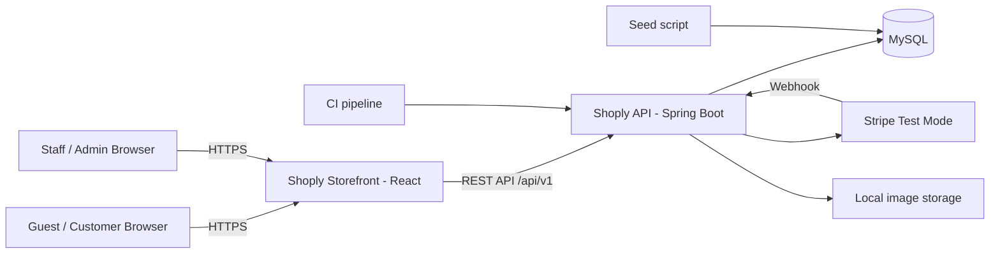

# Shoply — Software Requirements Specification (SRS)

| Field | Value |
|---|---|
| **Project name** | Shoply |
| **Document type** | Software Requirements Specification |
| **Version** | 1.0 |
| **Date** | 2026-11-03 |
| **Status** | 🟡 Draft — Awaiting stakeholder approval |
| **Author** | Business Analysis & Requirements Engineering |
| **Source of truth** | `docs/PROJECT_PLANNING.md` v1.0 (approved) |
| **Next phase** | Technical architecture + API contract (after approval) |
| **Code status** | ❌ No application code may be written until this document is approved |

---

## Document Control

| Version | Date | Change |
|---|---|---|
| 1.0 | 2026-11-03 | Initial SRS derived from the approved business plan |

**Rules governing this document:**

1. `PROJECT_PLANNING.md` is authoritative. Where this SRS adds detail, it must not contradict the plan. Where a gap exists, it is marked **[PLAN GAP]** and raised as a decision in [§33](#33-unresolved-decisions-requiring-approval).
2. Requirements are stated at the **behavioral level** (what the system must do), not the implementation level (how it is coded).
3. No major business assumption is made silently. Every unresolved matter is listed in [§33](#33-unresolved-decisions-requiring-approval).
4. Sections 17, 18 and parts of 19/20 describe features that are **explicitly deferred** by the approved plan. They are specified here so they are ready later, but they are **not part of the MVP**.

---

## Table of Contents

1. [Introduction](#1-introduction)
2. [Project Purpose](#2-project-purpose)
3. [Product Scope](#3-product-scope)
4. [Target Users](#4-target-users)
5. [User Roles and Permissions](#5-user-roles-and-permissions)
6. [Functional Requirements](#6-functional-requirements)
7. [Customer Features](#7-customer-features)
8. [Admin Features](#8-admin-features)
9. [Authentication Requirements](#9-authentication-requirements)
10. [Product Management Requirements](#10-product-management-requirements)
11. [Shopping Cart Requirements](#11-shopping-cart-requirements)
12. [Checkout Requirements](#12-checkout-requirements)
13. [Order Management Requirements](#13-order-management-requirements)
14. [Payment Requirements](#14-payment-requirements)
15. [Inventory Management Requirements](#15-inventory-management-requirements)
16. [Search and Filtering Requirements](#16-search-and-filtering-requirements)
17. [Reviews and Ratings](#17-reviews-and-ratings)
18. [Wishlist Requirements](#18-wishlist-requirements)
19. [Notifications](#19-notifications)
20. [Analytics and Reporting](#20-analytics-and-reporting)
21. [Non-Functional Requirements](#21-non-functional-requirements)
22. [Performance Requirements](#22-performance-requirements)
23. [Security Requirements](#23-security-requirements)
24. [Accessibility Requirements](#24-accessibility-requirements)
25. [Responsive Design Requirements](#25-responsive-design-requirements)
26. [Error Handling](#26-error-handling)
27. [Business Rules](#27-business-rules)
28. [Edge Cases](#28-edge-cases)
29. [Acceptance Criteria](#29-acceptance-criteria)
30. [MVP Scope](#30-mvp-scope)
31. [Future Features](#31-future-features)
32. [Summary of Requirements](#32-summary-of-requirements)
33. [Unresolved Decisions Requiring Approval](#33-unresolved-decisions-requiring-approval)

---

## 1. Introduction

### 1.1 Purpose

This document specifies the complete functional and non-functional requirements for **Shoply**, a premium single-vendor B2C ecommerce application. It is written for a **solo developer working with OpenCode as an AI development assistant**.

It serves three purposes:

1. **Binding scope** — defines exactly what V1 must do, so scope creep has something to push against.
2. **Build reference** — gives unambiguous, testable requirements that code can be generated against and verified against.
3. **Decision record** — separates *decided* requirements from *open* ones, so nothing gets silently assumed.

### 1.2 Scope of this document

Covers the storefront, customer account, admin back office, and platform-level requirements for V1 (MVP). It does **not** contain code, database DDL, API endpoint definitions, or UI designs — those belong to the architecture, API contract, and Figma phases that follow approval.

### 1.3 Document conventions

**Requirement identifiers**

| Prefix | Meaning | Example |
|---|---|---|
| `FR-GEN-*` | Cross-cutting functional requirement | FR-GEN-01 |
| `FR-CUS-*` | Customer/storefront feature | FR-CUS-03 |
| `FR-ADM-*` | Admin/back-office feature | FR-ADM-02 |
| `FR-AUTH-*` | Authentication/authorization | FR-AUTH-01 |
| `FR-PROD-*`, `FR-CAT-*` | Product & category management | FR-PROD-05 |
| `FR-CART-*` | Shopping cart | FR-CART-06 |
| `FR-CHK-*` | Checkout | FR-CHK-05 |
| `FR-ORD-*` | Order management | FR-ORD-02 |
| `FR-PAY-*` | Payment | FR-PAY-04 |
| `FR-INV-*` | Inventory | FR-INV-02 |
| `FR-SRCH-*` | Search & filtering | FR-SRCH-02 |
| `FR-REV-*`, `FR-WIS-*` | Reviews, wishlist (**deferred**) | FR-REV-01 |
| `FR-NTF-*`, `FR-ANL-*` | Notifications, analytics | FR-ANL-01 |
| `NFR-*`, `PERF-*`, `SEC-*`, `A11Y-*`, `RESP-*` | Non-functional, performance, security, accessibility, responsive | SEC-05 |
| `BR-*` | Business rule | BR-12 |
| `EC-*` | Edge case | EC-03 |
| `AC-*` | Acceptance criterion (system-level) | AC-05 |
| `DEC-*` | Unresolved decision | DEC-01 |

**Priority**

| Level | Meaning |
|---|---|
| **P0** | Mandatory for MVP. Removing it breaks a core purchase or management workflow. |
| **P1** | Should be in MVP; may be descoped under time pressure using the cut order in [§30.4](#304-descoping-order-if-time-runs-out). |
| **P2** | Nice to have; not expected in MVP. |
| **Deferred** | Explicitly out of MVP; specified for a later release. |

**Specification template.** Major features — those touching money, inventory, authentication, authorization, or a full user journey — receive the full template:

> Feature ID · Feature name · Description · User role · Preconditions · Expected behavior · Validation rules · Error scenarios · Acceptance criteria

Minor features receive a compact single-line specification. Shared validation and error tables are defined once per section and referenced.

### 1.4 Definitions and acronyms

| Term | Definition |
|---|---|
| **SKU** | Stock Keeping Unit — the unique sellable variant (product × size × color). |
| **Variant** | A specific sellable combination of a product's options; carries SKU and stock. |
| **PDP** | Product Detail Page. |
| **PLP** | Product Listing Page. |
| **RBAC** | Role-Based Access Control. |
| **State machine** | The set of order statuses and the only legal transitions between them. |
| **Idempotency** | Guaranteeing that repeating the same request produces the same result, not a duplicate. |
| **Oversell** | Selling more units than are in stock. |
| **Snapshot** | Data copied onto an order at purchase time so later catalog changes never rewrite history. |
| **Minor units** | Money stored as whole cents (integer), never decimal/floating point. |
| **MVP** | Minimum Viable Product — V1 in this document. |
| **WCAG** | Web Content Accessibility Guidelines. |
| **Test mode** | Payment provider's sandbox; no real money moves. |

### 1.5 References

| Ref | Document |
|---|---|
| [R1] | `docs/PROJECT_PLANNING.md` v1.0 — approved business plan (source of truth) |
| [R2] | WCAG 2.1 AA — accessibility standard |
| [R3] | Stripe test-mode documentation (payment integration, to be consulted in architecture phase) |

### 1.6 Intended audience

| Reader | Use |
|---|---|
| Stakeholder / developer | Approve scope and open decisions |
| OpenCode (AI assistant) | Generate code against explicit, testable requirements |
| Future technical design phase | Derive domain model, API contract, and test plan |

---

## 2. Project Purpose

### 2.1 Problem statement

Shoply addresses two problems simultaneously (see [R1] §2.2):

1. **Real (portfolio):** ecommerce demos are ubiquitous and mostly fake — browser-local carts, no backend authority, no payment, no inventory. Interviewers probe with questions like *"what happens when two people buy the last item?"* and most candidates cannot answer. Shoply must be able to answer.
2. **Fictional (domain):** a small premium apparel brand needs a fast, visually distinctive storefront plus an accurate back office for products, stock, and orders — instead of a generic template with manual spreadsheet operations.

### 2.2 Business objectives for V1

| # | Objective | Measured by |
|---|---|---|
| O1 | A complete, real purchase can be completed end-to-end | Test-card checkout succeeds first try |
| O2 | The store can be run entirely from the admin UI | Admin creates a product and sells it without DB access |
| O3 | The system is demonstrably production-shaped | Migrations, tests, CI, Docker, README all present |
| O4 | The design is genuinely premium | Figma design system translated into the UI |
| O5 | The project **ships** | Live demo deployed, not 80% complete |

### 2.3 Success metrics

Inherited from [R1] §10: checkout completion ≥ 70% (fictional), mobile checkout < 2 minutes, payment success ≥ 95% (test mode), **zero overselling incidents**, p95 API latency < 300 ms, all money/inventory paths covered by automated tests.

### 2.4 Out-of-purpose statements

Shoply is **not** intended to: process real money, acquire real customers, handle real personal data at scale, or serve production traffic. It demonstrates production *practices*, not production *load*.

---

## 3. Product Scope

### 3.1 In scope (V1)

| Area | Included |
|---|---|
| **Storefront** | Home, product listing with filters/sort/pagination, product detail with variants and gallery, server-side search, server-side cart (guest + authenticated, merged on login), checkout with address and shipping method, payment in test mode, order confirmation, order history |
| **Account** | Registration, login, logout, profile, address book, order history/detail, password change |
| **Admin** | RBAC, product & variant CRUD with draft/publish/archive, category management, inventory adjustment with low-stock flagging, order management with enforced state transitions, customer management, KPI dashboard |
| **Platform** | MySQL schema via migrations, seed data, layered REST API, error envelope, pagination convention, health check, Docker Compose, tests on critical paths, CI, README, Figma design file |

### 3.2 Out of scope (V1)

Reviews, wishlists, coupons/discounts, transactional email, returns/RMA workflow, real shipping-rate and tax engines, recommendations, i18n/multi-currency, PWA/native app, microservices, Elasticsearch, subscriptions, loyalty, marketplace/multi-vendor, audit-log UI, gift cards, product Q&A, live chat.

> Sections [17](#17-reviews-and-ratings) and [18](#18-wishlist-requirements) specify deferred features so they are ready for V1.5, but they are **not** MVP requirements and must not be built in V1.

### 3.3 System context



### 3.4 External dependencies

| Dependency | Use in V1 | Criticality |
|---|---|---|
| MySQL 8 | Primary datastore | Hard dependency |
| Stripe (test mode) | Payment intent, confirmation, refund, webhook | Hard — fallback is a mock gateway behind the same interface ([R1] §6) |
| Image host / local storage | Product imagery | Soft — seeded assets ship with the repo |
| Cloud hosts (free tier) | Live demo deployment | Soft — local Docker Compose is the baseline |

**No** email provider, shipping carrier, tax service, or analytics/tracking provider is integrated in V1.

### 3.5 Assumptions inherited from the approved plan

Treated as approved defaults; listed only for transparency:

1. Single market, English, USD, one shipping country or flat rate ([R1] §11 A2).
2. Stripe test mode acceptable; mock gateway is the fallback ([R1] §11 A3).
3. Guest checkout included (Q3 default).
4. Basic KPI cards in V1, charts later (Q4 default).
5. Docker Compose locally + free-tier cloud hosts (Q5 default).
6. Live demo expected (Q6 default).
7. Product category: **apparel & accessories** (Q1 default).

Items 1, 2 and 7 are re-confirmed as decisions [DEC-30](#33-unresolved-decisions-requiring-approval) to [DEC-32](#33-unresolved-decisions-requiring-approval) in case the approval was implicit.

---

## 4. Target Users

### 4.1 Personas (product users)

Full personas are in [R1] §4. Summary of what each requires from the system:

| Persona | Primary need | Key requirements |
|---|---|---|
| **Maya** — design-conscious professional (primary) | Fast, confident purchase on mobile | Saved addresses, clear sizing/materials, < 2 min checkout, no visual clutter |
| **Daniel** — gift buyer (secondary) | Reassurance and speed | Guest checkout, delivery window visible **before** payment, clear pricing with no surprises |
| **Sofia** — returning loyalist (tertiary) | Continuity | Order history, remembered addresses, reorder with pre-filled data |

### 4.2 Real user (portfolio reviewer)

Judges build quality in 60–120 seconds: opens the live demo, performs a purchase, inspects README and code. Requirements derived: the demo must work unaided, seeded data must look real, and no lorem ipsum may appear anywhere (see [BR-33](#27-business-rules)).

### 4.3 Operational users

| User | Description |
|---|---|
| **Store operator (ADMIN)** | Full control: catalog, pricing visibility, orders, refunds, customers, roles, settings |
| **Fulfillment staff (STAFF)** | Day-to-day order processing and stock adjustments; no destructive or commercial authority |

### 4.4 Usage context

- Mobile-first: majority of traffic at 375–430 px width, on cellular connections.
- Storefront: anonymous browsing is the default state; authentication is optional until purchase.
- Admin: desktop-first (≥ 1024 px), authenticated, low volume.
- Sessions may be interrupted at any point (reload, backgrounding, network loss) — **no step may lose user input** (see [BR-30](#27-business-rules)).

---

## 5. User Roles and Permissions

### 5.1 Roles

| Role | Description | Assignment |
|---|---|---|
| `GUEST` | Anonymous visitor. Owns a session-bound cart; may check out. | Implicit |
| `CUSTOMER` | Registered shopper. Owns profile, addresses, carts, orders. | On registration |
| `STAFF` | Operational back-office user. Fulfills orders, adjusts stock, edits products. | By ADMIN |
| `ADMIN` | Full back-office authority including publish, categories, customers, roles, refunds, settings. | By ADMIN (seeded initially) |

> `GUEST` is an anonymous identity, not a database role. The authoritative roles persisted are `CUSTOMER`, `STAFF`, `ADMIN`.

### 5.2 Permission matrix

Inherited from [R1] §2.9. **Enforcement is at the API layer; hiding UI is not authorization.**

| Capability | GUEST | CUSTOMER | STAFF | ADMIN |
|---|---|---|---|---|
| Browse catalog, search, view PDP | ✅ | ✅ | ✅ | ✅ |
| Maintain a cart | ✅ | ✅ | ✅ | ✅ |
| Checkout & pay | ✅ | ✅ | ✅ | ✅ |
| Own profile, addresses, orders | ❌ | ✅ | ✅ | ✅ |
| View **all** orders | ❌ | ❌ | ✅ | ✅ |
| Transition order status (fulfillment path) | ❌ | ❌ | ✅ | ✅ |
| Cancel an unpaid order | ❌ | ❌ | ✅ | ✅ |
| Issue refund / cancel a paid order | ❌ | ❌ | ⚠️ **DEC-11** | ✅ |
| View inventory, adjust stock | ❌ | ❌ | ✅ | ✅ |
| Create / edit products & variants | ❌ | ❌ | ✅ | ✅ |
| Publish / unpublish / archive products | ❌ | ❌ | ❌ | ✅ |
| Manage categories | ❌ | ❌ | ❌ | ✅ |
| Manage customers, change roles, block | ❌ | ❌ | ❌ | ✅ |
| View dashboard KPIs | ❌ | ❌ | ✅ | ✅ |
| Store settings configuration | ❌ | ❌ | ❌ | ✅ |

### 5.3 Authorization rules

| ID | Rule |
|---|---|
| **FR-AUTH-07** | Every non-public API endpoint declares its required role(s); the request is rejected with `403 FORBIDDEN` when the authenticated role is insufficient. |
| **FR-AUTH-07a** | Customer-owned resources (orders, addresses, carts) are additionally scoped to the authenticated user id. A valid session accessing another user's resource returns `404 NOT_FOUND` (not `403`) to avoid resource-existence disclosure. |
| **FR-AUTH-07b** | Client-supplied role, user id, price, stock, or total fields are **never** trusted; they are recomputed server-side. |
| **FR-AUTH-10** | A blocked (`ACTIVE = false`) account cannot authenticate, cannot use an existing session for mutating operations, and cannot check out. Existing historical orders remain visible and untouched. |

### 5.4 Guard rails

| ID | Rule | Reason |
|---|---|---|
| **FR-AUTH-11** | The **last remaining active `ADMIN`** cannot be demoted, blocked, or deleted — including by themselves. | Prevents permanent lockout of the store |
| **FR-AUTH-12** | Role changes take effect on the next request (no cached authorization beyond token lifetime). | Immediate enforcement |
| **FR-AUTH-13** | Admin users authenticate through a **separate admin login route** ([R1] §2.6) with the same credential store; `CUSTOMER`-only accounts attempting admin routes receive `403`. | Clear separation of surfaces |

### 5.5 Session & identity model

| ID | Behavior |
|---|---|
| **FR-AUTH-09** | Anonymous visitors receive an opaque guest identifier cookie that binds their cart. It is not an authentication credential and grants access only to that guest's cart. |
| **FR-AUTH-04** | Authenticated users remain signed in across reloads and browser restarts until session expiry or logout. Expiry silently redirects to login **preserving the intended destination** and, for checkout, the in-progress checkout data. |
| **FR-AUTH-14** | On logout, the session is invalidated server-side (the token/cookie is not merely discarded client-side), and the guest identifier rotates to a fresh one. |

---

## 6. Functional Requirements

### 6.1 Numbering and status conventions

Every requirement carries an ID, a priority, and a status:

| Status | Meaning |
|---|---|
| **Approved** | Directly derived from [R1]; no further approval needed |
| **Proposed** | Added by this SRS to close a gap; needs stakeholder approval |
| **Open** | Requires a business decision ([§33](#33-unresolved-decisions-requiring-approval)) before it can be finalized |
| **Deferred** | Specified but excluded from MVP |

### 6.2 Master requirements index

#### Cross-cutting (§6.4)

| ID | Requirement | Pri | Status |
|---|---|---|---|
| FR-GEN-01 | Uniform API error envelope | P0 | Approved |
| FR-GEN-02 | Pagination convention | P0 | Approved |
| FR-GEN-03 | Dual-layer validation (client + server) | P0 | Approved |
| FR-GEN-04 | Loading, empty, and error states for every view | P0 | Approved |
| FR-GEN-05 | Filter/sort/search state reflected in the URL | P0 | Approved |
| FR-GEN-06 | Health check endpoint | P0 | Approved |
| FR-GEN-07 | Slug-based public URLs (no raw IDs) | P0 | Approved |
| FR-GEN-08 | Money stored and transmitted in minor units | P0 | Approved |
| FR-GEN-09 | Repeatable, realistic seed data | P0 | Approved |
| FR-GEN-10 | Schema changes only via versioned migrations | P0 | Approved |

#### Customer / storefront (§7)

| ID | Requirement | Pri | Status |
|---|---|---|---|
| FR-CUS-01 | Home page (hero, featured, new arrivals, categories) | P0 | Approved |
| FR-CUS-02 | Product listing page with pagination | P0 | Approved |
| FR-CUS-03 | Product detail page (gallery, variants, price, stock, size guide) | P0 | Approved |
| FR-CUS-04 | Account dashboard & profile | P0 | Approved |
| FR-CUS-05 | Address book CRUD with default flag | P0 | Approved |
| FR-CUS-06 | Order history and order detail with status timeline | P0 | Approved |
| FR-CUS-07 | Post-purchase account creation prompt (guest) | P1 | Approved |
| FR-CUS-08 | Static policy pages (shipping, returns, privacy, terms) | P1 | **Proposed** [DEC-25] |
| FR-CUS-09 | Size guide content on PDP | P0 | Approved |
| FR-CUS-10 | Global layout: header, navigation, footer, cart badge | P0 | Approved |

#### Admin (§8)

| ID | Requirement | Pri | Status |
|---|---|---|---|
| FR-ADM-01 | Admin console shell on a separate route | P0 | Approved |
| FR-ADM-02 | Dashboard KPI cards | P1 | Approved |
| FR-ADM-03 | Order management console | P0 | Approved |
| FR-ADM-04 | Customer management (view, block, role change) | P1 | Approved |
| FR-ADM-05 | Home-page merchandising control (featured products) | P1 | **Open** [DEC-24] |
| FR-ADM-06 | Store settings panel | P2 | **Open** [DEC-26] |

#### Authentication (§9)

| ID | Requirement | Pri | Status |
|---|---|---|---|
| FR-AUTH-01 | Registration | P0 | Approved |
| FR-AUTH-02 | Login | P0 | Approved |
| FR-AUTH-03 | Logout | P0 | Approved |
| FR-AUTH-04 | Session persistence & expiry behavior | P0 | Approved |
| FR-AUTH-05 | Password change | P0 | Approved |
| FR-AUTH-06 | Password reset (forgot password) | — | **Deferred to V1.5** |
| FR-AUTH-07 | API-layer role enforcement | P0 | Approved |
| FR-AUTH-08 | Brute-force protection / rate limiting | P0 | Proposed |
| FR-AUTH-09 | Guest identity binding for carts | P0 | Approved |
| FR-AUTH-10 | Blocked-account enforcement | P0 | Approved |
| FR-AUTH-11 | Last-admin guard rail | P0 | Approved |
| FR-AUTH-12 | Immediate role-change effect | P0 | Approved |
| FR-AUTH-13 | Separate admin login route | P0 | Approved |
| FR-AUTH-14 | Server-side session invalidation on logout | P0 | Approved |

#### Product & category management (§10)

| ID | Requirement | Pri | Status |
|---|---|---|---|
| FR-PROD-01 | Create product (as draft) | P0 | Approved |
| FR-PROD-02 | Edit product | P0 | Approved |
| FR-PROD-03 | Archive product (no hard delete) | P0 | Approved |
| FR-PROD-04 | Publish / unpublish (ADMIN only) | P0 | Approved |
| FR-PROD-05 | Variant management (SKU, options, price override, stock) | P0 | Approved |
| FR-PROD-06 | Image assignment & ordering | P0 | Approved |
| FR-PROD-07 | Admin product list with search/filter | P0 | Approved |
| FR-CAT-01 | Category CRUD (ADMIN only) | P0 | Approved |
| FR-CAT-02 | Category navigation with product counts | P0 | Approved |
| FR-CAT-03 | Slug generation & uniqueness | P0 | Approved |

#### Cart (§11)

| ID | Requirement | Pri | Status |
|---|---|---|---|
| FR-CART-01 | Add item to cart | P0 | Approved |
| FR-CART-02 | View cart (server-authoritative) | P0 | Approved |
| FR-CART-03 | Update line quantity | P0 | Approved |
| FR-CART-04 | Change variant of an existing line | P0 | Approved |
| FR-CART-05 | Remove line | P0 | Approved |
| FR-CART-06 | Live stock validation on every mutation | P0 | Approved |
| FR-CART-07 | Guest cart persistence across sessions/reloads | P0 | Approved |
| FR-CART-08 | Cart merge on login | P1 | Approved |
| FR-CART-09 | Header cart badge (count of units) | P0 | Approved |
| FR-CART-10 | Guest cart expiry & cleanup | P1 | **Open** [DEC-14] |
| FR-CART-11 | Price revalidation on cart load | P0 | Approved |

#### Checkout (§12)

| ID | Requirement | Pri | Status |
|---|---|---|---|
| FR-CHK-01 | Checkout entry guard | P0 | Approved |
| FR-CHK-02 | Address capture / selection | P0 | Approved |
| FR-CHK-03 | Shipping method selection | P0 | **Open** [DEC-05] |
| FR-CHK-04 | Order summary with all costs shown before payment | P0 | Approved |
| FR-CHK-05 | Place order (idempotent, server-computed totals) | P0 | Approved |
| FR-CHK-06 | Payment failure recovery without losing data | P0 | Approved |
| FR-CHK-07 | Checkout state survives refresh/navigation | P0 | Approved |

#### Orders (§13)

| ID | Requirement | Pri | Status |
|---|---|---|---|
| FR-ORD-01 | Order creation with immutable snapshot | P0 | Approved |
| FR-ORD-02 | Order state machine with server-enforced legal transitions | P0 | Approved |
| FR-ORD-03 | Customer order list, detail, and status timeline | P0 | Approved |
| FR-ORD-04 | Customer cancellation of unpaid orders | P0 | Approved |
| FR-ORD-05 | Admin order list with filters and search | P0 | Approved |
| FR-ORD-06 | Admin status transition action | P0 | Approved |
| FR-ORD-07 | Refund execution | P0 | **Open** [DEC-08], [DEC-11] |
| FR-ORD-08 | Human-readable unique order number | P0 | **Open** [DEC-17] |
| FR-ORD-09 | Order status history (audit trail for timeline) | P0 | Proposed |
| FR-ORD-10 | Automatic expiry of unpaid orders with stock restore | P0 | **Open** [DEC-02] |

#### Payments (§14)

| ID | Requirement | Pri | Status |
|---|---|---|---|
| FR-PAY-01 | Payment intent creation (test mode) | P0 | Approved |
| FR-PAY-02 | Hosted payment form (card data never on our server) | P0 | Approved |
| FR-PAY-03 | Payment confirmation → order `PAID` | P0 | Approved |
| FR-PAY-04 | Idempotent order/payment creation | P0 | Approved |
| FR-PAY-05 | Signed webhook processing | P0 | Approved |
| FR-PAY-06 | Payment failure handling | P0 | **Open** [DEC-03] |
| FR-PAY-07 | Full refund execution | P0 | **Open** [DEC-08] |
| FR-PAY-08 | Payment record retained for audit | P0 | Approved |

#### Inventory (§15)

| ID | Requirement | Pri | Status |
|---|---|---|---|
| FR-INV-01 | Stock tracked per SKU | P0 | Approved |
| FR-INV-02 | Transactional, conditional stock decrement | P0 | **Open** [DEC-01] |
| FR-INV-03 | Stock restoration on cancellation | P0 | **Open** [DEC-01], [DEC-09] |
| FR-INV-04 | Admin inventory console with low-stock filter | P0 | Approved |
| FR-INV-05 | Manual stock adjustment with reason | P0 | Approved |
| FR-INV-06 | Low-stock threshold and flagging | P1 | **Open** [DEC-13] |
| FR-INV-07 | Availability display on PDP/listing | P0 | **Open** [DEC-16] |
| FR-INV-08 | Oversell prevention guarantee (+ concurrency test) | P0 | Approved |
| FR-INV-09 | Stock movement ledger | P1 | Proposed |

#### Search & filtering (§16)

| ID | Requirement | Pri | Status |
|---|---|---|---|
| FR-SRCH-01 | Keyword search over name/description | P0 | Approved |
| FR-SRCH-02 | Faceted filters (category, size, color, price) | P0 | Approved |
| FR-SRCH-03 | Sort options (whitelisted) | P0 | Approved |
| FR-SRCH-04 | Pagination with stable ordering | P0 | Approved |
| FR-SRCH-05 | Filter state in URL (shareable, back-button safe) | P0 | Approved |
| FR-SRCH-06 | Result count and recoverable empty state | P0 | Approved |
| FR-SRCH-07 | Facet result counts | P2 | Proposed |

#### Deferred (§17–§19) and analytics (§20)

| ID | Requirement | Release | Status |
|---|---|---|---|
| FR-REV-01…06 | Reviews & ratings | V1.5 | Deferred |
| FR-WIS-01…04 | Wishlist | V1.5 | Deferred |
| FR-NTF-01…04 | In-app notifications | V1 | Approved |
| FR-NTF-05…06 | Email notifications | V2 | Deferred |
| FR-ANL-01…05 | Dashboard analytics (KPIs) | V1 (P1) | Approved |
| FR-ANL-06…08 | Advanced reporting, charts, export | V2 | Deferred |

### 6.3 Traceability summary

| Section | FR count | MVP | Deferred |
|---|---|---|---|
| Cross-cutting | 10 | 10 | 0 |
| Customer | 10 | 10 | 0 |
| Admin | 6 | 4 | 0 (2 open) |
| Authentication | 14 | 13 | 1 |
| Product/Category | 10 | 10 | 0 |
| Cart | 11 | 11 | 0 |
| Checkout | 7 | 7 | 0 |
| Orders | 10 | 10 | 0 |
| Payments | 8 | 8 | 0 |
| Inventory | 9 | 9 | 0 |
| Search | 7 | 6 | 1 |
| Reviews/Wishlist/Notifications/Analytics | 18 | 4 | 14 |
| **Total** | **120** | **102** | **18** |

### 6.4 Cross-cutting functional requirements

| ID | Requirement | Acceptance |
|---|---|---|
| **FR-GEN-01** | Every API error response uses one envelope: `code` (machine-readable), `message` (human-readable), `fieldErrors[]` (optional), `requestId`. | No endpoint returns a bare stack trace or HTML error page. |
| **FR-GEN-02** | List endpoints accept `page`, `size`, `sort` with defaults and a documented maximum `size` (default 24, max 48). Ordering always includes a unique tiebreaker so rows never duplicate or skip across pages. | Paging through a filtered set yields each row exactly once. |
| **FR-GEN-03** | Validation runs on the client (immediate feedback) and again on the server (authoritative). Server rejection uses `400 VALIDATION_ERROR` with per-field messages. | Manipulating a client payload cannot bypass a server rule. |
| **FR-GEN-04** | Every data-driven view implements four states: loading (skeleton), populated, empty (with a recovery action), and error (with retry). | No view renders a bare spinner indefinitely or a blank screen on failure. |
| **FR-GEN-05** | Listing filters, sort, search query, and page are encoded in the URL query string. Back/forward navigation restores state exactly. | Sharing a filtered URL reproduces the same result set. |
| **FR-GEN-06** | An unauthenticated health endpoint reports database connectivity and application status. | Returns `200` when healthy, `503` when the DB is unreachable. |
| **FR-GEN-07** | Public product/category URLs use slugs (`/products/slim-oolong-shirt`). Numeric IDs never appear in public URLs. | Direct navigation by slug works; ID-based public URLs are not generated. |
| **FR-GEN-08** | All money values are integer minor units end-to-end (API and DB). Float/decimal money is prohibited. | `$19.99` is represented as `1999`; totals are exact across aggregation. |
| **FR-GEN-09** | A repeatable seed script creates a realistic catalog: 4–5 categories, 40–60 products, ~250–400 SKUs, images, admin/staff/customer accounts. Re-running it does not duplicate data. | Fresh environment → complete demo-ready store in one command. |
| **FR-GEN-10** | Schema is created and evolved exclusively through versioned migrations; automatic schema generation is disabled in all environments. | Applying migrations to an empty database yields a working schema; re-applying is a no-op. |

---

## 7. Customer Features

### 7.1 FR-CUS-01 — Home page

**ID:** FR-CUS-01 · **Role:** GUEST, CUSTOMER · **Priority:** P0 · **Status:** Approved

| Field | Value |
|---|---|
| **Description** | Entry point that establishes the brand and routes users into the catalog. |

**Preconditions:** None — publicly accessible.

**Expected behavior:**
1. Renders a hero section with a primary call-to-action into a collection or category.
2. Renders merchandised modules: featured collection, new arrivals, and category entry points.
3. Each module shows real product data (image, name, price) and links to the PDP.
4. Merchandised items come from published, in-stock products only.
5. First contentful paint < 2.0 s and LCP < 3.5 s on 4G ([PERF-01](#22-performance-requirements)).

**Validation rules:** None (read-only view).

**Error scenarios:**
| Scenario | Handling |
|---|---|
| Backend unreachable | Error state with retry (FR-GEN-04); static shell still renders |
| A merchandised product is archived mid-session | Link resolves to 404 page with a route back to the catalog |

**Acceptance criteria:**
- [ ] Home renders from live API data, not hard-coded fixtures
- [ ] No placeholder/lorem text appears anywhere
- [ ] All CTAs lead to a valid catalog view
- [ ] Modules show only `PUBLISHED` products

> **[PLAN GAP — DEC-24]:** [R1] §2.9 Workflow D implies admin-controlled featured products, but [R1] §2.6 does not list it as a V1 feature. Requirement is P1 and open: admin-selectable merchandising vs. seeded/static modules.

---

### 7.2 FR-CUS-02 — Product listing page (PLP)

**ID:** FR-CUS-02 · **Role:** GUEST, CUSTOMER · **Priority:** P0 · **Status:** Approved

| Field | Value |
|---|---|
| **Description** | Grid of products within a category or search result, with filtering, sorting, and pagination. |

**Preconditions:** None.

**Expected behavior:**
1. Displays a responsive grid of product cards: image, name, price (and compare-at price struck through when applicable), and availability badge.
2. Supports category, size, color, and price-range filters; sort by price (asc/desc) and newest (FR-SRCH-02/03).
3. Paginates with stable ordering (FR-SRCH-04).
4. Filter/sort/page state is reflected in the URL (FR-SRCH-05).
5. Shows total result count and a recoverable empty state (FR-SRCH-06).

**Validation rules:** See [§16.4](#164-shared-validation-and-error-tables-searchlisting).

**Error scenarios:** See [§16.4](#164-shared-validation-and-error-tables-searchlisting) — invalid sort falls back to default; page beyond range returns an empty set with navigation back.

**Acceptance criteria:**
- [ ] Only `PUBLISHED` products of the selected category appear
- [ ] Filter combination producing zero results shows a clear "clear filters" action
- [ ] Back button restores the previous filter state exactly
- [ ] Card price matches the PDP price for the same product

---

### 7.3 FR-CUS-03 — Product detail page (PDP)

**ID:** FR-CUS-03 · **Role:** GUEST, CUSTOMER · **Priority:** P0 · **Status:** Approved

| Field | Value |
|---|---|
| **Description** | Full product presentation and the only surface that adds items to the cart. |

**Preconditions:** Product exists, is `PUBLISHED`, and is reachable by slug.

**Expected behavior:**
1. Renders an image gallery (3–5 images) with thumbnail navigation and alt text.
2. Renders name, price (plus compare-at price when set), description, material/care details.
3. Renders variant selectors for size and color; selecting a combination resolves to a specific SKU and its stock state.
4. Renders availability: `In stock` / `Only N left` / `Sold out` per [DEC-16](#33-unresolved-decisions-requiring-approval).
5. Renders size guide reference (FR-CUS-09).
6. **Add to cart is disabled until all required options are selected**, and disabled entirely when the selected SKU is out of stock.
7. Add-to-cart provides immediate feedback (confirmation and cart badge update) without a full page reload.

**Validation rules:**
| Rule | Violation response |
|---|---|
| All required options selected before add | Client-side message: "Please select a size" — no API call |
| SKU must be active and product published | `409 PRODUCT_UNAVAILABLE` |
| Requested quantity ≤ available stock | `409 INSUFFICIENT_STOCK` |

**Error scenarios:**
| Scenario | Handling |
|---|---|
| Unknown slug | 404 page with catalog link |
| Product archived while PDP open, then add-to-cart | `409 PRODUCT_UNAVAILABLE`, user informed the product is no longer available |
| Stock changed since page load | Server returns actual available quantity; UI updates rather than failing silently |

**Acceptance criteria:**
- [ ] Adding a valid item updates the server-side cart and header badge
- [ ] Out-of-stock SKU cannot be added and is visually marked
- [ ] Every image has meaningful alt text
- [ ] Price shown equals price charged at checkout (no drift)

---

### 7.4 FR-CUS-04 — Account dashboard & profile

**ID:** FR-CUS-04 · **Role:** CUSTOMER · **Priority:** P0 · **Status:** Approved

**Description:** Landing area of the customer account showing profile details and shortcuts to orders and addresses.

**Preconditions:** Authenticated as `CUSTOMER` (or staff/admin viewing their own account).

**Expected behavior:** View name and email; edit display name; change password (FR-AUTH-05); navigate to order history (FR-CUS-06) and address book (FR-CUS-05); logout.

**Validation rules:** Email is **not** editable in V1 **[Proposed — DEC-20]**; name 2–100 chars; password change requires current password.

**Error scenarios:** Current password incorrect → `400 VALIDATION_ERROR` on the password field; session expired → redirect to login preserving destination.

**Acceptance criteria:**
- [ ] Unauthenticated access redirects to login
- [ ] Password change invalidates other sessions (FR-AUTH-05)
- [ ] Profile edits persist across sessions

---

### 7.5 FR-CUS-05 — Address book

**ID:** FR-CUS-05 · **Role:** CUSTOMER · **Priority:** P0 · **Status:** Approved

**Description:** CRUD management of saved shipping addresses with a single default.

**Preconditions:** Authenticated.

**Expected behavior:**
1. List saved addresses with a clear default marker.
2. Add address (validated per [§12.2](#122-shared-address-validation)).
3. Edit and delete addresses.
4. Set one address as default; the default is pre-selected at checkout.
5. Deleting an address never affects existing orders (orders hold an address snapshot — [BR-17](#27-business-rules)).

**Validation rules:** Field rules in §12.2. Maximum **20 addresses per account** `[Proposed]`.

**Error scenarios:** Deleting the default address → the oldest remaining address becomes default (or the user is prompted to choose one) `[Proposed]`; deleting a non-existent address → `404`.

**Acceptance criteria:**
- [ ] Exactly one address can be default at any time
- [ ] Checkout pre-selects the default address
- [ ] Deleting an address leaves past orders fully readable

---

### 7.6 FR-CUS-06 — Order history & order detail

**ID:** FR-CUS-06 · **Role:** CUSTOMER · **Priority:** P0 · **Status:** Approved

**Description:** The customer's list of orders and the detailed view of a single order, including a status timeline.

**Preconditions:** Authenticated; order belongs to the requesting user (otherwise `404`).

**Expected behavior:**
1. Order list: order number, date, status badge, total, item count; newest first; paginated.
2. Order detail: line items (name, SKU, options, unit price, quantity), totals breakdown, shipping address snapshot, placed timestamp, status timeline built from status history (FR-ORD-09).
3. Timeline shows only states the order has actually entered, with timestamps.
4. **Cancel order** action is offered only when the order is cancellable (FR-ORD-04).
5. Reorder support: an action that re-adds available line items to the cart and reports any that are unavailable `[Proposed — P1]`.

**Validation rules:** Cancellation allowed only in `PENDING` (subject to [DEC-10](#33-unresolved-decisions-requiring-approval)); quantity of a cancelled order does not exceed original.

**Error scenarios:** Order of another user → `404`; cancel an already-cancelled order → `409 ILLEGAL_TRANSITION`; reorder with out-of-stock items → partial success with an explicit list of skipped items.

**Acceptance criteria:**
- [ ] Only the owner can see an order
- [ ] Timeline matches the actual status history table
- [ ] Cancel is hidden/disabled outside `PENDING`, and the API rejects it regardless of UI state

---

### 7.7 FR-CUS-07 — Post-purchase account prompt (guest)

**ID:** FR-CUS-07 · **Role:** GUEST · **Priority:** P1 · **Status:** Approved

**Description:** After a successful guest purchase, offer account creation to attach the order to a persistent account.

**Preconditions:** Order was placed as a guest; user is not authenticated.

**Expected behavior:**
1. Confirmation page displays the order number and a prompt: "Create an account to track this order."
2. The email field is pre-filled with the guest checkout email.
3. On successful registration with the **same email**, previously placed guest orders become visible in the new account's order history.
4. Declining leaves the guest able to view the order via the confirmation page.

**Validation rules:** Registration rules per FR-AUTH-01; linking requires exact email match.

**Error scenarios:** Email already registered → prompt to log in instead, then orders link on login; linking fails → orders remain accessible via confirmation page, non-blocking warning shown.

**Acceptance criteria:**
- [ ] Guest order appears in account history after matching-email registration
- [ ] No order is ever lost or duplicated by this flow
- [ ] Prompt is dismissible and does not block the confirmation view

---

### 7.8 FR-CUS-08 — Static policy pages

**ID:** FR-CUS-08 · **Role:** GUEST, CUSTOMER · **Priority:** P1 · **Status:** Proposed [DEC-25]

**Description:** Minimal static content pages: shipping policy (methods, costs, delivery windows), returns policy, privacy, terms.

**Expected behavior:** Reachable from footer and from checkout (delivery estimate link); content is editable configuration/CMS-lite content, not hard-coded in components.

**Acceptance criteria:** [ ] Shipping and delivery information shown at checkout matches the policy page verbatim; [ ] No lorem ipsum.

> **[PLAN GAP]:** [R1] personas (Daniel) explicitly require visible delivery dates and returns policy, but [R1] §2.6 does not list policy pages. Recommended as a low-cost, high-trust addition.

---

### 7.9 FR-CUS-09 — Size guide

**ID:** FR-CUS-09 · **Role:** GUEST, CUSTOMER · **Priority:** P0 · **Status:** Approved

**Description:** Sizing information reachable from the PDP (modal or page), per [R1] §2.4.

**Expected behavior:** Global size chart (measurements per size); optional per-product sizing note; openable by keyboard and closable with Escape.

**Acceptance criteria:** [ ] Available on every apparel PDP; [ ] Accessible as a dialog (focus trapped, focus returned on close).

**Open sub-decision:** [DEC-21](#33-unresolved-decisions-requiring-approval) — single global chart vs. per-product charts.

---

### 7.10 FR-CUS-10 — Global layout

**ID:** FR-CUS-10 · **Role:** All · **Priority:** P0 · **Status:** Approved

**Description:** Persistent header, primary navigation (categories), search entry, account entry, cart badge; footer with policy links and brand info.

**Expected behavior:** Responsive behavior per [§25](#25-responsive-design-requirements); cart badge shows unit count and updates without reload; navigation is fully keyboard operable; current route is indicated.

**Acceptance criteria:** [ ] No layout shift when badge count changes; [ ] Mobile navigation works with keyboard and touch; [ ] Footer links resolve.

---

## 8. Admin Features

> All admin features are enforced server-side per [§5.3](#53-authorization-rules). The admin UI is desktop-first but must remain usable at 768 px ([RESP-06](#25-responsive-design-requirements)).

### 8.1 FR-ADM-01 — Admin console shell

**ID:** FR-ADM-01 · **Role:** STAFF, ADMIN · **Priority:** P0 · **Status:** Approved

**Description:** A separate `/admin` area with its own layout, navigation, and login route (FR-AUTH-13).

**Preconditions:** Authenticated with role `STAFF` or `ADMIN`.

**Expected behavior:**
1. Accessing `/admin` unauthenticated redirects to the admin login route.
2. `CUSTOMER` accounts are rejected with `403` and never see admin navigation.
3. Navigation adapts to role: menu items the role cannot use are not rendered **and** their endpoints return `403` if called directly.
4. Admin area never renders storefront chrome (and vice versa) to avoid confusion.

**Error scenarios:** Session expiry inside admin → redirect to admin login preserving the destination; insufficient role → 403 view with a link back to the storefront.

**Acceptance criteria:**
- [ ] A `CUSTOMER` token cannot call any `/api/v1/admin/**` endpoint (verified by test)
- [ ] Direct URL navigation to an unauthorized admin route is rejected
- [ ] Role-restricted menu items are absent for STAFF

---

### 8.2 FR-ADM-02 — Dashboard KPI cards

**ID:** FR-ADM-02 · **Role:** STAFF, ADMIN · **Priority:** P1 · **Status:** Approved

**Description:** At-a-glance store health, per [R1] §2.6.

**Expected behavior:**
1. KPI cards: **revenue, order count, average order value, low-stock count** for a selected date range.
2. **Recent orders** widget (last 10, linking to order detail).
3. **Top products** widget (by units and revenue) within the range.
4. **Low-stock** widget listing SKUs at/below threshold, linking to inventory.
5. Default range last 30 days; selectable 7/30/90 days (FR-ANL-02).

**Validation rules:** Range bounds validated; invalid range falls back to default.

**Error scenarios:** No data in range → explicit "no orders in this period" empty state (not zeros that look like failures); aggregation failure → per-widget error, not a blank dashboard.

**Acceptance criteria:**
- [ ] Revenue excludes cancelled orders and is derived from captured payments (see [DEC-22](#33-unresolved-decisions-requiring-approval))
- [ ] AOV = revenue ÷ order count, defined when count > 0, otherwise displayed as "—"
- [ ] Widgets load independently; one failing widget does not break the page

---

### 8.3 FR-ADM-03 — Order management console

**ID:** FR-ADM-03 · **Role:** STAFF, ADMIN · **Priority:** P0 · **Status:** Approved

**Description:** The operational surface for finding, inspecting, and progressing orders. Detailed behavior in [§13](#13-order-management-requirements).

**Expected behavior:** Filterable list (status, date range, customer/email, order number) with pagination; order detail with items, address snapshot, payment record, status history, and only the transition actions that are legal **and** permitted for the role; actions confirm before executing.

**Acceptance criteria:** See [AC-06](#29-acceptance-criteria); illegal transitions are impossible via API regardless of UI.

---

### 8.4 FR-ADM-04 — Customer management

**ID:** FR-ADM-04 · **Role:** ADMIN · **Priority:** P1 · **Status:** Approved

**Description:** View customers, inspect their orders, block/unblock, and change roles.

**Expected behavior:**
1. Paginated customer list: name, email, registration date, order count, status.
2. Customer detail: profile, addresses (read-only), orders.
3. Block/unblock: blocked customers cannot log in or check out (FR-AUTH-10); existing orders are unaffected.
4. Role change among `CUSTOMER`/`STAFF`/`ADMIN`, subject to the last-admin guard (FR-AUTH-11).
5. Staff and admin accounts appear in the same directory but are flagged by role.

**Validation rules:** Cannot block/demote the last active ADMIN (FR-AUTH-11); cannot change own role to a lower role in a way that leaves zero admins.

**Error scenarios:** Last-admin demotion attempt → `409 CONFLICT` "At least one administrator is required"; blocking a user with a `PENDING` order → allowed, with an explicit warning that the order still requires handling `[Proposed]`.

**Acceptance criteria:**
- [ ] Role change takes effect on the subject's next request
- [ ] Blocked account cannot authenticate
- [ ] Self-demotion by the last admin is rejected server-side

---

### 8.5 FR-ADM-05 — Home-page merchandising control

**ID:** FR-ADM-05 · **Role:** ADMIN · **Priority:** P1 · **Status:** **Open [DEC-24]**

**Description:** Select and order featured products for home-page modules (Workflow D, [R1] §2.9).

**Expected behavior (if approved):** Admin picks published products per module, reorders them, and publishes; storefront reflects changes. If declined, home modules are driven by seed data and rules (e.g., "newest 8").

**Acceptance criteria (if approved):** [ ] Only published products can be featured; [ ] removing a featured product does not error the home page.

---

### 8.6 FR-ADM-06 — Store settings panel

**ID:** FR-ADM-06 · **Role:** ADMIN · **Priority:** P2 · **Status:** **Open [DEC-26]**

**Description:** UI for editing operational configuration (tax rate, shipping methods, low-stock threshold, free-shipping threshold).

**Expected behavior (if approved):** Persisted settings editable by ADMIN, validated, with a reset-to-default. If declined, these values are environment/config-file settings only — simpler and sufficient for V1.

---

## 9. Authentication Requirements

### 9.1 Shared authentication rules

| ID | Rule |
|---|---|
| **FR-AUTH-01a** | Email is the login identifier; stored normalized (trimmed, lower-cased) and unique. |
| **FR-AUTH-01b** | Passwords are stored only as strong adaptive hashes (bcrypt/argon2) — never plaintext, never reversible ([SEC-02](#23-security-requirements)). |
| **FR-AUTH-02a** | Login failures return one generic message regardless of whether the email exists or the password is wrong ([SEC-07](#23-security-requirements)). |
| **FR-AUTH-02b** | Successful authentication sets an httpOnly, SameSite session cookie; no tokens in `localStorage` ([SEC-04](#23-security-requirements)). |

### 9.2 FR-AUTH-01 — Registration

**ID:** FR-AUTH-01 · **Role:** GUEST → CUSTOMER · **Priority:** P0 · **Status:** Approved

**Preconditions:** Email not already registered; not rate-limited.

**Expected behavior:**
1. Accepts name, email, password (+ confirm).
2. On success: creates `CUSTOMER` account, establishes a session, redirects to the intended destination (or account home), and **merges any guest cart** (FR-CART-08).
3. If the registration email matches a guest order, those orders link to the account (FR-CUS-07).

**Validation rules:**
| Field | Rule | Error |
|---|---|---|
| Name | 2–100 chars | `VALIDATION_ERROR` |
| Email | Valid format, ≤254 chars, unique | `VALIDATION_ERROR` / duplicate message |
| Password | ≥8 chars, ≤72 chars, contains a letter and a number | `VALIDATION_ERROR` |
| Confirm | Matches password | `VALIDATION_ERROR` |

**Error scenarios:** Duplicate email → `400 VALIDATION_ERROR` with field error "An account with this email already exists" **[DEC-19a: accepting this disclosure tradeoff because V1 has no email verification]**; rate limited → `429 RATE_LIMITED`.

**Acceptance criteria:**
- [ ] Password is never returned by any API or visible in logs
- [ ] Session is established immediately after registration
- [ ] Guest cart survives registration and is merged

---

### 9.3 FR-AUTH-02 — Login

**ID:** FR-AUTH-02 · **Role:** GUEST · **Priority:** P0 · **Status:** Approved

**Preconditions:** None.

**Expected behavior:**
1. Accepts email + password; authenticates against the credential store.
2. On success: sets session cookie, merges guest cart (FR-CART-08), redirects to intended destination.
3. On failure: generic error, no account enumeration.
4. Blocked accounts are rejected with a distinct, explicit message ("Your account has been disabled") **[Proposed]** — this intentionally discloses account state for support clarity [DEC-19b].
5. Failed attempts are counted per email/IP; exceeding the threshold triggers temporary lockout (FR-AUTH-08).

**Validation rules:** Both fields required; email format validated client-side only (server checks credential match).

**Error scenarios:** Wrong credentials → `401 UNAUTHENTICATED` with generic message; locked → `429 RATE_LIMITED` with retry-after; blocked → `403 FORBIDDEN`.

**Acceptance criteria:**
- [ ] Identical error response for unknown email vs. wrong password
- [ ] Login from checkout returns the user to checkout with state intact
- [ ] Rate limit engages after 5 failures in 15 minutes `[Proposed]`

---

### 9.4 FR-AUTH-03 — Logout

**ID:** FR-AUTH-03 · **Role:** Authenticated · **Priority:** P0 · **Status:** Approved

**Behavior:** Invalidates the session server-side, clears cookies, rotates the guest identifier, and redirects to home. A subsequent authenticated request with the old cookie returns `401`.

**Acceptance criteria:** [ ] Old token unusable after logout (tested); [ ] Cart contents remain associated with the account if logged in, or with the (new) guest session if anonymous.

---

### 9.5 FR-AUTH-04 — Session persistence & expiry

**ID:** FR-AUTH-04 · **Role:** Authenticated · **Priority:** P0 · **Status:** Approved

**Behavior:**
1. Session survives page reloads and browser restarts within its lifetime (target: **7 days** `[Proposed — DEC-18]`).
2. On expiry: subsequent API calls return `401`; the UI redirects to login preserving the destination and any non-committed checkout input.
3. Authentication state is restored on app load before rendering protected views (no flash of protected content).

**Acceptance criteria:** [ ] No protected data renders before auth resolves; [ ] expiry during checkout does not lose address or cart.

---

### 9.6 FR-AUTH-05 — Password change

**ID:** FR-AUTH-05 · **Role:** CUSTOMER, STAFF, ADMIN · **Priority:** P0 · **Status:** Approved

**Behavior:** Requires current password + new password (same policy as registration). On success, all **other** sessions for that user are invalidated; current session may be kept.

**Error scenarios:** Wrong current password → field error on `currentPassword`; new password equal to current → `VALIDATION_ERROR` `[Proposed]`.

**Acceptance criteria:** [ ] Other sessions rejected after change; [ ] old password no longer authenticates.

---

### 9.7 FR-AUTH-06 — Password reset *(deferred)*

**ID:** FR-AUTH-06 · **Priority:** — · **Status:** Deferred to V1.5 (per [R1] §2.8)

**V1 fallback:** the login screen links to a static "Contact support" page ([DEC-18](#33-unresolved-decisions-requiring-approval) confirms this).

**Future specification:** request by email → single-use, time-limited (15 min) token → set new password → invalidate all sessions. Requires the email provider introduced in V2 (FR-NTF-05).

---

### 9.8 FR-AUTH-07 — API-layer role enforcement

**ID:** FR-AUTH-07 · **Role:** All · **Priority:** P0 · **Status:** Approved

**Behavior:** See [§5.3](#53-authorization-rules). Every endpoint declares its required role and ownership scope; enforcement occurs before business logic runs.

**Acceptance criteria:** Covered by [AC-09](#29-acceptance-criteria) — automated tests assert `403`/`404` for each protected endpoint × wrong role.

---

### 9.9 FR-AUTH-08 — Brute-force protection

**ID:** FR-AUTH-08 · **Role:** All · **Priority:** P0 · **Status:** Proposed

**Behavior:** Rate-limit authentication attempts by IP **and** email: after **5 failed attempts within 15 minutes**, further attempts are rejected with `429` and a retry-after header for **15 minutes** `[Proposed values — DEC-19c]`. Successful login resets the counter. Limits apply to registration and password-change endpoints as well.

**Error scenarios:** Legitimate user locked out → message states when to retry (no support contact needed for a demo).

**Acceptance criteria:** [ ] 6th consecutive failure returns 429; [ ] success resets the counter; [ ] the limiter does not block unrelated endpoints.

---

### 9.10 FR-AUTH-09 — Guest identity binding

**ID:** FR-AUTH-09 · **Role:** GUEST · **Priority:** P0 · **Status:** Approved

**Behavior:** Anonymous visitors receive an opaque guest cookie (non-credential, httpOnly, ~30-day lifetime `[Proposed]`) used solely to bind a cart. It grants no access to orders or account data.

**Acceptance criteria:** [ ] Deleting the cookie starts a new empty cart, not access to another cart; [ ] the guest id is never accepted as proof of identity for any non-cart resource.

---

### 9.11 FR-AUTH-10…14 — Enforcement & guard rails

| ID | Behavior | Acceptance |
|---|---|---|
| FR-AUTH-10 | Blocked accounts cannot log in, and existing sessions fail on mutating requests; existing orders remain readable by admins | Tested per role |
| FR-AUTH-11 | Last active ADMIN cannot be demoted/blocked/deleted | `409 CONFLICT` |
| FR-AUTH-12 | Role changes effective on next request | No stale authorization beyond token lifetime |
| FR-AUTH-13 | Separate admin login route; CUSTOMER tokens rejected on admin endpoints | Test per endpoint |
| FR-AUTH-14 | Logout invalidates server-side; guest id rotates | Old cookie rejected |

---

## 10. Product Management Requirements

### 10.1 Lifecycle

```
DRAFT ──publish──► PUBLISHED ──unpublish──► DRAFT
   │                    │
   └────archive─────────┴──────────────► ARCHIVED (terminal for storefront)
```

| State | Visible on storefront | Editable | Sellable |
|---|---|---|---|
| `DRAFT` | No | Yes | No |
| `PUBLISHED` | Yes | Yes | Yes |
| `ARCHIVED` | No (404 for new visits) | Read-only | No |

**There is no hard delete of products** ([BR-06](#27-business-rules)) — orders reference products permanently.

### 10.2 Shared product validation

| Field | Rule | Error |
|---|---|---|
| Name | 2–120 chars | `VALIDATION_ERROR` |
| Slug | Auto-generated from name; `^[a-z0-9]+(-[a-z0-9]+)*$`, ≤120, unique; collisions suffixed | `VALIDATION_ERROR` on manual invalid value |
| Description | Plain text or sanitized markup, ≤5,000 chars | `VALIDATION_ERROR` |
| Category | Required, must exist and not be archived | `VALIDATION_ERROR` |
| Price | Integer cents; ≥ 100 ($1.00) and ≤ 1,000,000 ($10,000) | `VALIDATION_ERROR` |
| Compare-at price | Optional; **must be > price** when present | `VALIDATION_ERROR` |
| Status | `DRAFT`/`PUBLISHED`/`ARCHIVED` only; publish requires ADMIN (FR-PROD-04) | `403` / `VALIDATION_ERROR` |
| Variants | ≥1 **active** variant required to publish | `VALIDATION_ERROR` "Add at least one variant before publishing" |
| Images | 1–8 per product; jpg/png/webp ≤5 MB each | `VALIDATION_ERROR` |
| SKU | Globally unique, 3–40 chars, case-insensitive uniqueness | `409 CONFLICT` |
| Size / color | From controlled vocabularies `[Proposed — DEC-15d]` | `VALIDATION_ERROR` |

### 10.3 FR-PROD-01 — Create product

**ID:** FR-PROD-01 · **Role:** STAFF, ADMIN · **Priority:** P0 · **Status:** Approved

**Preconditions:** Authenticated with STAFF/ADMIN.

**Expected behavior:** Creates a product in `DRAFT` with core fields, then allows variants and images to be added in the same editing session. Duplicate SKU or slug is rejected with a field-level error. Success returns the product and opens the edit view.

**Error scenarios:** Missing category → field error; duplicate SKU → `409` on the SKU field; unauthorized → `403`.

**Acceptance criteria:**
- [ ] New products default to `DRAFT` and are invisible on the storefront
- [ ] A product created via UI is immediately visible after publish
- [ ] Validation errors map to the correct form fields

---

### 10.4 FR-PROD-02 — Edit product

**ID:** FR-PROD-02 · **Role:** STAFF, ADMIN · **Priority:** P0 · **Status:** Approved

**Behavior:** Update core fields, pricing, images, and variants. Editing never changes order snapshots ([BR-16](#27-business-rules)). Changing a slug keeps the old URL resolving via redirect **[Proposed — P2, may be descoped]**.

**Concurrency:** If the record changed since the editor loaded it, the save is rejected with `409 CONFLICT` prompting a reload `[Proposed — DEC-23; alternative is last-write-wins]`.

**Acceptance criteria:** [ ] Price change affects only future orders; [ ] archived products are read-only.

---

### 10.5 FR-PROD-03 — Archive product

**ID:** FR-PROD-03 · **Role:** ADMIN · **Priority:** P0 · **Status:** Approved

**Behavior:** Removes the product from the storefront and search, disables add-to-cart, and marks it read-only — while preserving it for order history and reporting. In-flight carts containing it surface a clear "no longer available" state at checkout (EC-04).

**Guard rail:** Archiving is not permitted while the product has `PENDING` orders? → **recommended: allowed**, with a warning that pending orders remain valid and must be fulfilled `[Proposed — DEC-12]`.

**Acceptance criteria:** [ ] Archived product 404s publicly; [ ] historical orders still render its name and price; [ ] it disappears from search and category listings.

---

### 10.6 FR-PROD-04 — Publish / unpublish

**ID:** FR-PROD-04 · **Role:** ADMIN only · **Priority:** P0 · **Status:** Approved

**Behavior:** Toggles `DRAFT ↔ PUBLISHED`. Publish requires: valid data, ≥1 active variant, ≥1 image `[Proposed]`. Unpublish immediately removes it from storefront/search without affecting existing carts or orders.

**Error scenarios:** STAFF attempts publish → `403`; publish without variants → `VALIDATION_ERROR`.

**Acceptance criteria:** [ ] STAFF cannot publish (tested); [ ] unpublish takes effect on next request with no caching delay.

---

### 10.7 FR-PROD-05 — Variant management

**ID:** FR-PROD-05 · **Role:** STAFF, ADMIN · **Priority:** P0 · **Status:** Approved

**Behavior:**
1. Create/edit/deactivate variants with size, color, SKU, optional price override, and initial stock.
2. Variant price resolution: **variant override if present, otherwise product price** ([BR-03](#27-business-rules)).
3. Deactivating a variant prevents new sales; it remains visible on historical orders.
4. Stock on a new/edited variant may only be set at creation or via inventory adjustment afterwards — direct stock editing on the product form is disallowed to keep the ledger honest `[Proposed]`.

**Validation rules:** Per §10.2; price override must be > 0.

**Error scenarios:** Duplicate SKU within the product or globally → `409`; deactivating the last active variant of a published product → `VALIDATION_ERROR`.

**Acceptance criteria:** [ ] Every variant resolves to exactly one price; [ ] SKU uniqueness enforced by the database, not only in code.

---

### 10.8 FR-PROD-06 — Image assignment & ordering

**ID:** FR-PROD-06 · **Role:** STAFF, ADMIN · **Priority:** P0 · **Status:** Approved

**Behavior:** Attach up to 8 images, set the primary image, and reorder the gallery. Images are served with descriptive alt text; the first image is the listing card image.

**Storage:** local directory in V1, object storage in a later release ([R1] §6). Upload accepts jpg/png/webp ≤5 MB; rejection returns a field error. URL-based images are an acceptable fallback if upload is descoped `[Proposed — DEC-27]`.

**Acceptance criteria:** [ ] Invalid file type/size rejected with a clear message; [ ] gallery order persists; [ ] PDP and listing use consistent images.

---

### 10.9 FR-PROD-07 — Admin product list

**ID:** FR-PROD-07 · **Role:** STAFF, ADMIN · **Priority:** P0 · **Status:** Approved

**Behavior:** Paginated table with search by name/SKU, filters (category, status, low-stock), and inline status badge; row actions: edit, publish/unpublish (ADMIN), archive (ADMIN).

**Acceptance criteria:** [ ] Filters combine correctly; [ ] destructive actions confirm first; [ ] unauthorized actions are hidden **and** rejected by API.

---

### 10.10 FR-CAT-01 — Category CRUD

**ID:** FR-CAT-01 · **Role:** ADMIN only · **Priority:** P0 · **Status:** Approved

**Behavior:** Create, rename, reorder, and archive categories. Categories are single-level in V1 (no nesting) `[Proposed — DEC-15a]`. Archiving a category with products requires first reassigning those products (prevents orphaned navigation).

**Validation:** Name 2–60 chars, unique (case-insensitive), slug unique.

**Error scenarios:** Archive with linked products → `409 CONFLICT` listing the count; delete is not offered (archive only).

**Acceptance criteria:** [ ] STAFF cannot modify categories; [ ] storefront navigation reflects changes immediately.

---

### 10.11 FR-CAT-02 — Category navigation with counts

**ID:** FR-CAT-02 · **Role:** All · **Priority:** P0 · **Status:** Approved

**Behavior:** Header/footer navigation lists active categories in defined order; counts reflect **published, active-variant** products only.

**Acceptance criteria:** [ ] A category with zero visible products is hidden or shows 0 consistently (choose one and apply globally) `[Proposed]`.

---

### 10.12 FR-CAT-03 — Slug generation & uniqueness

**ID:** FR-CAT-03 · **Role:** System · **Priority:** P0 · **Status:** Approved

**Behavior:** Slugs are generated from names, lower-cased, transliterated, hyphenated, deduplicated (`-2`, `-3`). Manual slug editing is allowed for admins but validated for format and uniqueness.

---

## 11. Shopping Cart Requirements

### 11.1 Model

- The cart is **server-authoritative** — stored in MySQL, never as the source of truth in the browser ([R1] §2.5).
- One active cart per identity: per guest session, or per authenticated user.
- A cart line = variant + quantity. Prices are **not** stored on the cart; they are resolved at read time from the product (and revalidated at checkout).

### 11.2 Shared cart validation & errors

| Condition | Rule | Response |
|---|---|---|
| Quantity | Integer, 1 ≤ qty ≤ min(stock, **max per line** `[Proposed: 10]` — [DEC-15b]) | `400 VALIDATION_ERROR` / `409 INSUFFICIENT_STOCK` |
| Distinct lines | ≤ 30 per cart `[Proposed]` | `409 CONFLICT` |
| Variant | Must be active; product must be `PUBLISHED` (except while already in cart — see below) | `409 PRODUCT_UNAVAILABLE` |
| Stock | Requested qty must be available at mutation time | `409 INSUFFICIENT_STOCK` with actual available quantity |
| Identity | Guest carts accessible only via their guest cookie; user carts only when authenticated as that user | `404` for foreign carts |

**Line states while in cart:** if a product is archived or a variant deactivated after being added, the line is retained but marked **unavailable**, excluded from totals, and blocks checkout until removed — the user is told explicitly rather than silently dropping items `[Proposed]`.

### 11.3 FR-CART-01 — Add item to cart

**ID:** FR-CART-01 · **Role:** GUEST, CUSTOMER · **Priority:** P0 · **Status:** Approved

**Preconditions:** Variant active, product published, stock available.

**Expected behavior:**
1. Accepts variant id + quantity; resolves price server-side.
2. If the variant already exists in the cart, quantities are **summed** (capped by stock) rather than creating a duplicate line.
3. Returns the updated cart (line count and unit count for the badge).
4. Requires no authentication — guest carts are bound via FR-AUTH-09.

**Validation rules:** §11.2.

**Error scenarios:**
| Scenario | Response |
|---|---|
| Out of stock | `409 INSUFFICIENT_STOCK` — "Only 2 left" |
| Quantity would exceed stock | `409 INSUFFICIENT_STOCK` with the maximum allowed |
| Product unpublished/archived | `409 PRODUCT_UNAVAILABLE` |
| Max distinct lines reached | `409 CONFLICT` |

**Acceptance criteria:**
- [ ] Add works for a guest with no account
- [ ] Adding the same variant twice produces one line with summed quantity
- [ ] The returned quantity never exceeds current stock
- [ ] Price shown in cart equals the product price at that moment

---

### 11.4 FR-CART-02 — View cart

**ID:** FR-CART-02 · **Role:** GUEST, CUSTOMER · **Priority:** P0 · **Status:** Approved

**Behavior:** Returns all lines with resolved current price, quantity, line total, cart subtotal, availability state, and product/variant display data. Unavailable lines are flagged and excluded from subtotal.

**Error scenarios:** No cart yet → `200` with an empty cart (not `404`), so the UI renders an empty state.

**Acceptance criteria:** [ ] Subtotal = Σ(line totals) exactly, in minor units; [ ] price changes since last visit are reflected immediately with an inline notice `[Proposed]`.

---

### 11.5 FR-CART-03 — Update line quantity

**ID:** FR-CART-03 · **Role:** GUEST, CUSTOMER · **Priority:** P0 · **Status:** Approved

**Behavior:** Sets a line's quantity to a new value within §11.2 bounds; recomputes line and cart totals; returns the new availability state.

**Error scenarios:** New qty > stock → `409 INSUFFICIENT_STOCK` and **the cart is left unchanged** (no partial mutation); qty < 1 → use remove semantics or `400`.

**Acceptance criteria:** [ ] A failed update leaves the previous cart intact; [ ] concurrent stock reduction is reflected in the error message.

---

### 11.6 FR-CART-04 — Change variant of a line

**ID:** FR-CART-04 · **Role:** GUEST, CUSTOMER · **Priority:** P0 · **Status:** Approved

**Behavior:** Swaps a line's variant (e.g., size M → L) keeping quantity, subject to stock of the target variant. If the target variant is already a line, the two lines merge with quantity summing (capped by stock).

**Error scenarios:** Target variant unavailable → `409 PRODUCT_UNAVAILABLE`; exceeds stock → `409 INSUFFICIENT_STOCK`.

**Acceptance criteria:** [ ] No duplicate lines for the same variant ever exist; [ ] merging respects the per-line maximum.

---

### 11.7 FR-CART-05 — Remove line

**ID:** FR-CART-05 · **Role:** GUEST, CUSTOMER · **Priority:** P0 · **Status:** Approved

**Behavior:** Removes a line. Removing the last line yields a valid empty cart. Idempotent: removing twice returns `200` the second time `[Proposed]`.

---

### 11.8 FR-CART-06 — Live stock validation

**ID:** FR-CART-06 · **Role:** System · **Priority:** P0 · **Status:** Approved

**Behavior:** Stock is revalidated on **every** cart mutation and again at checkout entry (FR-CHK-01) and order placement (FR-CHK-05). The cart never holds reserved stock in V1; it only reflects availability `[Proposed — subject to DEC-01]`.

**Acceptance criteria:** [ ] A cart line exceeding current stock is visibly flagged on cart load, before checkout.

---

### 11.9 FR-CART-07 — Guest cart persistence

**ID:** FR-CART-07 · **Role:** GUEST · **Priority:** P0 · **Status:** Approved

**Behavior:** The guest cart survives page reloads, browser restarts (within cookie lifetime), and navigation, keyed by the guest cookie. It does **not** survive cookie clearing (unavoidable) and does not sync across devices.

**Acceptance criteria:** [ ] Reload at checkout keeps all lines; [ ] a different browser shows an empty cart.

---

### 11.10 FR-CART-08 — Cart merge on login

**ID:** FR-CART-08 · **Role:** GUEST → CUSTOMER · **Priority:** P1 · **Status:** Approved

**Behavior:** When an anonymous user with a non-empty cart authenticates (login **or** registration):
1. Guest lines are merged into the account cart.
2. Same variant → quantities summed, capped by stock and per-line maximum; the **higher** quantity wins on conflict ([R1] §5).
3. Lines that cannot merge (unavailable, over stock) are reported to the user, not silently dropped.
4. The guest cart is cleared; the merged cart persists for the account.

**Error scenarios:** Merge partially fails → success response lists skipped/adjusted lines with reasons; merge never throws away the account cart.

**Acceptance criteria:**
- [ ] Login with items in both carts produces one combined cart
- [ ] Quantities never exceed stock after merge
- [ ] User is informed of every adjustment
- [ ] Merge happens exactly once per authentication event (no duplication on token refresh)

---

### 11.11 FR-CART-09 — Header cart badge

**ID:** FR-CART-09 · **Role:** All · **Priority:** P0 · **Status:** Approved

**Behavior:** Shows total unit count; updates immediately after any cart mutation without a page reload; accessible label for screen readers (e.g., "Cart, 3 items").

---

### 11.12 FR-CART-10 — Guest cart expiry & cleanup

**ID:** FR-CART-10 · **Role:** System · **Priority:** P1 · **Status:** **Open [DEC-14]**

**Proposed behavior:** Guest carts older than **60 days** are purged by a scheduled job; active carts untouched. Prevents unbounded table growth.

---

### 11.13 FR-CART-11 — Price revalidation on cart load

**ID:** FR-CART-11 · **Role:** System · **Priority:** P0 · **Status:** Approved

**Behavior:** Every cart read re-resolves current prices and stock. If a price changed since the item was added, the cart shows the new price with an inline notice "Price updated" `[Proposed]`. The charged price is always the current price — carts never lock prices ([BR-05](#27-business-rules)).

**Acceptance criteria:** [ ] Cart subtotal always equals the sum of current prices × quantities.

---

## 12. Checkout Requirements

### 12.1 Checkout flow (behavioral)

```
[Cart] → Checkout entry (guard) → Address → Shipping method → Summary (all costs) → [Place order]
                                                                                         │
                                                          Order created (PENDING) + stock decremented
                                                                                         │
                                                          Payment form (hosted) → Confirm
                                                                                         │
                                     ┌───────────────────────────────────────────────────┴──────────────┐
                               success                                                              failure
                                 │                                                                      │
                          Order → PAID                                                     Order remains PENDING (see DEC-03)
                                 │                                                                      │
                          Confirmation page                                                     Retry allowed; cart/address intact
                          (+ guest account prompt)
```

**Key invariant:** the customer sees **every** cost — items, shipping, tax — before any payment is attempted ([R1] Workflow 2).

### 12.2 Shared address validation

| Field | Rule |
|---|---|
| Full name | 2–100 chars, required |
| Address line 1 | 3–120 chars, required |
| Address line 2 | optional, ≤120 chars |
| City | 2–60 chars, required |
| State / province | required (2–60) — free text or dropdown depending on [DEC-28](#33-unresolved-decisions-requiring-approval) |
| Postal code | required; format validated per country (US: `#####` or `#####-####`) |
| Country | required; restricted to supported list ([DEC-28](#33-unresolved-decisions-requiring-approval)) |
| Phone | optional; 7–20 chars, digits/`+`/`-`/space |
| Email (guest only) | required, ≤254 chars, valid format; used for order linkage |

**Error mapping:** any violation → `400 VALIDATION_ERROR` with `fieldErrors[]` bound to the exact input.

### 12.3 FR-CHK-01 — Checkout entry guard

**ID:** FR-CHK-01 · **Role:** GUEST, CUSTOMER · **Priority:** P0 · **Status:** Approved

**Behavior:** Checkout is accessible only when the cart has ≥1 **available** line. Otherwise redirect to the cart with an explanatory message. Guard re-runs when returning from payment failure.

**Acceptance criteria:** [ ] Empty-cart direct URL access redirects; [ ] unavailable lines must be resolved before proceeding.

---

### 12.4 FR-CHK-02 — Address capture / selection

**ID:** FR-CHK-02 · **Role:** GUEST, CUSTOMER · **Priority:** P0 · **Status:** Approved

**Behavior:**
1. **Authenticated:** saved addresses are selectable; the default is pre-selected; "new address" form available; selected address is stored on the order.
2. **Guest:** inline address form with email; data is retained in checkout state (survives refresh — FR-CHK-07).
3. The **same address is snapshotted onto the order**, so later edits to the address book never alter historical orders ([BR-17](#27-business-rules)).

**Validation rules:** §12.2.

**Error scenarios:** Session expiry mid-entry → redirect to login preserving entered data; server rejects address → field errors, no data loss.

**Acceptance criteria:**
- [ ] Address data survives a browser refresh and a failed payment
- [ ] Order detail shows the address as it was at purchase, even if the saved address was later edited or deleted

---

### 12.5 FR-CHK-03 — Shipping method selection

**ID:** FR-CHK-03 · **Role:** GUEST, CUSTOMER · **Priority:** P0 · **Status:** **Open [DEC-05]**

**Behavior:**
1. Lists the configured shipping methods, each with cost and estimated delivery window.
2. Selecting a method updates the total immediately (server-computed quote).
3. At least one method is always available (a store with zero methods cannot check out — configuration guard).
4. The delivery window shown here must match the shipping policy page (FR-CUS-08).

**Recommended default (pending approval):**

| Method | Cost | Est. delivery |
|---|---|---|
| Standard | $5.95 — **free over $100 subtotal** | 5–7 business days |
| Express | $14.95 | 2–3 business days |

**Error scenarios:** No methods configured → checkout blocked with a clear message (and a configuration warning in admin); invalid method id → `400`.

**Acceptance criteria:** [ ] Total updates when the method changes; [ ] cost shown here equals the cost charged.

---

### 12.6 FR-CHK-04 — Order summary with all costs before payment

**ID:** FR-CHK-04 · **Role:** GUEST, CUSTOMER · **Priority:** P0 · **Status:** Approved

**Behavior:** A persistent summary shows: line items (name, options, qty, unit price), **item subtotal**, shipping cost, **tax** ([DEC-04](#33-unresolved-decisions-requiring-approval)), and **order total** — all rendered before the payment form is engaged. No cost may appear for the first time after payment.

**Validation:** Totals are always computed server-side from the cart + method + tax rule; the client never supplies totals ([BR-21](#27-business-rules)).

**Acceptance criteria:** [ ] The total displayed pre-payment equals the amount charged; [ ] changing shipping method refreshes the summary; [ ] tax line is labeled as an estimate if it is.

---

### 12.7 FR-CHK-05 — Place order (idempotent)

**ID:** FR-CHK-05 · **Role:** GUEST, CUSTOMER · **Priority:** P0 · **Status:** Approved

**Preconditions:** Non-empty cart with all lines available; valid address; valid shipping method; totals confirmed server-side.

**Expected behavior:**
1. Client sends a single **idempotency key** with the request.
2. Server, in **one transaction**: validates cart against live stock → creates the order (`PENDING`) with immutable line/address/price snapshots → **decrements stock conditionally** (FR-INV-02) → creates the payment record and payment intent → returns order number and payment client secret.
3. Repeating the request with the same key returns the **same** order — never a second one (FR-PAY-04).
4. On success the user is taken to payment; the confirmation page appears only after payment confirmation (FR-PAY-03).

**Validation rules:**
| Rule | Response |
|---|---|
| Cart non-empty | `409 CART_EMPTY` |
| Every line in stock | `409 INSUFFICIENT_STOCK` naming the affected line(s) |
| Address complete | `400 VALIDATION_ERROR` |
| Shipping method valid | `400 VALIDATION_ERROR` |
| Idempotency key present & well-formed | `400 VALIDATION_ERROR` |
| Same key, different payload | `409 IDEMPOTENCY_CONFLICT` |

**Error scenarios:**
| Scenario | Handling |
|---|---|
| Stock insufficient (concurrent purchase) | Transaction rolls back; **no order, no stock change**; user returns to cart with specifics |
| Double-click / network retry | Same order returned; exactly one order exists |
| Payment intent creation fails | Transaction rolls back; cart untouched; retryable |
| Unexpected server error | `500 INTERNAL_ERROR` with requestId; cart and stock unchanged |

**Acceptance criteria:**
- [ ] Two simultaneous checkouts for the last unit → exactly one succeeds ([AC-04](#29-acceptance-criteria))
- [ ] Double-click produces exactly one order
- [ ] After a failed placement, cart and stock are byte-for-byte unchanged
- [ ] Order snapshots survive later catalog edits

---

### 12.8 FR-CHK-06 — Payment failure recovery

**ID:** FR-CHK-06 · **Role:** GUEST, CUSTOMER · **Priority:** P0 · **Status:** Approved

**Behavior:** A declined/failed payment must: show a clear, non-technical error; keep the order, address, and shipping selection; allow retry with the same or a different card; **never** charge twice; never lose cart contents.

**Acceptance criteria:** [ ] Decline → user can retry and succeed without re-entering address; [ ] exactly zero successful charges after a decline.

> **Open:** [DEC-03](#33-unresolved-decisions-requiring-approval) — whether the `PENDING` order is retained for retry (recommended) or cancelled immediately on failure (literal reading of the [R1] state-machine annotation). This is a contradiction inside the approved plan and must be resolved.

---

### 12.9 FR-CHK-07 — Checkout state survives refresh/navigation

**ID:** FR-CHK-07 · **Role:** GUEST, CUSTOMER · **Priority:** P0 · **Status:** Approved

**Behavior:** Address, shipping selection, and step position survive reload, back/forward navigation, and a round trip through the payment form. Auth expiry redirects to login and restores the checkout on return.

**Acceptance criteria:** [ ] Refresh on the payment step returns to the payment step with data intact; [ ] no field is ever silently cleared.

---

## 13. Order Management Requirements

### 13.1 Order states

Inherited from [R1] §2.8 — these are the **only** states an order may occupy:

| State | Meaning |
|---|---|
| `PENDING` | Created, stock decremented, awaiting payment |
| `PAID` | Payment captured successfully |
| `PROCESSING` | Paid and being prepared for shipment |
| `SHIPPED` | Handed to the carrier |
| `DELIVERED` | Confirmed delivered |
| `CANCELLED` | Terminated before fulfillment (stock restored) |
| `REFUNDED` | Money returned after shipment/delivery (terminal) |

### 13.2 Authoritative transition table

| # | From | To | Trigger | Actor | Side effects |
|---|---|---|---|---|---|
| T1 | `PENDING` | `PAID` | Payment confirmed (webhook/confirm) | System | Record payment reference |
| T2 | `PENDING` | `CANCELLED` | Explicit cancel, payment abandoned, or timeout | Customer / System / ADMIN | **Restore stock**; cancel payment intent |
| T3 | `PAID` | `PROCESSING` | Fulfillment begins | STAFF, ADMIN | — |
| T4 | `PROCESSING` | `SHIPPED` | Handed to carrier | STAFF, ADMIN | Record `shippedAt`; optional tracking number `[DEC-07]` |
| T5 | `SHIPPED` | `DELIVERED` | Delivery confirmed | STAFF, ADMIN | Record `deliveredAt` |
| T6 | `PAID` | `CANCELLED` | Admin cancels + refund | ADMIN | Refund; **restore stock** `[DEC-09]` |
| T7 | `PROCESSING` | `CANCELLED` | Admin cancels + refund | ADMIN | Refund; **restore stock** `[DEC-09]` |
| T8 | `SHIPPED` | `REFUNDED` | Refund approved | ADMIN | Refund; **no restock** (goods in transit) `[DEC-09]` |
| T9 | `DELIVERED` | `REFUNDED` | Refund approved | ADMIN | Refund; **no restock** (no returns process in V1) `[DEC-09]` |

**Every other transition is illegal** and returns `409 ILLEGAL_TRANSITION` — including attempts made by admins ([R1] §2.8).

**Note on semantics:** an order cancelled at `PAID`/`PROCESSING` ends in `CANCELLED` even though money was returned; therefore **refund truth is derived from the payment record, not from order status** ([BR-27](#27-business-rules)). `REFUNDED` alone does not represent all refunds.

### 13.3 FR-ORD-01 — Order creation with immutable snapshot

**ID:** FR-ORD-01 · **Role:** System · **Priority:** P0 · **Status:** Approved

**Behavior:** The order stores: order number, user id (or guest identity + email), status, timestamps, **copied line items** (product name, SKU, options, unit price at purchase, quantity), **copied address**, shipping method label and cost, tax, total, and a link to the payment record. Later catalog, price, or address changes never modify it ([BR-16](#27-business-rules), [BR-17](#27-business-rules)).

**Acceptance criteria:** [ ] Editing or archiving a product leaves past orders unchanged; [ ] deleting a saved address leaves past orders complete.

---

### 13.4 FR-ORD-02 — Order state machine enforcement

**ID:** FR-ORD-02 · **Role:** System · **Priority:** P0 · **Status:** Approved

**Behavior:** All status changes go through a single transition validator that: checks the transition is in the T1–T9 table; verifies the actor's role for that transition; verifies preconditions (e.g., refund succeeded before `REFUNDED`); applies side effects atomically with the status change; writes a status-history row (FR-ORD-09).

**Error scenarios:** Illegal transition → `409 ILLEGAL_TRANSITION` with the current and requested states; role insufficient → `403`; precondition unmet (refund failed) → `409` and **status unchanged**.

**Acceptance criteria:** [ ] Exhaustive test asserting all 42 possible from→to pairs, expecting exactly T1–T9 to succeed; [ ] no transition path bypasses the validator.

---

### 13.5 FR-ORD-03 — Customer order list, detail, timeline

**ID:** FR-ORD-03 · **Role:** CUSTOMER · **Priority:** P0 · **Status:** Approved

**Behavior:** Paginated history (newest first) with number/date/status/total; detail view with line items, totals, address snapshot, payment state, and a timeline rendered from status history (FR-ORD-09) showing only entered states with timestamps.

**Error scenarios:** Foreign order → `404`; order with no history rows (data integrity issue) → fall back to created-at only.

**Acceptance criteria:** [ ] Timeline always ends at the current status; [ ] totals match the confirmation page exactly.

---

### 13.6 FR-ORD-04 — Customer cancellation

**ID:** FR-ORD-04 · **Role:** CUSTOMER (own order) · **Priority:** P0 · **Status:** Approved

**Behavior:** The customer may cancel **only** an order in `PENDING` (recommended; see [DEC-10](#33-unresolved-decisions-requiring-approval)). Cancellation is a T2 transition: status → `CANCELLED`, stock restored, payment intent cancelled, history row written. The action is idempotent and confirmable in the UI.

**Error scenarios:** Order already `PAID` → `409 ILLEGAL_TRANSITION` with guidance to contact support; double-click → single effect.

**Acceptance criteria:** [ ] Cancelled order shows as `CANCELLED` with timestamp; [ ] stock is restored exactly once; [ ] no charge exists for a cancelled unpaid order.

---

### 13.7 FR-ORD-05 — Admin order list

**ID:** FR-ORD-05 · **Role:** STAFF, ADMIN · **Priority:** P0 · **Status:** Approved

**Behavior:** Paginated list with filters: status (multi), date range, customer name/email, order number search; sortable; each row shows number, date, customer, status, total, item count; row links to detail. Filter state in the URL (FR-GEN-05).

**Acceptance criteria:** [ ] Search by partial order number or email finds the order; [ ] filters combine; [ ] 10k-order dataset pages without duplicate/skipped rows.

---

### 13.8 FR-ORD-06 — Admin status transition action

**ID:** FR-ORD-06 · **Role:** STAFF, ADMIN (per table) · **Priority:** P0 · **Status:** Approved

**Behavior:**
1. The UI offers **only** transitions that are both legal (§13.2) **and** permitted for the role — but the API enforces both independently.
2. Destructive/commercial transitions (T6–T9) require an explicit confirmation step with a summary of side effects (refund amount, stock restoration).
3. Every transition writes a status-history row with actor, timestamp, and optional note.
4. Optional tracking number captured at T4 `[DEC-07]`.

**Error scenarios:** Illegal or unauthorized → `409`/`403` with a message stating current status and allowed next states; concurrent transition by two admins → one succeeds, the other gets `409`.

**Acceptance criteria:** [ ] STAFF cannot issue a refund (subject to DEC-11); [ ] the same transition requested twice has one effect; [ ] every change is attributable in history.

---

### 13.9 FR-ORD-07 — Refund execution

**ID:** FR-ORD-07 · **Role:** ADMIN · **Priority:** P0 · **Status:** **Open [DEC-08], [DEC-11]**

**Behavior (recommended):** full-amount refund of the captured payment via the payment provider; on success the order transitions per §13.2 and stock is restored only for T6/T7; on failure **nothing changes** and the admin sees a retryable error. Partial refunds are out of scope for V1.

**Acceptance criteria:** [ ] Refunded total reconciles with the payment record; [ ] a failed refund leaves status unchanged; [ ] refund appears in dashboard revenue calculations correctly (DEC-22).

---

### 13.10 FR-ORD-08 — Order number

**ID:** FR-ORD-08 · **Role:** System · **Priority:** P0 · **Status:** Open [DEC-17]

**Behavior:** Human-readable, unique, non-sequential-guessable order number (recommended format: `SHOP-YYYYMMDD-XXXX`, e.g. `SHOP-20261103-8F2K`). Used in URLs, search, and customer communications; unique constraint in the database.

**Acceptance criteria:** [ ] Format stable; [ ] uniqueness enforced by DB; [ ] searchable in the admin list.

---

### 13.11 FR-ORD-09 — Order status history

**ID:** FR-ORD-09 · **Role:** System · **Priority:** P0 · **Status:** Proposed

**Behavior:** Append-only record of every status change: from-state, to-state, timestamp, actor (system/user id), optional note. Never updated or deleted. Drives the customer timeline and provides an audit trail.

**Acceptance criteria:** [ ] Every transition in §13.2 produces exactly one row; [ ] rows are immutable.

> **[PLAN GAP]:** Required to implement the status timeline in [R1] Workflow 5, which [R1] §2.6 does not explicitly enumerate.

---

### 13.12 FR-ORD-10 — Automatic expiry of unpaid orders

**ID:** FR-ORD-10 · **Role:** System · **Priority:** P0 · **Status:** **Open [DEC-02]**

**Proposed behavior:** A scheduled job cancels `PENDING` orders older than **30 minutes** (T2): status → `CANCELLED`, stock restored, payment intent cancelled, history row written, order visible to the customer as cancelled. Prevents abandoned checkouts from holding stock indefinitely.

**Acceptance criteria:** [ ] Stock is restored exactly once for expired orders; [ ] an order paid at minute 29 is never expired (payment confirmation wins over the job — race resolved in favor of `PAID`).

---

## 14. Payment Requirements

### 14.1 Principles

1. **Test mode only** — no real money moves ([R1] §2.1).
2. **No raw card data touches Shoply's server** — the payment form is hosted by the provider (Payment Element), keeping the integration at the lowest PCI burden ([R1] §6).
3. **Server is the source of truth for amounts** — the client never sends a payable total.
4. **Idempotency everywhere** — a retry must never double-charge or double-order.
5. All payment behavior sits behind a `PaymentGateway` abstraction so the provider can be swapped for a mock ([R1] §6).

### 14.2 FR-PAY-01 — Payment intent creation

**ID:** FR-PAY-01 · **Role:** System · **Priority:** P0 · **Status:** Approved

**Behavior:** When an order is placed (FR-CHK-05), the server creates a payment intent for the **server-computed** order total in USD, tagged with the order id, using an idempotency key derived from the order's idempotency key. Returns only a client secret to the browser.

**Validation:** Amount must equal the order total exactly; currency must be `USD`; test mode must be active (refuse to start in live mode — [SEC-14](#23-security-requirements)).

**Error scenarios:** Provider unreachable → order placement rolls back (no orphan order); amount mismatch → `500 INTERNAL_ERROR` logged as a defect-level event, never charged.

**Acceptance criteria:** [ ] Intent amount always equals order total; [ ] no card data is present in any request body Shoply receives.

---

### 14.3 FR-PAY-02 — Hosted payment form

**ID:** FR-PAY-02 · **Role:** GUEST, CUSTOMER · **Priority:** P0 · **Status:** Approved

**Behavior:** The payment step renders the provider's hosted form for card entry (and its own error handling, including 3-D Secure challenges). Shoply's code never reads, stores, or transmits the card number, CVC, or expiry.

**Acceptance criteria:** [ ] Network inspection shows no card fields posted to Shoply; [ ] failure and 3DS flows render without breaking checkout state.

---

### 14.4 FR-PAY-03 — Payment confirmation → `PAID`

**ID:** FR-PAY-03 · **Role:** System · **Priority:** P0 · **Status:** Approved

**Behavior:** Confirmation is driven by the provider (client confirmation **and** signed webhook, whichever arrives first; both are idempotent). On confirmed payment: order `PENDING → PAID` (T1), payment record updated with provider reference, status history written, confirmation page rendered with order number and delivery estimate.

**Race rule:** payment confirmation always beats the expiry job (FR-ORD-10) — an order being paid concurrently with expiry ends `PAID`, never `CANCELLED`.

**Error scenarios:** Webhook arrives before local commit → processed after commit, no-op if already `PAID`; duplicate webhook → ignored, single effect.

**Acceptance criteria:** [ ] Confirmation page never appears without a confirmed payment; [ ] duplicate events produce exactly one transition.

---

### 14.5 FR-PAY-04 — Idempotent order & payment creation

**ID:** FR-PAY-04 · **Role:** System · **Priority:** P0 · **Status:** Approved

**Behavior:** The client generates one idempotency key per checkout attempt and reuses it on retries. The server maps key → order: same key + same payload returns the existing order (`200`); same key + different payload returns `409 IDEMPOTENCY_CONFLICT`; keys expire after 24 hours `[Proposed]`.

**Acceptance criteria:** [ ] Simulated network retry creates exactly one order and one intent ([AC-11](#29-acceptance-criteria)).

---

### 14.6 FR-PAY-05 — Signed webhook processing

**ID:** FR-PAY-05 · **Role:** System · **Priority:** P0 · **Status:** Approved

**Behavior:** Payment events (succeeded, failed, refunded) arrive by webhook. Requirements:
1. **Signature verified** before any processing ([SEC-13](#23-security-requirements)).
2. Event id recorded for **exactly-once** processing; duplicates are acknowledged and ignored.
3. Out-of-order events are handled by state (an event for an already-final state is ignored, not applied).
4. Processing is transactional: provider state and order state commit together.
5. Unprocessable events are logged with the event id for diagnosis, never silently dropped.

**Error scenarios:** Bad signature → rejected (`400`), no state change; unknown order id → logged, acknowledged; handler crash → provider retries, handler is idempotent.

**Acceptance criteria:** [ ] Forged webhook cannot change an order; [ ] replayed webhook has no additional effect.

---

### 14.7 FR-PAY-06 — Payment failure handling

**ID:** FR-PAY-06 · **Role:** System · **Priority:** P0 · **Status:** **Open [DEC-03]**

**Behavior (recommended):** a declined/failed payment leaves the order `PENDING` (stock still held), surfaces a clear error, and allows retry with the same or a different method until the expiry timeout (FR-ORD-10) cancels it. No charge exists after a decline.

> **Conflict to resolve:** [R1] §2.8's state diagram annotates `PENDING → CANCELLED` with "payment fails", while the same document's supporting flow requires "retry without losing cart or address". These cannot both hold literally. Recommendation: **retain `PENDING` on failure; cancel only on explicit abandonment or timeout.**

**Acceptance criteria:** [ ] Decline → retry → success produces exactly one `PAID` order; [ ] no `CANCELLED` order caused by a mere decline if the user is still retrying.

---

### 14.8 FR-PAY-07 — Full refund execution

**ID:** FR-PAY-07 · **Role:** ADMIN · **Priority:** P0 · **Status:** **Open [DEC-08]**

**Behavior:** Initiates a full refund of the captured amount for the order. Success → order transitions per §13.2 (T6/T7 or T8/T9) and payment record marked refunded with reference. Failure → nothing changes; retry available. Partial refunds and multi-capture are out of scope.

**Acceptance criteria:** [ ] Refunded amount always equals the captured amount; [ ] refund failure never advances order status.

---

### 14.9 FR-PAY-08 — Payment record retention

**ID:** FR-PAY-08 · **Role:** System · **Priority:** P0 · **Status:** Approved

**Behavior:** One payment record per order attempt containing: order reference, amount, currency, status (`PENDING/AUTHORIZED/CAPTURED/FAILED/REFUNDED`), provider reference ids, timestamps. This is the audit source for revenue and refund reporting ([BR-27](#27-business-rules)).

**Acceptance criteria:** [ ] Every order has ≥1 payment record; [ ] no cardholder data is stored ([SEC-11](#23-security-requirements)).

---

## 15. Inventory Management Requirements

### 15.1 Model

- Stock is tracked **per SKU (variant)**, never per product ([R1] §5).
- Stock values are non-negative integers; the database rejects negative values (constraint) as a last line of defense ([BR-09](#27-business-rules)).
- Recommended: an append-only **stock movement ledger** (FR-INV-09) recording every change with reason and reference (order number / adjustment).

### 15.2 FR-INV-01 — Stock tracked per SKU

**ID:** FR-INV-01 · **Role:** System · **Priority:** P0 · **Status:** Approved

**Behavior:** Each variant holds an independent `stock` quantity. Product-level stock is the sum of active variant stocks and is displayed only as an aggregate.

**Acceptance criteria:** [ ] Two variants of one product deplete independently.

---

### 15.3 FR-INV-02 — Transactional, conditional stock decrement

**ID:** FR-INV-02 · **Role:** System · **Priority:** P0 · **Status:** **Open [DEC-01]**

**Behavior (recommended option A):** stock is decremented **inside the order-placement transaction**, with a conditional update that only succeeds when sufficient stock remains. If any line fails, the entire transaction rolls back — no order, no partial decrement.

**Requirements regardless of chosen option:**
1. The decrement and the order insert commit atomically.
2. Overselling is impossible — enforced at the database, not merely in application code ([BR-08](#27-business-rules)).
3. A concurrency test proves two simultaneous buyers of the last unit yield exactly one success ([AC-04](#29-acceptance-criteria)).

**Options under [DEC-01](#33-unresolved-decisions-requiring-approval):**

| Option | Mechanism | Pros | Cons |
|---|---|---|---|
| **A (recommended)** | Decrement at order placement | Simple, no oversell, easy to reason about | Abandoned orders hold stock until expiry (mitigated by FR-ORD-10) |
| B | Decrement at payment success | No stock held pre-payment | Oversell window between checkout and payment; hard to roll back |
| C | Separate `reserved` quantity | Most precise | Two quantities to manage; highest complexity for a solo dev |

**Acceptance criteria:** [ ] Never negative under any test; [ ] rollback restores exact prior values; [ ] the chosen option is documented in the README architecture notes.

---

### 15.4 FR-INV-03 — Stock restoration on cancellation

**ID:** FR-INV-03 · **Role:** System · **Priority:** P0 · **Status:** **Open [DEC-01], [DEC-09]**

**Behavior:** On T2/T6/T7 transitions, the exact quantities from the order's snapshot lines are returned to their SKUs — **exactly once**, atomically with the status change. Restock is **not** performed for T8/T9 (goods shipped/delivered; no returns process in V1) `[Proposed — DEC-09]`.

**Error scenarios:** Variant since deactivated → stock still restored to its record (never dropped); double cancellation attempt → second is rejected, so restoration cannot double-fire.

**Acceptance criteria:** [ ] Cancel → stock equals pre-order value; [ ] repeated cancellation cannot restore twice.

---

### 15.5 FR-INV-04 — Admin inventory console

**ID:** FR-INV-04 · **Role:** STAFF, ADMIN · **Priority:** P0 · **Status:** Approved

**Behavior:** Paginated SKU-level table: product, variant options, SKU, stock, status badge (in stock / low / out), last updated. Filters: product, category, status, **low stock only**; search by name/SKU; sortable by stock ascending.

**Acceptance criteria:** [ ] Low-stock filter matches the threshold rule; [ ] every row links to its product.

---

### 15.6 FR-INV-05 — Manual stock adjustment

**ID:** FR-INV-05 · **Role:** STAFF, ADMIN · **Priority:** P0 · **Status:** Approved

**Behavior:** Set or delta-adjust a SKU's quantity with an optional reason note (`≤200` chars; **required for negative adjustments** `[Proposed]`). Applied transactionally; writes a ledger row (FR-INV-09); result never below zero.

**Validation:** Resulting quantity ≥ 0 and ≤ 1,000,000 `[Proposed]`; delta must be a non-zero integer.

**Error scenarios:** Adjustment below zero → `400 VALIDATION_ERROR` "would make stock negative"; concurrent adjustment → last write wins with ledger rows reflecting both `[Proposed — DEC-23]`.

**Acceptance criteria:** [ ] Negative results impossible; [ ] every manual change is attributable (who, when, why).

---

### 15.7 FR-INV-06 — Low-stock threshold & flagging

**ID:** FR-INV-06 · **Role:** System · **Priority:** P1 · **Status:** **Open [DEC-13]**

**Behavior:** A SKU is "low stock" when `stock ≤ threshold` (recommended default **5**, globally configurable; per-product override deferred). Low-stock SKUs are flagged in the inventory console, surfaced in the admin badge/dashboard (FR-ANL-05), and shown in the admin nav as a count.

**Acceptance criteria:** [ ] Threshold changes immediately affect flagging; [ ] out-of-stock (0) is reported separately from low stock.

---

### 15.8 FR-INV-07 — Availability display on PDP & listing

**ID:** FR-INV-07 · **Role:** All · **Priority:** P0 · **Status:** **Open [DEC-16]**

**Behavior (recommended):** PDP shows `In stock` when stock > 5; `Only N left` when 1 ≤ N ≤ 5; `Sold out` when 0. Listing cards show a `Sold out` badge only. The exact number is never exposed above the low-stock threshold (avoids revealing inventory depth).

**Acceptance criteria:** [ ] State always matches server stock; [ ] sold-out items remain visible but cannot be added.

---

### 15.9 FR-INV-08 — Oversell prevention guarantee

**ID:** FR-INV-08 · **Role:** System · **Priority:** P0 · **Status:** Approved

**Behavior:** A system-level guarantee (not a single feature): under any concurrency, a product can never be sold beyond available stock. Enforced by conditional decrement (FR-INV-02) + non-negative DB constraint + transactional boundaries, and **proven** by an automated concurrency test in CI.

**Acceptance criteria:** [ ] Test: N parallel buyers, 1 unit → exactly 1 success, N−1 clean failures, final stock = 0, no negative stock.

---

### 15.10 FR-INV-09 — Stock movement ledger

**ID:** FR-INV-09 · **Role:** System · **Priority:** P1 · **Status:** Proposed

**Behavior:** Append-only rows for every stock change: SKU, delta, resulting quantity, reason (`ORDER_PLACED`, `ORDER_CANCELLED`, `ORDER_EXPIRED`, `MANUAL_ADJUSTMENT`, `INITIAL_SEED`), reference (order number / admin id), timestamp. Never updated or deleted.

**Acceptance criteria:** [ ] Sum of deltas + seed equals current stock for every SKU; [ ] order-driven movements reference the order number.

---

## 16. Search and Filtering Requirements

### 16.1 Scope

Server-side search and filtering over the **published catalog only**, implemented with MySQL (full-text or indexed `LIKE`) per [R1] §6. Elasticsearch is explicitly out of scope.

### 16.2 FR-SRCH-01 — Keyword search

**ID:** FR-SRCH-01 · **Role:** All · **Priority:** P0 · **Status:** Approved

**Behavior:** Matches product **name** and **description** (case-insensitive). Results are paginated, sorted by relevance (name matches before description matches) unless the user picks a sort. Query length 1–100 chars after trimming. Minimum meaningful query: 2 characters (shorter queries show a prompt, not results).

**Validation:** Special characters and SQL/LIKE wildcards (`%`, `_`) are escaped or stripped — user input can never alter query semantics ([SEC-09](#23-security-requirements)).

**Error scenarios:** Empty query → browse mode (no filter) rather than an error; no matches → empty state (FR-SRCH-06).

**Acceptance criteria:** [ ] Search never returns unpublished/archived products; [ ] a query with `%' OR '1'='1` returns a normal empty result; [ ] results are stable across pages.

---

### 16.3 FR-SRCH-02 — Faceted filters

**ID:** FR-SRCH-02 · **Role:** All · **Priority:** P0 · **Status:** Approved

**Behavior:** Filters combinable with AND across facets and OR within a facet:

| Facet | Values |
|---|---|
| Category | One or more category slugs |
| Size | From the controlled size vocabulary |
| Color | From the controlled color vocabulary |
| Price range | `minPrice`–`maxPrice` in minor units |

Applied to search results and category listings alike. Clearing a facet updates results without a full reload.

**Validation:** `minPrice ≤ maxPrice`, both ≥ 0; unknown facet values are ignored (not an error); filters only apply to published products.

**Error scenarios:** Invalid range → `400 VALIDATION_ERROR` on the API, but the UI clamps input before submitting; unknown category → empty result set with breadcrumb showing the attempted category.

**Acceptance criteria:** [ ] Combined filters intersect correctly; [ ] zero-result combinations offer "clear all filters"; [ ] result count always matches displayed items.

---

### 16.4 Shared validation and error tables (search/listing)

| Condition | Rule | Response |
|---|---|---|
| `q` | 2–100 chars (trimmed) | Prompt, not error, below 2 |
| `page` | ≥ 0; beyond last page → empty set | `200` with empty page |
| `size` | 1–48; default 12 | Clamped or `400` (pick one — clamping recommended) |
| `sort` | Whitelist: `newest`, `price_asc`, `price_desc`, `name_asc` | Unknown → default `newest`, no error |
| Price range | `0 ≤ min ≤ max` | `400 VALIDATION_ERROR` |
| Category/size/color | Must exist in vocabulary | Ignored if unknown |

---

### 16.5 FR-SRCH-03 — Sorting

**ID:** FR-SRCH-03 · **Role:** All · **Priority:** P0 · **Status:** Approved

**Behavior:** Newest (created desc), price ascending, price descending, name A–Z. Every sort appends a unique tiebreaker (product id) so pagination is stable. Default: `newest`.

---

### 16.6 FR-SRCH-04 — Pagination

**ID:** FR-SRCH-04 · **Role:** All · **Priority:** P0 · **Status:** Approved

**Behavior:** Page/size based (not infinite scroll) with visible result count and page controls; page resets to 1 whenever filters or sort change; URL reflects page.

**Acceptance criteria:** [ ] No product appears on two pages or is skipped when paging through an unchanging result set.

---

### 16.7 FR-SRCH-05 — Filter state in URL

**ID:** FR-SRCH-05 · **Role:** All · **Priority:** P0 · **Status:** Approved

**Behavior:** All facets, sort, query, and page live in the query string. Back/forward navigation restores state exactly; URLs are shareable; deep links reproduce the same view.

**Acceptance criteria:** [ ] Reload on a filtered URL shows identical results; [ ] back returns to the prior filter set, not the previous page load only.

---

### 16.8 FR-SRCH-06 — Result count and recoverable empty state

**ID:** FR-SRCH-06 · **Role:** All · **Priority:** P0 · **Status:** Approved

**Behavior:** Every result view shows a count ("37 products"). Zero results shows: what was searched/filtered, the reason (if a single filter is responsible, identify it), and actions — clear filters, or browse categories.

---

### 16.9 FR-SRCH-07 — Facet counts *(P2, not MVP)*

**ID:** FR-SRCH-07 · **Priority:** P2 · **Status:** Proposed

Displays the number of results each facet would yield. Deferred because it adds query complexity for modest gain at 60 products.

---

## 17. Reviews and Ratings

> ⛔ **DEFERRED — NOT PART OF THE MVP.** [R1] §2.6 explicitly excludes reviews from V1. This section is written so V1.5 can be built without re-analysis. **No code for these requirements may be written during V1.**

**Release:** V1.5 · **Overall status:** Deferred

### 17.1 Requirement summary

| ID | Feature | Description |
|---|---|---|
| FR-REV-01 | Display reviews on PDP | Paginated reviews with star distribution, average rating, and sort (newest / highest / lowest) |
| FR-REV-02 | Write a review | Eligible customers submit rating + optional title + body for a product they purchased |
| FR-REV-03 | One review per user per product | Duplicate submission rejected; user may edit their existing review |
| FR-REV-04 | Rating aggregate | Average (1 decimal) and count maintained per product; shown on PDP and listing card |
| FR-REV-05 | Moderation | Reviews start `PENDING`; ADMIN publishes or rejects; rejected reviews are never public |
| FR-REV-06 | Abuse controls | Report/hide action; admin can hide a review without deleting it |

### 17.2 Detailed specification (V1.5)

**User role:** CUSTOMER (write), All (read), ADMIN (moderate).

**Preconditions (write):** Authenticated; has a `DELIVERED` order containing the product (verified purchase — [R1] §2.7).

**Expected behavior:** Submit → validation → `PENDING` → moderation → published. Aggregate updates only on publish. Editing resets moderation state to `PENDING` `[Proposed]`.

**Validation rules:**
| Field | Rule |
|---|---|
| Rating | Integer 1–5 |
| Title | Optional, 3–80 chars |
| Body | Optional but at least one of title/body required, ≤2,000 chars |
| Eligibility | Verified purchase of that product |

**Error scenarios:**
| Scenario | Response |
|---|---|
| Not authenticated | `401 UNAUTHENTICATED` |
| No delivered order with the product | `403 NOT_PURCHASED` |
| Already reviewed | `409 CONFLICT` |
| Rating out of range | `400 VALIDATION_ERROR` |

**Acceptance criteria (V1.5):** [ ] Unpurchased users cannot review; [ ] unpublished reviews are invisible to everyone but their author and admins; [ ] aggregates match the published set exactly; [ ] a user cannot review the same product twice.

### 17.3 Out-of-scope for reviews

Review photos, helpfulness voting, review requests by email, third-party syndication, profanity ML filters, and review-based merchandising.

---

## 18. Wishlist Requirements

> ⛔ **DEFERRED — NOT PART OF THE MVP.** [R1] §2.6 explicitly excludes wishlists from V1. Specified here for V1.5 readiness. **No code for these requirements may be written during V1.**

**Release:** V1.5 · **Overall status:** Deferred

### 18.1 Requirement summary

| ID | Feature | Description |
|---|---|---|
| FR-WIS-01 | Add/remove product | Authenticated users save a product to their wishlist from PDP or listing card |
| FR-WIS-02 | View wishlist | Paginated list with current price and availability |
| FR-WIS-03 | Move to cart | Adds the product's default/first-available variant, subject to normal cart rules |
| FR-WIS-04 | Wishlist badge | Count shown in the account menu |

### 18.2 Detailed specification (V1.5)

**User role:** CUSTOMER only (guests are prompted to log in — [DEC-15c](#33-unresolved-decisions-requiring-approval)).

**Preconditions:** Authenticated; product `PUBLISHED`.

**Expected behavior:** Add is **idempotent** (adding an existing item is a no-op success, not an error); wishlist holds **products, not variants** (size/color chosen at move-to-cart time); archived products remain listed but marked unavailable and cannot move to cart.

**Validation rules:** One entry per product per user (DB unique constraint); maximum 100 entries `[Proposed]`.

**Error scenarios:**
| Scenario | Response |
|---|---|
| Guest attempts add | `401 UNAUTHENTICATED` with login prompt preserving destination |
| Duplicate add | `200` idempotent success |
| Product archived | Listed as unavailable; move-to-cart → `409 PRODUCT_UNAVAILABLE` |
| Limit reached | `409 CONFLICT` |

**Acceptance criteria (V1.5):** [ ] No duplicate entries possible; [ ] move-to-cart respects stock; [ ] wishlist survives logout/login; [ ] guest users are never silently blocked without an explanation.

### 18.3 Out-of-scope for wishlist

Public/shareable wishlists, gift registries, stock-drop alerts, cross-device sync for guests, and wishlist-based recommendations.

---

## 19. Notifications

### 19.1 V1 scope: in-app only

**Approved position:** [R1] §2.6 defers transactional email to V2 and requires in-app confirmation instead. **No email, SMS, or push is sent in V1.**

| ID | Feature | Pri | Status | Behavior |
|---|---|---|---|---|
| FR-NTF-01 | Order confirmation view | P0 | Approved | Post-payment page: order number, items, totals, delivery estimate, next steps |
| FR-NTF-02 | Order status timeline | P0 | Approved | In account → order detail, updated from status history (FR-ORD-09) |
| FR-NTF-03 | Admin low-stock indicator | P1 | Approved | Nav badge + dashboard widget with count of low-stock SKUs (FR-INV-06) |
| FR-NTF-04 | Action feedback toasts | P0 | Approved | Success toasts auto-dismiss (4–5 s); error toasts persist until dismissed; errors never conveyed by toast alone when a field error exists |
| FR-NTF-05 | Transactional email | — | Deferred (V2) | Order confirmed, shipped, password reset — requires provider integration ([R1] §2.7) |
| FR-NTF-06 | Back-in-stock alerts | — | Deferred | Requires job queue + subscriber list ([R1] §2.7) |

### 19.2 Behavioral rules

- Notifications are **never** the only record of an event: order state is always visible in the order detail.
- The confirmation view must be reachable again from order history — losing the tab loses nothing.
- Admin indicators must not block work: they are informational, not modals.

### 19.3 Acceptance criteria (V1)

- [ ] After payment, confirmation shows the correct order number and totals without a refresh
- [ ] Order timeline updates when an admin changes status (visible after reload/navigation)
- [ ] Success toasts clear on their own; error messages remain actionable
- [ ] No outbound email is attempted anywhere in V1 (verified by test/logs)

---

## 20. Analytics and Reporting

### 20.1 V1 scope (P1): dashboard KPIs

| ID | Feature | Pri | Status | Specification |
|---|---|---|---|---|
| FR-ANL-01 | KPI cards | P1 | Approved | Revenue, order count, average order value, low-stock count — for the selected range |
| FR-ANL-02 | Date range selector | P1 | Approved | 7 / 30 / 90 days; default last 30 days; range in URL |
| FR-ANL-03 | Recent orders widget | P1 | Approved | Last 10 by placed date, linking to detail |
| FR-ANL-04 | Top products widget | P1 | Approved | Top 5 by units and by revenue within range |
| FR-ANL-05 | Low-stock widget | P1 | Approved | SKUs at/below threshold, linking to inventory |
| FR-ANL-06 | Charts & trends | — | Deferred (V2) | Time-series, funnels, cohorts ([R1] §2.7) |
| FR-ANL-07 | CSV export | — | Deferred (V2) | Orders/products export |
| FR-ANL-08 | Product/customer analytics | — | Deferred | Views, conversion, LTV |

### 20.2 Definitions (must be fixed before build — [DEC-22](#33-unresolved-decisions-requiring-approval))

| Metric | Proposed definition |
|---|---|
| **Revenue (gross)** | Sum of **captured** payment amounts minus refunded amounts, for orders placed in the selected range, excluding `CANCELLED` and unpaid `PENDING` orders |
| **Order count** | Orders reaching `PAID` or beyond within the range |
| **AOV** | Revenue ÷ order count; display "—" when count is 0 |
| **Top products** | By units (and separately by revenue) from order line snapshots in the range |
| **Range boundaries** | Inclusive of the whole selected day in server timezone (UTC storage) |

### 20.3 Constraints

- No third-party analytics/tracking scripts in V1 (privacy + scope) `[Proposed]`.
- KPIs must be computed on the server; the browser never aggregates raw orders.
- A failing widget degrades independently (FR-ADM-02).
- Numbers must reconcile with order/payment records — a dashboard that disagrees with orders is a defect.

### 20.4 Acceptance criteria (V1)

- [ ] Revenue excludes cancelled and unpaid orders
- [ ] Changing the date range changes all KPIs consistently
- [ ] Zero-data range renders a clear empty state
- [ ] Widgets load in < 500 ms p95 with seeded data

---

## 21. Non-Functional Requirements

### 21.1 Reliability

| ID | Requirement |
|---|---|
| NFR-01 | All money and stock mutations execute within database transactions; partial application is impossible. |
| NFR-02 | A failed payment never leaves an order in an inconsistent state (order, payment, and stock agree after any failure). |
| NFR-03 | Schema changes are forward-only, versioned, and applied automatically on deploy; rollback strategy documented. |
| NFR-04 | The application starts and becomes healthy from an empty database using only migrations + seed script. |
| NFR-05 | Idempotent operations (order placement, webhook handling, status transitions) produce exactly one effect under retries. |

### 21.2 Compatibility

| ID | Requirement |
|---|---|
| NFR-06 | Latest two major versions of Chrome, Firefox, Safari, Edge. |
| NFR-07 | Supported viewport range 375 px – 1920 px with no horizontal scrolling at any supported width. |
| NFR-08 | Core purchase flow must work with JavaScript disabled to the extent of graceful degradation (a static message is acceptable — SPA limitation acknowledged) `[Proposed]`. |

### 21.3 Observability

| ID | Requirement |
|---|---|
| NFR-09 | Structured server logs with a request correlation id on every request; log level configurable via environment. |
| NFR-10 | No secrets, passwords, tokens, card data, or full personal addresses in logs ([SEC-15](#23-security-requirements)). |
| NFR-11 | Health endpoint reports application + database status (FR-GEN-06). |
| NFR-12 | Payment and inventory anomalies (amount mismatch, negative stock attempt, failed webhook signature) are logged at ERROR with context. |

### 21.4 Maintainability

| ID | Requirement |
|---|---|
| NFR-13 | Layered structure with a clear separation: controller → service → repository; business rules live in services, not controllers. |
| NFR-14 | Consistent naming, formatting, and lint rules enforced by CI on both frontend and backend. |
| NFR-15 | All external integrations (payment, storage) sit behind an interface so they can be replaced or mocked in tests. |
| NFR-16 | README documents setup, architecture, key decisions, seed accounts, and how to run tests. |
| NFR-17 | No dead code, no commented-out blocks, no hard-coded credentials in the repository. |

### 21.5 Scalability (demonstration-level)

| ID | Requirement |
|---|---|
| NFR-18 | Correct and responsive with 10× the seed catalog (≈600 products) and 10,000 orders — no algorithmic or pagination regressions. |
| NFR-19 | No N+1 query patterns on listing, cart, or order views (verified by SQL log review) `[Proposed]`. |

### 21.6 Data

| ID | Requirement |
|---|---|
| NFR-20 | Money in integer minor units everywhere ([FR-GEN-08](#64-cross-cutting-functional-requirements)). |
| NFR-21 | Timestamps stored in UTC; displayed in the user's local timezone with the timezone implicit. |
| NFR-22 | Seed script is idempotent and repeatable (FR-GEN-09). |
| NFR-23 | Backup/restore procedure documented (mysqldump) for the demo environment. |
| NFR-24 | Referential integrity enforced by the database (foreign keys), not only by application code. |

---

## 22. Performance Requirements

### 22.1 Targets

| ID | Metric | Target | Measured how |
|---|---|---|---|
| PERF-01 | First Contentful Paint (home, 4G) | < 2.0 s | Lighthouse |
| PERF-02 | Largest Contentful Paint (home) | < 3.5 s | Lighthouse |
| PERF-03 | API latency, p95, read endpoints (non-search) | < 300 ms | Server timing / APM |
| PERF-04 | API latency, p95, search/listing | < 500 ms | Server timing |
| PERF-05 | Order placement + payment intent creation, p95 | < 1.0 s (excluding provider) | Server timing |
| PERF-06 | Admin dashboard widgets, p95 | < 500 ms | Server timing |
| PERF-07 | Time to Interactive (home) | < 3.5 s | Lighthouse |
| PERF-08 | Cart badge/update round trip | < 300 ms perceived | Manual + API timing |

### 22.2 Asset budgets

| ID | Requirement |
|---|---|
| PERF-09 | Product images are responsive (sized variants), lazy-loaded below the fold, and served in a modern format; listing cards do not load full-resolution images. |
| PERF-10 | Initial JavaScript bundle budget: **≤ 250 KB gzipped** for the storefront route; admin may exceed but should stay ≤ 400 KB `[Proposed]`. |
| PERF-11 | No layout shift from image loading (explicit width/height or aspect-ratio reserved). |
| PERF-12 | Fonts: limited weights, `font-display: swap`, preloaded critical face. |

### 22.3 Query & code performance

| ID | Requirement |
|---|---|
| PERF-13 | Indexed access paths for: product slug, SKU, category, order number, order user, cart identity, and all frequent filter/sort columns `[Proposed]`. |
| PERF-14 | Search input debounced (~300 ms) before hitting the API; stale responses discarded. |
| PERF-15 | No unbounded queries: every list endpoint is paginated with a maximum page size (FR-GEN-02). |
| PERF-16 | Caching: **none initially** ([R1] §6); introduce only where profiling proves a need, with correctness unaffected. |

**Acceptance:** measured against the seeded dataset plus 10× volume on a representative free-tier deployment; results recorded in the README.

---

## 23. Security Requirements

| ID | Requirement |
|---|---|
| SEC-01 | All traffic over HTTPS in deployed environments; HTTP redirects to HTTPS. |
| SEC-02 | Passwords hashed with a strong adaptive algorithm (bcrypt cost ≥ 10 or argon2); never logged, never returned, never reversible. |
| SEC-03 | Authentication state carried in **httpOnly, SameSite cookies** — never in `localStorage` or readable JS. |
| SEC-04 | CSRF protection enabled on all state-changing requests; token validated server-side. |
| SEC-05 | Security headers set: clickjacking protection (`X-Frame-Options`/frame-ancestors), content-type sniffing disabled, referrer policy, a baseline Content-Security-Policy. |
| SEC-06 | **All** input validated server-side; only whitelisted fields accepted (mass-assignment protection — client cannot set `role`, `status`, `price`, `stock`, `total`). |
| SEC-07 | Login returns an identical error for unknown email vs. wrong password; account existence is not disclosed through login responses. |
| SEC-08 | Authorization enforced at the API layer on every protected endpoint (FR-AUTH-07), with resource ownership scoping (FR-AUTH-07a). |
| SEC-09 | SQL injection prevented via parameterized queries/ORM only; LIKE/search wildcards escaped; no string-built SQL. |
| SEC-10 | XSS prevented by framework output encoding; any rich text is sanitized server-side; no `dangerouslySetInnerHTML` with untrusted content. |
| SEC-11 | **No cardholder data** is received, stored, or logged by Shoply (FR-PAY-02). |
| SEC-12 | Secrets (DB, Stripe keys) supplied via environment variables; no secrets committed; `.env` excluded from version control. |
| SEC-13 | Webhooks verified by signature before processing; event ids recorded for replay protection (FR-PAY-05). |
| SEC-14 | Application refuses to start against the **live** payment API; test mode is the only permitted mode for this project. |
| SEC-15 | Logs exclude passwords, tokens, cookies, card data, and full addresses ([NFR-10](#213-observability)). |
| SEC-16 | Rate limiting on authentication endpoints (FR-AUTH-08); coarse per-IP limiting on expensive endpoints `[Proposed]`. |
| SEC-17 | Session invalidation on logout and on password change (FR-AUTH-03, FR-AUTH-05). |
| SEC-18 | Sensitive operations (role change, refund, publish) require an authenticated, authorized session — never a bare id. |
| SEC-19 | Dependency vulnerabilities checked in CI (npm audit / equivalent); high-severity findings block the build `[Proposed]`. |
| SEC-20 | Admin and storefront authentication surfaces separated (FR-AUTH-13); failed admin logins are logged. |

**Out of scope for V1** (documented, not neglected): WAF, DDoS protection, penetration testing, audit-log UI, GDPR data-export tooling, and 2FA. Their absence is acceptable for a demo and must be stated in the README.

---

## 24. Accessibility Requirements

Target: **WCAG 2.1 AA** ([R1] §7).

| ID | Requirement |
|---|---|
| A11Y-01 | All functionality operable by keyboard alone, including menus, dialogs, gallery, variant pickers, cart, and checkout. |
| A11Y-02 | Visible focus indicator on every interactive element (never `outline: none` without a replacement). |
| A11Y-03 | Every input has a programmatic label; error messages are associated with their field (`aria-describedby`) and announced. |
| A11Y-04 | Text contrast ≥ 4.5:1 for normal text, ≥ 3:1 for large text and UI components. |
| A11Y-05 | Status is never conveyed by color alone (stock, order status, form errors all carry text/icon). |
| A11Y-06 | Dialogs/drawers: focus trapped while open, `Escape` closes, focus returns to the trigger. |
| A11Y-07 | All product images have meaningful alt text; decorative images are marked accordingly. |
| A11Y-08 | Page structure uses semantic landmarks (header/nav/main/footer) with a "skip to content" link. |
| A11Y-09 | Headings form a logical hierarchy (one `h1` per page). |
| A11Y-10 | Touch targets ≥ 44×44 px on mobile. |
| A11Y-11 | `prefers-reduced-motion` respected — non-essential animation disabled. |
| A11Y-12 | Live regions announce dynamic changes (cart added, error, toast) without stealing focus. |
| A11Y-13 | Forms usable at 200% zoom without loss of content or function. |
| A11Y-14 | Admin panel meets the same standard (tables, filters, dialogs). |

**Acceptance:** manual pass with keyboard-only and a screen reader on home, PDP, cart, checkout, and admin order flow; automated axe/Lighthouse scan with **zero critical/serious violations** on those views.

---

## 25. Responsive Design Requirements

Breakpoints (from [R1] §7): **375 / 768 / 1024 / 1440 / 1920 px**, mobile-first.

| ID | Requirement |
|---|---|
| RESP-01 | Layout authored for 375 px first; larger breakpoints enhance, never repair. |
| RESP-02 | No horizontal scrolling at any supported width. |
| RESP-03 | **Header:** icon-based controls on mobile with a slide-out navigation drawer; full category nav on desktop; cart/account always reachable. |
| RESP-04 | **PDP:** single-column on mobile — gallery, then details, then sticky add-to-cart bar; two-column (gallery | details) ≥ 1024 px. |
| RESP-05 | **Cart/checkout:** single column on mobile; summary collapses above/below the form without hiding totals; no table layouts that force zooming. |
| RESP-06 | **Admin:** usable at ≥ 768 px; data tables scroll horizontally within a container (page does not scroll sideways); dense desktop layout ≥ 1024 px. |
| RESP-07 | **Typography and spacing** scale through the defined type/spacing tokens — no arbitrary per-breakpoint font hacks. |
| RESP-08 | **Images:** responsive sizes with reserved aspect ratios at all breakpoints. |
| RESP-09 | **Tap targets** ≥ 44 px; spacing prevents mis-taps on variant selectors and quantity controls. |
| RESP-10 | **No hover-only functionality** — every hover affordance has a tap/keyboard equivalent. |
| RESP-11 | Tested at 375, 390, 414, 768, 1024, 1440, 1920 px on the eight key views. |
| RESP-12 | Orientation-agnostic; no fixed heights that clip content when text scales up. |

**Acceptance:** screenshot comparison at all seven widths for home, listing, PDP, cart, checkout, confirmation, account, and admin dashboard.

---

## 26. Error Handling

### 26.1 Error envelope (FR-GEN-01)

Every non-2xx API response uses one shape:

| Field | Type | Purpose |
|---|---|---|
| `code` | string | Machine-readable, stable identifier (e.g. `INSUFFICIENT_STOCK`) |
| `message` | string | Human-readable, safe to display |
| `fieldErrors[]` | array of `{field, message}` | Present for validation failures |
| `requestId` | string | Correlates with server logs for support/diagnosis |

**Rules:** responses never contain stack traces, SQL, internal paths, or framework error pages; `message` must be safe to render to any user.

### 26.2 Status code mapping

| HTTP | Code(s) | Used when |
|---|---|---|
| 400 | `VALIDATION_ERROR`, `IDEMPOTENCY_CONFLICT`, `CART_EMPTY`, `PRODUCT_UNAVAILABLE` | Malformed/invalid input, business precondition on client action |
| 401 | `UNAUTHENTICATED`, `SESSION_EXPIRED` | Missing/expired credentials |
| 402 | `PAYMENT_FAILED` | Provider rejected the payment |
| 403 | `FORBIDDEN`, `NOT_PURCHASED` | Authenticated but not permitted |
| 404 | `NOT_FOUND` | Missing resource **or** foreign resource (deliberate non-disclosure) |
| 409 | `CONFLICT`, `INSUFFICIENT_STOCK`, `ILLEGAL_TRANSITION`, `IDEMPOTENCY_CONFLICT` | State conflicts |
| 429 | `RATE_LIMITED` | Auth or expensive-endpoint throttling |
| 500 | `INTERNAL_ERROR` | Unexpected failure (with `requestId`) |
| 503 | `SERVICE_UNAVAILABLE` | Health check failure / dependency down |

### 26.3 Server-side rules

| ID | Requirement |
|---|---|
| ERR-01 | All exceptions pass through a single global handler producing the envelope. |
| ERR-02 | Business-rule violations (`409` family) are raised deliberately, never as `500`. |
| ERR-03 | Transactional boundaries guarantee that a `500` leaves no partial writes. |
| ERR-04 | Logs record `requestId`, code, and context for every non-2xx; `500`s log the exception server-side only. |
| ERR-05 | Validation failures list **all** invalid fields at once, not just the first. |
| ERR-06 | Retryable conditions (network, `503`) are distinguishable from permanent ones so the UI can offer "Retry" vs. "Edit". |

### 26.4 Client-side rules

| ID | Requirement |
|---|---|
| ERR-07 | Field errors render inline, adjacent to the input, and focus moves to the first invalid field on submit. |
| ERR-08 | Form input is **never cleared** because of a server error. |
| ERR-09 | A global error boundary catches render crashes: the user sees a recoverable error page with retry and navigation — never a blank screen. |
| ERR-10 | Network failure shows a retry affordance and preserves in-progress state. |
| ERR-11 | Background query failures degrade the affected widget only. |
| ERR-12 | Every view implements loading (skeleton), empty (with action), and error (with retry) states — FR-GEN-04. |
| ERR-13 | Payment errors display provider messages verbatim when safe, plus a plain-language explanation and retry path. |
| ERR-14 | `401` during navigation → redirect to login preserving destination; `403` → a "not allowed" view, not a crash. |

### 26.5 User-facing message standards

Messages state **what happened**, **why**, and **what to do next**. Forbidden: raw codes, "An error occurred", stack traces, blaming the user. Example: "We couldn't complete your payment — your card was declined. Your cart is saved; try another card."

---

## 27. Business Rules

Consolidated, single source of truth. Each rule is enforceable and testable.

| ID | Rule | Rationale / source |
|---|---|---|
| BR-01 | The sellable unit is the **variant**; a product cannot be sold directly. | [R1] §5 |
| BR-02 | Only `PUBLISHED` products with ≥1 active variant are visible/sellable. | [R1] §2.6 |
| BR-03 | Price = variant override if present, else product price. | [R1] §5 |
| BR-04 | Compare-at price, when set, is strictly greater than the selling price. | [R1] §2.4 |
| BR-05 | Carts never lock prices; the charged price is the price at order placement. | Standard practice |
| BR-06 | Products are archived, never hard-deleted; order history always resolves. | [R1] §5 |
| BR-07 | SKU is globally unique (case-insensitive), enforced by the database. | [R1] §2.9 |
| BR-08 | Stock can never go negative; the database rejects it regardless of application logic. | [R1] §2.10 |
| BR-09 | Stock is decremented and restored exactly once per order event, atomically with the status change. | [R1] §2.8 |
| BR-10 | Only transitions T1–T9 (§13.2) are permitted; everything else is rejected. | [R1] §2.8 |
| BR-11 | Order line items and address are immutable snapshots; catalog/address edits never rewrite orders. | [R1] §5 |
| BR-12 | Payment amounts are always computed by the server from the order — never accepted from the client. | [R1] §6 |
| BR-13 | Order placement is idempotent per idempotency key; duplicates are impossible. | [R1] §2.10 |
| BR-14 | A paid order cannot be cancelled by a customer; only ADMIN may cancel/refund after payment. | [R1] §2.8 |
| BR-15 | Exactly one address is default per customer. | Standard practice |
| BR-16 | Deleting a saved address does not affect existing orders. | Snapshot rule |
| BR-17 | Guest carts belong to a session; account carts belong to a user; merge happens once at authentication. | [R1] §5 |
| BR-18 | Merge caps quantities by live stock and the per-line maximum; the higher quantity wins on conflict. | [R1] §5 |
| BR-19 | The last active ADMIN cannot be demoted, blocked, or deleted. | [R1] §2.9 |
| BR-20 | Blocked accounts cannot authenticate, transact, or check out; their history remains intact. | [R1] §2.9 |
| BR-21 | All costs (items, shipping, tax) are shown before payment; totals are server-computed. | [R1] §2.8 |
| BR-22 | Tax is a separate, labeled line item — never silently embedded (subject to DEC-04). | Transparency principle |
| BR-23 | Shipping methods are configured; at least one must exist for checkout to function. | Availability guard |
| BR-24 | One currency (USD) and one language (English) in V1. | [R1] §2.1 |
| BR-25 | Order numbers are unique and human-readable; never reused. | Support/UX |
| BR-26 | Status history rows are append-only. | Audit integrity |
| BR-27 | Refund truth comes from the payment record, not from order status alone (an order may be `CANCELLED` yet refunded). | §13.2 note |
| BR-28 | Revenue excludes unpaid and cancelled orders and is net of refunds (subject to DEC-22). | §20.2 |
| BR-29 | Stock restoration happens only for T2/T6/T7 — never for shipped/delivered refunds (subject to DEC-09). | §13.2 |
| BR-30 | No user input is lost on session expiry, refresh, or payment failure. | [R1] §2.8 |
| BR-31 | Role enforcement happens on the server; the UI merely reflects it. | [R1] §2.9 |
| BR-32 | Seed data must be realistic: no lorem ipsum, no `test@test.com` visible in the storefront, coherent product copy. | [R1] R11 |
| BR-33 | Search/filter results include only published products. | BR-02 |
| BR-34 | Manual stock adjustments cannot produce a negative result. | BR-08 |
| BR-35 | Admin actions that change money or status require an authenticated, authorized session and are recorded in history. | SEC-18 |

---

## 28. Edge Cases

Expected handling for realistic failure and race conditions. All are testable.

| ID | Scenario | Expected handling | Covered by |
|---|---|---|---|
| EC-01 | Two users buy the last unit simultaneously | Exactly one order succeeds; the other receives `409 INSUFFICIENT_STOCK` with the cart intact; stock ends at 0, never negative | FR-INV-02/08, AC-04 |
| EC-02 | User double-clicks "Place order" | One order created; identical response returned; no double stock decrement | FR-CHK-05, FR-PAY-04 |
| EC-03 | Payment succeeds but the webhook is delayed/lost | Confirmation waits for authoritative confirmation; order becomes `PAID` when the event arrives; no duplicate charge | FR-PAY-03/05 |
| EC-04 | Product archived while items sit in a guest cart | Lines retained but marked unavailable, excluded from totals; checkout blocked until removed; explicit message | §11.2, FR-PROD-03 |
| EC-05 | Price changes after adding to cart | New price shown with an inline notice; new price is charged; subtotal always recomputed | FR-CART-11 |
| EC-06 | Stock drops to 0 while item is in cart | Cart flags the line; checkout guard blocks; user can remove or wait | FR-CART-06, FR-CHK-01 |
| EC-07 | Guest logs in with items in both carts | Single merged cart; quantities summed and capped; adjustments reported; merge exactly once | FR-CART-08 |
| EC-08 | Same variant added twice | Quantities merge into one line; never duplicate lines | FR-CART-01 |
| EC-09 | Merge would exceed stock | Capped at available stock; user informed | FR-CART-08 |
| EC-10 | Declined card, user retries with another card | Order stays `PENDING`; no charge from the decline; retry succeeds → exactly one `PAID` order | FR-PAY-06, DEC-03 |
| EC-11 | Network drops after payment submission | Recovery via provider status/webhook; no duplicate order or charge on refresh/retry | FR-PAY-03/04 |
| EC-12 | Duplicate/out-of-order webhook delivery | Verified, deduplicated by event id, ignored if state already final; single effect | FR-PAY-05 |
| EC-13 | Forged webhook with valid-looking payload | Signature check fails → rejected; no state change | SEC-13 |
| EC-14 | Order expiring while payment is confirming | Payment confirmation wins; order ends `PAID`, never `CANCELLED` | FR-PAY-03, FR-ORD-10 |
| EC-15 | Two admins transition the same order concurrently | One succeeds; the other gets `409`; history shows one change | FR-ORD-06 |
| EC-16 | Admin attempts an illegal transition (e.g. `PENDING → SHIPPED`) | `409 ILLEGAL_TRANSITION`; no side effects | FR-ORD-02 |
| EC-17 | Refund attempt fails at the provider | Status unchanged; admin sees retryable error; no phantom `REFUNDED` | FR-PAY-07 |
| EC-18 | Admin tries to demote the last admin | `409 CONFLICT`; no change | FR-AUTH-11 |
| EC-19 | Blocked user with a `PENDING` order | Cannot log in or check out; existing orders remain manageable by admins | FR-AUTH-10 |
| EC-20 | Customer deletes an address that appears on a past order | Past order still shows the full snapshot | BR-16 |
| EC-21 | Admin archives a product with a `PENDING` order | Allowed with warning; pending order remains valid and fulfillable | FR-PROD-03, DEC-12 |
| EC-22 | Session expires during checkout | Redirect to login; address/cart/selection restored on return | FR-CHK-07 |
| EC-23 | Duplicate registration email | Field error on email; no duplicate account; cart merge still works on login | FR-AUTH-01 |
| EC-24 | Search query contains `%' OR '1'='1` | Escaped; normal empty result; no error, no data leak | SEC-09 |
| EC-25 | Filter combination returns zero results | Clear empty state with "clear filters" and category links | FR-SRCH-06 |
| EC-26 | Page requested beyond the last page | Empty page (or clamped), never an error or crash | FR-GEN-02 |
| EC-27 | Product with all variants out of stock | Remains visible with `Sold out`; add-to-cart disabled | FR-INV-07, DEC-16 |
| EC-28 | Image fails to load | Placeholder renders; layout does not shift; alt text remains | PERF-11, A11Y-07 |
| EC-29 | Slug collision on product creation | Auto-suffixed unique slug; manual collision rejected | FR-CAT-03 |
| EC-30 | Seed script re-run | Idempotent — no duplicated products/users | FR-GEN-09 |
| EC-31 | Admin edits a product another admin is editing | Rejected with `409` (recommended) or last-write-wins with notice — see DEC-23 | FR-PROD-02 |
| EC-32 | Quantity typed as `0`, `-1`, `1.5`, or `99999` in cart | Rejected/clamped by validation before any API effect | §11.2 |
| EC-33 | Very long product name/description | Truncated with ellipsis in cards; full text on PDP; no layout break | RESP-07 |
| EC-34 | Clock/timezone change on client | Timestamps stored UTC and rendered consistently; no date drift in history | NFR-21 |
| EC-35 | User clears cookies mid-session | New guest identity; account orders remain after re-login; no cross-access | FR-AUTH-09 |
| EC-36 | Guest abandons checkout before paying | Order expires per DEC-02; stock restored; no charge ever exists | FR-ORD-10 |
| EC-37 | Customer cancels an order already being processed | Rejected (`409`); guidance to contact support | BR-14 |
| EC-38 | Stock adjustment would push quantity negative | Rejected with field error; ledger unchanged | BR-34 |

---

## 29. Acceptance Criteria

Per-feature checkboxes live in each specification above. This section defines **system-level** acceptance: the end-to-end scenarios that must pass for V1 to be considered done. Format: Given / When / Then.

### 29.1 End-to-end scenarios

**AC-01 — Guest completes a purchase**
- Given a guest with 2 items in the cart and no account
- When they enter an address, choose Standard shipping, and pay with a test card
- Then an order exists in `PAID`, stock is decremented, a confirmation shows the order number and total equal to the pre-payment summary, and no account was required

**AC-02 — Registered purchase with saved address**
- Given a logged-in customer with a default saved address
- When they check out
- Then the default address is pre-selected, the order snapshots it, and the order appears in their history

**AC-03 — Cart merge on login**
- Given a guest cart with item X (qty 2) and an account cart with item X (qty 1)
- When the guest logs in
- Then one line exists with qty 3 (if stock ≥ 3), nothing is lost, and the user is informed of any adjustment

**AC-04 — Last-unit concurrency (oversell prevention)**
- Given a SKU with stock = 1
- When two checkout attempts run simultaneously
- Then exactly one order succeeds, the other fails cleanly with `409`, final stock = 0, and no order exists without its stock decrement

**AC-05 — Failed payment recovery**
- Given an order placed and paid with a card that is declined
- When the user retries with a valid test card
- Then no charge exists from the decline, exactly one `PAID` order results, and address/cart data was never lost

**AC-06 — Illegal order transition rejected**
- Given an order in `PENDING`
- When an admin (via API) requests `PENDING → SHIPPED`
- Then `409 ILLEGAL_TRANSITION` is returned, status is unchanged, and no history row is written

**AC-07 — Admin creates and sells a product**
- Given an ADMIN account with no direct database access
- When they create a category, a product with variants and images, and publish it
- Then it appears on the storefront, is purchasable, and stock decrements on sale

**AC-08 — Archive preserves history**
- Given a product with past orders
- When it is archived
- Then it 404s publicly and is absent from search, while past orders still show its name, options, and price

**AC-09 — RBAC enforcement**
- Given accounts with each role
- When they call every protected endpoint
- Then `CUSTOMER` gets `403` on all admin endpoints, `STAFF` gets `403` on publish/category/customer/refund endpoints, and foreign-resource access returns `404`

**AC-10 — Stock restoration on cancel**
- Given an order in `PENDING` with decremented stock
- When it is cancelled (by customer or by expiry)
- Then stock returns to the pre-order value exactly once and status history shows the transition

**AC-11 — Idempotent order placement**
- Given a valid checkout request with an idempotency key
- When the same request is retried 3 times
- Then exactly one order and one payment intent exist, and all responses return that order

**AC-12 — Keyboard-only checkout**
- Given only a keyboard
- When a user navigates home → PDP → cart → checkout → payment
- Then every step is reachable, operable, and visually focused, with dialogs trapping and returning focus

**AC-13 — Mobile layout integrity**
- Given a 375 px viewport
- When visiting all eight key views
- Then there is no horizontal scrolling, tap targets are ≥ 44 px, and totals remain visible at checkout

**AC-14 — Search, filter, sort, URL state**
- Given a filtered, sorted, paginated listing
- When the URL is shared (or back/forward used)
- Then the identical result set is reproduced

**AC-15 — Blocked account enforcement**
- Given a blocked customer
- When they attempt login, use an existing session, or check out
- Then each attempt fails with a clear message and no data changes

**AC-16 — Dashboard reconciliation**
- Given seeded orders and payments
- When the dashboard range is set to 30 days
- Then revenue, order count, and AOV reconcile exactly with the underlying order/payment records

### 29.2 Quality gates (must all pass before release)

| # | Gate |
|---|---|
| QG-1 | Automated tests cover: checkout, payment (success/failure/idempotency), inventory concurrency, order state machine, RBAC |
| QG-2 | Migrations apply cleanly to an empty database; seed script runs twice without duplication |
| QG-3 | CI runs lint + tests on every push and is green |
| QG-4 | No high-severity findings in dependency audit; no secrets in the repository |
| QG-5 | Accessibility pass: zero critical/serious automated violations on the key views; keyboard pass complete |
| QG-6 | Performance targets in §22 met on the deployed demo |
| QG-7 | README documents setup, architecture, decisions, seed accounts, and test instructions |
| QG-8 | Zero lorem ipsum / placeholder content anywhere in the demo |
| QG-9 | Live demo URL reachable and the full purchase flow works on first try |
| QG-10 | Every `DEC-*` in §33 is either approved or explicitly accepted with its recommendation |

---

## 30. MVP Scope

### 30.1 In-scope feature list with priority

| Priority | Features |
|---|---|
| **P0 (mandatory)** | Catalog browse (FR-CUS-01/02/03), search & filters (FR-SRCH-01…06), cart (FR-CART-01…07, 09, 11), checkout (FR-CHK-01…07), payment (FR-PAY-01…06, 08), orders (FR-ORD-01…06, 08…10), inventory (FR-INV-01…05, 07, 08), auth (FR-AUTH-01…05, 07…14), product/category management (FR-PROD-01…07, FR-CAT-01…03), admin console (FR-ADM-01, 03), customer account (FR-CUS-04…06), cross-cutting (FR-GEN-01…10), notifications in-app (FR-NTF-01…04), size guide (FR-CUS-09), global layout (FR-CUS-10) |
| **P1 (should have)** | Cart merge (FR-CART-08), guest cart expiry (FR-CART-10), guest account prompt (FR-CUS-07), policy pages (FR-CUS-08), dashboard KPIs (FR-ADM-02, FR-ANL-01…05), customer management (FR-ADM-04), low-stock threshold (FR-INV-06), stock movement ledger (FR-INV-09), password reset *(deferred to V1.5 by plan)* |
| **P2 (optional)** | Store settings panel (FR-ADM-06), facet counts (FR-SRCH-07), slug redirects, reorder button |

### 30.2 Explicitly excluded from MVP

Reviews, wishlist, coupons/discounts, transactional email, returns/RMA, real shipping/tax engines, recommendations, i18n/multi-currency, PWA, microservices, Elasticsearch, subscriptions, loyalty, audit-log UI, gift cards, product Q&A, live chat, third-party analytics, 2FA, guest wishlist, partial refunds.

### 30.3 Definition of Done (per feature)

A feature is done when **all** of the following hold:

1. Works at 375 px and 1440 px with no layout defects.
2. Loading, empty, and error states exist (FR-GEN-04).
3. Input validated on client **and** server (FR-GEN-03).
4. Automated coverage exists if it touches money, inventory, auth, or authorization.
5. Follows API/error/design conventions (FR-GEN-01, tokens).
6. Documented in README where it involves a decision.
7. Accessibility checklist items for that view are satisfied.

### 30.4 Descoping order if time runs out

In this exact order, cut P1/P2 items — **never** cut anything that breaks the purchase loop:

1. FR-ADM-06 settings panel (config file instead)
2. FR-SRCH-07 facet counts
3. Slug redirect on rename (accept 404 for changed slugs)
4. FR-INV-09 stock movement ledger (adjustments still validated, just less history)
5. FR-ADM-05 merchandising control (seeded home modules)
6. FR-CUS-07 guest account prompt (keep confirmation page only)
7. FR-ANL-04/05 top-products & low-stock widgets (keep core KPI cards)
8. FR-ADM-04 customer management UI (block via seed/tooling; note in README)
9. FR-ADM-02 dashboard → replace with a minimal single-summary card
10. FR-CUS-08 policy pages (inline shipping estimate text at checkout instead)
11. FR-CART-10 guest cart expiry (manual cleanup documented)

**Never descoped:** FR-GEN-*, FR-AUTH-07/08/11, FR-CHK-*, FR-PAY-01…06, FR-ORD-01…06/10, FR-INV-02/03/08, FR-SRCH-01…06, FR-CART-01…07.

### 30.5 MVP effort profile (solo developer)

| Area | Relative effort | Note |
|---|---|---|
| Auth + RBAC | Medium | Foundation; do early |
| Catalog + admin CRUD | Medium–High | Largest surface area |
| Cart (server-side + merge) | Medium | Subtle merge rules |
| Checkout + payment + webhooks | **High** | Highest risk; build a thin slice early |
| Order state machine | Medium | Mostly rule enforcement + tests |
| Inventory concurrency | Medium | Small code, high test cost |
| Admin UI polish | High | Tables, filters, forms |
| Design system → Tailwind | Medium–High | Front-loaded in Figma |
| Testing & hardening | **High** | Non-negotiable for the portfolio claim |

---

## 31. Future Features

Nothing here may be built before V1 ships ([R1] §2.7). Requirements are sketched so later work starts from a written spec.

### 31.1 V1.5 — high value, low effort

| ID prefix | Feature | Key requirements to write when scheduled |
|---|---|---|
| FR-REV-* | Reviews & ratings | Fully specified in [§17](#17-reviews-and-ratings) |
| FR-WIS-* | Wishlist | Fully specified in [§18](#18-wishlist-requirements) |
| FR-CPN-* | Coupons & promotions | Percentage/fixed, single-coupon rule, eligibility, stacking policy, redemption limits, refund behavior |
| FR-NTF-05 | Transactional email | Templates (confirmed, shipped, password reset), provider config, delivery logging |
| FR-RVW-* | Recently viewed | Local/session history, privacy note |
| FR-IMG-* | Object-storage uploads | Replace local storage behind the same interface |
| FR-ALERT-* | Low-stock email alerts | Threshold job, digest, admin opt-out |
| FR-AUTH-06 | Password reset | Token issuance/expiry/consumption; defined in §9.7 |

### 31.2 V2 — significant capability

| ID prefix | Feature | Principal open questions to resolve |
|---|---|---|
| FR-RET-* | Returns & refund workflow | RMA states, return windows, restock rules, partial refunds, shipping labels |
| FR-ANL-06/07 | Charts, cohorts, CSV export | Metric definitions, retention, performance at scale |
| FR-SEO-* | SSR / SEO upgrade | Next.js vs. Spring-rendered landing layer |
| FR-SRCH-* | Advanced search + autocomplete | Indexing strategy, typo tolerance |
| FR-LOYAL-* | Loyalty/points | Earn/redeem rules, accounting integrity |
| FR-SUB-* | Subscriptions | Billing, dunning, cancellation policy |
| FR-I18N-* | Multi-language/currency | Locale data, FX source, rounding rules |
| FR-SHIP-* | Real carrier rates & labels | Carrier account, packaging model, label printing |
| FR-AUDIT-* | Admin audit log UI | Actor/action/retention policy |
| FR-PWA-* | PWA | Offline cart, caching strategy |
| FR-BUNDLE-* | Bundles | Composite inventory and pricing rules |
| FR-BIS-* | Back-in-stock notifications | Queue, subscriber consent |

### 31.3 V3 / exploratory

Personalization and recommendations, A/B testing framework, native mobile app, marketplace/multi-vendor, AI-assisted search, gift cards.

---

## 32. Summary of Requirements

### 32.1 What this document specifies

| Category | Count | MVP | Deferred | Open decisions |
|---|---|---|---|---|
| Cross-cutting functional (FR-GEN) | 10 | 10 | 0 | 0 |
| Customer/storefront (FR-CUS) | 10 | 10 | 0 | 2 |
| Admin (FR-ADM) | 6 | 4 | 0 | 2 |
| Authentication (FR-AUTH) | 14 | 13 | 1 | 3 |
| Product & category (FR-PROD/CAT) | 10 | 10 | 0 | 2 |
| Cart (FR-CART) | 11 | 11 | 0 | 1 |
| Checkout (FR-CHK) | 7 | 7 | 0 | 2 |
| Orders (FR-ORD) | 10 | 10 | 0 | 3 |
| Payments (FR-PAY) | 8 | 8 | 0 | 2 |
| Inventory (FR-INV) | 9 | 9 | 0 | 4 |
| Search (FR-SRCH) | 7 | 6 | 1 | 0 |
| Reviews / Wishlist | 10 | 0 | 10 | 0 |
| Notifications (FR-NTF) | 6 | 4 | 2 | 0 |
| Analytics (FR-ANL) | 8 | 5 | 3 | 1 |
| **Functional total** | **120** | **107** | **18** | **~22** |
| Non-functional (NFR/PERF/SEC/A11Y/RESP/ERR) | 84 | 84 | 0 | 0 |
| Business rules (BR) | 35 | 35 | 0 | 4 (via DEC) |
| Edge cases (EC) | 38 | 38 | 0 | — |
| System acceptance criteria (AC + QG) | 26 | 26 | 0 | — |

*Counts are indicative and may shift slightly as decisions are resolved; the traceability tables in §6.2 are authoritative.*

### 32.2 The requirements in one paragraph

Shoply V1 is a **server-authoritative, single-vendor storefront** in which anonymous visitors browse a published catalog of ~40–60 products with variant-level stock, search and filter it with URL-persisted state, and buy through a cart that lives in MySQL rather than the browser. Checkout shows every cost before payment, creates an **immutable order snapshot** and a **conditional stock decrement in a single transaction**, and completes through a hosted, test-mode payment form whose confirmation (client + signed webhook, idempotent) advances the order along a **strict nine-transition state machine**. Customers manage profiles, addresses, and orders with a status timeline; staff and admins operate a separate, role-enforced console to create and publish products, manage categories, adjust inventory through a validated ledger, progress orders only along legal paths, and read a KPI dashboard that reconciles with payment records. Everything is validated twice, errors share one envelope, money is integer minor units, and accessibility, responsiveness, performance, and security targets are stated as testable requirements.

### 32.3 The five decisions that shape everything

If only five items in §33 are resolved first, make them these — each one changes data flow, not just wording:

1. **[DEC-01] When stock is decremented** — determines the checkout transaction, the cancellation side effects, and the oversell guarantee.
2. **[DEC-02] How long unpaid orders hold stock** — required by DEC-01 to avoid leaking inventory.
3. **[DEC-03] What a failed payment does to the order** — resolves a contradiction inside the approved plan between "cancel on payment failure" and "retry without losing data".
4. **[DEC-04] Tax treatment** — adds or removes a checkout line item and its calculation rule.
5. **[DEC-05] Shipping methods, costs, and delivery windows** — defines the checkout UI, the summary, and the policy page.

### 32.4 Posture of this document

- **No contradiction with [R1].** Where the plan is silent, additions are marked *Proposed*; where the plan is internally inconsistent, the inconsistency is surfaced (DEC-03) rather than silently resolved.
- **No silent assumptions.** 30+ open decisions carry an explicit recommendation and a default so the build can proceed immediately after a yes.
- **No scope creep.** 18 requirements are specified but fenced as deferred; §30.4 gives a deterministic descoping order for a solo developer.
- **Ready to build.** Approval of this document unblocks the architecture phase (domain model, API contract, test plan), after which OpenCode can generate code against testable requirements.

---

## 33. Unresolved Decisions Requiring Approval

**How to use this list:** each decision states the question, options, a recommendation, and whether it is **blocking** (needed before architecture/API design) or **non-blocking** (a default applies until you say otherwise). Replying "approve recommendations" resolves all of them; otherwise reply with the decision IDs you want changed.

### 33.1 Blocking decisions (needed before the architecture phase)

| ID | Decision | Options | **Recommendation** | Impact if undecided |
|---|---|---|---|---|
| **DEC-01** | **When is stock decremented?** | A) At order placement · B) At payment success · C) Separate `reserved` quantity | **A** — decrement inside the placement transaction; simple, guarantees no oversell | Checkout transaction, cancellation logic, and concurrency design cannot be specified |
| **DEC-02** | **How long can an unpaid (`PENDING`) order hold stock?** | A) 30 min auto-cancel + restock · B) 2 h · C) No auto-cancel | **A** — 30 minutes, scheduled job, restores stock exactly once | Abandoned checkouts leak stock; FR-ORD-10 undefined |
| **DEC-03** | **What happens to the order when a payment fails?** | A) Stay `PENDING`, allow retry until timeout · B) Cancel immediately (literal [R1] diagram) | **A** — matches the plan's own "retry without losing cart or address" requirement; [R1] §2.8 annotation should be read as *timeout/abandonment*, not *decline* | Checkout failure UX and order lifecycle contradict each other; FR-PAY-06/FR-CHK-06 unbuildable as written |
| **DEC-04** | **How is tax handled?** | A) Single configurable rate applied at checkout, labeled "Estimated tax" · B) No tax line · C) Real tax engine (out of scope) | **A** — e.g. configurable % (default ~7.5%) on item subtotal, rounded to cents; honest simplification | Checkout summary (FR-CHK-04) and totals cannot be finalized |
| **DEC-05** | **Shipping methods, costs, delivery windows?** | A) Standard $5.95 (free ≥ $100), 5–7 days + Express $14.95, 2–3 days · B) Single flat rate · C) Fully free shipping | **A** | Checkout UI, policy page, and delivery-estimate displays cannot be built; [R1] personas require visible windows |
| **DEC-06** | **Payment capture timing?** | A) Capture immediately on confirmation · B) Authorize now, capture at shipment | **A** — simpler; full refunds cover cancellation | Refund and order-flow logic depend on it |
| **DEC-07** | **Carrier/tracking at `SHIPPED`?** | A) Optional tracking number + carrier text fields · B) None in V1 | **A** — cheap, high perceived realism | Order detail and admin transition form undefined |
| **DEC-08** | **How are refunds executed?** | A) Full refund via provider API, triggered by ADMIN · B) Admin records an external refund manually · C) Provider dashboard only | **A** — keeps the payment record authoritative | FR-ORD-07/FR-PAY-07 unspecified |
| **DEC-09** | **Is stock restored when a shipped/delivered order is refunded (T8/T9)?** | A) No restock (no returns process in V1) · B) Restock automatically | **A** — restocking goods we never received corrupts inventory; returns arrive in V2 | Inventory correctness rule undefined |
| **DEC-10** | **Who may cancel, and from which states?** | A) Customer cancels `PENDING` only; ADMIN cancels `PAID`/`PROCESSING` · B) Customer may cancel up to `PAID` | **A** | FR-ORD-04 boundaries undefined |

### 33.2 Important decisions (needed before the relevant feature is built)

| ID | Decision | Options | **Recommendation** | Needed by |
|---|---|---|---|---|
| **DEC-11** | Can **STAFF** cancel a paid order or issue refunds? | A) Refunds/`PAID`-cancellation = ADMIN only · B) STAFF too | **A** — money authority stays with ADMIN | Admin order console |
| **DEC-12** | May a product be archived while it has `PENDING` orders? | A) Yes, with warning · B) Blocked until orders resolve | **A** — pending orders remain valid | FR-PROD-03 |
| **DEC-13** | Low-stock threshold default? | Global value (5 / 10 / per-product) | **5**, globally configurable | FR-INV-06 |
| **DEC-14** | Guest cart lifetime? | 30 / 60 / 90 days before purge | **60 days**, scheduled cleanup | FR-CART-10 |
| **DEC-15a** | Category structure: single-level or nested? | A) Single-level (4–5) · B) Two-level | **A** — matches [R1] catalog | FR-CAT-01 |
| **DEC-15b** | Maximum quantity per cart line? | 5 / 10 / unlimited | **10** per SKU | Cart validation |
| **DEC-15c** | Guest wishlist allowed in V1.5? | Yes / authenticated only | **Authenticated only** | FR-WIS-* (V1.5) |
| **DEC-15d** | Size and color values: controlled vocabulary or free text? | A) Fixed lists (XS–XXL; ~8 colors) · B) Free text | **A** — required for filtering to work | FR-PROD-05, FR-SRCH-02 |
| **DEC-16** | How much stock detail is shown publicly? | A) "Only N left" only when N ≤ 5 · B) Exact count always · C) No numbers | **A** | FR-INV-07 |
| **DEC-17** | Order number format? | `SHOP-YYYYMMDD-XXXX` / sequential / UUID | **`SHOP-YYYYMMDD-XXXX`** | FR-ORD-08 |
| **DEC-18** | Session lifetime, and V1 password-reset fallback? | 7 days + "contact support" page | **7 days**; support page fallback until V1.5 | FR-AUTH-04/06 |
| **DEC-19a** | Registration reveals "email already exists"? | A) Yes (needed without email verification) · B) No (needs email) | **A** — document the tradeoff | FR-AUTH-01 |
| **DEC-19b** | Show a distinct message for blocked accounts? | Yes / generic message | **Yes** — clearer support experience | FR-AUTH-02 |
| **DEC-19c** | Rate-limit values? | 5 attempts / 15 min / 15 min lockout | **Adopt as proposed** | FR-AUTH-08 |
| **DEC-20** | Is email editable in the profile? | A) No (V1) · B) Yes with re-verification | **A** | FR-CUS-04 |
| **DEC-21** | Size guide: one global chart or per-product? | A) Global + optional per-product note · B) Per-product only | **A** | FR-CUS-09 |
| **DEC-22** | Revenue definition & default range? | Gross captured minus refunds; default 30 days | **Adopt** | FR-ANL-01 |
| **DEC-23** | Concurrent admin edits to one product? | A) Optimistic lock → `409` · B) Last-write-wins | **A** | FR-PROD-02 |
| **DEC-27** | Product images: admin upload to local storage, or URL field only? | A) Local upload (jpg/png/webp ≤5 MB) · B) URL field only (less effort) | **A**, with **B** as the descoping fallback | FR-PROD-06 |
| **DEC-28** | Supported shipping countries & address shape? | A) United States only (state dropdown + ZIP validation) · B) International with free-text state | **A** — halves address complexity | Checkout address form |

### 33.3 Scope decisions (decide with a yes/no)

| ID | Decision | **Recommendation** | Notes |
|---|---|---|---|
| **DEC-24** | Is admin control of home-page featured products in V1? | **No** — seed/rule-driven modules; admin merchandising in V1.5 | [PLAN GAP]: [R1] §2.9 Workflow D vs. §2.6 feature list |
| **DEC-25** | Are static policy pages (shipping, returns, privacy, terms) in V1? | **Yes** — four short pages | [PLAN GAP]: personas require visible delivery/returns info; very low cost |
| **DEC-26** | Is a store-settings panel in V1? | **No** — configuration via environment/config file | Saves a full CRUD surface; revisit in V1.5 |
| **DEC-30** | Confirm **single market: English, USD, United States shipping** | **Confirm** (inherited [R1] §11 A2) | Affects DEC-04, DEC-05, DEC-28 |
| **DEC-31** | Confirm **Stripe test mode** as the payment approach | **Confirm** (inherited [R1] §11 A3); mock gateway remains the fallback | Shapes checkout design and test strategy |
| **DEC-32** | Confirm **apparel & accessories** as the product category | **Confirm** (inherited [R1] Q1 default) | Shapes Figma screens and seed data |

### 33.4 Smaller items carried as proposals (no answer needed unless you disagree)

Email not editable (DEC-20) · address max 20 per account · 30 distinct cart lines max · 8 images per product max · 24-hour idempotency-key retention · slug-redirect on rename (P2) · reorder button (P1) · "price updated" notice on cart · blocked-user warning when they have pending orders · category with zero products hidden · no third-party analytics scripts · no profanity filtering in reviews (V1.5) · optimistic "PENDING orders" warning text.

### 33.5 What approval unlocks

| If you approve… | Next phase |
|---|---|
| §33 blocking decisions (DEC-01…DEC-10) | **Technical architecture**: domain model, API contract, order/payment/inventory design, test plan |
| §33 important/scope decisions | Feature specifications locked for build |
| This SRS as a whole | Figma design specification may proceed in parallel; **code still begins only after architecture sign-off** |

---

### ❓ Decision required

**Please review and respond to this SRS.**

- ✅ **Approve** — including all recommendations in §33 → I proceed to the technical architecture phase.
- ✅ **Approve with changes** — list the `DEC-*` IDs and your chosen options.
- ❌ **Reject** — tell me which requirements do not match your vision.

*Minimum needed to move forward: the five blocking decisions in [§33.1](#331-blocking-decisions-needed-before-the-architecture-phase) — **DEC-01, DEC-02, DEC-03, DEC-04, DEC-05**. Everything else has a safe default and can be confirmed later.*

