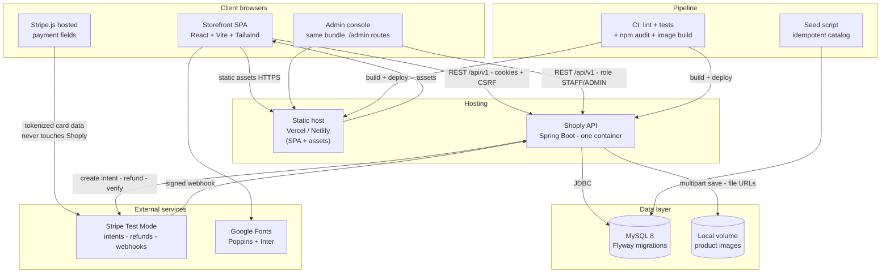
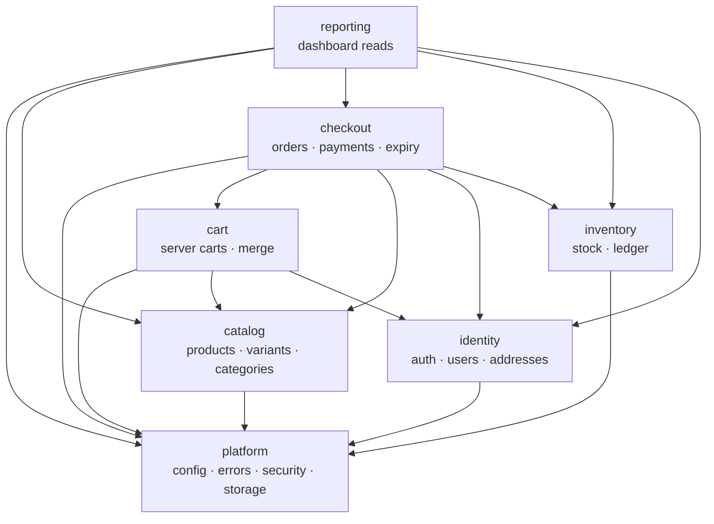
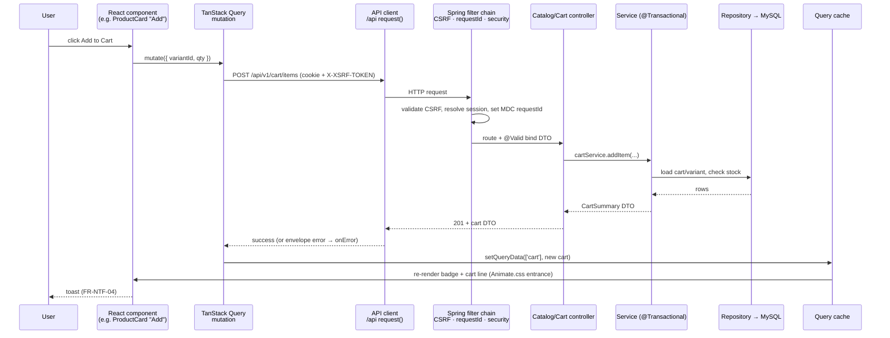
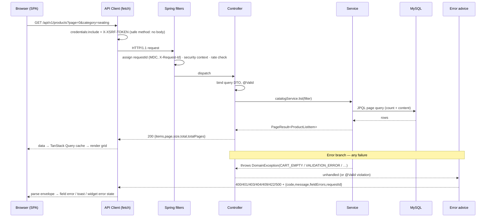
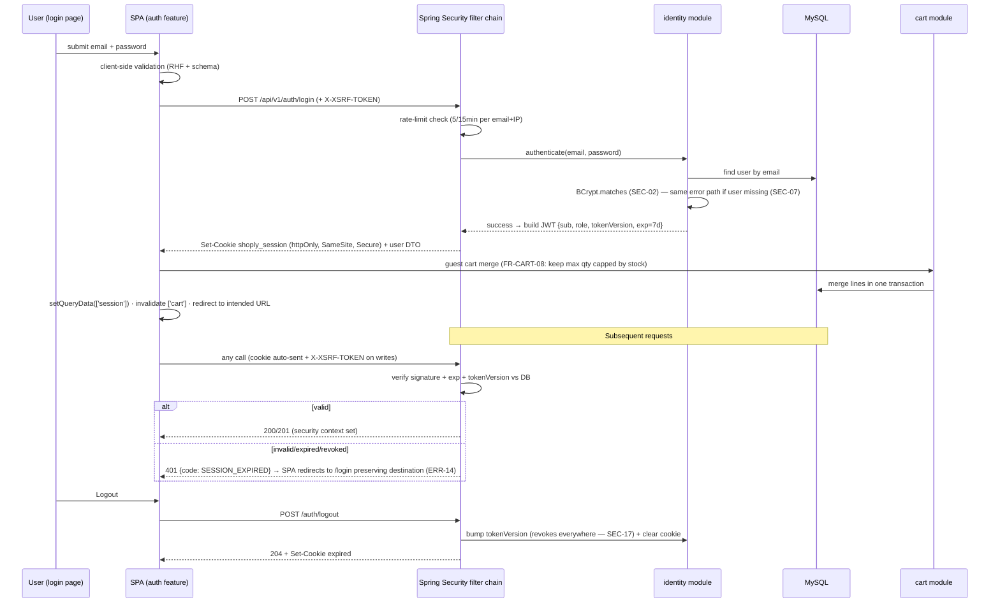
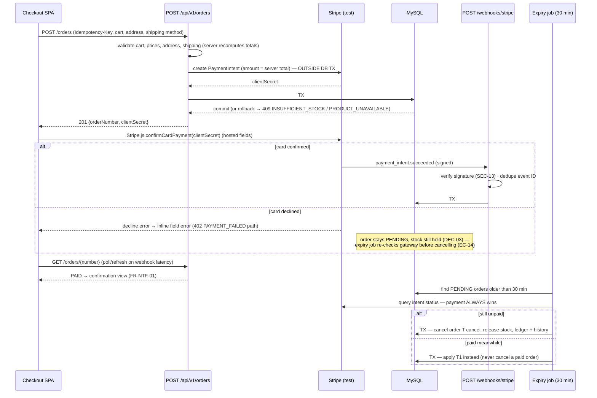
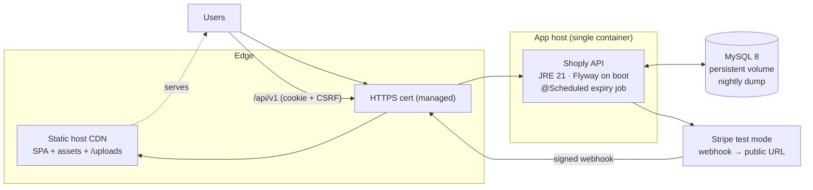

# Shoply — System Architecture

| Field | Value |
|---|---|
| **Project name** | Shoply |
| **Document type** | System Architecture Specification |
| **Version** | 1.0 |
| **Date** | 2026-11-04 |
| **Status** | 🟡 Draft — Awaiting stakeholder approval |
| **Author** | Senior Software Architect |
| **Sources of truth** | `docs/PROJECT_PLANNING.md` v1.0 (approved) · `docs/SRS.md` v1.0 · `docs/USER_FLOWS.md` v1.0 · `docs/UI_UX_DESIGN_SPEC.md` v1.0 |
| **Stack** | React JS + Tailwind CSS + Lucide React + Animate.css · Java + Spring Boot + Spring Security + Hibernate/JPA · MySQL 8 |
| **Architecture style** | Modular monolith · REST · layered within modules |
| **Next phase** | Database design (ERD + schema) — **after approval of this document** |
| **Code status** | ❌ No application code |

---

## Document Control

| Version | Date | Change |
|---|---|---|
| 1.0 | 2026-11-04 | Initial system architecture: modules, flows, security, deployment, risk register |

**Rules governing this document:**

1. Requirements come only from the four approved documents. **No feature exists here that is not in the SRS**, and nothing deferred to V1.5/V2 is architected beyond naming its seam (rule: *document the seam, do not build it*).
2. **No microservices** (plan §6: modular monolith is the approved scale; deliberately rejected: GraphQL, MongoDB, Redux-for-server-state, CSS-in-JS, Kubernetes).
3. This document specifies **structure, contracts, and flows — not schema.** Entities are referenced conceptually; tables, columns, and relationships are the next phase (database design) and are deliberately not defined here.
4. Where the SRS leaves an implementation choice open, a recommendation is given and logged in [§21 AR-DEC](#21-unresolved-architectural-decisions-ar-dec) — no silent architecture choices.
5. Diagrams required by the brief live in the section they explain: **architecture (§1) · component interaction (§6) · request–response (§7) · authentication (§8) · checkout (§11)**.

---

## Table of Contents

1. [Architecture Overview](#1-architecture-overview) *(incl. Mermaid architecture diagram)*
2. [Architecture Style and Justification](#2-architecture-style-and-justification)
3. [Frontend Architecture](#3-frontend-architecture)
4. [Backend Architecture](#4-backend-architecture)
5. [Backend Module Responsibilities](#5-backend-module-responsibilities)
6. [Frontend/Backend Communication](#6-frontendbackend-communication) *(incl. component interaction diagram)*
7. [REST API Architecture](#7-rest-api-architecture) *(incl. request–response flow)*
8. [Authentication Architecture](#8-authentication-architecture) *(incl. authentication flow)*
9. [Authorization Architecture](#9-authorization-architecture)
10. [Database Communication](#10-database-communication)
11. [Payment Integration Architecture](#11-payment-integration-architecture) *(incl. checkout flow)*
12. [Product Image Storage Architecture](#12-product-image-storage-architecture)
13. [Email Notification Architecture](#13-email-notification-architecture)
14. [Error Handling Architecture](#14-error-handling-architecture)
15. [Security Architecture](#15-security-architecture)
16. [Logging and Monitoring](#16-logging-and-monitoring)
17. [Deployment Architecture](#17-deployment-architecture)
18. [Environment Configuration](#18-environment-configuration)
19. [External Service Dependencies](#19-external-service-dependencies)
20. [Architecture Risks and Trade-offs](#20-architecture-risks-and-trade-offs)
21. [Unresolved Architectural Decisions (AR-DEC)](#21-unresolved-architectural-decisions-ar-dec)
22. [Summary & Approval](#22-summary--approval)

---

## 1. Architecture Overview

### 1.1 System context

Shoply is a **single deployable backend** (Spring Boot) serving a **single deployable frontend** (React SPA), one database (MySQL 8), local file storage for product images, and Stripe test mode as the only third-party runtime integration. This mirrors SRS §3.3 and adds the operational view (CI, hosts, fonts).



### 1.2 The five structural decisions (summary)

| # | Decision | Where |
|---|---|---|
| 1 | **Modular monolith**, one Spring Boot jar, package-by-feature with enforced acyclic module dependencies | §2, §4, §5 |
| 2 | **Layered inside modules:** controller → service → repository; business rules live in services (NFR-13) | §4 |
| 3 | **React SPA** with feature folders; TanStack Query owns server state; Tailwind tokens exported from Figma | §3 |
| 4 | **Security:** JWT in httpOnly cookie + CSRF token, roles enforced at the API layer, DTO-only inputs | §8, §9, §15 |
| 5 | **All money/stock mutations transactional** with idempotency keys and a server-authoritative order state machine | §10, §11 |

### 1.3 Runtime units (what actually runs)

| Unit | Technology | Count | Notes |
|---|---|---|---|
| Web/static | React build (static files) | 1 | Served by static host; SPA fallback to `index.html` |
| API | Spring Boot (JRE 21) in Docker | 1 instance in V1 | Stateless (JWT cookie) — horizontal scaling possible later without session affinity |
| Database | MySQL 8 | 1 | Flyway on boot; `ddl-auto` disabled everywhere (FR-GEN-10) |
| File volume | Docker volume / host dir | 1 | Product images (plan §6: local in V1, S3 seam later) |
| Jobs | In-process `@Scheduled` | in API | Order expiry (DEC-02), no external scheduler |
| Webhooks | Public `POST /api/v1/webhooks/stripe` | in API | Signature-verified (SEC-13) |

### 1.4 Primary data flows (one line each)

1. **Browse:** SPA → `GET /api/v1/products?...` → catalog query service → MySQL → DTO page → grid (skeleton/empty/error states per FR-GEN-04).
2. **Cart:** server-side cart keyed by user **or** guest session cookie; every mutation re-validates variant, product state, and stock.
3. **Checkout:** `POST /orders` with `Idempotency-Key` → payment intent (Stripe) → single DB transaction (order `PENDING` + conditional stock decrement + payment row) → client confirms in hosted fields → **webhook is the authority** that applies T1 → `PAID`.
4. **Admin:** role-gated `/api/v1/admin/**` → module admin controllers → same services → status history / stock ledger rows written for every transition.
5. **Expiry:** scheduled job cancels stale `PENDING` orders after 30 min (DEC-02) — but only after re-checking payment status with the gateway (payment always wins, EC-14).

---

## 2. Architecture Style and Justification

### 2.1 Chosen style: modular monolith (layered within modules)

**One** deployable application whose internal structure is a set of **modules** (identity, catalog, cart, checkout, inventory, reporting, platform), each following `controller → service → repository`, with **dependency rules between modules** (§5) and **no cross-module table access** except a documented read-only exception for reporting.

This is the style explicitly approved in `PROJECT_PLANNING.md` §6 ("Correct scale; interview-friendly; avoids premature microservices").

### 2.2 Why — mapped to real constraints

| Constraint (source) | Why modular monolith fits |
|---|---|
| Solo developer, portfolio timeline (plan §1, R1) | One codebase, one deployment, no distributed tracing/service meshes; every change is a local build+test |
| Money + stock correctness: order, stock, payment must agree atomically (NFR-01/02) | Single database → real ACID transactions across order/stock/payment rows — **impossible to get for free in microservices** without sagas |
| Order state machine T1–T9 with idempotent transitions (SRS §13) | State machine + tables live in one transactional boundary |
| Demo scale: 60 products, ~10k orders (NFR-18) | Zero need for independent scaling; a single instance with p95 < 300 ms (PERF-03) is trivially met |
| Ops burden on free-tier hosts (plan §6, R12) | One container + one database = one health check, one log stream, one backup |
| Interview/portfolio readability (R6) | Clear module boundaries + diagrams read as deliberate engineering, not a folder soup |

### 2.3 Rejected alternatives

| Alternative | Why rejected |
|---|---|
| **Microservices** (catalog-svc, order-svc…) | Distributed transactions for stock+order+payment; 3× deployment/CI/observability cost; no scaling need; explicitly forbidden by this brief |
| **Classic layered monolith (no modules)** | Becomes a ball of mud by month two; module rules keep ownership visible (and are testable with ArchUnit — AR-DEC-09) |
| **Server-side rendered (Thymeleaf/Next SSR)** | Stack is fixed to React SPA; SEO loss is acceptable for a demo (trade-off logged in §20) |
| **GraphQL** | Deliberately rejected (plan §6): REST fits 60 products; caching and error envelope are already specified |
| **BFF + two backends** | One API serves storefront and admin (role-gated); a second service would duplicate security and error handling |
| **Event-driven backbone (Kafka/Rabbit)** | No async consumers in V1 (no email, no queue-based jobs); in-process scheduled jobs suffice; an outbox seam is named for V2 (§13) |
| **CQRS / separate read model** | Reporting can read the same tables at this scale; a read replica would be theater |

### 2.4 When this decision would be revisited (honest triggers)

Not planned for this project — recorded so the trade-off is visible: (a) search quality demands a real search engine; (b) image/CDN traffic must leave the app host; (c) a second consumer needs the API with different release cadence; (d) independent scaling of read traffic. Each would justify extracting **one** module — the acyclic module graph (§5) exists precisely so extraction is a rename, not a rewrite.

### 2.5 Quality attributes targeted

| Attribute | Mechanism |
|---|---|
| Correctness | Service-level transactions, conditional stock updates, idempotency keys, state machine guards (§10, §11) |
| Security | Cookie auth + CSRF, DTO validation, role checks at API layer (§8, §9, §15) |
| Maintainability | Module boundaries, DTO/entity separation, uniform error envelope, CI lint+tests (NFR-13/14) |
| Observability | `requestId` correlation on every request, structured logs, health endpoint (NFR-09/11) |
| Testability | Interfaces for external integrations (NFR-15), Testcontainers with real MySQL, mock payment gateway |
| Performance | Pagination everywhere, no N+1 (NFR-19), lazy images + tokenized fonts (PERF-09/12), no caching layer yet (PERF-16) |

---

---

## 3. Frontend Architecture

### 3.1 Stack and posture

| Concern | Choice | Source |
|---|---|---|
| Build/tooling | Vite + React **JS** (no TypeScript — stack fixed by brief) | Stack |
| Routing | React Router (declarative routes; route-level code splitting) | Plan §6 |
| Server state | **TanStack Query** (cache, loading/error states, invalidation) | Plan §6 |
| Forms | React Hook Form + **schema validation** (recommended: Zod — AR-DEC-06) mirroring server rules | Plan §6, FR-GEN-03 |
| Styling | Tailwind CSS with a **token layer exported from Figma** (`UI_UX_DESIGN_SPEC` §20.5) | Plan §6, design spec |
| Icons | **Lucide React** — outline set, `strokeWidth` set to **1.75** to match the design spec's icon rule | Design spec §7.1 #10 |
| Animation | **Animate.css** for entrance/exit utilities + Tailwind transitions for micro-interactions (§3.6) | Stack + design spec §18 |
| UI state | React Context + hooks — **no Redux** (deliberately rejected, plan §6) | Plan §6 |

**Posture:** the SPA is a *view* of server state. The server is the source of truth for cart, stock, prices, and orders (plan §6); the client never computes money totals that matter (it may mirror subtotal for display, server recomputes on every mutation).

### 3.2 Folder structure (feature-based)

```
/src
  /app                 → app shell: router, providers (Query, Toast, Session),
                         global ErrorBoundary, layout (storefront/admin shells)
  /api                 → api client (fetch wrapper), endpoint modules, error envelope
                         types, CSRF helper, query key factory
  /features
     /auth             → login, register, support-fallback pages; session query; route guards
     /catalog          → home modules, PLP (+ filter rail/sheet), PDP, search page
     /cart             → cart page, line controls, badge count
     /checkout         → stepped checkout, payment step, confirmation
     /account          → overview, orders, order detail, addresses, profile
     /admin            → shell (sidebar), dashboard, products, editor, inventory,
                         orders, customers, categories, settings(if approved)
  /components/ui       → primitives mapped 1:1 to Figma components
                         (Button, IconButton, Input, Select, Badge, Chip, Tabs,
                          ProductCard, CategoryCard, Modal, Toast, Skeleton,
                          EmptyState, ErrorState, Pagination, QtyStepper)
  /hooks               → useDebounce, useMediaQuery, useFocusTrap, …
  /lib                 → formatters (money minor-units → $X.XX, dates), constants
  /styles              → tokens (Tailwind theme extension from Figma variables)
```

**Rules:**

1. **Features never import from other features** — cross-feature needs go through `/components` or `/api` (mirrors backend module acyclicity, §5).
2. `/components/ui` contains **only** presentational primitives with variant props matching Figma component properties (`size`, `state`, `type`) — no data fetching inside primitives (plan §8.6 component discipline).
3. Route guards (`RequireAuth`, `RequireRole`) live in `/app`; they **hide UI only** — real enforcement is server-side (§9).
4. Route-level `React.lazy` for admin and checkout bundles to protect the storefront bundle budget (PERF-10: ≤ 250 KB gzipped storefront).

### 3.3 State ownership matrix

| State | Owner | Pattern |
|---|---|---|
| Product/category/list data | TanStack Query | Query keys: `['products', filters, page]`, `['product', slug]`, `['categories']` |
| Session (who am I) | TanStack Query (`['session']`) | Refetch on login/logout; 401 handled centrally |
| Cart | TanStack Query (`['cart']`) | Server-authoritative; invalidate on every cart mutation |
| Orders | TanStack Query | `['orders', page]`, `['order', number]` |
| Admin lists | TanStack Query | Key includes filter object; URL is the source (FR-GEN-05) |
| Form input | React Hook Form | Uncontrolled where possible; server errors injected via `setError` (ERR-07) |
| UI (drawer open, active tab, sheet) | Context / local state | Ephemeral; never persisted |
| URL (filters, sort, query, page) | Router | Synced both ways (FR-GEN-05) — back/forward restores exactly |

**Invalidation map (the contract that keeps UI honest):**

| Mutation | Invalidates |
|---|---|
| Add/update/remove cart line | `['cart']` |
| Login / register / logout | `['session']`, `['cart']` (merge), `['orders']` |
| Place order / cancel order | `['cart']`, `['orders']`, `['order', n]` |
| Admin product/category/inventory change | `['products']`, `['product', slug]`, `['categories']`, admin lists |
| Admin order transition | `['orders']`, `['order', n]`, `['adminDashboard']` |

### 3.4 API client layer (`/api`)

Single `request()` wrapper around `fetch` responsible for:

1. `credentials: 'include'` (session cookie) on every call.
2. **CSRF:** read non-httpOnly `XSRF-TOKEN` cookie → send as `X-XSRF-TOKEN` header on state-changing methods (SEC-04, §8.3).
3. Parse the **error envelope** (FR-GEN-01) into a typed error `{ code, message, fieldErrors, requestId }` — never surfaces raw HTTP bodies (§14).
4. Central `401` handling → redirect to login **preserving destination** (ERR-14); `403` → not-allowed view; `5xx/network` → retry affordance (ERR-10).
5. Timeouts (10 s default) + `AbortController`; **retries only for idempotent GETs** (one attempt, network errors) — **never** auto-retry `POST /orders` (the human presses retry; the `Idempotency-Key` makes it safe).
6. Attach `Idempotency-Key` (UUID per checkout attempt) to order placement.

### 3.5 Loading / empty / error states (FR-GEN-04, design spec §19.E)

Every data view renders four states via small shared components: **Skeleton** (layout-matched, Animate.css shimmer), **Populated**, **Empty** (icon + heading + action), **Error** (message + Retry, degrades only that widget — ERR-11). This is a component-library concern, not per-page code.

### 3.6 Animation architecture (Animate.css reconciliation)

The design spec (§18) defines motion tokens; the stack mandates Animate.css. Division of labor:

| Use | Mechanism |
|---|---|
| Entrances/exits: toast, modal, drawer/bottom-sheet, step panels | Animate.css utilities (`animate__fadeInUp`, `animate__fadeIn`, `animate__slideInRight`) with **duration overridden** via CSS variable (`--animate-duration: 250ms` etc. per token) |
| Hover/focus micro-interactions: button tint, card image zoom, arrow nudge, tab color | **Tailwind transitions** (`transition-colors duration-150`) — Animate.css is not used for state changes |
| Skeleton shimmer | Custom keyframes in `/styles` (Animate.css has no shimmer) |
| Cart badge pop | Custom keyframe (`ease-emphasis` from design spec §18.2) |
| Reduced motion (A11Y-11) | Global CSS: under `prefers-reduced-motion: reduce`, force `animation: none` on Animate.css classes **and** reduce Tailwind transitions to ≤ 100 ms opacity |

Forbidden per design spec §18.5 still applies: no parallax, no scroll-jacking, no autoplay carousels, nothing > 300 ms for routine interactions.

### 3.7 Frontend quality gates

- ESLint + Prettier in CI (NFR-14); Vitest + React Testing Library on: API client (envelope parsing, CSRF, 401 redirect), product card states, checkout step guard, money formatter (minor units).
- Global `ErrorBoundary` (ERR-09) — render crash shows recoverable page, never a blank screen.
- No `dangerouslySetInnerHTML` (SEC-10); product descriptions render as plain text or sanitized markup (§15.4).
- JS-disabled: graceful static message acknowledged (NFR-08).

---

## 4. Backend Architecture

### 4.1 Runtime stack

| Concern | Choice |
|---|---|
| Framework | Spring Boot **3.x** on **Java 21 LTS** (AR-DEC-01 confirms 21) |
| Security | Spring Security (filter chain: CSRF, cookies, headers, role rules) |
| Persistence | Hibernate/JPA + Spring Data JPA; **Flyway** migrations; `ddl-auto=validate` only |
| Validation | Bean Validation (`@Valid` on DTOs) + service-layer business rules (FR-GEN-03) |
| Scheduling | Spring `@Scheduled` in-process jobs (order expiry) |
| API docs | springdoc-openapi (AR-DEC-07) |
| Tests | JUnit 5 + Spring Boot Test + **Testcontainers (real MySQL)**; mock `PaymentGateway` |
| Packaging | Single JAR → single Docker image |

### 4.2 Package layout (package-by-feature)

```
com.shoply
  /platform          → config, security filter chain, error envelope + advice,
                       requestId (MDC) filter, rate-limit filter, storage port,
                       health, migrations, seed
  /identity          → auth (login/register/logout/session), users, roles,
                       profile, addresses, admin customer management
  /catalog           → categories, products, variants, product images,
                       publish/archive, listing/search queries
  /cart              → server carts, lines, guest binding, merge, totals
  /checkout          → orders, order items, state machine, status history,
                       payments: { PaymentGateway port, stripe adapter,
                       mock adapter, webhook processing, refunds },
                       expiry job, customer + admin order endpoints
  /inventory         → stock levels, conditional mutations, stock ledger,
                       adjustments, low-stock queries
  /reporting         → dashboard KPIs, top products, recent orders (read-only)
```

Each feature package follows the same internal layering:

```
<feature>
  /web               → REST controllers (storefront + admin controllers split),
                       request/response DTOs, @Valid bindings, DTO mappers
  /service           → business rules, transactions, orchestration, domain
                       exceptions (all money/stock logic lives here — NFR-13)
  /repository        → Spring Data JPA repositories + named/derived queries
  /domain            → entities, enums (order status, roles), value objects
```

### 4.3 Layer responsibilities and rules

| Layer | Does | Never does |
|---|---|---|
| **Controller** | Bind/validate DTOs, call one application service, map result to response DTO, set status | Contain business rules, touch entities of other modules, catch-and-swallow, build responses from entities directly |
| **Service** | Business rules, authorization *scoping* (ownership checks), transactions (`@Transactional`), idempotency, write history/ledger rows | Know HTTP, render messages for users, perform raw SQL strings |
| **Repository** | Queries via JPA/JPQL only | Business logic, cross-module writes |
| **DTO mappers** | Entity ↔ DTO (manual mapper functions — AR-DEC-08: no MapStruct) | — |

**Cross-cutting enforcement:**

1. **Entities never leave the service layer** (prevents lazy-loading surprises and mass assignment — SEC-06).
2. **Whitelist binding:** request DTOs contain only fields the client may set; `role`, `status`, `price`, `stock`, `total`, `placedAt` are never client-writable (SEC-06).
3. **Transactions:** `@Transactional` at service entry points only; external HTTP calls (Stripe) happen **outside** DB transactions (§11.3) with compensating actions.
4. **Module boundaries are acyclic** (§5); optional ArchUnit tests fail the build on violations (AR-DEC-09).

### 4.4 Request lifecycle (single GET, happy path)

`Filter (requestId → MDC)` → `Security filters (CSRF, session parse)` → `Controller (DTO bind + validate)` → `Service (@Transactional, rules)` → `Repository (JPQL)` → `DTO map` → `Response` → log line with `requestId`, route, status, duration (NFR-09).

### 4.5 Cross-cutting backend services (platform module)

| Service | Responsibility | SRS refs |
|---|---|---|
| Error advice | Single `@RestControllerAdvice` → envelope (§14) | FR-GEN-01, ERR-01 |
| Request-ID filter | UUID per request → MDC + response header `X-Request-Id` | NFR-09 |
| Rate-limit filter | In-memory sliding window: auth endpoints 5/15 min per email+IP; coarse per-IP on expensive endpoints (AR-DEC-05) | FR-AUTH-08, SEC-16 |
| Security config | Cookie/CSRF/header rules, URL matchers (§9) | SEC-03/04/05 |
| Storage port | `FileStorage` interface → local disk impl (§12) | NFR-15 |
| Health | `/api/v1/health` → DB connectivity, `200`/`503` | FR-GEN-06 |
| Config binder | Typed app properties from env (§18) | SEC-12 |
| Seed runner | Idempotent catalog/accounts bootstrap (dev/prod demo) | FR-GEN-09 |

---

---

## 5. Backend Module Responsibilities

### 5.1 Module inventory

| Module | Owns | Public surface (used by other modules) | Key SRS refs |
|---|---|---|---|
| **platform** | Config, security filter chain, error advice, request-ID, rate limiting, `FileStorage` port, health, Flyway, seed | Everything (infrastructure; depended on by all, depends on none) | FR-GEN-01/06/09/10, SEC-04/16, NFR-09 |
| **identity** | Users, credentials, roles, session/token version, addresses, profile, admin customer management | `CurrentUser` read (id, role), address lookup for checkout | FR-AUTH-01…08, SEC-02/07/17 |
| **catalog** | Categories, products, variants, product images, publish/archive state, listing & search queries | `CatalogView` reads (product/variant availability, price, slug resolution) for cart/checkout; category tree for nav | FR-CAT-01…07, FR-PROD-*, §16 |
| **cart** | Server-side carts, lines, guest-session binding, merge-on-login, cart totals | `CartSummary` for checkout (lines, subtotal) | FR-CART-01…09 |
| **checkout** | Orders, order items, state machine (T1–T9), status history, **payments** (gateway port, Stripe/mock adapters, webhook processing, refunds), expiry job, storefront + admin order endpoints | `OrderView` reads for account/admin; `PaymentGateway` port (internal) | FR-ORD-*, FR-PAY-*, DEC-01…03, EC-14 |
| **inventory** | Stock levels per variant, **conditional** stock mutations, stock ledger, manual adjustments, low-stock queries | `StockPort.reserve/release/query` consumed inside checkout transactions | FR-INV-01…07, NFR-01 |
| **reporting** | Dashboard KPIs, top products, recent orders, low-stock count | None (leaf; read-only) | FR-REP-01…04 |

**Payments live inside `checkout`** (not a separate module) so that order + payment rows share one transactional boundary and the order→payment dependency can never become a package cycle (NFR-01/02/05).

### 5.2 Dependency rules (acyclic)

Allowed edges only — anything else fails CI (ArchUnit, AR-DEC-09):



**Rules:**

1. **No cycles.** `platform` depends on nothing. `reporting` is a leaf (nothing depends on it).
2. **Cross-module calls go through service interfaces**, never through another module's repositories or entities.
3. **Writes are single-module:** only `inventory` mutates stock; only `checkout` mutates orders/payments; only `identity` mutates users. A checkout request *coordinates* via ports (`StockPort.reserve`) executed **inside the same DB transaction** — same database, so "distributed" concerns do not exist (§2.2).
4. **Reads may be shared** through narrow read DTOs (`CatalogView`, `OrderView`). Reporting is the documented **read-only exception** that may query other modules' tables directly for dashboards (kept read-only so it can never corrupt another module's invariants).
5. **Guest cart merge on login** (FR-CART-08) is orchestrated by `cart` calling `identity` for the user — direction `cart → identity`, never the reverse.

### 5.3 Module → frontend feature mapping

| Backend module | Frontend feature folder |
|---|---|
| identity | `/features/auth`, `/features/account` (profile, addresses) |
| catalog | `/features/catalog` |
| cart | `/features/cart` |
| checkout | `/features/checkout`, `/features/account/orders`, `/features/admin/orders` |
| inventory | `/features/admin/inventory` (+ PDP availability display via catalog reads) |
| reporting | `/features/admin/dashboard` |
| platform | `/api` client + `/app` providers (cross-cutting) |

---

## 6. Frontend/Backend Communication

### 6.1 Transport contract

| Aspect | Contract |
|---|---|
| Base path | `/api/v1` (versioned prefix; health at `/api/v1/health`) |
| Format | JSON, UTF-8; `Content-Type: application/json` (multipart for image upload — §12) |
| Auth | Session cookie (httpOnly, SameSite=Lax, Secure in prod) — never tokens in JS (SEC-03) |
| CSRF | Double-submit: non-httpOnly `XSRF-TOKEN` cookie → `X-XSRF-TOKEN` header on POST/PUT/PATCH/DELETE (SEC-04) |
| Errors | Single envelope `{code, message, fieldErrors[], requestId}` on **every** non-2xx (FR-GEN-01) |
| Lists | `{items[], page, size, total, totalPages}`; `page` 0-based, default size 24, max 48 (FR-GEN-02) |
| Money | Integer **minor units** everywhere (FR-GEN-08); client formats for display only |
| Idempotency | `Idempotency-Key` header (UUID) on `POST /orders` (NFR-05) |
| Correlation | Response header `X-Request-Id` = log `requestId` (NFR-09) |

### 6.2 Component interaction diagram

How a UI action travels through TanStack Query, the API client, Spring layers, and back into re-rendered components:



**Rules of engagement:**

1. Components **never call `fetch` directly** — only through feature mutations/queries in `/api`.
2. Every mutation declares its **invalidation** per the §3.3 map; the cache never drifts from the server.
3. Errors surface in three places only: **field error** (inline), **toast** (action feedback), **error state** (widget) — per ERR-07 (never toast-only when a field error exists).
4. Optimistic UI is allowed **only** for cart quantity and wishlist-free toggles present in V1 (cart qty) — with rollback on envelope error. Checkout is strictly pessimistic.

---

## 7. REST API Architecture

### 7.1 Conventions

| Rule | Detail |
|---|---|
| Nouns, plural | `/products`, `/carts/items`, `/orders`, `/admin/orders/{number}/status` |
| Methods | GET read · POST create/action · PUT full update · PATCH partial · DELETE remove |
| Versioning | URL prefix `/api/v1` (only mechanism in V1) |
| Public vs admin | Storefront under root; privileged under `/api/v1/admin/**` (role-gated, §9) |
| Slugs in public URLs | Product/category by slug in **frontend** routes; API accepts slug for public reads, numeric ID internally (FR-GEN-07) |
| Filters on lists | `?q=&category=&minPrice=&maxPrice=&sort=&page=&size=` — mirrored to the URL by the SPA (FR-GEN-05) |
| Actions | Non-CRUD actions as sub-resources: `POST /orders/{number}/cancel`, `POST /admin/orders/{number}/status` (body carries target status + reason) |
| Auth errors | 401 envelope; 403 for role/ownership failures (§9) |

### 7.2 Endpoint map (V1 — no feature outside the SRS)

| Area | Endpoints (summary) | Auth |
|---|---|---|
| Auth | `POST /auth/register`, `POST /auth/login`, `POST /auth/logout`, `GET /auth/session` | public / cookie |
| Catalog | `GET /products` (list/search/filter), `GET /products/{slug}`, `GET /categories`, `GET /products/{slug}/related`* | public |
| Cart | `GET /cart`, `POST /cart/items`, `PATCH /cart/items/{lineId}`, `DELETE /cart/items/{lineId}`, `DELETE /cart` | cookie (guest or user) |
| Checkout | `POST /orders` (Idempotency-Key), `GET /orders/{number}`, `GET /orders`, `POST /orders/{number}/cancel` | customer |
| Payments | `POST /payments/client-secret` (intent for cart), webhook `POST /webhooks/stripe` (no cookie; signature) | cookie / signature |
| Account | `GET/PATCH /me`, `GET /me/addresses`, `POST/PUT/DELETE /me/addresses/{id}`, `GET /me/orders` | customer |
| Notifications | `GET /me/notifications` (in-app list, FR-NTF-*) | customer |
| Admin products | `GET/POST /admin/products`, `GET/PATCH/DELETE /admin/products/{id}`, variant + image sub-resources | STAFF/ADMIN |
| Admin categories | CRUD `/admin/categories` | STAFF/ADMIN |
| Admin inventory | `GET /admin/inventory`, `POST /admin/inventory/{variantId}/adjustments`, `GET /admin/inventory/low-stock` | STAFF/ADMIN |
| Admin orders | `GET /admin/orders`, `GET /admin/orders/{number}`, `POST /admin/orders/{number}/status`, refund action | STAFF/ADMIN |
| Admin customers | `GET /admin/customers`, `GET /admin/customers/{id}` (orders read) | ADMIN |
| Reporting | `GET /admin/dashboard` (KPIs, top products, recent orders, low-stock count) | STAFF/ADMIN |
| Platform | `GET /health` | public (infra) |

\* Related-products is listed in the SRS only if present in `FR-CAT-*`; **if not an approved requirement it is dropped** — this table is reconciled against the SRS requirement IDs during database design, not invented here.

> **Reconciliation note:** exact paths are finalized against `FR-*` IDs in the SRS API appendix at implementation time; this map fixes the *shape* (versioning, grouping, actions, auth tiers), not every literal string.

### 7.3 Request–response flow (canonical happy-path GET, with error branch)



**Guarantees on this path:** no entity escapes the service layer; every response (success or failure) carries `requestId`; list responses always use the FR-GEN-02 shape; a failed request never leaves partial data because reads are single-query and writes are transactional (§10).

---

## 8. Authentication Architecture

### 8.1 Model (approved positions)

| Aspect | Decision | Source |
|---|---|---|
| Mechanism | **JWT** signed (HS256) delivered in an **httpOnly cookie** `shoply_session` — not `localStorage` | SEC-03, DEC-18 |
| CSRF | Double-submit token cookie + header (§6.1) — required because the auth cookie is sent automatically | SEC-04 |
| Session lifetime | **7 days**, sliding on activity (DEC-18) | DEC-18 |
| Invalidation | **`tokenVersion`** on the user row: bump to revoke all outstanding tokens (password change, role change, admin disable) | SEC-17 |
| Password hashing | **BCrypt** cost 10+ (or Argon2) via Spring `PasswordEncoder` — never logged/returned | SEC-02 |
| Login failure | Identical error for unknown email vs wrong password; generic message | SEC-07 |
| Rate limiting | 5 attempts / 15 min per email+IP then 429 `RATE_LIMITED` (in-memory — AR-DEC-05) | FR-AUTH-08 |
| Guest session | Separate non-httpOnly-identified guest cart cookie binding the server cart (not an auth credential) | FR-CART-06/08 |
| Reset flow | **V1:** static "Contact support" fallback page; V2: email token (seam only, §13) | FR-AUTH-06, DEC-18 |

**Why JWT-in-cookie instead of Spring Session (server-side sessions):** stateless API simplifies the free-tier single-container deploy and future horizontal scaling (no shared session store); revocation needs are met by `tokenVersion` + 7-day expiry (SEC-17). Trade-off logged in AR-DEC-02.

### 8.2 Roles

`ROLE_CUSTOMER` (default) · `ROLE_STAFF` · `ROLE_ADMIN` — carried in the JWT claims, re-checked against the DB `tokenVersion` on each request; URL rules in §9.

### 8.3 Authentication flow



**Session persistence:** the cookie survives reloads and browser restarts within 7 days (FR-AUTH-04); `GET /auth/session` hydrates the SPA on boot (returns identity only, never the token).

---

---

## 9. Authorization Architecture

### 9.1 Model

Authorization is enforced **server-side at the API layer on every protected endpoint** (SEC-08 / FR-AUTH-07). Frontend guards are UX-only.

Two layers:

| Layer | Mechanism | Catches |
|---|---|---|
| **1. Coarse (URL rules)** | Spring Security `AuthorizationManager` request matchers in the security config | Anonymous vs authenticated vs role tier |
| **2. Fine (ownership/scoping)** | Service-layer checks: `order.user.id == currentUser.id`, address ownership, cart binding | IDOR / horizontal escalation (SEC-09) |

### 9.2 Access matrix

| Resource / action | Guest | CUSTOMER | STAFF | ADMIN |
|---|---|---|---|---|
| Browse catalog, view product by slug | ✅ | ✅ | ✅ | ✅ |
| Cart (server cart bound to guest cookie) | ✅ own | ✅ own | — | — |
| Place order / pay | ❌ | ✅ own | ❌ | ❌ |
| View own orders, cancel own pending order | ❌ | ✅ own | — | — |
| Account profile / addresses | ❌ | ✅ own | — | — |
| In-app notifications | ❌ | ✅ own | — | — |
| Admin product/category CRUD | ❌ | ❌ | ✅ | ✅ |
| Inventory view + adjustments | ❌ | ❌ | ✅ | ✅ |
| Order list / detail / status transitions / refund | ❌ | ❌ | ✅ | ✅ |
| Dashboard (reporting) | ❌ | ❌ | ✅ | ✅ |
| Customer account details (other users) | ❌ | ❌ | ❌ | ✅ |
| Health endpoint | ✅ | ✅ | ✅ | ✅ |

### 9.3 Rules

1. **Deny by default:** endpoints not explicitly matched require authentication; `/api/v1/auth/**`, `/api/v1/products/**`, `/api/v1/categories/**`, `/api/v1/health`, `/api/v1/webhooks/**` are the public list.
2. **Role checks in one place:** URL matchers express the matrix above; services re-verify *ownership* (never roles — roles are checked once at the edge to avoid scattering).
3. **JWT role claim is trusted for routing, but sensitive admin writes re-read the user** (and `tokenVersion`) so a demoted STAFF loses access within one request (SEC-17).
4. **Admin routes in the SPA** (`/admin/**`) use `RequireRole` guards to hide UI; the API remains the authority (a customer calling `/admin/products` gets 403 `FORBIDDEN`).
5. **403 vs 401:** unauthenticated → 401 `UNAUTHENTICATED` (redirect to login); authenticated-but-not-permitted → 403 `FORBIDDEN` (no redirect loop); resource belongs to someone else → 404/403 per endpoint (SEC-09 avoids existence disclosure).

---

## 10. Database Communication

> **Boundary:** this section defines *how* the application talks to MySQL — patterns, transactions, and query discipline. **No tables, columns, or ERD** — that is the next phase after approval.

### 10.1 Access stack

| Concern | Decision |
|---|---|
| API | Spring Data JPA repositories over Hibernate |
| Queries | Derived/named methods + JPQL; native SQL only where justified (reporting aggregates), commented |
| Schema | **Flyway only**; `spring.jpa.hibernate.ddl-auto=validate` (FR-GEN-10, NFR-03) |
| Migrations | Forward-only, versioned, applied automatically on deploy; rollback = roll back to prior image (NFR-03) |
| IDs | Database-generated (identity) — public URLs use slugs, not IDs (FR-GEN-07) |
| Timezone | Store UTC (`Instant`); format in the SPA |
| Money | Integer minor units in `BIGINT` columns (FR-GEN-08) — never floats |

### 10.2 Transaction discipline (NFR-01, NFR-02)

1. **`@Transactional` at service entry points only.** Controllers and repositories are never transactional.
2. **Money + stock mutations are always transactional** — order creation, status transitions, refunds, stock adjustments, cart totals recompute.
3. **External calls (Stripe intent creation, webhook HTTP) happen outside DB transactions.** Inside a transaction we only do local work; compensating actions handle the failure window (§11.3).
4. **Conditional stock mutation:** decrement uses a guarded update (`UPDATE … SET stock = stock - :q WHERE variant_id = :id AND stock >= :q`); zero rows updated → `INSUFFICIENT_STOCK` thrown → transaction rolls back (DEC-01 recommendation).
5. **Optimistic locking** (`@Version`) on the order aggregate so concurrent status transitions (webhook vs. admin vs. expiry job) cannot both win — the loser retries or observes the state machine guard (NFR-05).
6. **Isolation:** default READ_COMMITTED is sufficient; the conditional decrement + version column cover the contention points at demo scale.

### 10.3 Query discipline (NFR-19, PERF-05/06)

- **No N+1:** association fetching declared explicitly (`JOIN FETCH` / `@EntityGraph`); lists project straight to read DTOs.
- **Pagination everywhere** on list endpoints (default 24, max 48 — FR-GEN-02); unbounded queries are a code-review defect.
- **Reads return DTOs**, never entities, across the service boundary (§4.3).
- **Search/filter** implemented as indexed `LIKE`/range predicates for V1 (60 products); full-text/`FULLTEXT` is an upgrade seam if the dataset grows (AR-DEC-04).
- **No cache layer** (PERF-16 leaves caching open; Redis is not in the stack) — the SPA's TanStack Query cache covers repeated reads for users; server-side caching is a documented future option.

### 10.4 Data integrity rules

| Rule | Mechanism |
|---|---|
| Order lines are immutable snapshots (name, SKU, price at purchase) | Written once at placement; product edits never touch orders (plan §5) |
| Every status transition appends status history | Same transaction as the transition (FR-ORD-09) |
| Every stock change appends a ledger row | Same transaction as the mutation (FR-INV-05) |
| Webhook event IDs deduplicated | Unique constraint + insert-then-ignore (NFR-05) |
| Idempotency keys on order placement | Unique key per customer+key; replay returns the original order |
| Guest cart merge is atomic | Single transaction; conflict → keep higher qty capped by stock (FR-CART-08) |
| Seed data idempotent | Insert-if-absent (FR-GEN-09); app boots healthy from empty DB (NFR-04) |

---

## 11. Payment Integration Architecture

### 11.1 Shape

| Concern | Decision | Source |
|---|---|---|
| Provider | **Stripe test mode** (intents, hosted confirmation, refunds, webhooks) | SRS §3.4, §14 |
| Abstraction | `PaymentGateway` port inside `checkout` with **Stripe adapter** and **Mock adapter** (config-selected) | Plan §6, R1 |
| Card data | Never touches Shoply — Stripe.js hosted fields, tokenized | SRS §14 |
| Authority | **Webhook is the source of truth** for payment outcome; client confirmation is advisory | FR-PAY-*, EC-14 |
| Refunds | Admin action → gateway refund → webhook/T1-style state application | FR-ORD-* |
| Currency | Single currency (USD) in minor units | FR-GEN-08 |

### 11.2 Checkout placement sequence (the critical path)

Mandated by SRS §12–§14 and DEC-01/03: intent **outside** the transaction; **one** local transaction creates the pending order + reserves stock + records payment; the webhook applies T1.



### 11.3 Failure windows and how they close

| Window | Risk | Resolution |
|---|---|---|
| Intent created, TX#1 fails | Orphan intent, no order | Intent expires on Stripe; no stock touched (stock only moves in TX#1) |
| TX#1 committed, client never confirms | Stuck PENDING holding stock | 30-min expiry job re-queries gateway before cancelling (EC-14) |
| Webhook lost/delayed | PAID on Stripe, PENDING in DB | Webhook retries + admin can view/reconcile; expiry job's gateway check also catches this |
| Webhook arrives twice | Double transition | Event-ID dedup + state machine guard + optimistic lock (NFR-05) |
| Admin cancels while webhook in flight | Race | `@Version` on order; one writer wins; loser sees current state (§10.2 #5) |
| Decline | False "success" UI | Order remains PENDING, decline shown inline; nothing marked PAID without webhook (DEC-03) |

**State machine guard:** every transition validates `(from → to)` legality (PENDING→PAID, PENDING→CANCELLED, PAID→SHIPPED→DELIVERED, PAID→REFUNDED…); illegal transitions return 409, never corrupt history.

---

## 12. Product Image Storage Architecture

| Concern | Decision | Source |
|---|---|---|
| Storage in V1 | **Local filesystem volume** behind a `FileStorage` port (impl: `LocalFileStorage`) | Plan §6, SRS §3.4 |
| S3/CDN seam | Same port → future `S3FileStorage` without touching catalog code (NFR-15) | NFR-15 |
| Layout | `/uploads/products/{productId}/{variantOrKey}-{variant}.webp` — content-addressed enough to bust CDN caches later | Architecture choice (AR-DEC-03) |
| Upload | Admin-only multipart `POST /admin/products/{id}/images`; server validates type/size, strips metadata, **generates WebP variants** | FR-PROD-*, SEC-06 |
| Serving | Static handler maps `/uploads/**` → volume (read-only); image URLs stored in DB as relative paths | Architecture choice |
| Validation | Allowlist extensions (jpg/png/webp), max size (5 MB), dimension sanity; filename never trusted (path traversal blocked) | SEC-06/SEC-11 |
| Seeded assets | Ship with repo; seed script copies idempotently (FR-GEN-09) | FR-GEN-09 |
| Frontend | `` + width/height to prevent CLS; responsive `srcset` for the two card densities | PERF-09 |

**Not in V1:** image CDN, on-the-fly resizing service, remote buckets (soft dependency per SRS §3.4).

---

## 13. Email Notification Architecture

### 13.1 V1 position: no email is ever sent (FR-NTF-05 deferred)

| Channel | V1 | V2 seam |
|---|---|---|
| Order confirmation view | ✅ post-payment page (FR-NTF-01) | — |
| Order status timeline in account | ✅ from status history (FR-NTF-02) | — |
| Admin low-stock badge/widget | ✅ (FR-NTF-03) | — |
| Action feedback toasts | ✅ (FR-NTF-04) | — |
| Transactional email (order confirmed, shipped, password reset) | ❌ **none** | `NotificationPort` + outbox table + provider adapter |
| Back-in-stock alerts | ❌ | job queue + subscriber list |

### 13.2 The seam (documented, not built)

Architecture reserves exactly two hooks so V2 is additive:

1. **`NotificationPort`** in `platform` — a one-method interface (`notify(user, template, context)`). V1 ships a **no-op implementation**. Order state transitions that will later email already emit their state change through the normal transition path, so the V2 adapter subscribes there without touching `checkout` logic.
2. **Outbox pattern (V2):** a `notification_outbox` row written **inside the same transaction** as the state change, drained by a worker — guarantees an email is never lost or sent for a rolled-back order.

**V1 guarantee (acceptance-tested):** the application contains **no SMTP configuration, no email dependency, and no outbound mail call** anywhere.

---

---

## 14. Error Handling Architecture

### 14.1 The single envelope (FR-GEN-01)

Every non-2xx response from every endpoint:

```json
{
  "code": "INSUFFICIENT_STOCK",
  "message": "Only 2 left in this size.",
  "fieldErrors": [ { "field": "quantity", "message": "Exceeds available stock" } ],
  "requestId": "8f3c…"
}
```

- `code` — stable, machine-readable (frontend branches on it, not on `message`).
- `message` — human-safe; **never** stack traces, SQL, paths, or framework pages (ERR-01/SEC-10).
- `fieldErrors` — present on validation failures; SPA renders them inline (ERR-07).
- `requestId` — same value as the server log line and `X-Request-Id` header (NFR-09).

### 14.2 Backend handling pipeline

| Step | Component | Behavior |
|---|---|---|
| 1 | Bean Validation in controller | 400 `VALIDATION_ERROR` + `fieldErrors` |
| 2 | Service throws typed **domain exceptions** (`DomainException(code, status, fieldErrors)`) | Business rules raise codes, never HTTP |
| 3 | Global `@RestControllerAdvice` | Maps: `NoSuchElementException`→404 `NOT_FOUND`, ownership violation→403/404, constraint/idempotency conflict→409, `DataIntegrity`→409, auth filters→401 `UNAUTHENTICATED`/`SESSION_EXPIRED`, rate limit→429 `RATE_LIMITED`, default→500 `INTERNAL_ERROR` |
| 4 | `HandlerExceptionWrapper` fallback | Guarantees even uncaught exceptions produce the envelope (never Spring's default JSON/HTML) |
| 5 | Logging | One WARN (business) / ERROR (unexpected) line with `requestId`, route, code — no PII, no secrets (NFR-09) |

Status mapping follows SRS §26.2 exactly (400/401/402/403/404/409/422/429/500/503).

### 14.3 Frontend handling strategy

| Failure | SPA behavior |
|---|---|
| Validation (400) | Map `fieldErrors` → React Hook Form `setError` (field-level, no toast) |
| 401 | Central handler → `/login?next=…` preserving destination (ERR-14); session cache cleared |
| 403 | Not-allowed view / inline message (never a redirect loop) |
| 404 | Route-level or widget-level Not Found |
| 409 (conflict, e.g. stock changed) | Refresh affected query, show message, focus the field |
| 402/422 payment & business errors | Step-local error UI (checkout keeps the user on the step) |
| 429 | "Too many attempts — try in X" with countdown |
| 5xx / network / timeout | Widget-level Error state + **Retry** (ERR-10); global ErrorBoundary only for render crashes (ERR-09) |
| Degraded widget | One failing module never blanks the page (ERR-11) |

**Principles:** errors are **typed by code**, handled **centrally where cross-cutting**, **locally where contextual**, and every view has explicit loading/empty/error states (FR-GEN-04).

---

## 15. Security Architecture

### 15.1 Controls mapped to SRS §23

| Req | Control (where) |
|---|---|
| SEC-01 HTTPS | TLS terminated at host (Vercel/Netlify + host proxy); HTTP→HTTPS redirect at edge; `Secure` cookie flag in prod |
| SEC-02 hashing | BCrypt ≥ cost 10 via `PasswordEncoder`; password never logged/returned (§8.1) |
| SEC-03 cookie auth | JWT in httpOnly cookie; **no auth token in `localStorage`** (§8) |
| SEC-04 CSRF | Double-submit cookie+header validated on every state-changing request (§6.1); Spring Security CSRF enabled |
| SEC-05 headers | `X-Frame-Options: DENY`/frame-ancestors, `X-Content-Type-Options: nosniff`, `Referrer-Policy: strict-origin-when-cross-origin`, baseline CSP (no inline scripts beyond Vite's nonce/hashes; `object-src 'none'`) |
| SEC-06 validation | DTO whitelist binding + Bean Validation server-side; client cannot set `role/status/price/stock/total` (§4.3) |
| SEC-07 login errors | Single generic failure message (§8.3) |
| SEC-08/09 authz | URL rules + ownership checks (§9) |
| SEC-10 injection/XSS | Parameterized JPQL only; React escaping by default; no `dangerouslySetInnerHTML`; sanitized admin-entered HTML (§3.7) |
| SEC-11 upload | Extension/size allowlist, regenerated filenames, path-traversal defense (§12) |
| SEC-12 secrets | Env vars only (§18); never in git; `.env.example` committed without values |
| SEC-13 webhooks | Stripe signature verification + event-ID dedup before any processing (§11) |
| SEC-14 dependency scanning | `npm audit` + Dependabot + `mvn dependency-check` in CI |
| SEC-15 data minimization | Responses exclude password hashes, tokens, other users' data (§9.4) |
| SEC-16 rate limiting | Auth5/15min + coarse per-IP on expensive endpoints (§4.5) |
| SEC-17 revocation | `tokenVersion` bump on password change/role change/disable (§8.1) |
| SEC-18 audit | Status history + stock ledger rows = business audit trail (§10.4) |
| SEC-19 least privilege | DB user has DML only (migrations run under deploy-time credential); admin roles minimal |
| SEC-20 session expiry | 7-day expiry (DEC-18) + logout revocation |

### 15.2 Threat-focused notes

- **IDOR:** every `{id}`-shaped customer endpoint resolves within the caller's ownership scope (§9.3).
- **Mass assignment:** request DTOs are separate from entities and contain only client-settable fields (SEC-06).
- **Price/stock tampering:** server recomputes totals from DB on every order; client-sent prices are ignored (DEC-01 posture).
- **Webhook spoofing:** unsigned requests rejected before parsing (SEC-13).
- **Race on stock:** conditional decrement, not read-then-write (§10.2).
- **Privilege escalation via JWT:** role claim + DB `tokenVersion` re-check on sensitive writes (§9.3 #3).

### 15.3 Security review gate

Before launch: checklist walk of SEC-01…20 + dependency scan clean + auth-flow manual test (login, logout, revoke, expiry, rate limit) — recorded in §20 risk table.

---

## 16. Logging and Monitoring

### 16.1 Logging

| Aspect | Decision |
|---|---|
| Format | Structured single-line: `timestamp level logger requestId route status durationMs userId code` |
| Levels | DEBUG (dev) / INFO (lifecycle, successful state transitions) / WARN (business rejections: stock, validation, rate limit) / ERROR (unexpected + webhook failures) |
| Correlation | MDC `requestId` set by filter, present on every line of a request (NFR-09); response header `X-Request-Id` shown in the UI error state for support |
| Redaction | No passwords, tokens, card data, full addresses in logs (SEC-02/12) |
| Transport | Container stdout → host/docker log driver (free-tier friendly); rotation by driver |
| Frontend | Console errors in prod minimized; ErrorBoundary reports message + route only; **no third-party error tracker in V1** (not in SRS — seam only) |

### 16.2 Health & monitoring

| Signal | Mechanism |
|---|---|
| Liveness/readiness | `GET /api/v1/health` → checks DB connectivity; 200 `UP` / 503 `DOWN` (FR-GEN-06) — used by host deploy gate |
| Key metrics (logged, derivable) | p95 latency per route (PERF-03), error rate by `code`, webhook success/failure counts, order conversion funnel from order rows |
| Business "alerts" | In-app only: low-stock badge (FR-NTF-03), failed-payment visibility in admin orders |
| Backups | MySQL dump on schedule (host capability or cron script); restore tested once — documented in runbook |
| What is NOT in V1 | Prometheus/Grafana, APM (Datadog/Sentry), log aggregation SaaS — no SRS requirement; docker logs + health endpoint suffice for demo scale |

---

## 17. Deployment Architecture

### 17.1 Environments

| Env | Frontend | Backend | Database | Payments |
|---|---|---|---|---|
| **Local (baseline)** | Vite dev server | `mvn spring-boot:run` or Docker | MySQL 8 via **Docker Compose** | Mock gateway (default) or Stripe test |
| **Demo/live** | Static host (Vercel/Netlify) | Single Docker container on free-tier host (Render/Railway/Fly) | Managed or containerized MySQL with volume | Stripe test mode |
| **CI** | build + lint + tests | build + tests + image | Testcontainers (ephemeral MySQL) | mock gateway |

### 17.2 Topology (demo)



### 17.3 Deploy pipeline

1. Push → CI: frontend lint+unit tests+build; backend tests (Testcontainers MySQL) + `npm audit`/dependency scan; Docker image build.
2. Flyway runs automatically on container boot against the target DB (NFR-03/04).
3. Frontend deploy is independent (static host); API deploy is a container replacement (stateless → no session affinity).
4. Health endpoint gates the switch (§16.2).
5. **Rollback:** redeploy previous image (code) — schema is **forward-only**, so migrations must stay backward-compatible with the previous release (expand-contract noted in §20).
6. Seeding: idempotent seed runs in local/demo, never overwrites production data (FR-GEN-09).

**Deliberately rejected (plan §6):** Kubernetes, service meshes, multi-service orchestration.

---

## 18. Environment Configuration

### 18.1 Configuration groups (env vars, no secrets in git)

| Group | Variables (names indicative) | Notes |
|---|---|---|
| Server | `SERVER_PORT`, `SPRING_PROFILES_ACTIVE` | profiles: `local`, `demo` |
| Database | `DB_URL`, `DB_USERNAME`, `DB_PASSWORD` | JDBC URL points at Compose/managed host |
| Security | `JWT_SECRET`, `COOKIE_SECURE=true/false` | JWT secret ≥ 32 bytes; generated per env (SEC-12) |
| Payments | `PAYMENT_PROVIDER=stripe|mock`, `STRIPE_SECRET_KEY`, `STRIPE_WEBHOOK_SECRET` | mock default locally; **no live keys in V1** |
| Storage | `UPLOAD_DIR`, `PUBLIC_UPLOAD_BASE=/uploads` | volume path (§12) |
| App | `ORDER_EXPIRY_MINUTES=30`, `SESSION_DAYS=7`, `RATE_LIMIT_*` | business knobs (DEC-02, DEC-18) |
| CORS | `CORS_ALLOWED_ORIGINS` | explicit allowlist — never `*` with credentials |
| Frontend | `VITE_API_BASE=/api/v1` | build-time only, no secrets (public) |

### 18.2 Rules

1. **Typed binding:** a `@ConfigurationProperties` class validates required vars at boot; missing critical config fails fast with a clear message (no silent defaults for secrets).
2. **`.env.example`** committed with placeholders; real `.env` git-ignored (SEC-12).
3. **Same code, all envs** — behavior differences come only from config (mock vs Stripe, upload dir, cookie flags).
4. **No feature flags in V1** (no SRS requirement); config exists for environment differences only.

---

## 19. External Service Dependencies

| Dependency | Use in V1 | Criticality | Failure mode / fallback |
|---|---|---|---|
| **MySQL 8** | Primary datastore | **Hard** | App unhealthy (503); no fallback store — backup + restore is the mitigation |
| **Stripe test mode** | Intent, hosted confirm, refund, webhook | **Hard** (soft-swappable) | `MockGateway` behind the same `PaymentGateway` port (plan §6/R1) keeps checkout demoable if Stripe is unreachable |
| **Google Fonts** (Poppins + Inter) | Typography (design spec §5) | Soft | `font-display: swap` + system fallback stack (PERF-12) |
| **Cloud static host** | SPA hosting | Soft | Local Docker Compose is the documented baseline (SRS §3.4) |
| **Cloud app host** | API container | Soft | Local run is the baseline |
| **Local image volume** | Product imagery | Soft | Seeded assets ship in repo (FR-GEN-09) |

**Explicitly NOT integrated in V1** (SRS §3.4): email provider, shipping carrier, tax service, analytics/tracking, CDN, Redis, message broker, search engine. Each has a named seam only where §11–§13 document one.

**Integration rule:** every external call goes through a **port interface** with a local adapter (NFR-15) so tests run without the network and swaps are one class.

---

---

## 20. Architecture Risks and Trade-offs

### 20.1 Risk register (architecture-owned)

| # | Risk / trade-off | Impact | Likelihood | Mitigation in this design |
|---|---|---|---|---|
| A-R1 | **SPA loses SEO** vs SSR (product pages not server-rendered) | Medium (discoverability) | Certain | Accepted for a demo/portfolio product; slugs + meta tags + pre-render are a future seam — logged, not solved |
| A-R2 | **JWT revocation is not instantaneous** (stateless tokens) | Medium (stale access after revoke) | Low | `tokenVersion` check per request (SEC-17) + 7-day expiry (DEC-18); only a true server-session store would be stronger (AR-DEC-02) |
| A-R3 | **Stock race at checkout** (two buyers, last unit) | High (oversell) | Medium | Conditional guarded decrement + `@Version` optimistic lock + state-machine guards (§10.2) |
| A-R4 | **Webhook lost or delayed** (PAID on Stripe, PENDING in DB) | High (paid but unfulfilled order) | Low (Stripe retries) | Expiry job re-queries gateway before cancelling (EC-14); admin visibility; event dedup (§11.3) |
| A-R5 | **Declined payment strands a PENDING order** holding stock | Medium | High (normal) | By design (DEC-03): expiry job releases after 30 min with gateway re-check (EC-14) |
| A-R6 | **Single DB = single point of failure** | High at scale, low at demo scale | Low | Nightly dumps + restore test (§16.2); accepted for V1 scale |
| A-R7 | **Migrations are forward-only** — a bad migration can break the running release | Medium | Low | Expand-contract discipline (add → migrate data → drop later); deploy gate on health; keep migrations backward-compatible with previous image (§17.3) |
| A-R8 | **Local file storage doesn't survive container replacement** (uploads lost on redeploy) | Medium | Medium (demo host) | Named persistent volume; documented in runbook; S3 is the port-based upgrade (AR-DEC-03) |
| A-R9 | **In-memory rate limiting resets on restart** and doesn't cover multi-instance | Low | Medium | Acceptable for V1 single instance (AR-DEC-05); Redis/`Bucket4j` is the upgrade path if scaling out |
| A-R10 | **Module boundaries erode under delivery pressure** (ball-of-mud relapse) | High (maintainability) | Medium | Acyclic dependency rules (§5) + optional ArchUnit build gate (AR-DEC-09) + code-review checklist |
| A-R11 | **LIKE-based search quality** degrades if catalog grows past demo scale | Low | Low | 60-product scope (NFR-18); `FULLTEXT`/engine behind the same query service (AR-DEC-04) |
| A-R12 | **Manual DTO mappers drift** when entities change | Low | Medium | DTO/entity separation + tests asserting response contracts; no MapStruct (AR-DEC-08) |
| A-R13 | **Free-tier host cold starts / limits** hurt perceived latency (PERF-03) | Medium | Medium | Static host for SPA (fast first byte); API p95 budget monitored via logs; DB in same region as app |
| A-R14 | **CSRF cookie + fetch misconfiguration** (forgetting credentials/header) breaks auth silently | High | Medium | Single `request()` wrapper owns it (§3.4) + API-client tests (§3.7) |
| A-R15 | **No email channel** (V1) means no off-platform confirmation if the user leaves before the confirmation view | Low | Medium | Accepted scope (FR-NTF-05 deferred); in-app order history covers it; `NotificationPort` seam ready (§13) |

### 20.2 Trade-offs consciously accepted

| We gain | We give up |
|---|---|
| Real ACID for order+stock+payment (single DB) | Independent scaling of those concerns (microservices) |
| One deploy, one health check, solo-dev velocity | No per-service release cadence |
| Stateless API (JWT cookie) | Instant global revocation (mitigated by tokenVersion) |
| Simple local image storage | Durability/portability of S3 + CDN speed |
| No caching layer (simplicity, NFR-16) | Raw DB read performance ceiling (fine at demo scale) |
| Client-side rendering (fast, simple) | SEO for product pages |

---

## 21. Unresolved Architectural Decisions (AR-DEC)

Decisions the SRS/plan left open at architecture level. **Recommendation = the default in this document**; change any row and the corresponding section updates.

| ID | Decision | Options | **Recommendation** | Section |
|---|---|---|---|---|
| **AR-DEC-01** | Java version | 17 LTS vs 21 LTS | **21 LTS** (records, virtual threads available, long support) | §4.1 |
| **AR-DEC-02** | Session mechanism | JWT-in-httpOnly-cookie (stateless) vs Spring Server-Sessions (server store) | **JWT cookie + tokenVersion** (SEC-03 satisfied; stateless fits single-container deploy; revocation via tokenVersion) | §8.1 |
| **AR-DEC-03** | Image storage & serving | Local volume + app static handler vs S3-compatible bucket | **Local volume behind `FileStorage` port** (plan §6) with S3 adapter as the named upgrade | §12 |
| **AR-DEC-04** | Product search | SQL `LIKE`/range vs `FULLTEXT` index vs external engine | **`LIKE`/range for V1** (60 products); same query service hides the upgrade | §10.3 |
| **AR-DEC-05** | Rate-limit implementation | In-memory sliding window vs Bucket4j/Redis | **In-memory** (single instance, FR-AUTH-08 satisfied); Redis only if scaled out | §4.5, §15.1 |
| **AR-DEC-06** | Frontend form schema library | Zod vs Yup vs plain RHF rules | **Zod** (small, composable, mirrors server rules for FR-GEN-03) | §3.1 |
| **AR-DEC-07** | API documentation | springdoc-openapi (OpenAPI JSON + Swagger UI) vs none | **springdoc-openapi** in non-prod (interview/demo value; no SRS requirement — dev-only exposure) | §4.1 |
| **AR-DEC-08** | DTO mapping | Manual mapper functions vs MapStruct | **Manual mappers** (explicit, zero codegen in a JS-frontend repo) | §4.3 |
| **AR-DEC-09** | Enforcing module boundaries | Convention+review vs ArchUnit tests | **ArchUnit tests in CI** (fails build on cycle/violation — protects §5) | §5.2 |
| **AR-DEC-10** | List-response envelope shape | `{items,page,…}` vs Spring `Page` serialization (HATEOAS-ish) | **Custom flat DTO** `{items,page,size,total,totalPages}` (FR-GEN-02; stable contract, no framework leakage) | §6.1 |
| **AR-DEC-11** | Admin dashboard rendering | Server-computed KPIs in one endpoint vs client aggregation | **Single `GET /admin/dashboard`** composed by the reporting module | §7.2 |

**Carried-forward approved decisions (no action needed):** DEC-01 stock decrement inside the placement transaction · DEC-02 30-min pending-order expiry · DEC-03 decline keeps order PENDING · DEC-04 guest carts in DB keyed by session · DEC-05 shipping = Standard $5.95 (free ≥ $100) + Express $14.95 · DEC-18 7-day session + "contact support" reset fallback.

---

## 22. Summary & Approval

### 22.1 What this architecture commits to

- **One modular monolith** (7 modules, acyclic deps, layered `controller → service → repository`) — the approved scale, with an extraction path if it ever changes (§2.4).
- **React SPA** with feature folders, TanStack Query as the server-state owner, Tailwind tokens from the design spec, and Animate.css for entrances only (§3).
- **REST `/api/v1`** with a uniform error envelope, minor-unit money, slug public URLs, pagination defaults, and idempotent order placement (§6, §7, §14).
- **Cookie + CSRF authentication** with `tokenVersion` revocation and 7-day sessions; authorization enforced at the API layer with an explicit access matrix (§8, §9).
- **Transactional integrity** for every money/stock mutation; conditional stock decrement; optimistic locking on orders; webhook-authoritative payments with an expiry job that always re-checks Stripe (§10, §11).
- **V1 boundary honored:** no email, no wishlist/ratings/countdown, no analytics, no external services beyond Stripe + MySQL + fonts — every V2 concern has a documented seam and nothing more (§13, §19).

### 22.2 Deliverable checklist

| Required item | Status |
|---|---|
| 20 sections (1–20) | ✅ present |
| Mermaid architecture diagram | ✅ §1.1 |
| Component interaction diagram | ✅ §6.2 |
| Request–response flow | ✅ §7.3 |
| Authentication flow | ✅ §8.3 |
| Checkout flow | ✅ §11.2 |
| Unresolved decisions identified | ✅ §21 (AR-DEC-01…11 + carried DEC-01…05, DEC-18) |
| No application code | ✅ structure/contracts/flows only |
| No invented features | ✅ every endpoint/flow traces to an `FR-*`, SRS §, or plan § |
| No microservices | ✅ modular monolith throughout |
| Database design deferred | ✅ §10 deliberately excludes schema; ERD is the next phase |

### 22.3 Approval request

🟡 **Awaiting your approval.** On approval, the next phase is **database design** (entities → ERD → Flyway migration plan → seed strategy), which will keep the module boundaries, transaction rules, and state machines defined here.

Please review — especially:
1. **§5 module graph** (payments folded into `checkout`; reporting as read-only exception),
2. **§8.1 / AR-DEC-02** (JWT-cookie vs server sessions),
3. **§11.3 failure windows** (expiry-job re-check behavior),
4. **§21 AR-DEC rows** — any recommendation you'd like to flip.

*No source document was modified; no application code was written.*
