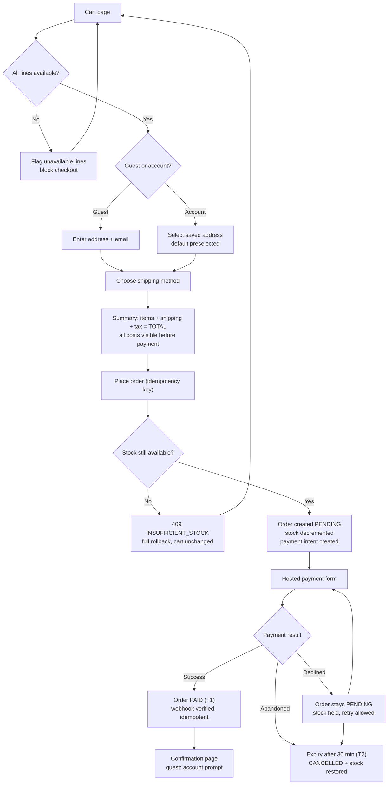
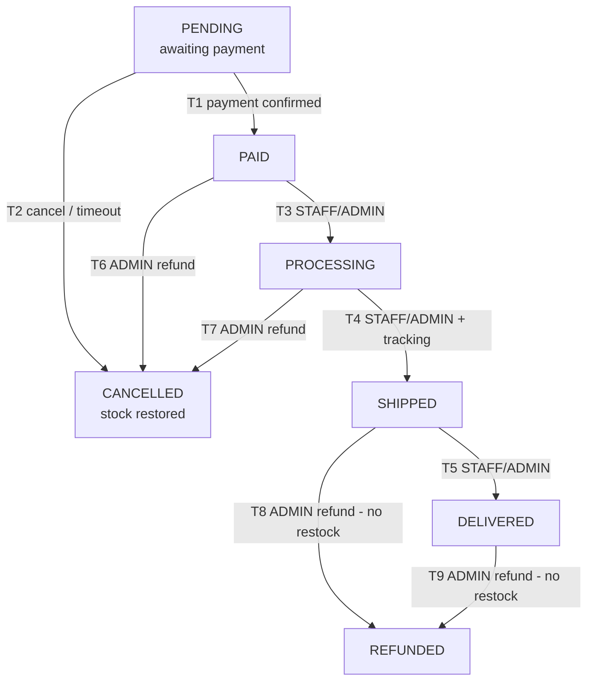
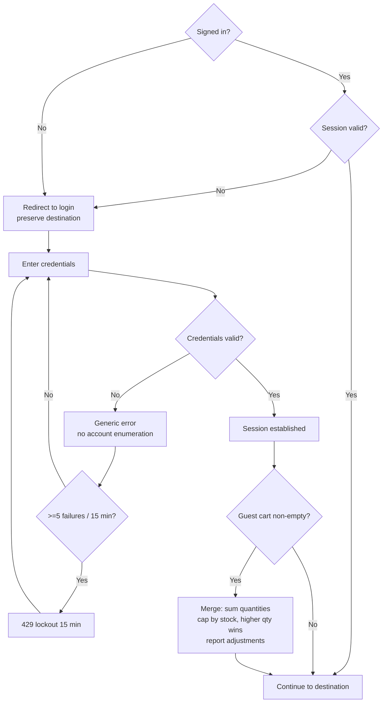
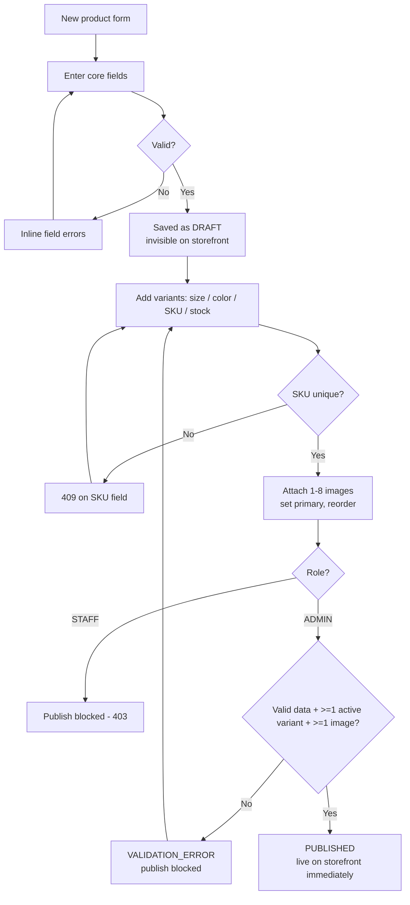
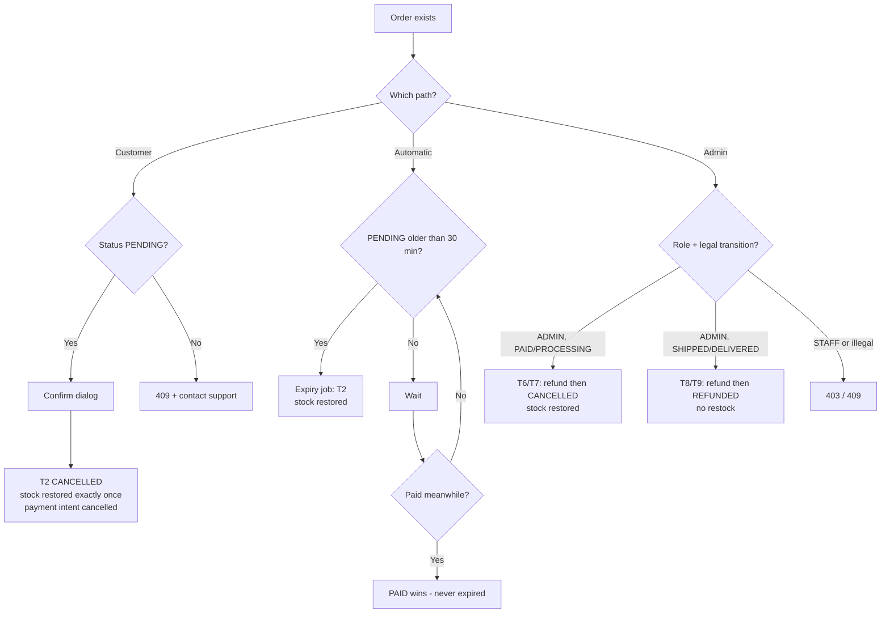
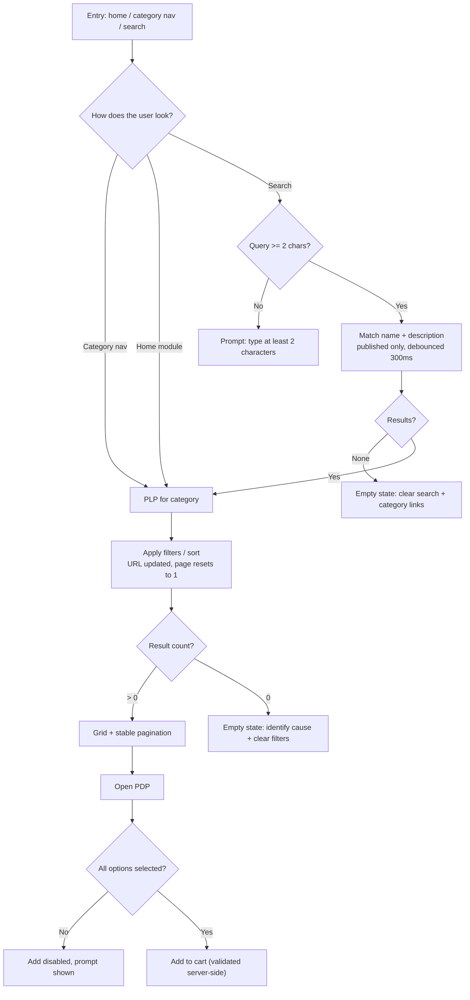

# Shoply — User Flows & User Journeys

| Field | Value |
|---|---|
| **Project name** | Shoply |
| **Document type** | User Flow & Journey Specification |
| **Version** | 1.0 |
| **Date** | 2026-11-03 |
| **Status** | 🟡 Draft — Awaiting stakeholder approval |
| **Author** | UX Design & Business Analysis |
| **Sources of truth** | `docs/PROJECT_PLANNING.md` v1.0 (approved) · `docs/SRS.md` v1.0 (draft) |
| **Next phase** | Figma wireframes/high-fidelity screens (after approval) |
| **Code status** | ❌ No application code |

---

## Document Control

| Version | Date | Change |
|---|---|---|
| 1.0 | 2026-11-03 | Initial user flows, journeys, navigation and page inventory |

**Rules governing this document:**

1. Flows describe **behavior, not implementation** — what the user does and what the system must do in response.
2. Where a requested workflow is **not in the approved MVP**, it is still documented (so nothing is lost) but flagged **⛔ Deferred**. Deferred flows must not be built during V1.
3. Every flow cites its SRS requirement IDs so UX and requirements stay traceable.
4. New design-level decisions raised by this document are collected in [§12](#12-unresolved-decisions) — no silent design choices.

---

## Table of Contents

1. [Purpose & Sources](#1-purpose--sources)
2. [Notation & Conventions](#2-notation--conventions)
3. [Scope Reconciliation](#3-scope-reconciliation)
4. [Customer Workflows (CF-01 … CF-18)](#4-customer-workflows)
5. [Admin Workflows (AF-01 … AF-11)](#5-admin-workflows)
6. [Journey Maps](#6-journey-maps)
7. [Mermaid Flowcharts](#7-mermaid-flowcharts)
8. [Navigation Structure](#8-navigation-structure)
9. [Complete Page Inventory](#9-complete-page-inventory)
10. [Pages Requiring Authentication](#10-pages-requiring-authentication)
11. [Admin-Only Pages](#11-admin-only-pages)
12. [Unresolved Decisions](#12-unresolved-decisions)
13. [Summary & Approval](#13-summary--approval)

---

## 1. Purpose & Sources

This document translates the approved business plan and the SRS into **executable user flows**: what appears on screen, what the user does, how the system responds, where the branches are, and what happens when things go wrong.

It exists to:

- Give the **Figma phase** an exact list of screens and states to design (including error and empty states that are easy to forget).
- Give the **build phase** a behavioral checklist per screen, so generated code matches approved behavior.
- Catch **UX-level decisions** before design work begins.

**Sources:** [R1] `PROJECT_PLANNING.md`, [R2] `SRS.md`. Neither document is modified by this one.

---

## 2. Notation & Conventions

### 2.1 Flow entry format

Each workflow carries:

| Element | Meaning |
|---|---|
| **Status** | `MVP` (build in V1) or `⛔ Deferred (release)` |
| **SRS refs** | Requirement IDs this flow implements |
| **Starting point** | Where the user begins (page/entry) |
| **Steps** | Ordered table: user action → system response |
| **Decision points** | ◆ branches with the condition and where each path leads |
| **Success outcome** | The state that counts as "done" |
| **Error scenarios** | What can fail and exactly how the system responds |
| **Alternative paths** | Legitimate other ways to reach or leave the flow |

### 2.2 Status markers

| Marker | Meaning |
|---|---|
| `MVP` | In V1 scope — must be built |
| `MVP (P1)` | In V1, lower priority; may be descoped per SRS §30.4 |
| `⛔ Deferred (V1.5)` | Specified, ready to build later — **not** in V1 |
| `⛔ Deferred (V2)` | Later release |
| `❌ Not in scope` | Excluded by the approved plan |

### 2.3 Roles referenced

`GUEST` (anonymous) · `CUSTOMER` (registered shopper) · `STAFF` (back-office operator) · `ADMIN` (full back office).

---

## 3. Scope Reconciliation

The workflow list requested for this document includes items the approved plan excludes. Rather than omit them or silently build them, each is mapped below. **This table is the most important section of this document for scope control.**

### 3.1 Customer workflows

| # | Requested workflow | Status in approved plan | Documented as |
|---|---|---|---|
| 1 | Homepage navigation | MVP ([R1] §2.6) | CF-01 ✅ |
| 2 | Product browsing | MVP | CF-02 ✅ |
| 3 | Product search | MVP | CF-03 ✅ |
| 4 | Product filtering and sorting | MVP | CF-04 ✅ |
| 5 | Product details | MVP | CF-05 ✅ |
| 6 | User registration | MVP | CF-06 ✅ |
| 7 | User login | MVP | CF-07 ✅ |
| 8 | **Forgot password** | **V1 fallback only** ("contact support"); full flow **V1.5** ([R2] FR-AUTH-06) | CF-08 ⛔ split |
| 9 | Add to cart | MVP | CF-09 ✅ |
| 10 | Update cart | MVP | CF-10 ✅ |
| 11 | **Wishlist management** | **V1.5** — excluded from V1 ([R1] §2.6, [R2] §18) | CF-11 ⛔ V1.5 |
| 12 | Checkout | MVP | CF-12 ✅ |
| 13 | Payment processing | MVP | CF-13 ✅ |
| 14 | Order confirmation | MVP | CF-14 ✅ |
| 15 | Order tracking | MVP | CF-15 ✅ |
| 16 | Order cancellation | MVP | CF-16 ✅ |
| 17 | Customer profile management | MVP | CF-17 ✅ |
| 18 | **Product reviews** | **V1.5** — excluded from V1 ([R1] §2.6, [R2] §17) | CF-18 ⛔ V1.5 |

### 3.2 Admin workflows

| # | Requested workflow | Status in approved plan | Documented as |
|---|---|---|---|
| 1 | Admin login | MVP | AF-01 ✅ |
| 2 | Admin dashboard | MVP (P1) | AF-02 ✅ |
| 3 | Product creation | MVP | AF-03 ✅ |
| 4 | Product editing | MVP | AF-04 ✅ |
| 5 | **Product deletion** | **Not possible** — archive only; hard delete is prohibited ([R1] §2.9, [R2] BR-06) | AF-05 ✅ (as *archive*) |
| 6 | Inventory management | MVP | AF-06 ✅ |
| 7 | Category management | MVP (ADMIN only) | AF-07 ✅ |
| 8 | Order management | MVP | AF-08 ✅ |
| 9 | Customer management | MVP (P1, ADMIN only) | AF-09 ✅ |
| 10 | **Coupon management** | **Not in V1** — coupons are a V1.5 backlog item ([R1] §2.7) | AF-10 ⛔ V1.5 |
| 11 | **Sales analytics** | **Split**: KPI dashboard = V1 (P1); charts, cohorts, CSV export = V2 ([R1] §2.7) | AF-11 ✅ + ⛔ V2 |

> **Designer note:** three requested items (forgot password, wishlist, reviews, coupons) are deliberately absent from V1. **Do not add placeholder UI, dead links, or "coming soon" badges for them** — unbuilt affordances make a demo look unfinished. Navigation simply omits them until their release.

---

## 4. Customer Workflows

> Shared rules applying to **all** customer flows: money is shown in USD; every list view has loading/empty/error states ([R2] FR-GEN-04); field errors appear inline without clearing input ([R2] ERR-08); no step ever loses user input on refresh or session expiry ([R2] BR-30).

---

### CF-01 — Homepage navigation

| | |
|---|---|
| **Status** | MVP |
| **SRS refs** | FR-CUS-01, FR-CUS-10, FR-GEN-04 |
| **Starting point** | Root URL `/` (bookmarked, typed, or from a shared link) |

**Steps**

| # | User action | System response |
|---|---|---|
| 1 | Opens `/` | Header renders (logo, category nav, search, account, cart badge); hero renders with primary CTA |
| 2 | Scans page | Featured collection, new arrivals, and category entry points load from **published** products only |
| 3 | Chooses an entry point (hero CTA, category link, product card) | Navigates to the target category listing, collection, or PDP |
| 4 | (Optional) Types in search | Live suggestions/results per CF-03 |
| 5 | (Optional) Clicks cart badge | Opens `/cart` with current contents ([R2] FR-CART-09) |

**Decision points**
- ◆ **Logged in?** → header shows account entry (name/avatar); otherwise shows "Sign in". Guest cart badge still shows.
- ◆ **Cart has items?** → badge shows unit count (e.g. "Cart · 3"); empty cart shows a neutral badge.
- ◆ **Hero CTA target** — category vs. featured collection. *Depends on [UX-DEC-01](#12-unresolved-decisions) and SRS DEC-24 (merchandising source).*

**Success outcome:** the user reaches a category listing, search results, or a PDP in ≤ 2 clicks from home.

**Error scenarios**

| Scenario | System response |
|---|---|
| Catalog API unreachable | Home shell still renders; module areas show error state with **Retry** (FR-GEN-04) |
| Featured product archived after render | Clicking it yields the 404 page with a "Browse catalog" action |
| Slow network | Skeleton loaders, not spinners; layout reserved so nothing jumps (PERF-11) |

**Alternative paths**
- Deep link directly to a category or product (URL-first arrival) — bypasses home entirely.
- Mobile: hamburger opens the navigation drawer with categories, search, account, and cart.

---

### CF-02 — Product browsing

| | |
|---|---|
| **Status** | MVP |
| **SRS refs** | FR-CUS-02, FR-SRCH-04, FR-GEN-02, FR-GEN-05 |
| **Starting point** | Category nav, home module, search results, or breadcrumb |

**Steps**

| # | User action | System response |
|---|---|---|
| 1 | Opens a category / listing | Grid renders: image, name, price, compare-at price (strikethrough), availability badge |
| 2 | Scrolls | More rows load per page (default 12, max 48); images lazy-load |
| 3 | Uses pagination | Next/prev or page numbers; ordering is stable — no item repeats or disappears (FR-SRCH-04) |
| 4 | Clicks a product card | Navigates to `/products/:slug` |
| 5 | (Optional) Applies filters/sort | Continues in CF-04 |

**Decision points**
- ◆ **Enough info on the card?** → if yes, may add only via PDP (PDP is the *only* surface that adds to cart — [R2] FR-CUS-03).
- ◆ **More results than one page?** → paginate; filter/sort changes reset to page 1.

**Success outcome:** the user finds a product of interest and reaches its PDP.

**Error scenarios**

| Scenario | System response |
|---|---|
| Category has zero published products | Empty state: "Nothing here yet" + links to other categories |
| Page number beyond the last page | Empty page with navigation back — never an error (EC-26) |
| Product archived mid-browse | Card disappears on refresh; direct navigation → 404 page |

**Alternative paths**
- Arrive from search results (query + filters combined).
- Arrive from a home "New arrivals" module (sorted by newest).

---

### CF-03 — Product search

| | |
|---|---|
| **Status** | MVP |
| **SRS refs** | FR-SRCH-01, FR-SRCH-06, FR-GEN-05 |
| **Starting point** | Header search field (desktop) or search entry in the mobile drawer |

**Steps**

| # | User action | System response |
|---|---|---|
| 1 | Types a query | Input debounced ~300 ms (PERF-14); minimum 2 characters to trigger |
| 2 | Server processes | Case-insensitive match on product **name** and **description**; only published products |
| 3 | Results render | Result count shown ("14 products"), same card grid as CF-02 |
| 4 | Refines query or applies filters | Results update; query + filters + page stored in the URL (FR-SRCH-05) |
| 5 | Clicks a result | Opens the PDP |
| 6 | Clears query | Returns to the previous browse context |

**Decision points**
- ◆ **≥ 2 characters?** No → show a prompt ("Type at least 2 characters"), no request.
- ◆ **Results found?** Yes → grid. No → empty state naming the query with "Clear search" and category shortcuts (FR-SRCH-06).

**Success outcome:** relevant products found, or a recoverable empty state with a next action.

**Error scenarios**

| Scenario | System response |
|---|---|
| No matches | "No products match *'xyz'*" + clear-search action + category links |
| Special characters (`%' OR '1'='1`) | Escaped; treated as a normal query returning an empty result (EC-24) |
| Search service error | Inline error with retry; previous results retained |

**Alternative paths**
- Mobile drawer search → results page.
- Search with filters already applied → intersection of query and facets.

---

### CF-04 — Product filtering and sorting

| | |
|---|---|
| **Status** | MVP |
| **SRS refs** | FR-SRCH-02/03/04/05/06 |
| **Starting point** | Any listing or search-results page |

**Steps**

| # | User action | System response |
|---|---|---|
| 1 | Opens filter controls | Facets available: **category, size, color, price range** |
| 2 | Selects facet values | Within a facet = OR; across facets = AND; results and count update without full reload |
| 3 | Sets price range (min–max, minor units) | Range validated: `0 ≤ min ≤ max`; UI clamps invalid input |
| 4 | Chooses a sort | Whitelist: **Newest (default) · Price low→high · Price high→low · Name A–Z**; unknown value falls back to Newest |
| 5 | Observes URL | Query string updates — shareable, back/forward safe (FR-SRCH-05) |
| 6 | Clears filters | "Clear all" restores the unfiltered listing; count returns to total |

**Decision points**
- ◆ **Filter combination returns 0?** → empty state identifying the cause and offering "Clear filters" (never a dead end).
- ◆ **Mobile or desktop?** → desktop: sidebar; mobile: **bottom-sheet for filters, dropdown/sheet for sort** — *see [UX-DEC-04](#12-unresolved-decisions)*.

**Success outcome:** the user narrows to a manageable result set and reaches a PDP.

**Error scenarios**

| Scenario | System response |
|---|---|
| Unknown category/size/color value in URL | Ignored silently; valid filters still apply |
| Invalid price range (`min > max`) | Client clamps; server would reject with `400 VALIDATION_ERROR` |
| Unknown sort value | Falls back to Newest, no error |
| Zero-result combination | Recoverable empty state (EC-25) |

**Alternative paths**
- Filtered state is shareable: pasting the URL reproduces the exact view.
- Combining a keyword search with facets (search results are filterable identically).

---

### CF-05 — Product details

| | |
|---|---|
| **Status** | MVP |
| **SRS refs** | FR-CUS-03, FR-CUS-09, FR-INV-07, FR-CART-01 |
| **Starting point** | Any product card / direct URL `/products/:slug` |

**Steps**

| # | User action | System response |
|---|---|---|
| 1 | Opens the PDP | Gallery (3–5 images, thumbnails, alt text), name, price (+ compare-at price), description, material/care |
| 2 | Selects **color** | Variant options update; available sizes for that color become selectable |
| 3 | Selects **size** | A specific SKU resolves; availability shows: `In stock` (>5) · `Only N left` (1–5) · `Sold out` (0) — *per SRS DEC-16* |
| 4 | Opens size guide | Global size chart dialog (focus-trapped, `Esc` closes) — *SRS DEC-21* |
| 5 | Clicks **Add to cart** | Server validates (variant active, product published, stock) → cart updates → confirmation feedback + header badge increments (FR-CART-09) |
| 6 | (Optional) Continues | → cart (`CF-10`) or keeps shopping |

**Decision points**
- ◆ **All required options selected?** No → button disabled with inline prompt "Please select a size"; no API call is made.
- ◆ **SKU sold out?** → Add to cart disabled, item marked `Sold out`. **No waitlist/back-in-stock alert exists in V1** (explicitly out of scope).
- ◆ **Single option value?** → *recommendation: auto-select when a dimension has only one value* — see [UX-DEC-05](#12-unresolved-decisions).

**Success outcome:** the item is in the server-side cart and the badge reflects the new unit count.

**Error scenarios**

| Scenario | System response |
|---|---|
| Unknown slug | 404 page with "Browse catalog" |
| Product archived while PDP open, then Add | `409 PRODUCT_UNAVAILABLE` → message "This product is no longer available" |
| Stock changed since page load | Server returns actual availability; UI updates rather than failing |
| Add with quantity over stock | `409 INSUFFICIENT_STOCK` → "Only N left" with the maximum allowed |

**Alternative paths**
- Arrive from search, category, home module, or (V1.5) wishlist/reviews links.
- Mobile: sticky bottom add-to-cart bar while scrolling ([R2] RESP-04).

---

### CF-06 — User registration

| | |
|---|---|
| **Status** | MVP |
| **SRS refs** | FR-AUTH-01, FR-AUTH-07, FR-CART-08, FR-CUS-07 |
| **Starting point** | "Create account" link from login page, checkout login prompt, or post-purchase prompt |

**Steps**

| # | User action | System response |
|---|---|---|
| 1 | Opens registration | Form: name, email, password, confirm password; password rules shown (≥8 chars, letter + number) |
| 2 | Submits valid data | Client validates → server validates → account created with `CUSTOMER` role → session cookie set |
| 3 | (If guest cart non-empty) | Guest cart **merged** into the new account cart — quantities summed, capped by stock; adjustments reported (FR-CART-08) |
| 4 | (If guest placed an order with same email) | That order links to the account (FR-CUS-07) |
| 5 | Redirect | To the intended destination (e.g. checkout) or account home |

**Decision points**
- ◆ **Email already registered?** → field error "An account with this email already exists" → offered a login link. *(Disclosure tradeoff accepted: V1 has no email verification — SRS DEC-19a.)*
- ◆ **Triggered from checkout?** → after success, user returns to checkout with cart intact (BR-30).
- ◆ **Triggered post-purchase (guest)?** → email pre-filled; on match, orders appear in history.

**Success outcome:** authenticated session established, cart preserved/merged, and the user lands where they intended.

**Error scenarios**

| Scenario | System response |
|---|---|
| Duplicate email | Inline field error + "Sign in instead" link |
| Weak password / mismatch | Inline errors on both password fields; input retained |
| Rate limited (5 attempts/15 min) | `429 RATE_LIMITED` with retry-after message (FR-AUTH-08) |
| Server error during creation | Error state with retry; no partial account (transactional) |

**Alternative paths**
- Login instead (already has an account) → CF-07.
- Abandon registration → cart remains bound to the guest session.

---

### CF-07 — User login

| | |
|---|---|
| **Status** | MVP |
| **SRS refs** | FR-AUTH-02/03/04/09, FR-CART-08 |
| **Starting point** | "Sign in" in header, checkout guard, or protected-route redirect |

**Steps**

| # | User action | System response |
|---|---|---|
| 1 | Opens `/login` | Email + password form; "Forgot password?" link; "Create account" link |
| 2 | Submits credentials | Server authenticates; **identical error** for unknown email vs. wrong password (SEC-07) |
| 3 | Success | Session cookie set; guest cart merged (higher quantity wins, capped by stock — BR-18); redirect to intended destination |
| 4 | Session persists | User stays signed in across reloads/restarts for 7 days — *SRS DEC-18* |

**Decision points**
- ◆ **Redirect target?** Checkout → return to checkout with state intact; otherwise → intended page or account home.
- ◆ **Failed attempts ≥ 5 in 15 min?** → `429` lockout with a "try again in 15 minutes" message (FR-AUTH-08).
- ◆ **Account blocked?** → distinct message: "Your account has been disabled" — *SRS DEC-19b*.

**Success outcome:** authenticated, cart merged, redirected to the original destination.

**Error scenarios**

| Scenario | System response |
|---|---|
| Wrong credentials | Generic: "Email or password is incorrect" — no account enumeration |
| Locked out | `429` with retry timing |
| Blocked account | `403` with the explicit disabled message |
| Session expired mid-visit | Redirect to login **preserving destination**; on return, checkout data restored (FR-AUTH-04) |

**Alternative paths**
- Admin login is a **separate route** (`/admin/login`) — CF-07 is storefront only (FR-AUTH-13).
- Guest who declines to log in continues with a guest cart.

---

### CF-08 — Forgot password

| | |
|---|---|
| **Status** | ⛔ **Split**: V1 = fallback page only · **V1.5** = full reset flow |
| **SRS refs** | FR-AUTH-06 (Deferred to V1.5) · [R1] §2.8 |
| **Starting point** | "Forgot password?" link on the login page |

**V1 behavior (build this):**

| # | User action | System response |
|---|---|---|
| 1 | Clicks "Forgot password?" | Navigates to a **static support page**: explains that password resets are handled by support, with contact details |
| 2 | (No email is sent anywhere in V1) | — |

> **Why:** V1 has no email provider ([R1] §2.6). Pretending to reset a password would be a broken promise in a portfolio demo.

**V1.5 behavior (do NOT build now — specified for readiness):**

| # | User action | System response |
|---|---|---|
| 1 | Enters account email | Server always responds identically (no enumeration) |
| 2 | — | If the account exists: single-use, 15-minute reset token issued and emailed (V2 provider) |
| 3 | Opens emailed link | Reset form: new password + confirm |
| 4 | Submits | Password updated; **all sessions invalidated**; redirect to login with success message |
| 5 | Token expired/used | Clear error with a "request a new link" action |

**Decision points**
- ◆ V1: any intent → support page. ◆ V1.5: valid token → reset form; invalid/expired → error + re-request path.

**Success outcome (V1):** the user is honestly redirected to a working support route — no dead end, no fake success.
**Success outcome (V1.5):** password changed and all old sessions dead.

**Error scenarios (V1.5):** expired token → error + re-request; reused token → error; unknown email → identical neutral response.

**Alternative paths:** V1.5 — user instead changes a known password from the profile (CF-17).

---

### CF-09 — Add to cart

| | |
|---|---|
| **Status** | MVP |
| **SRS refs** | FR-CART-01/06/07/09, FR-INV-07 |
| **Starting point** | PDP with all required options selected |

**Steps**

| # | User action | System response |
|---|---|---|
| 1 | Selects color + size (if not auto-selected) | SKU resolves; availability displayed |
| 2 | Sets quantity (default 1) | Capped at `min(stock, 10)` — *SRS DEC-15b* |
| 3 | Clicks **Add to cart** | Request to server: variant + qty. Server re-validates stock and product state |
| 4 | Success | Line created (or existing line's quantity summed); cart badge updates; confirmation feedback shown (toast/inline, FR-NTF-04) |
| 5 | Guest? | Line bound to the guest session cart (FR-AUTH-09) — survives reload |

**Decision points**
- ◆ **Variant already in cart?** → quantities **merge** into one line (capped by stock) — never a duplicate line (EC-08).
- ◆ **Cart at 30 distinct lines?** → `409 CONFLICT` with a message to remove an item first.
- ◆ **Keep shopping or view cart?** → both offered in the confirmation feedback.

**Success outcome:** server-side cart contains the line; badge shows the new unit count.

**Error scenarios**

| Scenario | System response |
|---|---|
| Out of stock | `409 INSUFFICIENT_STOCK` → "Only N left" |
| Qty exceeds stock | Rejected with the maximum allowed quantity stated |
| Product unpublished/archived | `409 PRODUCT_UNAVAILABLE` → "No longer available" |
| Max distinct lines reached | `409 CONFLICT` with clear guidance |

**Alternative paths**
- Only the PDP adds items in V1 (no quick-add on listing cards — see [UX-DEC-03](#12-unresolved-decisions)).
- V1.5: "Move to cart" from the wishlist (CF-11).

---

### CF-10 — Update cart

| | |
|---|---|
| **Status** | MVP |
| **SRS refs** | FR-CART-02/03/04/05/06/11, FR-CHK-01 |
| **Starting point** | `/cart` (header badge, post-add feedback, or direct URL) |

**Steps**

| # | User action | System response |
|---|---|---|
| 1 | Opens cart | Lines render with current price, qty, line total; subtotal recomputed server-side; unavailable lines flagged and excluded from subtotal |
| 2 | Changes quantity | Server validates `1 ≤ qty ≤ min(stock, 10)` → updates → returns new totals |
| 3 | Changes a variant (size/color) | Line swaps to the target variant if stock allows; if that variant is already a line, the two **merge** |
| 4 | Removes a line | Line deleted; empty cart remains a valid state |
| 5 | Sees a price change since last visit | Inline notice "Price updated" — new price applies (FR-CART-11) |
| 6 | Clicks **Checkout** | → CF-12 |

**Decision points**
- ◆ **Line unavailable (archived product / deactivated variant)?** → shown as unavailable, excluded from totals, **checkout blocked** until the user removes it (§11.2).
- ◆ **Qty > live stock?** → rejected; cart left **unchanged** with "Only N left" (EC-06).
- ◆ **Cart empty?** → empty state with "Continue shopping" — checkout is not reachable (FR-CHK-01).

**Success outcome:** cart reflects valid, purchasable lines with an accurate subtotal, ready for checkout.

**Error scenarios**

| Scenario | System response |
|---|---|
| Stock dropped below line qty | Line flagged; message with actual available quantity; checkout guard blocks |
| Price changed | New price + notice; subtotal always equals Σ(current price × qty) |
| Session lost (cleared cookies) | New empty guest cart — no cross-access (EC-35) |
| Concurrent edit from another tab | Server state wins; UI reflects it on next response |

**Alternative paths**
- Login while holding a guest cart → merge (CF-07) then continue here.
- Abandon the cart → guest cart persists ~60 days (SRS DEC-14); account carts persist indefinitely.

---

### CF-11 — Wishlist management

| | |
|---|---|
| **Status** | ⛔ **Deferred (V1.5)** — excluded from V1 by [R1] §2.6 |
| **SRS refs** | [R2] §18 (FR-WIS-01…04) |
| **Starting point** | Heart/save control on PDP or listing card (V1.5) |

> **Do not build any of this in V1.** No header icon, no placeholder link.

**V1.5 flow:**

| # | User action | System response |
|---|---|---|
| 1 | Clicks save on a PDP/card | If unauthenticated → login prompt preserving destination (FR-WIS-01) |
| 2 | Authenticated | Product added (idempotent — repeat click = no error, no duplicate) |
| 3 | Opens wishlist (`/account/wishlist`) | Paginated list with current price and availability |
| 4 | **Move to cart** | Adds the first available variant, subject to normal cart rules; archived items marked unavailable |
| 5 | Removes an item | Removed; list updates |

**Decision points**
- ◆ Guest → login required. ◆ Product archived → shown but unmovable. ◆ 100-item limit → `409` (V1.5 rule).
**Success outcome:** saved items are retrievable later and can move to the cart.
**Error scenarios:** `401` → login prompt; duplicate add → idempotent success; archived → `409 PRODUCT_UNAVAILABLE`.
**Alternative paths:** from cart ("save for later"), from search results.

---

### CF-12 — Checkout

| | |
|---|---|
| **Status** | MVP |
| **SRS refs** | FR-CHK-01…05, FR-CHK-07, FR-ORD-01, FR-INV-02 |
| **Starting point** | Cart → **Checkout** button |

**Steps**

| # | User action | System response |
|---|---|---|
| 1 | Enters checkout | Guard: cart non-empty and all lines available, else redirect to cart (FR-CHK-01) |
| 2a | **Guest:** fills address + email | Validated per SRS §12.2 (name, line1, city, state, postal, country; email required) |
| 2b | **Account:** selects address | Default address pre-selected; "add new address" available; selected address snapshotted onto the order |
| 3 | Chooses shipping method | Server returns a quote; summary updates — **all costs visible before payment** (BR-21) |
| 4 | Reviews summary | Line items, subtotal, shipping, **tax** (labelled "Estimated" — SRS DEC-04), **total** |
| 5 | Clicks **Place order** | Client sends one **idempotency key**; server in a single transaction: validates stock → creates order `PENDING` with snapshots → **conditionally decrements stock** → creates payment record/intent → returns order number + payment client secret (FR-CHK-05) |
| 6 | Proceeds to payment | → CF-13 |

**Decision points**
- ◆ **Guest or account?** Guest → inline form; account → saved addresses. Login mid-flow is allowed and preserves all entered data (FR-CHK-07).
- ◆ **Stock still available at placement?** No → `409 INSUFFICIENT_STOCK` naming the affected lines; transaction rolls back; **cart unchanged**; user returns to cart.
- ◆ **Shipping method valid?** Invalid → `400` with the form re-rendered.
- ◆ **Duplicate submit / retry?** Same key → the **same order** returned; never a second order (EC-02).

**Success outcome:** an order exists in `PENDING`, stock is held, and the user reaches the payment step with a visible total.

**Error scenarios**

| Scenario | System response |
|---|---|
| Empty cart / unavailable line at entry | Redirect to cart with explanation |
| Concurrent last-unit purchase | `409` → clean rollback, cart intact (EC-01) |
| Invalid address | Field-level errors; **no entered data lost** |
| Session expiry mid-checkout | Redirect to login; on return, checkout state restored (EC-22) |
| Payment-intent creation fails | Full rollback; retryable; cart untouched |

**Alternative paths**
- Login during checkout → cart merge → resume at the same step.
- Return from a failed payment → same address/shipping selection intact (CF-13).

---

### CF-13 — Payment processing

| | |
|---|---|
| **Status** | MVP |
| **SRS refs** | FR-PAY-01…06, FR-CHK-06, FR-ORD-10 |
| **Starting point** | Post-placement payment step (hosted payment form) |

**Steps**

| # | User action | System response |
|---|---|---|
| 1 | Payment form renders | Hosted by the provider (test mode); **card data never touches Shoply** (SEC-11) |
| 2 | Enters test card, submits | Provider confirms the intent; 3-D Secure challenge may appear |
| 3a | **Success** | Webhook/confirm (idempotent, signature-verified) → order `PENDING → PAID` (T1) → confirmation page (CF-14) |
| 3b | **Decline** | `409/PAYMENT_FAILED`-class error → clear message; **order stays `PENDING`**, stock still held; retry available (SRS DEC-03) |
| 4 | User abandons | Expiry job cancels `PENDING` orders after 30 min → stock restored, no charge ever exists (SRS DEC-02) |

**Decision points**
- ◆ **Payment confirmed?** Yes → `PAID` and confirmation. No → retry (same or different card) or abandon.
- ◆ **Confirmation vs. expiry race?** **Payment always wins** — an order being paid at minute 29 ends `PAID`, never `CANCELLED` (EC-14).
- ◆ **Duplicate/late webhook?** Verified by signature, deduplicated by event id, ignored if already final (EC-12).

**Success outcome:** exactly one `PAID` order, one captured charge, confirmation displayed.

**Error scenarios**

| Scenario | System response |
|---|---|
| Card declined | Plain-language message + retry; **no charge exists**; address/cart preserved (EC-10) |
| 3DS failure/abandon | Treated as failure → same as decline |
| Network drop after submit | Recovery via provider status/webhook; refresh never creates a duplicate (EC-11) |
| Forged webhook | Signature rejected; zero state change (EC-13) |
| Idempotency key reused with different payload | `409 IDEMPOTENCY_CONFLICT` |

**Alternative paths**
- Abandon → CF-16 (expiry) with automatic stock restoration.
- Success but lost confirmation tab → order is visible in order history (CF-15).

---

### CF-14 — Order confirmation

| | |
|---|---|
| **Status** | MVP |
| **SRS refs** | FR-CUS-07, FR-NTF-01, FR-ORD-03 |
| **Starting point** | Immediately after payment confirmation |

**Steps**

| # | User action | System response |
|---|---|---|
| 1 | Lands on confirmation | Order number (`SHOP-YYYYMMDD-XXXX` — SRS DEC-17), items, totals, shipping method, **delivery estimate window**, "what happens next" |
| 2 | **Guest only:** sees account prompt | "Create an account to track this order" with email pre-filled (FR-CUS-07) |
| 3 | Guest chooses | **Create account** → registration (CF-06) with orders linked on email match · **No thanks** → dismissed; order remains viewable here |
| 4 | (Optional) Saves/bookmarks | Confirmation route is refresh-safe and re-openable |

**Decision points**
- ◆ **Guest or account?** Account → prompt skipped; order already in history.
- ◆ **Create account?** Yes → CF-06 → orders appear in the new account's history (EC: email mismatch → prompt to log in instead).

**Success outcome:** the user has a durable record of the order — via confirmation page (always) and/or account history.

**Error scenarios**

| Scenario | System response |
|---|---|
| Refresh before payment confirmed | Waiting state (not a success page) until confirmation is authoritative |
| Registration email already exists | Offer login; on login the order links if emails match |
| Confirmation unreachable | Order still exists and is reachable from history once authenticated |

**Alternative paths**
- Continue shopping → home; or track immediately → CF-15.

---

### CF-15 — Order tracking

| | |
|---|---|
| **Status** | MVP |
| **SRS refs** | FR-CUS-06, FR-ORD-03/09 |
| **Starting point** | Account → **Orders** list |

**Steps**

| # | User action | System response |
|---|---|---|
| 1 | Opens order history | Paginated list, newest first: order number, date, status badge, total, item count |
| 2 | Opens an order | Line items (name, SKU, options, unit price, qty), totals, address snapshot, payment state |
| 3 | Views timeline | Status history rendered as a timeline — only states actually entered, each with a timestamp (FR-ORD-09) |
| 4 | Sees cancel option | **Only** when the order is `PENDING` (→ CF-16) |

**Decision points**
- ◆ **Order belongs to the user?** No → `404` (deliberate non-disclosure, FR-AUTH-07a).
- ◆ **Order state** → drives which actions are offered (only "Cancel" in `PENDING`).

**Success outcome:** the user can state exactly where their order is and what happens next.

**Error scenarios**

| Scenario | System response |
|---|---|
| Foreign order ID | `404` — no existence leak |
| Missing history rows (data issue) | Fall back to created-at only; never a crash |
| Session expired | Redirect to login, then return here |

**Alternative paths**
- **Guest tracking in V1:** only via the confirmation page — there is **no guest order-lookup page** (see [UX-DEC-06](#12-unresolved-decisions)).
- V1.5+: email notifications link here (FR-NTF-05).

---

### CF-16 — Order cancellation

| | |
|---|---|
| **Status** | MVP |
| **SRS refs** | FR-ORD-04/02/10, FR-INV-03, BR-14 |
| **Starting point** | Order detail (CF-15) or, automatically, the expiry job |

**Steps**

| # | User action | System response |
|---|---|---|
| 1 | Views a `PENDING` order | "Cancel order" action visible |
| 2 | Clicks cancel | Confirmation dialog stating consequences (no charge, stock released) — *[UX-DEC-09]* |
| 3 | Confirms | Server validates: state is `PENDING` → transition **T2** → status `CANCELLED`, **stock restored exactly once**, payment intent cancelled, history row written |
| 4 | Result | Order shows `CANCELLED` with timestamp; timeline updated |

**Decision points**
- ◆ **Is the order `PENDING`?** No → the action is absent from the UI **and** the API rejects it with `409 ILLEGAL_TRANSITION` (EC-37).
- ◆ **Race with payment?** If payment confirms first, cancellation is rejected — `PAID` wins (EC-14).
- ◆ **Already cancelled?** Second attempt → `409`; restoration cannot double-fire.

**Success outcome:** order `CANCELLED`, stock returned, zero charge.

**Error scenarios**

| Scenario | System response |
|---|---|
| Order already `PAID` | `409` + "Contact support to cancel a paid order" |
| Concurrent transition | One succeeds; the other `409` |
| Restoration failure | Transaction rolls back — status and stock stay consistent |

**Alternative paths**
- **Automatic:** abandoned `PENDING` order → expiry job performs the same T2 after 30 min (SRS DEC-02).
- **Admin:** STAFF/ADMIN cancel `PAID`/`PROCESSING` (T6/T7) with refund — see AF-08.
- Refund after shipment (T8/T9) is ADMIN-only and does **not** restock (SRS DEC-09).

---

### CF-17 — Customer profile management

| | |
|---|---|
| **Status** | MVP |
| **SRS refs** | FR-CUS-04/05, FR-AUTH-05 |
| **Starting point** | Account menu → **Account** |

**Steps**

| # | User action | System response |
|---|---|---|
| 1 | Opens account area | Overview: profile shortcut, orders, addresses, logout |
| 2 | Edits profile | Name (2–100 chars) saved. **Email is not editable in V1** — *SRS DEC-20* |
| 3 | Changes password | Requires current password; new password per policy; on success **all other sessions invalidated** (FR-AUTH-05) |
| 4 | Manages addresses | Add / edit / delete / set default; exactly one default (BR-15); max 20 (*SRS DEC-20 note*) |
| 5 | Deletes an address | Existing orders unaffected — they hold snapshots (BR-16) |

**Decision points**
- ◆ **Deleting the default address?** → oldest remaining becomes default, or the user is prompted to pick one.
- ◆ **Wrong current password?** → field error; nothing changes.

**Success outcome:** account data accurate, one default address, password change kills other sessions.

**Error scenarios**

| Scenario | System response |
|---|---|
| Invalid name/password | Inline field errors; input retained |
| Address limit reached | `409` with guidance to delete one first |
| Concurrent default change | Server state wins; UI refreshes |

**Alternative paths**
- Address book can also be entered directly from checkout (add-new-address path).

---

### CF-18 — Product reviews

| | |
|---|---|
| **Status** | ⛔ **Deferred (V1.5)** — excluded from V1 by [R1] §2.6 |
| **SRS refs** | [R2] §17 (FR-REV-01…06) |
| **Starting point** | PDP (V1.5) |

> **Do not build in V1.** No review section, no star placeholders.

**V1.5 flow:**

| # | User action | System response |
|---|---|---|
| 1 | Scrolls to reviews on PDP | Average rating + count, star distribution, sort (newest/highest/lowest), paginated |
| 2 | Clicks **Write a review** | If not authenticated → login prompt preserving destination |
| 3 | Submits rating (1–5, required) + optional title/body | Eligibility checked: must have a **`DELIVERED` order containing this product** (verified purchase) |
| 4 | Server accepts | Review saved as `PENDING`; user sees "awaiting moderation" |
| 5 | ADMIN publishes | Review appears publicly; product aggregate (average to 1 decimal + count) updates |
| 6 | User edits their review | Save resets moderation to `PENDING` *(V1.5 proposal)* |

**Decision points**
- ◆ **Verified purchase?** No → `403 NOT_PURCHASED` with an explanation.
- ◆ **Already reviewed this product?** → `409`; offer "edit your existing review".
- ◆ **Moderation outcome?** Published / rejected (rejected never public; author informed in V1.5).

**Success outcome:** an eligible customer's review is published and reflected in the product's aggregate.
**Error scenarios:** `401` → login; `403` → not purchased; `409` → duplicate; rating out of range → `400`.
**Alternative paths:** admin moderation queue in the back office (V1.5); report/hide action for abuse (FR-REV-06).

---

## 5. Admin Workflows

> **Shared rules:** all admin actions are enforced **server-side** (hiding UI is not authorization — [R2] §5.3); the admin console lives on a separate route; desktop-first but usable at 768 px (RESP-06); every destructive/commercial action confirms first; every status change writes a history row.

---

### AF-01 — Admin login

| | |
|---|---|
| **Status** | MVP |
| **SRS refs** | FR-AUTH-13, FR-ADM-01, FR-AUTH-07/08 |
| **Starting point** | `/admin` or `/admin/login` (separate from storefront login) |

**Steps**

| # | User action | System response |
|---|---|---|
| 1 | Opens `/admin` unauthenticated | Redirect to the admin login route (destination preserved) |
| 2 | Submits credentials | Same credential store as storefront; role checked |
| 3a | Role = `STAFF` or `ADMIN` | Console loads with the menu permitted for that role (FR-ADM-01) |
| 3b | Role = `CUSTOMER` | `403` — rejected from the entire admin surface |
| 4 | Session persists | Stays signed in per SRS DEC-18; expiry returns to admin login preserving destination |

**Decision points**
- ◆ **Role sufficient?** `CUSTOMER` → 403 view with a link back to the storefront.
- ◆ **Account blocked?** → rejected with the disabled message.
- ◆ **≥ 5 failures / 15 min?** → `429` lockout (FR-AUTH-08).

**Success outcome:** a `STAFF`/`ADMIN` user reaches a console whose menu matches their role.

**Error scenarios:** wrong credentials (generic message) · rate-limited (`429`) · blocked account · expired session mid-action (redirect, no data loss).

**Alternative paths:** storefront login does **not** grant admin UI unless the role allows; role change by an ADMIN takes effect on the user's next request (FR-AUTH-12).

---

### AF-02 — Admin dashboard

| | |
|---|---|
| **Status** | MVP (P1) |
| **SRS refs** | FR-ADM-02, FR-ANL-01…05 |
| **Starting point** | `/admin` after login |

**Steps**

| # | User action | System response |
|---|---|---|
| 1 | Opens dashboard | KPI cards load: **revenue, order count, average order value, low-stock count** for the selected range |
| 2 | Sets date range | 7 / 30 / 90 days (default **last 30**); range stored in URL; all KPIs recompute |
| 3 | Reads widgets | Recent orders (last 10) · Top products (top 5 by units & revenue) · Low-stock SKUs |
| 4 | Clicks through | Recent order → order detail (AF-08); low-stock row → inventory (AF-06) |

**Decision points**
- ◆ **Any data in range?** No → explicit "no orders in this period" empty state (not misleading zeros).
- ◆ **Widget failure?** → that widget errors independently; the rest of the dashboard still works (FR-ADM-02).

**Success outcome:** the operator can read store health in seconds and jump to actionable lists.

**Error scenarios:** empty range → empty state · aggregation failure → per-widget error + retry · zero orders → AOV displays "—".

**Alternative paths:** deep-link with a preselected range in the URL; STAFF sees the same KPIs (permission matrix).

> **Scope note:** "Sales analytics" (requested workflow #11) is **split** — this dashboard is the V1 part; charts/funnels/export are V2. See AF-11.

---

### AF-03 — Product creation

| | |
|---|---|
| **Status** | MVP |
| **SRS refs** | FR-PROD-01/05/06, FR-CAT-01, BR-07 |
| **Starting point** | Admin → Catalog → **New product** |

**Steps**

| # | User action | System response |
|---|---|---|
| 1 | Opens the create form | Fields: name, slug (auto-generated, editable), description, category (required), price, compare-at price, status |
| 2 | Enters core data | Client validation mirrors server rules (SRS §10.2) |
| 3 | Adds variants | Per variant: size, color, SKU, optional price override, initial stock; size/color come from controlled vocabularies (SRS DEC-15d) |
| 4 | Attaches images | 1–8 images, jpg/png/webp ≤ 5 MB; set primary; reorder gallery (SRS DEC-27) |
| 5 | Saves | Product created as **`DRAFT`** — invisible on the storefront |
| 6 | Publishes (ADMIN only) | Requires valid data, ≥1 active variant, ≥1 image → status `PUBLISHED` → appears on the storefront immediately |

**Decision points**
- ◆ **Save as draft or publish?** Draft is always available; **publish requires ADMIN** (FR-PROD-04) — STAFF gets `403`.
- ◆ **Publish without a variant/image?** → `VALIDATION_ERROR` blocking publish.
- ◆ **Duplicate SKU or slug?** → `409` / field error on the exact input (EC: slug auto-suffixes if generated).

**Success outcome:** a product exists, is properly variant-ized, and (if published) is browsable and sellable without any database access.

**Error scenarios**

| Scenario | System response |
|---|---|
| Missing category | Field error on category |
| Duplicate SKU | `409 CONFLICT` on the SKU field |
| Image too large / wrong type | Field error stating the limit |
| STAFF attempts publish | `403` |
| Unauthorized role | `403` before any write |

**Alternative paths:** create category first if none exists (AF-07, ADMIN); edit after saving (AF-04).

---

### AF-04 — Product editing

| | |
|---|---|
| **Status** | MVP |
| **SRS refs** | FR-PROD-02/05/06 |
| **Starting point** | Admin → Catalog → product row → **Edit** |

**Steps**

| # | User action | System response |
|---|---|---|
| 1 | Opens edit form | Prefilled with current data; status badge visible |
| 2 | Modifies fields/variants/images | Same validation as creation |
| 3 | Saves | Changes persisted; **order history unaffected** — snapshots are immutable (BR-16) |
| 4 | (Optional) Price change | Affects **future orders only** |

**Decision points**
- ◆ **Concurrent edit?** Record changed since load → `409 CONFLICT` prompting reload (optimistic locking — SRS DEC-23).
- ◆ **Product archived?** → read-only; edit controls disabled.
- ◆ **Deactivating the last active variant of a published product?** → blocked (`VALIDATION_ERROR`).

**Success outcome:** updated product live (if published) with no effect on past orders.

**Error scenarios:** optimistic-lock conflict → `409` + reload · archived → read-only · validation failure → inline errors, changes retained in the form.

**Alternative paths:** unpublish instead of editing heavily (FR-PROD-04); archive instead of deleting (AF-05).

---

### AF-05 — Product deletion *(implemented as Archive)*

| | |
|---|---|
| **Status** | MVP — **archive only; hard delete does not exist** ([R1] §2.9, [R2] BR-06) |
| **SRS refs** | FR-PROD-03, FR-PROD-04 |
| **Starting point** | Admin → Catalog → product row → **Archive** (ADMIN only) |

**Steps**

| # | User action | System response |
|---|---|---|
| 1 | Chooses **Archive** | Confirmation dialog explaining consequences |
| 2 | Confirms | Status → `ARCHIVED`: removed from storefront, search, and category listings; 404 on direct URL; read-only in admin |
| 3 | Existing carts holding it | Lines marked unavailable, excluded from totals; checkout blocked until removed (EC-04) |
| 4 | Past orders | Unchanged — still show name, options, price (AC-08) |

**Decision points**
- ◆ **Product has `PENDING` orders?** → allowed **with a warning** that pending orders remain valid and must be fulfilled (SRS DEC-12).
- ◆ **Role?** ARCHIVE is **ADMIN-only**; STAFF gets `403`.
- ◆ **Unpublish vs. archive?** Unpublish = temporary hide (reversible to `DRAFT`); Archive = terminal removal from sale.

**Success outcome:** product gone from sale, history fully intact — nothing is destroyed.

**Error scenarios:** STAFF attempt → `409/403` · restore-from-archive *(V1.5 decision — see [UX-DEC-07](#12-unresolved-decisions))* · cart containing it → handled at checkout, not silently dropped.

**Alternative paths:** unpublish for temporary removal; deactivation of individual variants for partial withdrawal.

---

### AF-06 — Inventory management

| | |
|---|---|
| **Status** | MVP |
| **SRS refs** | FR-INV-04/05/06/09, BR-08/34 |
| **Starting point** | Admin → Inventory |

**Steps**

| # | User action | System response |
|---|---|---|
| 1 | Opens inventory | SKU-level table: product, options, SKU, stock, status badge (in stock / low / out), last updated |
| 2 | Filters | Product, category, status, **low stock only** (≤ threshold, default 5 — SRS DEC-13); search by name/SKU; sort by stock asc |
| 3 | Selects a SKU | Adjust dialog: set quantity or delta, with a reason note (required for negative adjustments) |
| 4 | Saves | Applied transactionally; **ledger row written** (`MANUAL_ADJUSTMENT` + who/when/why); result never below zero |
| 5 | Observes flags | Low-stock count updates; dashboard widget reflects it (FR-NTF-03) |

**Decision points**
- ◆ **Result < 0?** → rejected: "would make stock negative" (BR-34).
- ◆ **Adjustment reason present?** Required when reducing stock *(proposal)*.
- ◆ **Concurrent adjustments?** Last write wins; both ledger rows retained (SRS DEC-23 applied to stock).

**Success outcome:** stock figures are accurate, non-negative, and every manual change is attributable.

**Error scenarios:** negative result → `400` · unauthorized role → `403` · quantity > 1,000,000 → `400` (proposed cap).

**Alternative paths:** order placement/cancellation/expiry move stock **automatically** (no manual action) — see CF-12/CF-16; seed script sets initial stock (FR-GEN-09).

---

### AF-07 — Category management

| | |
|---|---|
| **Status** | MVP (ADMIN only) |
| **SRS refs** | FR-CAT-01/02, FR-CUS-10 |
| **Starting point** | Admin → Categories |

**Steps**

| # | User action | System response |
|---|---|---|
| 1 | Opens categories | List with name, slug, product count, order |
| 2 | Creates a category | Name (2–60, unique), slug (unique); single-level only (SRS DEC-15a) |
| 3 | Renames / reorders | Storefront navigation reflects changes immediately |
| 4 | Archives a category | Only if it has **no linked products** — otherwise blocked |

**Decision points**
- ◆ **Category has products?** → `409 CONFLICT` with the count; products must be reassigned first.
- ◆ **Role?** ADMIN only — STAFF receives `403` on every category endpoint.
- ◆ **Zero-product category** → hidden or shown as "0" consistently *(see [UX-DEC-08](#12-unresolved-decisions))*.

**Success outcome:** navigation matches merchandising intent with no orphaned products.

**Error scenarios:** duplicate name/slug → field error · archive with products → `409` · delete → **not offered** (archive only).

**Alternative paths:** product creation requires an existing category (AF-03).

---

### AF-08 — Order management

| | |
|---|---|
| **Status** | MVP |
| **SRS refs** | FR-ORD-05/06/07/09, FR-ADM-03, §13.2 transition table |
| **Starting point** | Admin → Orders |

**Steps**

| # | User action | System response |
|---|---|---|
| 1 | Opens orders | Paginated list; filters: status (multi), date range, customer/email, order-number search; filter state in URL |
| 2 | Opens an order | Items (snapshots), address snapshot, payment record, totals, **status history**, and **only the legal + permitted transitions** |
| 3 | Selects a transition | Confirmation dialog summarizing side effects (refund amount, stock restoration) |
| 4 | Confirms | Server validates transition ∈ T1–T9 **and** role → applies atomically → history row with actor/timestamp/note |
| 5 | On `PROCESSING → SHIPPED` | Optional carrier + tracking number captured *(SRS DEC-07)* |
| 6 | On cancel/refund (`PAID`/`PROCESSING` → `CANCELLED`) | Full refund executed; **stock restored** (T6/T7) |
| 7 | On `SHIPPED`/`DELIVERED` → `REFUNDED` | Refund executed; **no restock** (SRS DEC-09) |

**Decision points**
- ◆ **Is the transition legal?** Not in T1–T9 → `409 ILLEGAL_TRANSITION` — e.g. `PENDING → SHIPPED` is impossible even for an ADMIN (AC-06).
- ◆ **Role permits it?** Refunds and paid-order cancellation are **ADMIN-only** (SRS DEC-11); STAFF gets `403`.
- ◆ **Refund succeeds?** Yes → transition; **No → nothing changes**, retry offered (EC-17).
- ◆ **Concurrent admins?** One succeeds, the other `409` (EC-15).

**Success outcome:** every order advances only along legal paths, fully attributed in history, with money and stock consistent.

**Error scenarios**

| Scenario | System response |
|---|---|
| Illegal transition | `409` naming current state + allowed next states |
| Refund failure at provider | Status unchanged; retryable error |
| STAFF attempts refund | `403` |
| Search miss | Empty result with clear-filters action |

**Alternative paths:** customer cancels `PENDING` themselves (CF-16); expiry job auto-cancels abandoned orders; customer-service lookup by order number or email.

---

### AF-09 — Customer management

| | |
|---|---|
| **Status** | MVP (P1, ADMIN only) |
| **SRS refs** | FR-ADM-04, FR-AUTH-10/11/12 |
| **Starting point** | Admin → Customers |

**Steps**

| # | User action | System response |
|---|---|---|
| 1 | Opens customers | Paginated: name, email, registration date, order count, status |
| 2 | Opens a customer | Profile, addresses (read-only), order history |
| 3 | Blocks / unblocks | Blocked users **cannot log in, use existing sessions to mutate, or check out**; existing orders untouched |
| 4 | Changes role | Among `CUSTOMER` / `STAFF` / `ADMIN`; effective on the user's **next request** |

**Decision points**
- ◆ **Target is the last active ADMIN?** → `409 CONFLICT` "At least one administrator is required" — including self-demotion (FR-AUTH-11).
- ◆ **User has `PENDING` orders?** → block allowed **with a warning** that those orders still need handling.
- ◆ **Role change to `CUSTOMER` for a staff user?** → immediately loses admin access on next request.

**Success outcome:** access control is correct, reversible, and can never orphan the store.

**Error scenarios:** last-admin guard → `409` · blocking self as last admin → `409` · foreign-resource access → `404`.

**Alternative paths:** unblock restores full access immediately; order history stays visible to admins regardless of block state.

---

### AF-10 — Coupon management

| | |
|---|---|
| **Status** | ⛔ **Not in V1** — coupons are a V1.5 backlog item ([R1] §2.7) |
| **SRS refs** | [R2] §31.1 (`FR-CPN-*`) — requirements not yet written |
| **Starting point** | *(V1.5)* Admin → Promotions |

> **Do not build in V1.** No coupon field appears at checkout, and no placeholder menu entry exists. Checkout totals have exactly three lines: items, shipping, tax.

**V1.5 outline (for scoping only):**

| # | User action (V1.5) | System response (V1.5) |
|---|---|---|
| 1 | Creates a coupon | Code, type (% or fixed), value, expiry, usage limit |
| 2 | Customer enters code at checkout | Validated server-side; discount shown as a **fourth summary line before payment** |
| 3 | Invalid/expired/used-up | Clear inline error; summary unchanged |
| 4 | Refund of a discounted order | Refund rules for discounts must be defined *(open for V1.5)* |

**Decision points (V1.5):** stacking allowed? one coupon per order (plan suggests single-coupon rule) · percentage applied before or after shipping/tax?
**Success outcome (V1.5):** discount reflected in total, charged amount equals displayed total.
**Error scenarios (V1.5):** unknown code · expired · usage exhausted · already-used-by-this-customer.

---

### AF-11 — Sales analytics

| | |
|---|---|
| **Status** | **Split** — V1 = KPI dashboard (AF-02, P1) · ⛔ **V2** = charts, cohorts, CSV export ([R1] §2.7) |
| **SRS refs** | FR-ANL-01…05 (V1) · FR-ANL-06…08 (deferred) |

**V1 scope (build):** the dashboard in AF-02 — KPI cards, date range, recent orders, top products, low-stock widget, with definitions fixed by SRS DEC-22:

| Metric | Definition |
|---|---|
| Revenue (gross) | Captured payments minus refunds, orders placed in range, excluding `CANCELLED` and unpaid `PENDING` |
| Order count | Orders reaching `PAID`+ in range |
| AOV | Revenue ÷ order count; "—" when zero |
| Range default | Last 30 days (7/30/90 selectable) |

**V2 scope (do NOT build):** time-series charts, sales funnels, cohort/retention analysis, per-product conversion, CSV export.

**Decision points (V1):** ◆ range with no data → empty state · ◆ widget failure → independent degradation.
**Success outcome (V1):** numbers reconcile exactly with order and payment records (AC-16).
**Error scenarios:** aggregation error → per-widget retry · zero orders → AOV "—".
**Alternative paths:** (V2) dedicated analytics page with chart navigation.

> **Overlap note:** AF-02 and AF-11 describe the **same V1 surface**. Build once (AF-02); treat AF-11's V2 half as the future expansion. This is flagged as [UX-DEC-02](#12-unresolved-decisions).

---

## 6. Journey Maps

### 6.1 Customer journey map — Maya (primary persona)

*Persona: 31, urban professional, 80% mobile, buys less but buys better. Goals: find a well-made staple quickly, be confident about fit/material, complete checkout in under two minutes.*

| | **1. Discover** | **2. Explore** | **3. Evaluate** | **4. Purchase** | **5. Receive** | **6. Post-purchase** |
|---|---|---|---|---|---|---|
| **User goal** | Arrive and orient | Find candidate products | Confirm fit, quality, price | Pay with zero doubt | Know where the order is | Reorder / manage account |
| **Key actions** | Opens home, scans hero/categories | Browse category, search, filter, sort | View gallery, select size/color, read materials, open size guide | Cart review, address, shipping, pay | View confirmation, track timeline | View history, reorder, edit addresses |
| **Touchpoints** | Home page, nav, search entry | PLP, filters, URL state | PDP, size guide dialog | Cart, checkout, payment form | Confirmation, order detail | Account, order history |
| **Inner monologue** | *"Is this my kind of brand?"* | *"Do they have what I want?"* | *"Will it fit? Is it worth it?"* | *"What's the final number? Is it safe?"* | *"When does it arrive?"* | *"That was painless."* |
| **Emotion** | 😟→🙂 Curious | 😐→😊 Finding things | 😐→😊 Confident / 😟 sizing doubt | 😰→😌 Relief on success | 🙂 Reassured | 😊 Loyal |
| **Pain points** | Generic-looking store, slow load | Too many results, filters lost on back button | Hidden costs, unclear sizing, low-quality images | Surprise fees, forced registration, declines losing data | No status clarity, no delivery window | Re-entering everything |
| **Design opportunities** | Strong hero + immediate category paths | URL-persisted filters, result counts, recoverable empty states | Gallery + alt text, size guide, material/care transparency, stock honesty | Guest checkout, all costs pre-payment, inline errors that keep input | Timeline from status history, order number, delivery estimate pre-purchase | Saved addresses, one-tap reorder, order history |

**Emotion curve:** `😟 Discover → 🙂 Explore → 😐 Evaluate → 😰 Checkout start → 😌 Paid → 🙂 Tracked → 😊 Reorder`

**The three moments that decide the experience:**
1. **Evaluate** — sizing doubt is the top abandonment cause for apparel → size guide + material transparency must be one tap away (CF-05).
2. **Purchase** — anxiety peaks at payment → every cost shown *before* payment, and a decline must never lose data (CF-12/CF-13).
3. **Receive** — relief must be immediate → confirmation shows order number and delivery window without a refresh (CF-14).

**Secondary personas:**
- **Daniel (gift buyer):** arrives with a deadline → needs guest checkout and visible delivery windows *before* payment; pain = forced accounts. Design response: guest path is first-class, ETA shown at shipping selection (CF-12).
- **Sofia (returning loyalist):** expects continuity → default address pre-selected, order history, reorder. Design response: CF-15/CF-17 speed, no re-entry (BR-30).

---

### 6.2 Admin journey map — Store operator (ADMIN/STAFF)

*Goals: run the store correctly without touching the database; never oversell; never mis-state an order.*

| | **1. Setup** | **2. Daily operations** | **3. Exception handling** | **4. Review** |
|---|---|---|---|---|
| **User goal** | Get the catalog live | Process orders, keep stock accurate | Resolve problems without corrupting data | Check store health |
| **Key actions** | Login → categories → create products → variants → images → publish | Orders list → open → transition `PROCESSING→SHIPPED` (tracking no.) → inventory adjustments | Handle declined payments, cancellations, low stock, blocked users | Read KPIs, check low-stock widget, scan recent orders |
| **Touchpoints** | `/admin/login`, product editor, category manager | Order console, inventory console | Order detail, customer detail, cart expiry (automatic) | Dashboard KPI cards |
| **Inner monologue** | *"Will this look right on the storefront?"* | *"Next order, next order…"* | *"Am I allowed to do this? What does it break?"* | *"Are we on track?"* |
| **Emotion** | 😰 Uncertain (data entry) | 😊 Flow when it's smooth | 😟 Anxiety about money/stock | 😐→🙂 Reassured or concerned |
| **Pain points** | Validation errors, duplicate SKUs, image limits | Repetitive transitions, unclear legal next steps | Fear of irreversible mistakes; ambiguous refund consequences | Numbers that don't reconcile with orders |
| **Design opportunities** | Live validation, auto-slug, clear draft→publish states | Only legal transitions offered, filters in URL, bulk-free simple list | Confirmation dialogs listing side effects; `409` messages that state allowed next states | KPI definitions fixed (DEC-22), per-widget degradation, empty-range states |

**Emotion curve:** `😰 Setup → 😊 Routine ops → 😟 Exceptions → 🙂 Reconciled review`

**The three moments that decide the admin experience:**
1. **Setup** — a product created through the UI must be sellable without DB access (AC-07) → validation must be precise and inline.
2. **Exception handling** — the UI must never offer an illegal action, and every `409` must explain what *is* possible (AF-08).
3. **Review** — dashboard numbers must reconcile exactly with orders/payments, or trust collapses (AC-16).

---

## 7. Mermaid Flowcharts

> Six charts for the workflows where branching matters most. These are behavioral diagrams — they specify paths, not implementation.

### MF-1 — Checkout & payment (end-to-end)



### MF-2 — Order state machine (all transitions)



*Every other from → to pair is rejected with `409 ILLEGAL_TRANSITION` (AC-06 exhaustively tests all 42 pairs). Refund truth comes from the payment record, not status alone (BR-27).*

### MF-3 — Authentication & cart merge



### MF-4 — Product creation → publish



### MF-5 — Order cancellation (all paths)



### MF-6 — Browse, search & filter



---

## 8. Navigation Structure

### 8.1 Sitemap (storefront)

```
/                                   Home
├── /category/:slug                 Category listing (Outerwear · Tops · Bottoms · Accessories · Footwear)
├── /search?q=…                     Search results
├── /products/:slug                 Product detail
│   └── size guide                  (dialog, global — SRS DEC-21)
├── /cart                           Shopping cart
├── /checkout                       Checkout (address → shipping → payment)
├── /checkout/confirmation/:no      Order confirmation (refresh-safe)
├── /login                          Sign in
├── /register                       Create account
├── /forgot-password                V1: redirect/landing → /support
├── /support                        Contact support (V1 password-reset fallback)
├── /account                        Account overview            [AUTH]
│   ├── /account/profile            Profile + change password   [AUTH]
│   ├── /account/addresses          Address book                [AUTH]
│   └── /account/orders             Order list                  [AUTH]
│       └── /account/orders/:no     Order detail + timeline     [AUTH]
├── /shipping-policy                Static policy               [DEC-25]
├── /returns-policy                 Static policy               [DEC-25]
├── /privacy                        Static policy               [DEC-25]
├── /terms                          Static policy               [DEC-25]
└── *                               404 page (with catalog link)

Deferred (V1.5): /account/wishlist · reviews section on PDP · coupon entry at checkout
```

### 8.2 Sitemap (admin — separate surface)

```
/admin/login                        Admin sign in                [ADMIN-ROUTE]
/admin                              Dashboard / KPIs             [STAFF+]
/admin/products                     Product list                 [STAFF+]
/admin/products/new                 Create product               [STAFF+]
/admin/products/:id/edit            Edit product                 [STAFF+]
/admin/inventory                    Stock console                [STAFF+]
/admin/orders                       Order list                   [STAFF+]
/admin/orders/:id                   Order detail + transitions   [STAFF+]
/admin/categories                   Categories                   [ADMIN]
/admin/customers                    Customers                    [ADMIN]
/admin/customers/:id                Customer detail              [ADMIN]
/admin/settings                     Settings                     [ADMIN — DEC-26, likely out of V1]
```

### 8.3 Global header (storefront)

| Element | Desktop | Mobile (≤767 px) |
|---|---|---|
| Logo (→ home) | Left | Left |
| Category nav | Inline links | Inside hamburger drawer |
| Search | Inline field (expand-on-focus) | Entry inside drawer → dedicated search view |
| Account | Icon/link → login or account menu | Icon → drawer |
| Cart | Icon + unit-count badge → `/cart` | Icon + badge (always visible, not in drawer) |
| Menu toggle | — | Hamburger → drawer with categories, search, account, cart |

*Behavior:* header is sticky on scroll; badge updates without reload (FR-CART-09); current route indicated; fully keyboard operable (A11Y-01).

### 8.4 Global footer

Brand blurb · Shop (category links) · Help (`/support`, shipping, returns) · Legal (privacy, terms) · **No wishlist/reviews/promotions links in V1** (nothing unbuilt is advertised).

### 8.5 Admin navigation

Sidebar: Dashboard · Products · Inventory · Orders · Categories *(ADMIN)* · Customers *(ADMIN)* · Settings *(ADMIN, pending DEC-26)*.
Role-restricted items are **not rendered** for STAFF **and** their endpoints return 403 if called directly (FR-ADM-01).

### 8.6 Breadcrumbs

Home › Category › Product · Home › Account › Orders › Order # · Admin sections show their hierarchy. Breadcrumbs appear on listing, PDP, and admin detail views.

---

## 9. Complete Page Inventory

`Auth` column: **Public** = anyone · **Customer** = any authenticated user · **Admin** = STAFF+ · **ADMIN** = ADMIN only.

| # | Page | Route | Purpose | Auth | Key flows | SRS refs |
|---|---|---|---|---|---|---|
| 1 | Home | `/` | Hero, featured, new arrivals, categories | Public | CF-01 | FR-CUS-01 |
| 2 | Category listing | `/category/:slug` | Grid for one category | Public | CF-02, CF-04 | FR-CUS-02 |
| 3 | Search results | `/search?q=` | Keyword results + facets | Public | CF-03, CF-04 | FR-SRCH-01 |
| 4 | Product detail | `/products/:slug` | Gallery, variants, size guide, add to cart | Public | CF-05, CF-09 | FR-CUS-03 |
| 5 | Size guide | *(dialog on PDP)* | Global size chart | Public | CF-05 | FR-CUS-09 |
| 6 | Cart | `/cart` | Review/edit lines | Public | CF-10 | FR-CART-02 |
| 7 | Checkout | `/checkout` | Address → shipping → summary → place order | Public (guest OK) | CF-12 | FR-CHK-01…05 |
| 8 | Payment step | `/checkout/payment` | Hosted payment form | Public (guest OK) | CF-13 | FR-PAY-02 |
| 9 | Order confirmation | `/checkout/confirmation/:no` | Success + guest account prompt | Public (link) | CF-14 | FR-NTF-01 |
| 10 | Login | `/login` | Sign in | Public | CF-07 | FR-AUTH-02 |
| 11 | Register | `/register` | Create account | Public | CF-06 | FR-AUTH-01 |
| 12 | Forgot password | `/forgot-password` | V1 → routes to support | Public | CF-08 | FR-AUTH-06 (V1 fallback) |
| 13 | Support | `/support` | Contact/support + password-reset guidance | Public | CF-08 | *(plan §2.8)* |
| 14 | 404 | `*` | Not found + catalog recovery | Public | all | FR-GEN-04 |
| 15 | Shipping policy | `/shipping-policy` | Methods, costs, delivery windows | Public | CF-12 | FR-CUS-08 (DEC-25) |
| 16 | Returns policy | `/returns-policy` | Returns/exchanges text | Public | — | FR-CUS-08 (DEC-25) |
| 17 | Privacy | `/privacy` | Privacy text | Public | — | FR-CUS-08 (DEC-25) |
| 18 | Terms | `/terms` | Terms text | Public | — | FR-CUS-08 (DEC-25) |
| 19 | Account overview | `/account` | Shortcuts to profile/orders/addresses | Customer | CF-17 | FR-CUS-04 |
| 20 | Profile | `/account/profile` | Edit name, change password | Customer | CF-17 | FR-CUS-04, FR-AUTH-05 |
| 21 | Address book | `/account/addresses` | CRUD + default address | Customer | CF-17 | FR-CUS-05 |
| 22 | Order list | `/account/orders` | History with status badges | Customer | CF-15 | FR-CUS-06 |
| 23 | Order detail | `/account/orders/:no` | Items, totals, timeline, cancel | Customer | CF-15, CF-16 | FR-ORD-03/04 |
| 24 | Admin login | `/admin/login` | Back-office sign-in | Public | AF-01 | FR-AUTH-13 |
| 25 | Admin dashboard | `/admin` | KPI cards + widgets | STAFF+ | AF-02, AF-11 | FR-ADM-02 |
| 26 | Product list | `/admin/products` | Search/filter/edit/publish/archive | STAFF+ | AF-03/04/05 | FR-PROD-07 |
| 27 | Product create | `/admin/products/new` | New product form | STAFF+ | AF-03 | FR-PROD-01 |
| 28 | Product edit | `/admin/products/:id/edit` | Edit product/variants/images | STAFF+ | AF-04 | FR-PROD-02 |
| 29 | Inventory | `/admin/inventory` | Stock table + adjustments | STAFF+ | AF-06 | FR-INV-04 |
| 30 | Order list | `/admin/orders` | Filterable operational list | STAFF+ | AF-08 | FR-ORD-05 |
| 31 | Order detail | `/admin/orders/:id` | Items, payment, history, transitions | STAFF+ | AF-08 | FR-ORD-06 |
| 32 | Categories | `/admin/categories` | Category CRUD | ADMIN | AF-07 | FR-CAT-01 |
| 33 | Customer list | `/admin/customers` | Customer directory | ADMIN | AF-09 | FR-ADM-04 |
| 34 | Customer detail | `/admin/customers/:id` | Profile, orders, block/role | ADMIN | AF-09 | FR-ADM-04 |
| 35 | Settings | `/admin/settings` | Operational config | ADMIN | — | FR-ADM-06 (**DEC-26**, likely out of V1) |

**Deferred pages (not built in V1):** `/account/wishlist` (V1.5) · reviews section on PDP (V1.5) · `/admin/promotions` (V1.5, coupons) · `/admin/analytics` (V2).

**Count:** 35 pages/drawers in V1 (34 if settings is declined) · 4 deferred.

---

## 10. Pages Requiring Authentication

### 10.1 Any authenticated user (CUSTOMER, STAFF, ADMIN)

| Page | Note |
|---|---|
| `/account` | Overview |
| `/account/profile` | Profile + password change |
| `/account/addresses` | Address book |
| `/account/orders` | Order history |
| `/account/orders/:no` | Own orders only — foreign order → **404**, not 403 |

*Behavior:* unauthenticated access → redirect to `/login` with the destination preserved, then return after login (FR-AUTH-04).

### 10.2 Guest-permitted but identity-dependent

| Page | Note |
|---|---|
| `/checkout`, `/checkout/payment` | Guests may purchase; login mid-flow preserves all input (FR-CHK-07) |
| `/checkout/confirmation/:no` | Reachable via the post-purchase link |

### 10.3 Not gated (commonly mistaken)

Cart, browsing, search, PDP, and size guide are **public** — requiring login before viewing a cart would break the guest-first design (BR-30, [R1] Workflow 2).

---

## 11. Admin-Only Pages

| Page | Minimum role | Notes |
|---|---|---|
| `/admin/login` | Public form; grants only STAFF/ADMIN | Separate from storefront login |
| `/admin` (dashboard) | STAFF | KPIs visible to both back-office roles |
| `/admin/products` (+ new/edit) | STAFF | **Publish/unpublish/archive = ADMIN** |
| `/admin/inventory` | STAFF | Adjustments allowed; ledger recorded |
| `/admin/orders` (+ detail) | STAFF | **Refunds & paid-order cancellation = ADMIN** (DEC-11) |
| `/admin/categories` | **ADMIN** | STAFF → 403 on every endpoint |
| `/admin/customers` (+ detail) | **ADMIN** | Block, unblock, role change; last-admin guard |
| `/admin/settings` | **ADMIN** | Pending DEC-26; likely out of V1 |

**Enforcement rules:** every `/api/v1/admin/**` endpoint checks role server-side (FR-AUTH-07); menu items are hidden *and* endpoints reject (defense in depth); a `CUSTOMER` token receives 403 on the entire admin surface (AC-09).

---

## 12. Unresolved Decisions

Decisions are grouped: **(A)** blocking SRS decisions these flows depend on, **(B)** new UX-level decisions raised by this document, **(C)** V1.5 design questions recorded now so they are not re-litigated later.

### 12.1 Carry-forward: blocking SRS decisions that shape these flows

These already exist in [R2] §33 and are repeated here only to show **which flows break** if they stay open.

| ID | Decision | Recommendation | Flows affected |
|---|---|---|---|
| DEC-01 | When stock is decremented | At order placement, same transaction | CF-12, CF-13, CF-16, MF-1, MF-5 |
| DEC-02 | Unpaid-order hold time | 30 min auto-cancel + restock | CF-13, CF-16, MF-1, MF-5 |
| DEC-03 | Failed payment → order stays `PENDING`? | Yes, allow retry (plan contradiction to resolve) | CF-13, MF-1 |
| DEC-04 | Tax treatment | Configurable rate, labelled "Estimated tax" | CF-12 (summary line) |
| DEC-05 | Shipping methods/costs/windows | Standard $5.95 (free ≥ $100) / Express $14.95 | CF-12, policy page, CF-14 |
| DEC-07 | Tracking number at `SHIPPED` | Optional carrier + tracking fields | AF-08 |
| DEC-08/11 | Refund mechanism & who may refund | Provider API, ADMIN only | AF-08 |
| DEC-09 | Restock on shipped/delivered refund | No restock | AF-08, MF-5 |
| DEC-10 | Customer cancels `PENDING` only | Yes | CF-16, MF-5 |
| DEC-16 | Public stock display | "Only N left" only when N ≤ 5 | CF-05, CF-09 |
| DEC-17 | Order number format | `SHOP-YYYYMMDD-XXXX` | CF-14, CF-15 |
| DEC-21 | Size guide scope | Global chart + optional note | CF-05 |
| DEC-24 | Admin merchandising in V1 | No — seeded/rule-driven modules | CF-01 |
| DEC-25 | Policy pages in V1 | Yes — four short pages | §9 pages 15–18 |
| DEC-26 | Settings panel in V1 | No — config file | §11 `/admin/settings` |

### 12.2 New UX decisions (raised by this document)

| ID | Question | Options | **Recommendation** | Blocking? |
|---|---|---|---|---|
| **UX-DEC-01** | What does the home hero CTA link to? | A) A category · B) A curated collection · C) Best-sellers | **B** — a curated collection best expresses "curation" (brand principle) | No — decide before Figma |
| **UX-DEC-02** | Dashboard (AF-02) and sales analytics (AF-11) overlap | A) One dashboard page in V1 · B) Separate analytics page | **A** — one surface; analytics page is V2 | No (recommendation already applied) |
| **UX-DEC-03** | Quick "add to cart" from listing cards? | A) No — PDP only (current SRS) · B) Yes, with default variant | **A** — apparel needs size selection; quick-add causes wrong-size orders. *(Confirm: the SRS already states PDP is the only add surface.)* | No |
| **UX-DEC-04** | Mobile filter/sort presentation | A) Bottom sheet (filters) + sheet (sort) · B) Separate filter page | **A** — fewer navigations, standard pattern | No — decide before Figma |
| **UX-DEC-05** | Auto-select options when a dimension has one value | A) Auto-select · B) Always require explicit choice | **A** — removes a pointless tap | No |
| **UX-DEC-06** | Guest order lookup page (order number + email)? | A) Not in V1 (confirmation page + account prompt only) · B) Add a lookup page | **A** — keeps scope; guests keep the confirmation link | No |
| **UX-DEC-07** | Can an archived product be restored? | A) Yes, ADMIN-only "Restore" (still no hard delete) · B) Archive is terminal in V1 | **A** — cheap, avoids seed-data dead ends | No |
| **UX-DEC-08** | Category with zero published products | A) Hidden from nav · B) Shown with "0" | **A** — cleaner nav; empty state still reachable by URL | No |
| **UX-DEC-09** | Cancellation confirmation content | A) Modal stating: no charge, stock released, irreversible · B) Inline confirm | **A** — money/stock consequences must be explicit | No |
| **UX-DEC-10** | Cart: dedicated page vs side drawer | A) Dedicated `/cart` page · B) Drawer with "view full cart" | **A** — one cart view, simpler; drawer can be added later | No |
| **UX-DEC-11** | Search presentation | A) Inline header field (desktop) / drawer entry (mobile) · B) Overlay command-palette style | **A** — simpler and accessible; overlay is a V1.5 polish | No |
| **UX-DEC-12** | Size guide presentation | A) Dialog on PDP · B) Separate page | **A** — keeps the shopper in context (focus-trapped, Esc closes) | No |
| **UX-DEC-13** | Show any trace of deferred features? | A) No placeholders/dead links/"coming soon" · B) Teasers | **A** — unbuilt affordances make a demo look unfinished | No |
| **UX-DEC-14** | Post-purchase account prompt behaviour | A) Dismissible; dismissal not remembered · B) Remembered per session | **A** — simplest; prompt never blocks the confirmation | No |
| **UX-DEC-15** | Checkout layout | A) Stepped (address → shipping → payment) with persistent summary · B) Single long page | **A** — mobile-first, matches the two-minute goal; summary always visible | No — decide before Figma |
| **UX-DEC-16** | Header sticky on scroll? | A) Yes, compact · B) No | **A** — keeps cart/search reachable on long PDPs | No |

### 12.3 Recorded for V1.5 (not blocking)

| ID | Question | Note |
|---|---|---|
| UX-DEC-17 | Wishlist entry point (header icon vs account-only) | Decide with FR-WIS build |
| UX-DEC-18 | Review moderation feedback to the author | "Pending review" state wording |
| UX-DEC-19 | Coupon entry placement at checkout | Must appear as a summary line **before** payment |
| UX-DEC-20 | Email notification deep links | Land on order detail with auth redirect |
| UX-DEC-21 | Forgot-password UX beyond the V1 support page | Token flow design in CF-08 |

---

## 13. Summary & Approval

### 13.1 What this document contains

| Artifact | Count |
|---|---|
| Customer workflows (CF-01…CF-18) | **18** — 15 MVP · 1 split (forgot password) · 2 deferred (wishlist, reviews) |
| Admin workflows (AF-01…AF-11) | **11** — 9 MVP · 1 reframed (product deletion → archive) · 1 split (coupons deferred, analytics split) |
| Journey maps | **2** (customer, admin) with emotion curves and design opportunities |
| Mermaid flowcharts | **6** (checkout/payment, order state machine, auth+cart merge, product publish, cancellation paths, browse/search/filter) |
| Navigation structures | Header, footer, admin sidebar, breadcrumbs, sitemap (storefront + admin) |
| Page inventory | **35** V1 pages · 4 deferred |
| Auth-gated pages | 5 customer pages + 2 guest-identity pages |
| Admin-only pages | 8 routes across 4 role tiers |
| New UX decisions | **16** (UX-DEC-01…16) + 5 recorded for V1.5 |

### 13.2 The flows in one paragraph

A visitor lands on a home page built from published products only, reaches a category or search result through **URL-persistent filters**, and lands on a PDP where they must choose a size before add-to-cart becomes possible. The cart lives on the server — for guests it is bound to a session cookie, and on login it **merges** with the account cart, quantities capped by live stock. Checkout is a **stepped, guest-first flow** where every cost — items, shipping, tax — is visible before payment; placing an order creates an immutable snapshot and decrements stock in a single transaction with an idempotency key, so double-clicks and concurrent buyers of the last unit both resolve correctly. Payment runs through a hosted form where card data never touches our server; a decline leaves the order `PENDING` with data intact for retry, abandonment auto-cancels after 30 minutes with stock restored, and a verified webhook is the only thing that makes an order `PAID`. Customers then track progress on a status timeline, cancel only while `PENDING`, and manage profile and addresses that can never rewrite order history. Administrators work in a separate, role-enforced console where they can only offer **legal** order transitions, publish/archive (never delete) products, adjust stock through a validated ledger, and read a dashboard whose numbers reconcile with payment records — while coupons, reviews, wishlists, and email remain honestly absent until V1.5.

### 13.3 Key UX principles applied

1. **No dead ends** — every empty state offers a next action; every `409` states what *is* possible.
2. **Nothing is ever lost** — refresh, session expiry, and payment failure all preserve user input (BR-30).
3. **Guest-first** — account creation is offered, never imposed (personas Daniel/Maya).
4. **Honesty over polish** — no fake success screens, no unbuilt feature placeholders, no invented policies (UX-DEC-13).
5. **Error states are designed, not afterthoughts** — each workflow specifies them explicitly.

### 13.4 Scope conflicts resolved in this document

| Requested | Resolution |
|---|---|
| Forgot password | V1 = honest support page; full flow specified for V1.5 (CF-08) |
| Product deletion | Reframed as **archive** — hard delete is prohibited by the plan (AF-05) |
| Wishlist / Reviews | Documented as V1.5 flows with an explicit "do not build" banner (CF-11, CF-18) |
| Coupon management | Documented as V1.5 outline; no checkout coupon field in V1 (AF-10) |
| Sales analytics | Split: V1 = dashboard KPIs; V2 = charts/export (AF-11) |

---

### ❓ Decision required

**Please review `docs/USER_FLOWS.md` and respond with one of:**

1. ✅ **Approve** — all flows, journey maps, navigation, page inventory, and UX-DEC recommendations accepted → I proceed to the **Figma design specification** phase (screens for the 8 key views + component library).
2. ✅ **Approve with changes** — tell me which `CF-*`, `AF-*`, or `UX-DEC-*` items to change.
3. ❌ **Reject** — tell me which part of the flow model does not match your vision.

**Minimum needed to proceed:** confirm **UX-DEC-01** (hero target), **UX-DEC-15** (stepped checkout), and the five blocking SRS decisions carried in §12.1 (DEC-01…DEC-05), since Figma needs the checkout summary and shipping/tax lines to draw them correctly.

*No application code has been written. No existing document was modified.*

